# AI Workflow Radar

每週收集 AI 開發與 Android 工程的原始更新，去重後生成靜態網站。每週不呼叫模型；AI 雙週整理可產生未核准審閱草稿，預設停用；本 repo 是公開作品集，因此程式碼、Git 歷史及已提交草稿都會公開可見。已提供版本化 Android 技能包與評測契約，仍為候選版本，Android 實測待接。

公開網站：[https://allenljf.github.io/ai-workflow/](https://allenljf.github.io/ai-workflow/)

## 網站頁面截圖

以下截圖涵蓋網站主要頁面與代表性指南；點擊圖片可開啟對應的公開頁面。

| 最新知識 | 來源狀態 | 工作流知識總覽 |
|---|---|---|
| [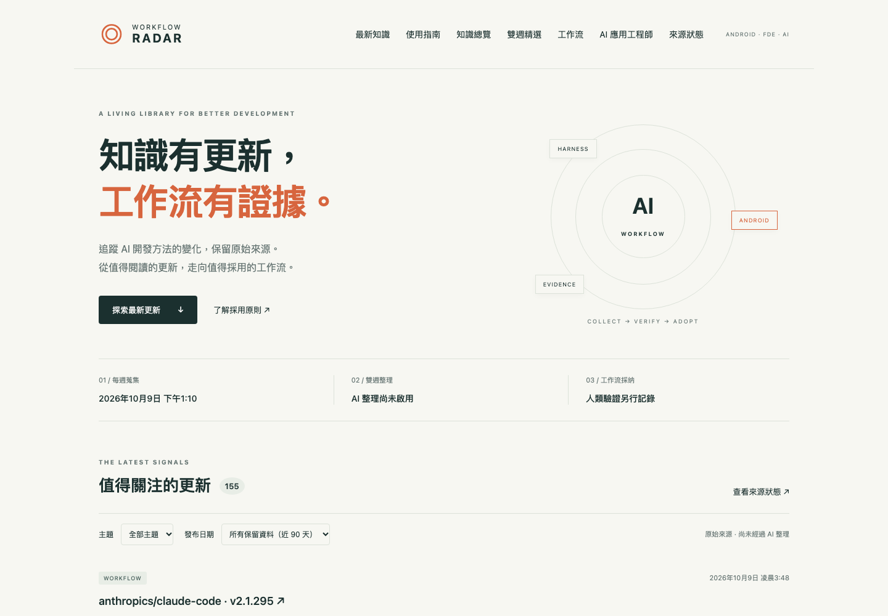](https://allenljf.github.io/ai-workflow/) | [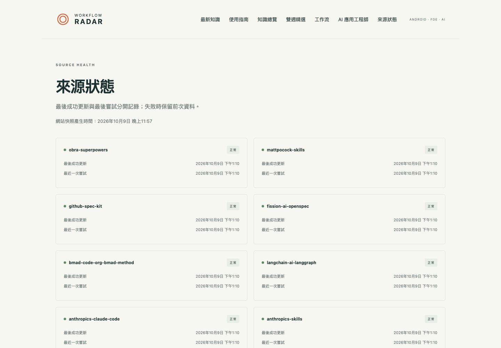](https://allenljf.github.io/ai-workflow/sources/) | [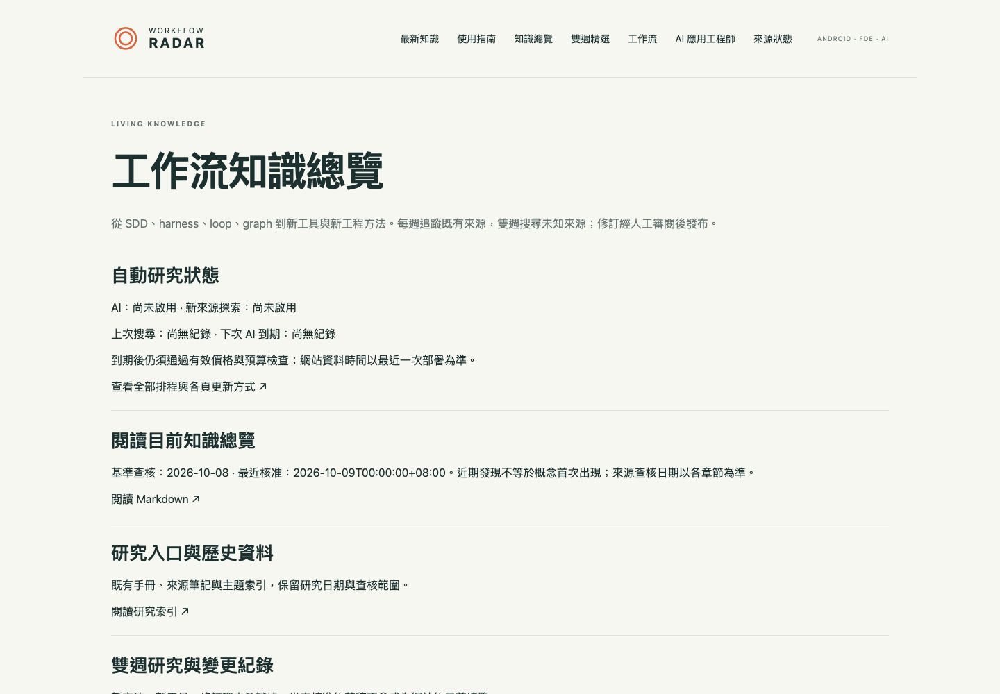](https://allenljf.github.io/ai-workflow/knowledge/) |
| 雙週精選 | 工作流與下載 | AI 應用工程師 |
| [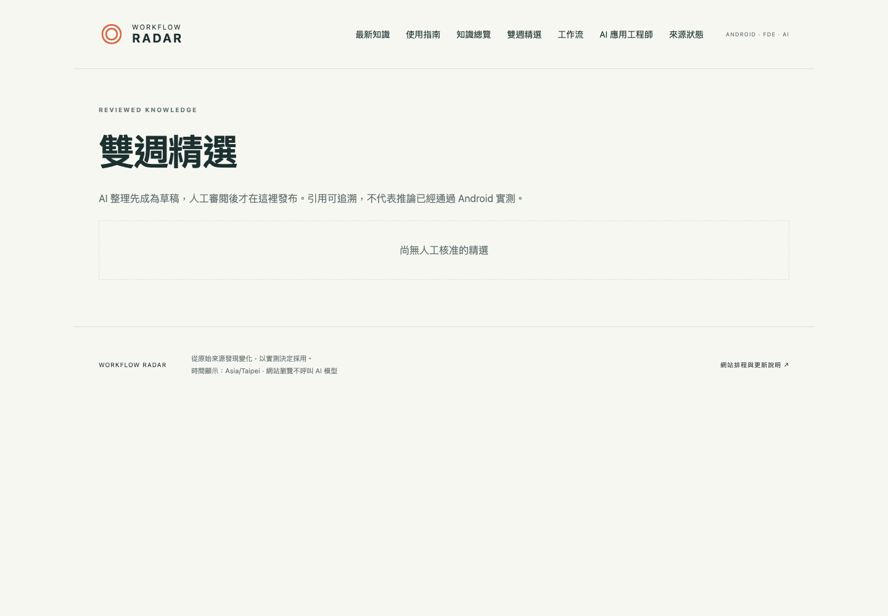](https://allenljf.github.io/ai-workflow/digests/) | [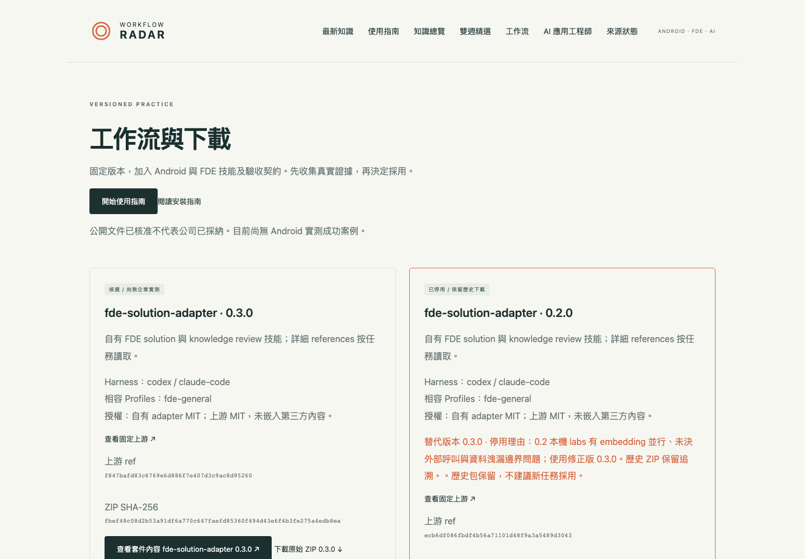](https://allenljf.github.io/ai-workflow/workflows/) | [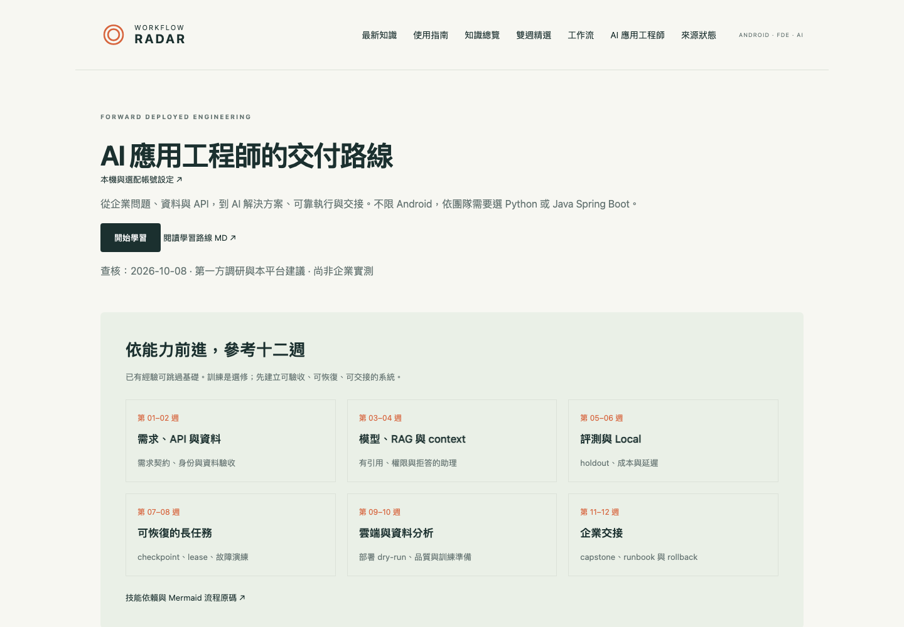](https://allenljf.github.io/ai-workflow/fde/) |
| FDE 最新變化 | 使用指南 | 網站排程說明 |
| [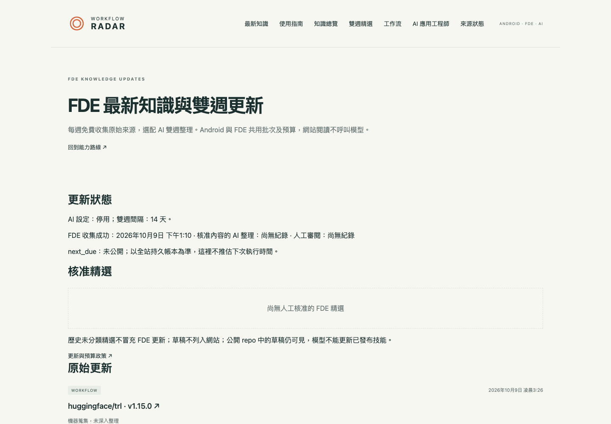](https://allenljf.github.io/ai-workflow/fde/updates/) | [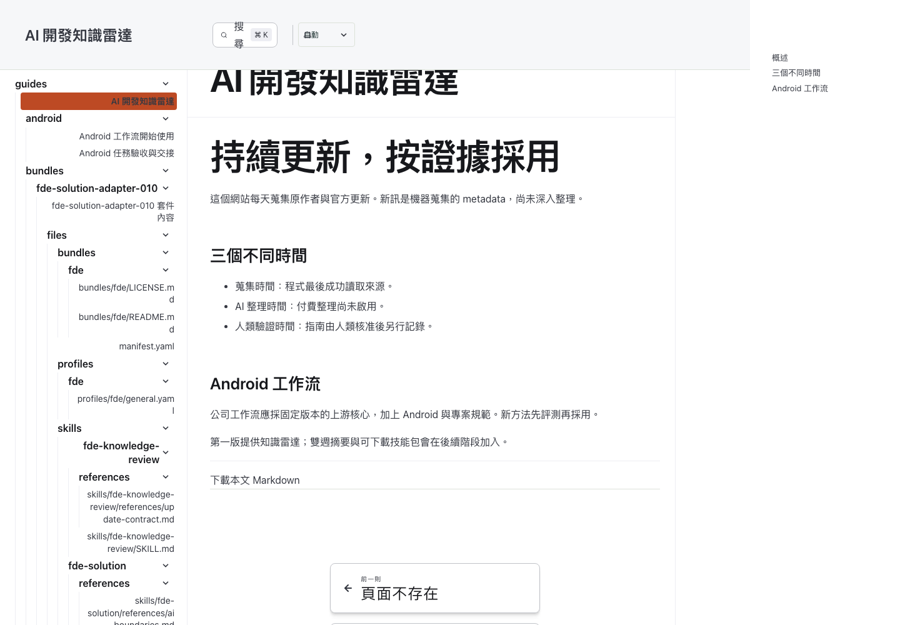](https://allenljf.github.io/ai-workflow/guides/) | [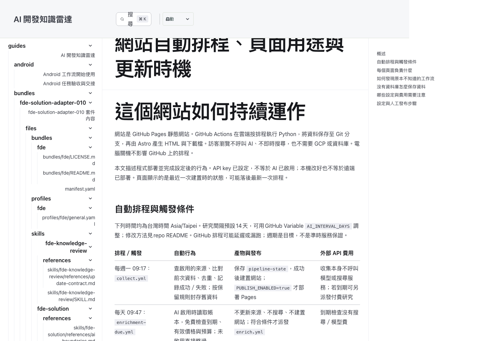](https://allenljf.github.io/ai-workflow/guides/site/operations/) |
| 工作流知識總覽全文 | Android 開始使用 | FDE 學習路線 |
| [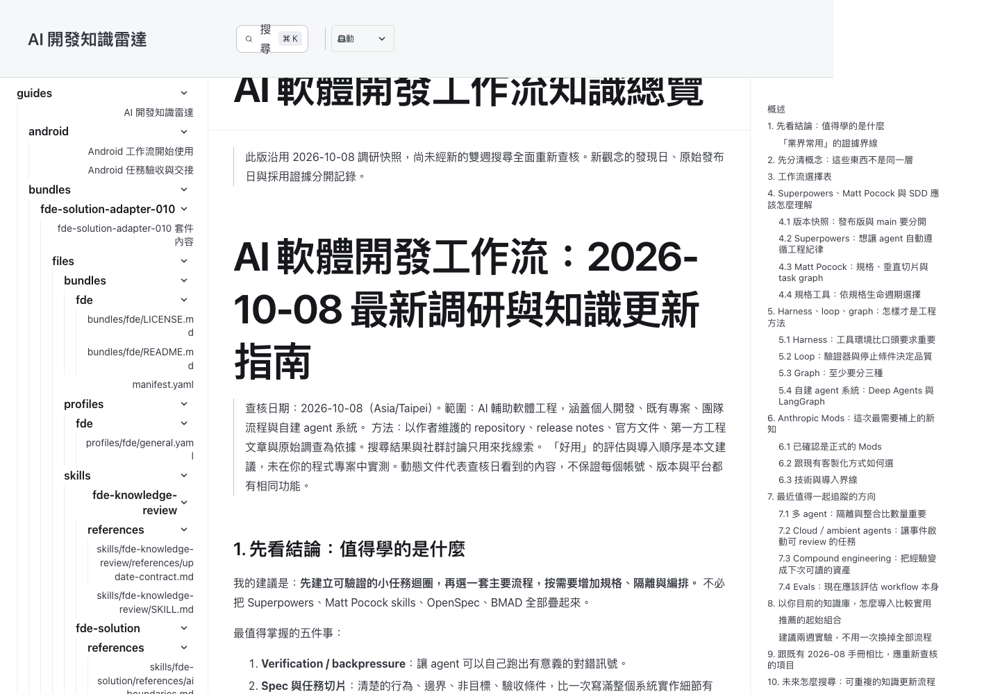](https://allenljf.github.io/ai-workflow/guides/knowledge/landscape/) | [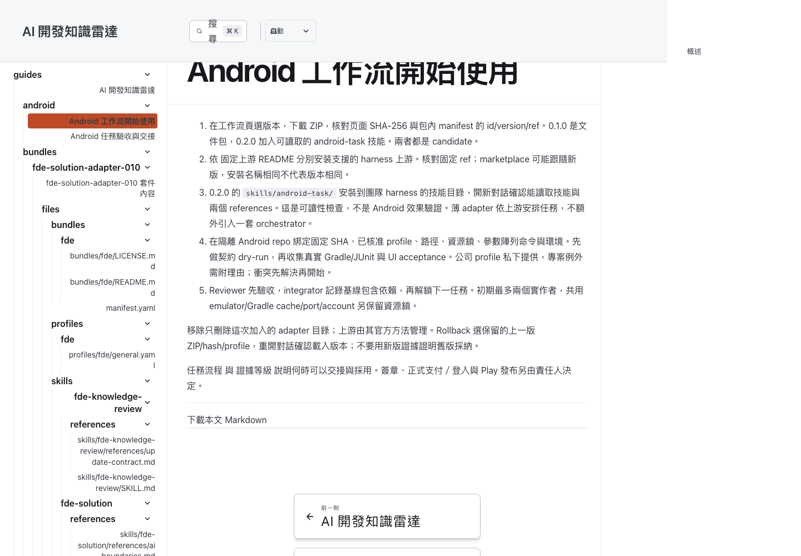](https://allenljf.github.io/ai-workflow/guides/android/getting-started/) | [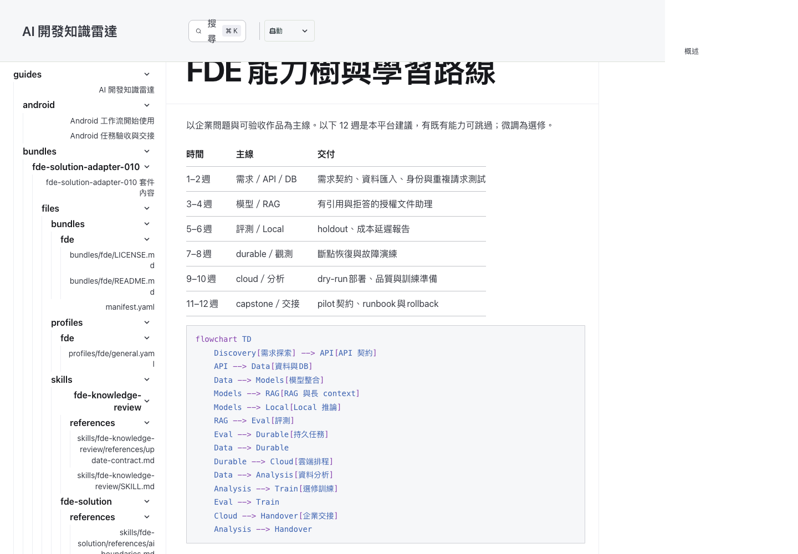](https://allenljf.github.io/ai-workflow/guides/fde/roadmap/) |
| RAG 指南 | Android 套件內容預覽 |  |
| [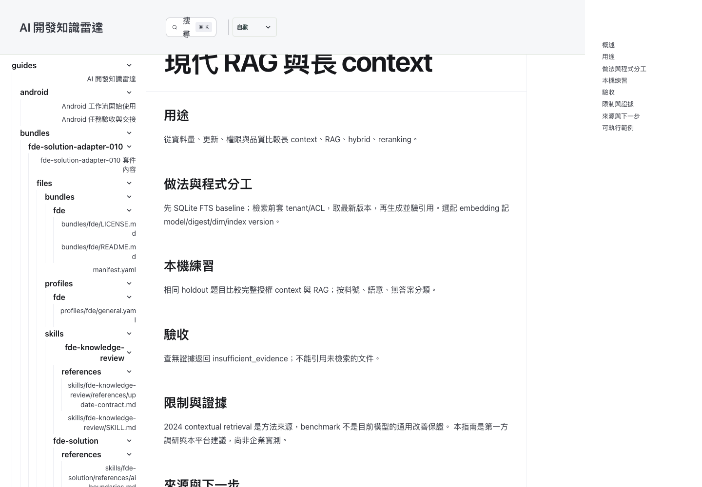](https://allenljf.github.io/ai-workflow/guides/fde/rag/) | [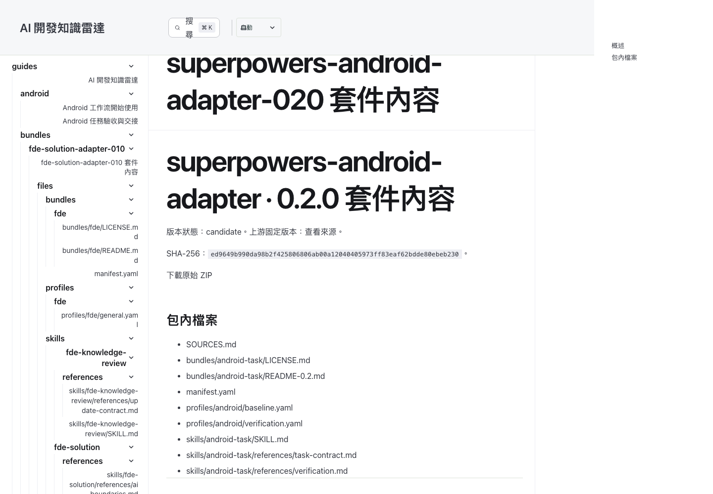](https://allenljf.github.io/ai-workflow/guides/bundles/superpowers-android-adapter-020/) |  |

## 網站排程與各頁用途

完整表格與操作說明見 [網站自動排程、頁面用途與更新時機](content/public/site/operations.md)，部署後也可從網站頁尾與知識總覽進入。每週收集、每日免費到期檢查、雙週搜尋／整理、審閱後發布；網站顯示近90天，運作資料保留180天並按月封存，保護待審與未決證據。

## 排程任務、週期與價格設定

所有 GitHub 排程以 **UTC** 寫入，以下表格另列台灣時間。程式必須在預設分支 `main`；Secret／Variable 的修改會由下次執行讀取，不需重新部署程式。

| 工作流程 | 觸發時機（台灣時間） | 執行細節 |
|---|---|---|
| `collect.yml` | 每週一09:17；也可手動 | 載入 `pipeline-state` → 收集18個已啟用 GitHub Releases → 去重與來源健康記錄 → 180天舊資料按月封存，保護待審證據 → 保存狀態 → 免費到期檢查 → 匯出最近90天資料、核准MD與技能包 → 建置並依發布開關部署。收集不呼叫AI；符合條件時可另派發付費研究。 |
| `enrichment-due.yml` | 每天09:47；也可手動 | 僅AI啟用時讀取狀態，免費檢查間隔、模型設定和預算；不收集、不搜尋、不建置。到期或有草稿需要恢復審閱PR時派發 `enrich.yml`。 |
| `enrich.yml` | 到期檢查派發，或手動 | 預設上次成功後至少14天；先保存搜尋預約，再做Tavily Basic搜尋，與既有資料及目前總覽一起交給單次DeepSeek批次。記錄用量、保存結果、建立公開審閱PR；未知結果不自動重試扣費。Android／FDE／知識總覽共用批次和預算。 |
| `publish-reviewed.yml` | 核准公開內容、網站或相關設定合併 `main`；也可手動 | 從現有狀態匯出、建置、發布；不重新收集、不呼叫模型。與資料任務共用排隊鎖，並拒絕舊main版本網站覆蓋新版。 |
| `checks.yml` | push、PR、手動 | Python測試、網站檢查、建置及兩種路徑的瀏覽器檢查；使用合成資料，不呼叫付費API。 |
| `export-preview.yml` | 手動 | 使用現有資料產生預覽artifact，保留7天，不發布正式網站。 |

**第一次研究不一定要等14天**：若尚無成功批次，下一次到期檢查即可判定到期。之後從上次成功完成時間計算間隔；不是每月固定日期。GitHub排程可能延遲或漏跑，無法保證準點。沒有新release也可搜尋新知；沒有可用結果、額度不足或存在未決外部呼叫時會暫停。公開repo長期沒有活動可能被GitHub停用排程，請從Actions確認並重新啟用。

探索每輪預設4個查詢、每個最多5筆，搜尋最近一個月的內容：AI開發工具／context、harness／長任務、graph／loop／SDD，以及模型官方發布／API能力／基準／價格。查詢在 `config/knowledge.yaml`；目前最多每輪6個查詢、每月12次搜尋預約。Tavily搜尋點數與DeepSeek美元預算分開。抓到來源並不等於驗證其主張；總覽與精選要人工核准、合併公開內容後才上站，技能包不會自行改版。

### 修改收集與檢查時間

修改對應檔案的 `on.schedule.cron`，提交並推送 `main`：

```yaml
# .github/workflows/collect.yml：每週一 UTC 01:17＝台灣09:17
- cron: '17 1 * * 1'
# 改成每週三台灣10:17：
- cron: '17 2 * * 3'
# .github/workflows/enrichment-due.yml：每天 UTC 01:47＝台灣09:47
- cron: '47 1 * * *'
```

Cron五欄依序是「分、時、日、月、星期」，台灣時間減8小時轉UTC，可能需要跨日。每日到期檢查只決定何時檢查，不代表每天付費研究。避免用cron的日欄 `*/14` 代表雙週，月初會重置而不是真正相隔14天。

### 修改研究間隔與預算

在GitHub的 Settings → Secrets and variables → Actions → **Variables** 修改，或執行：

```bash
# 預設14天；可設1～365天，例如改成每28天研究一次
gh variable set AI_INTERVAL_DAYS --repo allenljf/ai-workflow --body 28
# 每批與每月的模型估算預算（USD）
gh variable set AI_MAX_BATCH_USD --repo allenljf/ai-workflow --body 0.50
gh variable set AI_MAX_MONTHLY_USD --repo allenljf/ai-workflow --body 2
```

研究間隔與搜尋間隔一起修改，從最近成功時間重新計算；不會清空帳本。縮短週期仍受每月搜尋上限、模型預算及未決結果保護。恢復雙週將 `AI_INTERVAL_DAYS` 設回14。

### 修改價格與模型

**價格持續有效，直到你手動修改，不會14天後到期，也不會自動更新。** 計費預估沿用設定單價；實際帳單以供應商為準。舊 `expires_at` 欄位保留相容性，但不再阻止執行；新設定寫 `null`。

GitHub Variable `AI_PRICE_POLICY` 優先於repo的 `config/model-pricing.yaml`。目前模型 `deepseek-flash`、輸入USD0.30／百萬tokens、輸出USD1.20／百萬tokens。改遠端設定可先下載**不含API token**的JSON，編輯價格後寫回：

```bash
mkdir -p .build
gh variable get AI_PRICE_POLICY --repo allenljf/ai-workflow > .build/ai-price-policy.json
# 用編輯器修改 input_usd_per_million、output_usd_per_million；保留JSON其他欄位
gh variable set AI_PRICE_POLICY --repo allenljf/ai-workflow --body "$(cat .build/ai-price-policy.json)"
```

也可重跑 `bash scripts/setup/ai.sh`，沿用既有Secret後設定模型、單價與預算。換模型還要確認程式支援的API格式、輸出上限及模式，不能只填任意模型名。

### 開關、金鑰與手動補跑

`DEEPSEEK_API_KEY`、`TAVILY_API_KEY` 放Repository **Secrets**；以下是非敏感Repository **Variables**：

| Variable | 功能／預設 |
|---|---|
| `AI_ENABLED` | `true` 才允許AI研究；預設false |
| `KNOWLEDGE_DISCOVERY_ENABLED` | `true` 才做Tavily開放探索；預設false |
| `AI_INTERVAL_DAYS` | 研究／搜尋間隔天數；預設14 |
| `AI_PRICE_POLICY` | 模型、手動單價及已確認的輸出契約；持續有效 |
| `AI_MAX_BATCH_USD`／`AI_MAX_MONTHLY_USD` | 模型估算預算；預設0.50／2 |
| `PUBLISH_ENABLED` | `true` 才發布Pages |
| `SITE_URL`／`SITE_BASE` | 本repo為 `https://allenljf.github.io`／`/ai-workflow/` |

```bash
# 確認Secret名稱與設定（不讀出token）
gh secret list --repo allenljf/ai-workflow
gh variable list --repo allenljf/ai-workflow
# 補跑收集與免費到期檢查；到期檢查可能派發付費研究
gh workflow run collect.yml --repo allenljf/ai-workflow --ref main
gh workflow run enrichment-due.yml --repo allenljf/ai-workflow --ref main
# 只檢查模型研究條件，不付費
gh workflow run enrich.yml --repo allenljf/ai-workflow --ref main -f allow_paid=false
# 查看最近執行結果
gh run list --repo allenljf/ai-workflow --limit 10
```

付費研究可手動執行 `enrich.yml -f allow_paid=true`，仍需通過間隔與預算；不會強制繞過保護。要暫停研究將 `AI_ENABLED` 改false；要只暫停網路探索將 `KNOWLEDGE_DISCOVERY_ENABLED` 改false；原始週收集與靜態網站可繼續運作。

## 本機啟動

需要 Python 3.12+、Node 22.12+ 的受支持偶數版本。

```bash
python3.12 -m venv .venv
.venv/bin/python -m pip install -r requirements-dev.lock
.venv/bin/python -m pip install --no-deps -e .
npm --prefix site ci
.venv/bin/python -m radar.cli collect --config config --state .build/live/snapshot.json
.venv/bin/python -m radar.cli export --config config --state .build/live/snapshot.json --output .build/export
.venv/bin/python scripts/build-site.py --export .build/export --site site
npm --prefix site run build
npm --prefix site run preview
```

瀏覽 `http://localhost:4321`。資料已建立後可用 `npm --prefix site run dev` 修改畫面；Astro在agent環境可能自動背景執行，需前景模式時加 `-- --ignore-lock`。沒有完成export，網站不會直接讀公司docs作為fallback。

如果不想連網，可用下面的 synthetic fixture 跑測試網站；它只供測試，不能當真實成功案例。

## 驗證

```bash
.venv/bin/python -m pytest -q
.venv/bin/python tests/site_fixture.py
.venv/bin/python scripts/build-site.py --export .build/smoke-export --site site
npm --prefix site run check
npm --prefix site exec -- playwright install chromium
npm --prefix site run build
npm --prefix site run test:smoke
SITE_BASE=/ai-workflow/ npm --prefix site run build
SITE_BASE=/ai-workflow/ npm --prefix site run test:smoke
bash -n scripts/setup/github.sh
```

Browser smoke預期synthetic fixture，測試後重新export/build可回到live資料。GitHub checks固定相同流程並安裝Linux瀏覽器依賴。`npm audit`檢查前端依賴；目前對PostCSS間接依賴使用已修正版本的override，升版時需一起驗證。

## 設定與發布

先閱讀 [GitHub 設定流程](docs/platform-design/setup-github.md)，再執行：

```bash
bash scripts/setup/github.sh --check
bash scripts/setup/github.sh
```

公開發布預設停用。公開作品集原始 repo 同時承載網站；GitHub Actions 只部署核准 export 產生的靜態輸出，不把原始 `docs/`、`content/private/` 或 pipeline state 複製到網站。repo 本身與 Git 歷史仍對所有人可見。Wizard 不會推送本機分支；設定完成後才由你推送並啟用部署。

### 部署費用、流量與更新頻率

- `collect.yml` 每週一 UTC 01:17 執行（台北時間 09:17），也能手動執行。成功後才保存來源狀態、產生靜態網站並依 `PUBLISH_ENABLED` 部署到 Pages。GitHub 排程可能延遲或在高負載時漏跑；排程只在 default branch 生效，公開 repo 若 60 天沒有 repo 活動，GitHub 可能自動停用排程。需要時可從 Actions 手動補跑。
- 目前設定啟用 18 個 GitHub Release 來源，涵蓋 Superpowers、Matt Pocock Skills、Spec Kit、Claude Code、Android Now in Android、Spring AI、LangGraph、Temporal、pgvector、Qdrant、Ollama、vLLM、Pydantic AI 與 TRL 等。每筆資料包含專案、release 標題／版本、發布說明、發布與更新時間、來源連結；不抓一般文章全文。**目前排程實際抓的是 GitHub Releases；RSS/Atom 與 YouTube adapter 尚未加入啟用中的來源設定。**日常蒐集本身不呼叫模型，AI 預設停用；若之後啟用 AI，當雙週整理到期且 gate 通過時，collect 會另行觸發可能計費的 AI workflow。`export-preview.yml` 是手動預覽，不是每週排程。
- 公開 repo 的標準 GitHub-hosted runner（目前使用 `ubuntu-latest`）免 Actions 執行分鐘費用；公開 repo 可使用標準 runner。Pages 對公開 repo 的 GitHub Free 帳號可用。此專案沒有常駐雲端後端或資料庫。
- Pages 網站發佈後最多 1 GB；GitHub 建議 Pages 原始 repo 控制在 1 GB 內。Pages 每月頻寬軟上限為 100 GB，流量過大時仍可能觸發限流（HTTP 429）。每小時 10 次的 Pages 軟建置限制不適用於本專案使用的自訂 GitHub Actions workflow。[GitHub Pages 限制](https://docs.github.com/en/pages/getting-started-with-github-pages/github-pages-limits)
- GitHub Free 帳號包含 500 MB Actions artifact／GitHub Packages 共用儲存空間。每週 collection 產生的 `radar-site` artifact 保留 7 天；超過方案儲存額度時，依帳號的 Actions／Packages 設定可能產生儲存費用。公開 repo 的標準 runner 分鐘免費，不代表 artifact 儲存或第三方 API 都免費。[GitHub Actions 費用與儲存](https://docs.github.com/en/billing/concepts/product-billing/github-actions)
- 雙週 AI 整理預設停用；只有設定並啟用 DeepSeek 後才可能產生模型費用。程式的預算 gate 設為每批最高 USD 0.50、每月最高 USD 2；這是應用程式限制，DeepSeek 帳單仍由供應商計算。Pages 自訂網域若使用付費網域，另有網域商費用。

## 雙週 AI 整理

設定與恢復見 [AI設定指南](docs/platform-design/setup-ai.md)。先用 enrich --dry-run 看gate與預算；真實付費需要 --allow-paid、AI_ENABLED=true及durable Git checkpoint。公開 repo 中的 AI 草稿 PR、原始結果與 state branch 都可被閱讀。

## 工作流知識總覽與新來源探索

`/knowledge/` 提供研究索引、目前核准的知識總覽與 Markdown 下載，涵蓋 graph／loop／harness／SDD 與新工具。既有2026-10-08報告先作基準，不把上站日期稱為全篇新查核日期；原始docs快照保留。

每週收集固定來源；另有每日09:47免費到期檢查，只讀狀態、不更新來源。選配雙週 Tavily 開放搜尋不限定既有repo或廠商，即使沒有新release也能探索新方法。取得原文／只有片段分開標示。與最新總覽比較後，在同一次DeepSeek批次提出章節修訂及新來源候選，與Android／FDE共用模型帳本；候選不自動訂閱，AI草稿不自動發布。

```bash
bash scripts/setup/ai.sh
bash scripts/setup/knowledge.sh allenljf/ai-workflow
```

新增 GitHub Secret `TAVILY_API_KEY` 與 Variable `KNOWLEDGE_DISCOVERY_ENABLED`；DeepSeek key 仍放 Secret `DEEPSEEK_API_KEY`。兩者預設停用，wizard不把key存repo。搜尋服務費用／credits與模型美元預算分開，目前每輪4個basic查詢、每月最多12次搜尋預約；模型保留每批USD0.50／每月USD2；價格持續有效，直到手動修改。沒有配置、價格無效或不確定呼叫會停止，不自動重試付費。

總覽修訂先附公開PR，人工審閱後透過核准腳本更新 `content/public/knowledge/landscape.md`；baseline hash防止覆寫較新修改。公開內容合併main觸發網站發布，不再次呼叫AI。[完整設定與核准方式](docs/platform-design/knowledge-discovery.md) · [API與歷史一手證據](docs/agentic-workflow-research/research/2026-10-09-knowledge-discovery-source-notes.md)。

## 内容與來源

- `config/sources.yaml`：18個已查核且啟用中的 GitHub Release 來源；程式也有 RSS/Atom adapter，YouTube uploads metadata 為選配，但兩者目前未列入啟用中的 sources。
- `content/inbox/links.json`：手動加入HTTPS連結，只進待審核收件匣，不自動抓陌生網站。
- `content/public/`：frontmatter同時標 `visibility: public` 和 `review_state: approved` 才匯出；禁止symlink、raw HTML及指向非核准檔案的本機連結。附件只接受 workflow catalog 明列且通過來源／授權／hash驗證的生成ZIP，不匯出任意檔案。
- `content/private/`、`docs/`：不供公開網站讀取；由於作品集 repo 公開，已提交在這些路徑的內容仍可從 GitHub repo 瀏覽。
- `pipeline-state`：遠端專用branch存snapshot；本機snapshot位於忽略的`.build/`。不要以artifact/cache替代它。

資料包含原始發布、最後成功抓取、最近嘗試等不同時間；來源失敗不清空舊資料。GitHub release來源不涵蓋作者所有文章或產品功能，來源廣度需之後持續擴充。

## 設計與進度

[架構設計](docs/platform-design/2026-10-08-android-ai-workflow-platform-design.md) · [執行入口](docs/superpowers/plans/2026-10-08-ai-workflow-execution-index.md) · [執行紀錄](docs/platform-design/execution-log.md)

## Android 工作流與雲端設定時序

[雲端帳號時序](docs/platform-design/cloud-account-timing.md) · [評測 runbook](docs/platform-design/evaluation-runbook.md) · [上游與再散布政策](docs/platform-design/upstream-policy.md)

網站 `/workflows/` 提供0.1.0文件包、0.2.0技能包及SHA-256。公司profile不提供公開下載；真實Android報告與採納決策待接，fixture不會升級candidate。

## AI 應用工程師 / FDE

網站 `/fde/` 提供 12 節點能力樹與 12 週路線、企業交付/RAG/可靠任務/資料分析與訓練準備指南，以及有版本/hash 的自有 skills ZIP；`/fde/updates/` 分開顯示免費原始更新和人工核准精選。18 個官方來源每週免費收集；Android/FDE 共用 14 天付款帳本，AI 預設停用、USD 0.50/批與 USD 2/月，不因新增領域另扣一批。

本機 labs：`python -m pip install -e examples/fde/python` 後用 `python -m fde_lab.cli rag-demo --state-dir .build/fde-labs/rag`、`jobs-demo --state-dir .build/fde-labs/jobs`、`dataset-demo --state-dir .build/fde-labs/data`。全是合成 fixture，不宣稱模型品質或企業成功案例。API/worker 與 PostgreSQL 參考見 [部署 runbook](examples/fde/deploy/README.md)；Java 對照見 [Spring Boot](examples/fde/spring-api/README.md)。PostgreSQL 測試只在明確提供 `FDE_TEST_POSTGRES_DSN` 的獨立測試 DB 執行，會建立/刪除測試 schema，不使用正式 DB。

最後用 `bash scripts/setup/fde.sh --check` 唯讀驗證；互動入口 `bash scripts/setup/fde.sh` 分 local/github/provider/api-db/gcp/health。GCP 階段只保存非敏感 refs 並列出 dry-run 命令，尚未建立雲端資源；真正部署、模型品質、效能與客戶驗收仍需另完成。[執行證據與設計判斷](docs/platform-design/fde-execution-log.md)。

FDE labs 修正版為 0.3.0；0.2.0 已停用但保留原 ZIP/hash。修正 embedding profile 並行、取消與未決外部呼叫、input近重複及validation/holdout時間邊界。跨領域批次至少2筆，低於此值拒絕整理，不會增加付費。
