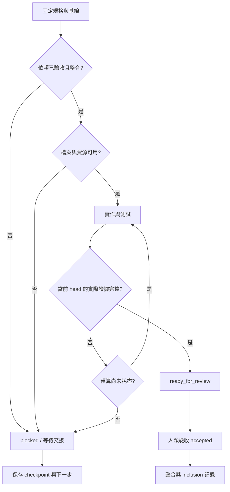

任務從不可變規格與固定整合基線開始，宣告讀寫範圍、依賴、acceptance、命令、重試／時間／token預算。進行中的任務預留資源；worktree 只能隔離檔案，不能隔離裝置或帳號。

圖的 Markdown 原碼可下載；文字門檻與圖一致。未知 token 用量保留 null；重開對話保留原始 deadline／attempt count，不自動重置。Checkpoint 比對 spec/base/head，若不同先修訂契約。

交接包包含 patch、當前 head 的報告、逐 acceptance、改動路徑、重試次數、剩餘預算、checkpoint、阻礙與下一步。ready_for_review 不會解鎖依賴；exit0、零執行、全部skip、舊head、fake/stub 或缺失驗收也不會解鎖。
