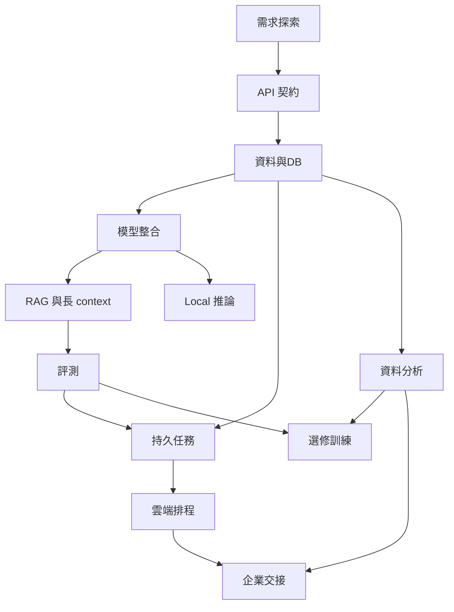

以企業問題與可验收作品為主線。以下 12 週是本平台建議，有既有能力可跳過；微調為選修。

| 時間 | 主線 | 交付 |
| --- | --- | --- |
| 1–2週 | 需求／API／DB | 需求契約、資料匯入、身份與重複請求測試 |
| 3–4週 | 模型／RAG | 有引用與拒答的授權文件助理 |
| 5–6週 | 評測／Local | holdout、成本延遲報告 |
| 7–8週 | durable／觀測 | 斷點恢復與故障演練 |
| 9–10週 | cloud／分析 | dry-run部署、品質與訓練準備 |
| 11–12週 | capstone／交接 | pilot契約、runbook與rollback |

文字流程：先定問題，建立API和資料契約，再比較模型與檢索；有評測才做持久任務與部署，最後交接。訓練依資料與需求選修。

- [需求探索與企業交付](enterprise-discovery.md)：起點
- [API 與後端契約](api.md)：先完成 enterprise-discovery
- [資料與資料庫](data.md)：先完成 api
- [模型、工具與 context](models.md)：先完成 api, data
- [現代 RAG 與長 context](rag.md)：先完成 models
- [Local 模型與服務化](local.md)：先完成 models
- [評測與可觀測性](eval.md)：先完成 rag
- [長任務與故障恢復](durable.md)：先完成 data, eval
- [雲端、部署與排程](cloud.md)：先完成 durable
- [資料分析與品質](analysis.md)：先完成 data
- [SFT／LoRA 與訓練準備](training.md)：先完成 analysis, eval
- [上線、交接與持續改善](handover.md)：先完成 cloud, analysis
