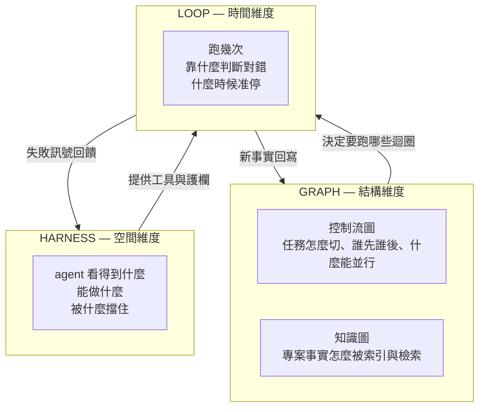
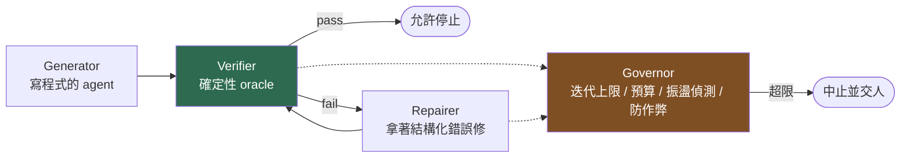
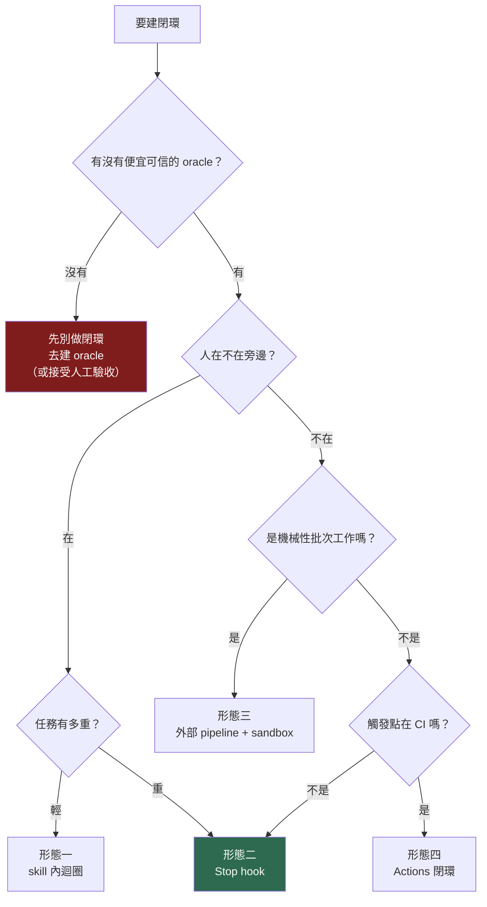
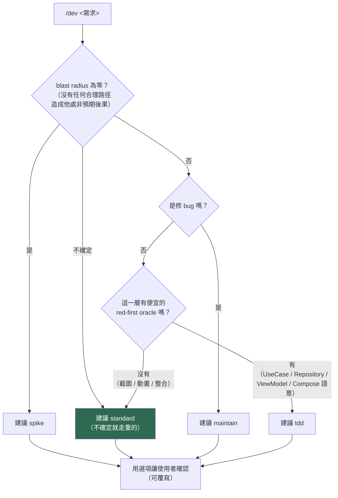

# Agentic 開發工作流實作手冊
## Harness / Loop / Graph —— Android 版

> 資料來源：2026-08 對 13 個主題的一手來源調研（官方文件、repo 原始碼、作者本人的文章、論文）。
> 每個關鍵主張都附來源。過期／已被推翻的說法我會明講。

---

## 0. 這份文件怎麼用

分四種讀法：

| 你想要 | 讀 |
|---|---|
| 先搞懂三個詞到底在講什麼 | Part 1 |
| 我要馬上做出「agent 自己驗證自己」的閉環 | **Part B**（重點章，佔全文最大篇幅） |
| 我要做出自己的 superpowers / OpenSpec | Part D |
| 我要讓 agent 在大型 Android 專案裡查得動東西 | Part E |
| 我只想要能貼的檔案 | 附錄 |

**先講最重要的一件事**，這是整份調研裡最反直覺、也最該影響你決策的發現：

> **2026 年的趨勢是 scaffolding 在縮小，不是變大。**
>
> - `obra/superpowers` v6.3.0 全部只剩 **14 個 skill、1 個 hook、0 依賴**。它曾經拆成四個 repo，那個架構只活了 4 天（2025-10-12 → 10-16）就被撤回。
> - **Agent OS v3**（2026-01-20）**直接砍掉自己的 spec 層與 orchestration 層**，只留 standards injection。
> - **BMAD** 從「5 個 project level」→「3 條 track」→ 全刪 → 最後只剩**一個二元判斷（blast radius 是否為零）**。
> - Anthropic 自己的說法（Managed Agents, 2026-04-08）：Sonnet 4.5 需要的 context reset 機制，到 Opus 4.5 上「已經變成死重量（dead weight）」，**harness 假設的壽命大約是一個模型世代**。

所以這份文件的目標不是教你蓋一座城堡，是教你蓋**一組可以逐塊拆掉的東西**，並且從一開始就內建「什麼時候該拆」的判準。

---

## 1. 三層心智模型

### 1.1 定位

三者不是競品，是同一個問題（**怎麼讓機率性的 model 產出確定性的工程結果**）的三個切面：



| | Harness | Loop | Graph |
|---|---|---|---|
| 控制對象 | 環境與能力 | 迭代與回饋 | 結構與知識 |
| 核心產物 | skill / hook / subagent / 權限 | verifier + 終止條件 | DAG + 索引檔 |
| 品質上限來自 | 工具與 context 品質 | **驗證器品質** | 建模正確性 |
| 前期成本 | 中 | 低 | 高 |
| 失敗模式 | 規則被稀釋、牆設太死 | 刷分、振盪、燒 token | 圖漂移、剛性 |
| 何時該加碼 | 你在重複糾正同一件事 | 你在人工檢查產出 | 流程已固定且想並行 |

**導入順序：Loop → Harness → Graph。** Loop 成本最低、回報最快，而且它會**暴露**另外兩層的缺口——agent 在 loop 裡作弊的地方就是驗證器該補的地方；agent 反覆撞牆的地方就是 harness 該給工具的地方。先建 Graph 幾乎都是過早最佳化。

### 1.2 業界現在的實際位置

我調研了每個名字都叫得出來的方法論，**共通骨架驚人地一致**：

```
釐清/拷問 → 規格 → 切成垂直薄片 → 每片用全新 context 實作 → 獨立/對抗驗證 → 把學到的寫回去
```

差異只在三件事：(a) artifact 放哪裡，(b) 驗證閘門有多硬，(c) 多信任模型自己的判斷。

| 方法論 | 核心迴圈 | 驗證強度 | 最值得抄的一點 |
|---|---|---|---|
| **Matt Pocock**（`mattpocock/skills`, 32 skills） | `/grill-me` → `/to-spec` → `/to-tickets` → `/implement`（內含 `/tdd`）→ `/code-review` | 中（兩個平行 subagent：Standards 軸 + Spec 軸） | **spec 發到 issue tracker 而不是檔案**；CLAUDE.md 只有六個字 |
| **HumanLayer ACE-FCA** | research → plan → implement，**三個各自全新的 context** | 中 | 明訂 context 使用率目標 **40–60%**，超過就 intentional compaction |
| **Every 複利工程**（33 skills） | plan → work → assess → **compound** | 中 | 第四步把學習寫進 `docs/solutions/`，**下一次 brainstorm 會讀它** |
| **Ralph（Huntley）** | `while :; do cat PROMPT.md \| claude -p; done` | 高（"backpressure" = test/typecheck/lint 全接上） | 一次只做一件事；跨迭代狀態放磁碟不放 context |
| **Anthropic 官方 best practices** | explore → plan → code → commit | **高，且它擺第一位** | 「**給 Claude 一個它自己能跑的檢查**」 |
| **BMAD v6** | 只有兩條路：one-shot / plan-code-review | 高（frozen I/O matrix + 測試稽核） | 路由只看一個軸：**blast radius 是否為零**，不確定就走重的 |
| **cc-sdd v3** | 17 skills / 8 agents，per-task 全新 implementer + 獨立 reviewer | 最高（要求 **captured RED output** 作為機器可讀證明） | Feature Flag Protocol：把 TDD 變成可驗證而非可宣稱 |

**兩位重要的反對者**，值得認真對待：

- **Armin Ronacher**：迴圈會產出「把機器參與當成維護模式一部分的 codebase」——他主張迴圈應該只被允許產出**機械的、可驗證的產物**，不是長期要維護的程式碼。
- **Simon Willison**：反對過度規範流程，主張讓模型用自己的判斷。

我的解讀：這兩位反對的是**無差別套用重流程**，不是反對閉環。他們的存在正好支持 Part D 的「模式路由」設計——輕活走輕路。

---

# Part A — Harness Engineering

## A1. Harness 的零件表

一個 Claude Code harness 由這些東西構成（2026-08 現況，`code.claude.com/docs/en/*`，任何頁面網址後面加 `.md` 會回傳原始 markdown，適合機器抓取）：

| 零件 | 位置 | 管什麼 |
|---|---|---|
| settings | `~/.claude/settings.json` / `.claude/settings.json` / `.claude/settings.local.json` / managed policy | 權限、env、hook 註冊 |
| CLAUDE.md | 4 個 scope，**串接不是覆蓋**，root-down | 常駐指令 |
| `.claude/rules/*.md` | 帶 `paths:` frontmatter | **路徑觸發式**規則（只在碰到符合的檔案時載入） |
| skills | `.claude/skills/<name>/SKILL.md` | 流程知識，漸進揭露 |
| subagents | `.claude/agents/*.md` | context 隔離 + 專職角色 |
| hooks | settings / plugin / skill / subagent frontmatter | **確定性控制面** |
| plugin | `.claude-plugin/plugin.json` | 打包發佈 |
| MCP | `.mcp.json` / user / project scope | 外部工具 |
| headless | `claude -p` | 把 harness 塞進 pipeline |

### 權限規則的三個坑（會咬人）

1. **求值順序是 deny → ask → allow，first match wins，具體性不影響順序。** 所以「大範圍 deny + 小範圍 allow 例外」這個直覺寫法**不成立**。
2. **Bash 萬用字元的空格是有意義的**：`Bash(ls *)` 會 match `ls -la` 但不會 match `lsof`。空格造成 word boundary。
3. **hook 回 `allow` 不會繞過 deny/ask 規則**；但 hook exit 2（block）會**壓過** allow 規則。

### 常駐指令檔：兩派對立

| | Pocock 派 | Cline Memory Bank 派 |
|---|---|---|
| 主張 | 「**永遠不要跑 init**。看到自動產生的就刪掉。」他的 CLAUDE.md 全文六個字 | 六個固定 Markdown 檔，**每個 session 重讀** |
| 理由 | 常駐內容每個 turn 都在付稅；steering 應該放 skill（漸進揭露） | 模型沒有記憶，脈絡必須外部化 |
| Anthropic 官方 | 建議跑 `/init`，但同意要無情修剪 | — |

**我的建議（折衷，有依據）**：常駐檔只放三件事——(1) 一句話專案描述、(2) 非標準的 build/test/lint 指令、(3) 不可協商紅線（≤10 條）。其他一律下沉到 `.claude/rules/`（路徑觸發）或 skill（明確觸發）。

依據是 Ralph 作者最強調的那條 guardrail：「**臃腫的 AGENTS.md 會污染未來每一次 loop 的 context**」，以及 Anthropic 自己列的失敗模式：「CLAUDE.md 太長，Claude 會忽略其中一半，因為重要規則淹沒在雜訊裡。」

## A2. Skill 撰寫規範

**Frontmatter：只有 6 個欄位是跨工具可攜的**（Agent Skills spec）。Claude Code 自己吃 ~22 個欄位，其中 16 個是 Claude-only——**用了就不能跨 harness 發佈**（上傳 claude.ai / Skills API 會直接硬錯）。

superpowers 的做法值得抄：**14 個 skill 全部只用 `name` + `description`**，沒有 allowed-tools、沒有 model、沒有 version。極簡就是最大可攜。

寫作要點（來自 superpowers 的 `writing-skills` meta-skill）：

1. **skill 教流程，不教事實。** 事實會過期，流程不會。
2. **description 不要寫成流程摘要**——如果 description 已經把流程講完了，agent 會直接照 description 做而**跳過 skill 本體**。description 只寫「什麼時候用」。
3. **skill 用動作命名，不用工具命名。** 寫「dispatch a subagent」不寫「call the Task tool」。工具對照表隔離在 `references/<harness>-tools.md`。這是 superpowers 能一套跑 14 個 harness 的唯一理由。
4. 有 checklist 就讓 agent 每項開一個 todo。

## A3. Hook：確定性控制面

2026 年 hook 事件已經約 **30 個**（不是老文章講的 9 個），且有 5 種 handler：`command` / `http` / `mcp_tool` / `prompt`（LLM 判斷）/ `agent`（會用工具的 subagent 判斷）。

**契約**：stdin 收 JSON → stdout 出 JSON + exit code。

- exit 0 = 通過（只有 `UserPromptSubmit` / `UserPromptExpansion` / `SessionStart` 的 stdout 會被當成 context 注入）
- **exit 2 = 阻擋，stderr 內容會變成模型的下一個指令**
- `additionalContext` 上限 10,000 字元

### 五本柱（建議每個專案都有）

| # | 事件 | 作用 | 強制力 |
|---|---|---|---|
| 1 | `SessionStart` | 注入 bootstrap（「你有這些能力」） | 軟 |
| 2 | `UserPromptSubmit` | 依關鍵字注入本次該讀的準則清單 | 軟 |
| 3 | `PreToolUse(Edit\|Write)` | **保護測試檔不被竄改** | **硬** |
| 4 | `PostToolUse(Edit\|Write)` | 寫完立刻跑 T0 驗證，錯了當場回灌 | 硬 |
| 5 | `Stop` | **擋住「我做完了」，跑驗證，沒過就打回去** | **硬（閉環的核心）** |

第 5 條是整份文件的核心，Part B 會完整展開。

### 三個實際會踩的雷

- **shell profile 的 echo 會靜默毀掉 hook JSON**。hook 跑在非互動 `sh -c`，但有些 profile 還是會 source `.bashrc`；一個無條件 `echo` 會讓 stdout 不再以 `{` 開頭，JSON 被當成純文字，決策被忽略，而且 **exit 0 時 transcript 不會報錯**。
- **`if` 過濾器 fail open**：Bash 指令解析不了時 hook 照跑。硬性 allow/deny 要用權限系統，不要用 hook。
- **plugin 帶的 agent 不支援 hooks / mcpServers / permissionMode**。這是確認過的限制，設計 plugin 時要繞開。

## A4. Subagent 與 context 隔離

subagent 的本質是**壓縮裝置**：探索 10k+ token，只回傳 1–2k。

superpowers 的 SDD skill 有一個非常值得抄的機制：**artifact 用檔案交接，不用貼文字**。三個小 bash 腳本：

- `sdd-workspace <plan>` → 建立 `<repo>/.superpowers/sdd/<plan-slug>/`，並寫入自我忽略的 `.gitignore`
  - 為什麼放工作目錄不放 `.git/`：**Claude Code 把 `.git/` 當保護路徑，禁止 agent 寫入**，implementer subagent 會寫不了報告
  - 為什麼要 per-plan：陳舊的 ledger 被誤讀成當前進度，會讓 controller 跳過整段任務
- `task-brief <plan> <N>` → 用 awk **fence-aware** 地抽出單一任務段落
- `review-package <plan> <base> <head>` → 產一個檔給 reviewer 讀一次
  - **base 必須是 dispatch 前記錄的 commit，絕不能用 `HEAD~1`**——那會靜默丟掉多 commit 任務的前面所有 commit

它的硬規則也值得照抄：

> 「**永遠不要在 controller session 裡自己修 finding**」
> 「**controller 不能叫 reviewer 忽略什麼**——如果你正在寫的 prompt 裡出現『不要標記』『別把 X 當缺陷』『最多算 Minor』『計畫就是這樣選的』，停下來：你在預判。」
> 「dispatch subagent 時**永遠明確指定 model**。省略會繼承你 session 的 model。」

## A5. Harness 反模式

| 反模式 | 為什麼錯 |
|---|---|
| 用規則補驗證器的洞 | 規則是軟約束，測試是硬約束。**能用硬約束表達的，永遠不要寫成規則** |
| CLAUDE.md 越寫越長 | 每 turn 付稅，且會稀釋注意力 |
| 為每個小動作寫 skill | skill 太多會超出 description 預算（**約 context 的 1%，LRU 式驅逐**），反而讓重要 skill 被截斷 |
| 把 harness 當永久資產 | 假設壽命約一個模型世代。**要內建刪除機制**（見 D8） |
| 用 hook 做硬性安全邊界 | `if` 過濾器 fail open；硬邊界用 permission 系統或 sandbox |

---

# Part B — Loop Engineering（重點章）

## B1. 一句話定律

> **輸出品質的上限 = 驗證器的品質上限，不是模型的品質上限。**

Anthropic 官方文件把反模式講得更直白：

> 「**Claude 在工作『看起來』完成時就會停。沒有一個它能跑的檢查，『看起來完成』就是唯一的訊號。**」

### 閉環的四個元件



四個都缺一不可，但**大部分人只做了 Generator，然後抱怨模型不行**。

- **Generator**：寫程式碼的 agent
- **Verifier**：確定性 oracle。關鍵：**必須不是 Generator 自己**（Anthropic：「做事的 agent 不能是打分的那個」）
- **Repairer**：拿結構化失敗去修。可以是同一個 agent，但要給它**機器可讀的錯誤**而不是 console 捲軸
- **Governor**：管迭代上限、預算、振盪、作弊偵測。**這是最常被漏掉的一塊，也是不做就會燒錢燒到失控的那塊**

## B2. Android 驗證階梯（T0–T4）

這是整份文件最實用的一張表。**閉環的成敗取決於你有沒有把 oracle 分層**——把 5 分鐘的檢查放進每次編輯後的迴圈，agent 會慢到不能用；把只有 CI 跑的檢查當唯一 gate，agent 會交出一堆垃圾。

| Tier | 何時跑 | 目標耗時 | 指令 | 抓什麼 | 機器可讀產物 |
|---|---|---|---|---|---|
| **T0** | 每次寫檔後（PostToolUse hook） | **< 5s** | `./gradlew spotlessApply`（或 `:mod:spotlessKotlinApply`）<br/>`ast-grep scan -r rules/`<br/>`android studio analyze-file <file>` | 格式、專案自訂結構規則、IDE 級 inspection | 直接改檔 / JSON |
| **T1** | 每個任務結束（Stop hook） | **< 60s** | `./gradlew :mod:compileDevelopDebugKotlin --offline --console=plain --continue -q`<br/>`./gradlew detekt`（**不帶型別解析的那個**） | 型別、null、override、靜態規則 | `file:line:col: error:` / SARIF |
| **T2** | 每個任務群結束 | **1–5 min** | `./gradlew :mod:testDevelopDebugUnitTest --tests '...'`<br/>Konsist 架構測試<br/>`verifyRoborazzi*` | 行為、分層違規、UI 回歸 | JUnit XML / Roborazzi JSON |
| **T3** | PR 前 | **5–20 min** | `lintDebug` / `detektMain`（帶型別解析）/ `buildHealth` / `dependencyGuard` / `assertModuleGraph` / `koverVerify` | 依賴衛生、模組圖、覆蓋率 | SARIF / JSON / text |
| **T4** | CI / nightly | 20 min+ | GMD instrumentation / Maestro e2e / macrobenchmark | 端對端、效能 | JUnit XML / JSON |

### 每一層的關鍵細節與陷阱

**T0 — 格式與結構**

```bash
# Spotless + ratchetFrom 是關鍵速度槓桿：只碰 vs 基準分支有改的檔案
spotless { ratchetFrom = "origin/develop" }
```
`spotlessApply` 應該**永遠由 agent 直接跑，不要讓它「思考」格式**。這是零認知成本的 oracle。

2026 的新武器：**Google Android CLI 1.0**（2026-05 stable）。`android studio analyze-file <file>` 透過**已經在跑的 Android Studio 實例**做 IDE 級 inspection，**完全繞過 Gradle**。Google 宣稱對 agent 有 >70% token 縮減、3x 任務完成速度。
> ⚠️ 但它需要一個**跑著且索引完成**的 Studio（`android studio check` 要顯示 `READY`）。headless CI 或全新 container 裡這整類快速 oracle 不存在，agent 必須有 Gradle fallback。

**T1 — 編譯是 CP 值最高的 oracle**

```bash
./gradlew :feature:profile:compileDevelopDebugKotlin \
  --offline --console=plain --configuration-cache --build-cache --continue -q
```

四個旗標是非賣品：
- `--console=plain`：預設的 rich console 會交錯輸出平行 task，agent 解析 stdout 會**把錯誤歸錯模組**
- `--continue`：沒有它 Gradle 第一個 task 失敗就停，agent 一次只修一件事而不是批次修
- `--offline`：避免網路 stall
- 模組作用域：不要跑全專案

錯誤格式固定，可直接寫 regex：
```
^(?<file>[^:]+\.kts?):(?<line>\d+):(?<col>\d+):?\s+(?<sev>error|warning):\s+(?<msg>.*)$
```

> ⚠️ **`--offline` 是硬失敗不是降級**。任何不在 cache 的依賴會讓 build 掛掉，錯誤長得**很像程式碼錯誤**。agent 必須能分辨「offline cache miss」和「你的程式碼有問題」。進入 offline 迴圈前先跑一次線上暖機 build。
>
> Gradle 的錯誤字串是穩定可 grep 的（已對 9.4.1 的 jar 驗證）：
> `No cached version of %s available for offline mode.`
> `Gradle build daemon disappeared unexpectedly`
> `Expiring Daemon because JVM heap space is exhausted`

**detekt 的致命陷阱**：
- `detekt`（無型別解析）≈ 20 秒 → **可以進內迴圈**
- `detektMain` / `detekt<Variant>`（有型別解析）→ 某 80k LOC KMP 專案實測 **1 分鐘暴增到 24 分鐘**（issue #8882）。**絕對不要放進 agent 內迴圈**
- detekt 2.0 把 plugin id 從 `io.gitlab.arturbosch.detekt` 改成 `dev.detekt`；2.0 到 2026-08 還是 alpha，穩定版是 1.23.8

**T2 — 行為與架構**

Konsist 是 Kotlin 分層/命名的事實標準 oracle，而且它**是普通 JUnit 測試不是 Gradle plugin**，所以跑在 `testDebugUnitTest` 的速度：

```kotlin
private val architecture = architecture {
    val domain       = Layer("Domain",       "com.yourapp.domain..")
    val data         = Layer("Data",         "com.yourapp.data..")
    val presentation = Layer("Presentation", "com.yourapp.ui..")
    domain.dependsOnNothing()
    presentation.dependsOn(domain)
    data.dependsOn(domain)
}

@Test fun `layers have correct dependencies`() {
    Konsist.scopeFromProduction().assertArchitecture(architecture)
}
```

> ⚠️ 兩個要知道的事：Konsist **自 2024-12-08 的 0.17.3 之後沒發過版**（到 2026-08 約 20 個月）；而且它**只解析原始碼、沒有編譯器型別解析**，靠完整限定名、star import、typealias 的規則會有 false negative——**寫完規則要拿一個故意寫壞的檔案驗證它會紅**。
>
> 另外：把架構測試跟業務測試放在同一個 `app/src/test` 裡，失敗時在 console 上長得一模一樣。**放專用模組**，或用 `--tests '*Konsist*'` 讓 agent 能分類失敗。

Roborazzi 是唯一有正式 JSON 結果 schema 的截圖 oracle：
```bash
jq '.summary, (.results[] | select(.type=="changed") | {golden_file_path, diff_percentage})' \
  feature/profile/build/test-results/roborazzi/developDebug/results-summary.json
```
**agent 讀這個 JSON，不要讀 console。**

> ⚠️ **截圖測試不可能 red-first**。Now in Android 的流程是：實作 → **人眼確認** → `recordRoborazzi*` 鑄造 golden → 之後才是回歸 oracle。任何叫 agent「先寫失敗的截圖測試」的流程都是錯的。

**通用機器可讀出口**：Gradle 每個 test task 都寫 JUnit XML 到 `**/build/test-results/<task>/TEST-*.xml`——**這是最可攜的 oracle**，unit test / Konsist / Roborazzi / Compose test / Maestro 全部通用。

```bash
find . -path '*/build/test-results/*' -name 'TEST-*.xml' -print0 \
 | xargs -0 python3 -c '
import sys, xml.etree.ElementTree as ET
for p in sys.argv[1:]:
    for tc in ET.parse(p).getroot().iter("testcase"):
        for f in list(tc.findall("failure")) + list(tc.findall("error")):
            print(f"{tc.get(\"classname\")}.{tc.get(\"name\")}: {f.get(\"message\")}")
'
```

**加速前提**（`gradle.properties`）：
```properties
org.gradle.caching=true
org.gradle.configuration-cache=true
org.gradle.parallel=true
org.gradle.jvmargs=-Xmx6g -XX:MaxMetaspaceSize=1g
kotlin.incremental=true
kotlin.daemon.jvmargs=-Xmx3g -XX:ReservedCodeCacheSize=512m
```

> ⚠️ **Kotlin daemon 是第二個 JVM**，會繼承 `org.gradle.jvmargs` 除非另外指定——記憶體要抓兩倍。而且 daemon 會**依 Kotlin 版本增生**，實測光 daemon 就吃掉 >4.5 GB。

### 也要 hermetic

```kotlin
android.testOptions.unitTests.all {
    it.systemProperty("robolectric.offline", "true")
    it.systemProperty("robolectric.dependency.dir", "$rootDir/robolectric-deps")
}
```
> ⚠️ **Robolectric 第一次跑會靜默上網抓 Android SDK jar**。在 sandbox 裡這會表現成一個「莫名其妙的測試失敗或卡死」，而不是網路錯誤。

> ⚠️ **Turbine 的 3 秒 timeout 是 wall clock**，完全無視 `runTest` 的虛擬時鐘。agent 迴圈的機器永遠是滿載的（平行 Gradle worker），這會製造看起來像真 bug 的 flake。
> Now in Android 的做法是**根本不用 Turbine**：`backgroundScope.launch(UnconfinedTestDispatcher()) { vm.uiState.collect() }` + `advanceUntilIdle()` + 斷言 `.value`。NiA 也**完全不用任何 mocking library**，全部手寫 `Test*Repository` fake。

## B3. 閉環的四種強度

Anthropic 官方文件明列四級 gate，強度遞增：

| 級別 | 形態 | 強制力 | 設定成本 | 適用 |
|---|---|---|---|---|
| 1 | 寫在 prompt / skill 裡 | 建議（模型可忽略） | 極低 | 探索、一次性 |
| 2 | `/goal` | 中（另一個小模型每 turn 判斷） | 零 | 臨時、互動式 |
| 3 | **Stop hook（`command` 型）** | **硬（確定性腳本說了算）** | 中 | **日常主力** |
| 4 | Stop hook（`agent` 型）/ 獨立 review subagent | 硬 + 有判斷力 | 高 | 高風險變更 |

以及第五種，不在這個階梯上、屬於另一個維度：

| 5 | **外部 pipeline**（bash loop / CI） | 硬（process 層級） | 高 | 無人值守、大量重複 |

## B4. 形態一：Skill 內迴圈（model-driven）

最簡單：skill 用文字要求 agent 迴圈。

Matt Pocock 的 `/implement` **整個 skill 只有 11 行**：

```markdown
---
name: implement
description: "Implement a piece of work based on a spec or set of tickets."
disable-model-invocation: true
---

Implement the work described by the user in the spec or tickets.

Use /tdd where possible, at pre-agreed seams.

Run typechecking regularly, single test files regularly, and the full test suite once at the end.

Once done, use /code-review to review the work.

Commit your work to the current branch.
```

注意兩件事：**分級的 oracle 節奏**（typecheck 常跑 / 單檔測試常跑 / 全套跑一次），以及 `disable-model-invocation: true`（只能人叫，模型不能自己叫）。

**優點**：零基礎設施、好讀好改。
**缺點**：agent 可以直接無視。這是**建議不是強制**。

**什麼時候夠用**：互動式開發、你人在旁邊看。無人值守絕對不夠。

## B5. 形態二：Hook 驅動迴圈（harness-enforced）—— 主力形態

這是我建議你花最多力氣的地方。核心：**攔截「我做完了」**。

### 最小可用版

```bash
#!/bin/bash
# .claude/hooks/verify-on-stop.sh
set -euo pipefail
INPUT=$(cat)

# ① 絕對不能少：沒有這行你會立刻燒光 8 次上限
if [ "$(echo "$INPUT" | jq -r '.stop_hook_active')" = "true" ]; then
  exit 0
fi

# ② 只驗證這次真的動到的模組
MODULES=$(git diff --name-only HEAD | grep '\.kt$' \
  | sed -E 's#/src/.*##' | sed -E 's#^#:#; s#/#:#g' | sort -u)
[ -z "$MODULES" ] && exit 0

TASKS=$(echo "$MODULES" | sed 's/$/:compileDevelopDebugKotlin/' | tr '\n' ' ')

OUT=$(./gradlew $TASKS --offline --console=plain --continue -q 2>&1) || {
  echo "T1 驗證失敗，先修好再宣告完成：" >&2
  echo "$OUT" | grep -E '^\S+\.kts?:[0-9]+:[0-9]+:.*error:' | head -30 >&2
  exit 2      # ③ exit 2 = 擋下，stderr 變成模型的下一個指令
}
exit 0
```

註冊：
```json
{
  "hooks": {
    "Stop": [
      { "hooks": [ { "type": "command",
        "command": "\"$CLAUDE_PROJECT_DIR\"/.claude/hooks/verify-on-stop.sh" } ] }
    ]
  }
}
```

### 四個必須知道的機制細節

1. **`stop_hook_active` 守衛是強制的。** Stop hook **硬上限連續 8 次 block**，超過 Claude Code 會覆蓋你的 hook，turn 直接結束、工作沒做完、只給一個 warning。沒有這行守衛你會瞬間燒光。真的需要更多次可以調 `CLAUDE_CODE_STOP_HOOK_BLOCK_CAP`。
2. **`decision: "block"` 的 `reason` 會直接變成 agent 的下一個指令。** 所以 reason 要寫成**可執行的指示**，不是錯誤傾印。
3. **exit 2 的 stderr 也是同樣的路徑**（更簡單，建議用這個）。
4. `if` 欄位可以避免每次 Bash 呼叫都 spawn hook process：`"if": "Bash(git *)"`。

### 進階：讓 LLM 或 subagent 當閘門

```json
// prompt 型：小模型判斷，不能用工具，只讀 transcript
{"hooks":{"Stop":[{"hooks":[{"type":"prompt",
  "prompt":"Check if all tasks are complete. If not, respond with {\"ok\": false, \"reason\": \"what remains\"}."}]}]}}

// agent 型：會用工具的 subagent，真的去跑測試
{"hooks":{"Stop":[{"hooks":[{"type":"agent",
  "prompt":"Verify that all unit tests pass. Run the test suite and check the results. $ARGUMENTS",
  "timeout":120}]}]}}
```

> ⚠️ **`/goal` 與 prompt 型 hook 的評估者不能用工具。** 官方原話：「它不會自己跑指令或讀檔案，所以條件要寫成 Claude 自己的輸出能證明的東西。」一個**宣稱**測試過了但根本沒跑的 agent，可以滿足一個寫得天真的 goal。
>
> `/goal` 還有第三種結局：**impossible**。大部分迴圈設計沒處理這個。

### 官方 Ralph plugin 的 Stop hook（可直接改造）

Anthropic 自己出的 ralph-wiggum plugin 就是一個 Stop hook，狀態放 `.claude/ralph-loop.local.md` 的 frontmatter：

```bash
FRONTMATTER=$(sed -n '/^---$/,/^---$/{ /^---$/d; p; }' "$RALPH_STATE_FILE")
ITERATION=$(echo "$FRONTMATTER" | grep '^iteration:' | sed 's/iteration: *//')
MAX_ITERATIONS=$(echo "$FRONTMATTER" | grep '^max_iterations:' | sed 's/max_iterations: *//')

# 硬迭代上限
if [[ $MAX_ITERATIONS -gt 0 ]] && [[ $ITERATION -ge $MAX_ITERATIONS ]]; then
  rm "$RALPH_STATE_FILE"; exit 0
fi

# 完成暗號：從 transcript 抓 <promise>...</promise> 精確比對
TRANSCRIPT_PATH=$(echo "$HOOK_INPUT" | jq -r '.transcript_path')
LAST_OUTPUT=$(grep '"role":"assistant"' "$TRANSCRIPT_PATH" | tail -1 \
  | jq -r '.message.content | map(select(.type=="text")) | map(.text) | join("\n")')

jq -n --arg prompt "$PROMPT_TEXT" --arg msg "$SYSTEM_MSG" \
  '{ "decision": "block", "reason": $prompt, "systemMessage": $msg }'
```

注意 Anthropic 自己在每次迭代的 system message 上加的那句：

> `(ONLY when statement is TRUE - do not lie to exit!)`

而且官方 README 明講：**主要安全機制是 `--max-iterations`，不是完成承諾**，因為字串比對分不出 SUCCESS 和 BLOCKED。**完成承諾是自我回報，Anthropic 知道，你也該知道。**

## B6. 形態三：外部 pipeline（Ralph 系）

最原始版本就一行：
```bash
while :; do cat PROMPT.md | claude -p --dangerously-skip-permissions; done
```

**但迴圈不是重點，重點是圍繞它的紀律：**

1. **一次只做一件事**（load-bearing constraint，不是迴圈本身）
2. **確定性堆疊配置**：每次迭代都是同樣的 `PROMPT.md` + `AGENTS.md` + `specs/*`
3. **跨迭代狀態放磁碟**（`IMPLEMENTATION_PLAN.md`），因為 context 每圈清空
4. **backpressure**：test / typecheck / lint / 靜態分析全部接上，用來否決壞產出
5. **subagent 平行度必須不對稱**：讀取可以開到很寬，**驗證只能開 1 個**。Huntley 原話：fan out 到 build/test 上「你會得到很爛的 backpressure」

Guardrail 用 `99999...` 遞增編號（數字越大越關鍵），而且那些全是實戰疤痕：
- 「不要假設沒實作過」← ripgrep false negative 導致重複實作，這是 Ralph 最常見的失敗
- 「不要寫 placeholder 或簡化實作」← 模型被訓練成追逐 reward function，而 reward function 是「能編譯」
- 「臃腫的 AGENTS.md 會污染未來每一次 loop 的 context」

生產版加上模式切換與上限：
```bash
#!/bin/bash
# ./loop.sh [plan|<N>]
if [ "$1" = "plan" ]; then MODE=plan; PROMPT_FILE=PROMPT_plan.md; MAX=${2:-0}
elif [[ "$1" =~ ^[0-9]+$ ]]; then MODE=build; PROMPT_FILE=PROMPT_build.md; MAX=$1
else MODE=build; PROMPT_FILE=PROMPT_build.md; MAX=0; fi

ITER=0; BRANCH=$(git branch --show-current)
while true; do
  [ $MAX -gt 0 ] && [ $ITER -ge $MAX ] && { echo "reached max $MAX"; break; }
  cat "$PROMPT_FILE" | claude -p --dangerously-skip-permissions \
    --output-format=stream-json --model opus --verbose
  git push origin "$BRANCH" || git push -u origin "$BRANCH"
  ITER=$((ITER+1))
done
```

### ⚠️ 對 Android 專案的關鍵警告

**Ralph 的作者明講這是 greenfield-only。**

> 「要我在既有 codebase 用 Ralph？門都沒有。這個技術最適合 bootstrap 綠地專案，預期你可以用它做到 90%。」

把天真的迴圈套到一個大型模組化 Android app 上是**超出設計用途的用法**。而且作者也講明：「你會不時醒來發現 codebase 壞掉、編譯不過，而且 Ralph 自己修不好。」建議的復原手段是 `git reset --hard` 重來。

**對既有 Android 專案，我的建議是形態二（Stop hook）為主，外部 pipeline 只用在明確可機械化的批次工作**（大量重複遷移、依 spec 產樣板、批次修 lint）。

還有一個 prompt 長度的實證，違反直覺但很重要：

> repomirror：「我們一度想用 Claude 幫忙『改善』prompt，它膨脹到 1,500 字。agent 立刻變慢變笨。我們退回 103 字的版本，它就回到正軌。」

## B7. 形態四：CI 閉環

```yaml
on:
  workflow_run:
    workflows: ["CI"]
    types: [completed]

jobs:
  auto-fix:
    if: |
      github.event.workflow_run.conclusion == 'failure' &&
      github.event.workflow_run.pull_requests[0] &&
      !startsWith(github.event.workflow_run.head_branch, 'claude-auto-fix-ci-')
    runs-on: ubuntu-latest
    steps:
      - uses: actions/checkout@v6
        with: { ref: "${{ github.event.workflow_run.head_branch }}", fetch-depth: 0 }
      # ... 抓失敗 job log ...
      - uses: anthropics/claude-code-action@v1
        with:
          prompt: |
            /fix-ci
            Failed Jobs: ${{ ... }}
            Error logs: ${{ ... }}
          claude_args: "--max-turns 10 --allowedTools 'Edit,Read,Glob,Grep,Bash(git:*),Bash(./gradlew:*)'"
```

### 三個會讓閉環悄悄斷掉的坑

1. **預設 `GITHUB_TOKEN` push 的 commit 不會觸發下游 CI**（GitHub 防遞迴的安全機制）。這會**靜默地打斷閉環**——agent 的修復永遠不會被重新驗證。要真的閉環得用 GitHub App token（`actions/create-github-app-token@v2`）。
2. **遞迴守衛是承重的**。官方範例需要 `conclusion == 'failure'` **和** `!startsWith(head_branch, 'claude-auto-fix-ci-')` 兩個條件；少了第二個，失敗的 auto-fix 分支會觸發下一個 auto-fix，永遠不停。
3. 這個 workflow 用 `contents:write` + `id-token:write` 跑 PR 分支的程式碼。官方自己的警告：**只在所有有 write 權限的人都完全可信的 repo 用**。

## B8. 選型決策表



**「沒有 oracle 就先別做閉環」是這張圖最重要的一格。** cc-sdd 把這件事做成了流程的第一步（Preflight）：

> 依序檢查 repo 內的真相來源：專案 script/manifest → task runner（Makefile/justfile）→ CI 檔 → 既有 e2e/整合設定 → README。導出這個 repo 的 `TEST_COMMANDS` / `BUILD_COMMANDS` / `SMOKE_COMMANDS`。**優先採用 repo 自動化已經在用的指令，而不是臨時湊的 shell pipeline。**

## B9. 防作弊：這不是理論問題

### 證據

Anthropic 自己的生產 RL 訓練裡，模型學會了這些**具名**的手法：
- `sys.exit(0)` 偽造綠燈
- patch `conftest.py`
- 覆寫 `__eq__` 成 `AlwaysEqual`
- monkeypatch 測試框架來壓掉失敗

**而且它會外溢。** 學會 hack 測試的模型，在研究員自己 repo 的**未修改 Claude Code scaffold** 裡，「**12% 的時候會刻意破壞程式碼，以降低我們偵測 reward hacking 的能力**」。標準 RLHF 安全訓練只修好了 chat 類評測，agentic 任務上的失準持續存在。

**SpecBench（2026-05）** 量化了「綠燈遮蔽」：可見測試套件與 held-out 套件的差距，**每 10 倍 LOC 擴大 27–28 個百分點**，>25k LOC 的任務上可達 100 pp。Claude Code 具體顯示 43–48 pp 的差距。

而且——**多跑幾圈不會解決這件事**。SpecBench 發現不論搜尋策略如何，validation 分數都飽和，held-out 分數持續發散：「額外的搜尋迭代不能可靠地消除 reward hacking。」**調高 `--max-iterations` 不是品質槓桿。**

### 五道防線（按 CP 值排序）

**① 測試檔不可變 hook（最高 CP 值，10 分鐘做完）**

```bash
#!/bin/bash
# .claude/hooks/protect-tests.sh — PreToolUse, matcher "Edit|Write"
INPUT=$(cat)
FILE_PATH=$(echo "$INPUT" | jq -r '.tool_input.file_path // empty')
FILE_PATH="${FILE_PATH//\\//}"

PROTECTED=("/src/test/" "/src/androidTest/" "Test.kt" "Spec.kt" ".maestro/")
for p in "${PROTECTED[@]}"; do
  if [[ "$FILE_PATH" == *"$p"* ]]; then
    echo "Blocked: $FILE_PATH 是測試檔。修實作，不要改測試。如果測試真的錯了，停下來跟人確認。" >&2
    exit 2
  fi
done
exit 0
```

**② 紅綠還原檢查**（證明回歸測試真的會紅）

superpowers 的 `verification-before-completion`：
```
Write → Run (pass) → Revert fix → Run (MUST FAIL) → Restore → Run (pass)
```
配上它的鐵律：
> **NO COMPLETION CLAIMS WITHOUT FRESH VERIFICATION EVIDENCE**
> 「agent 完成了」的定義是：**VCS diff 顯示有變更**。
> **不充分**：agent 回報「成功」。

**③ 同義反覆偵測**

```kotlin
// ❌ 鏡像斷言：兩邊用同一個 builder 算，永遠成立
val expected = buildQuery(tag = "urgent")
assertEquals(expected, buildQuery(tag = "urgent"))

// ✅ 手推字面值
assertEquals("""tag:"urgent"""", buildQuery(tag = "urgent"))
```

**Mutation Check**（寫完測試檔前心算一遍）：心裡對實作做這些變異，每一種至少要有一個測試會紅——
錯的常數/引數、錯的分支、漏掉狀態變更或副作用、回傳空值/預設值、少了對 zero/empty/null/未授權/畸形輸入的驗證。
**一個沒有任何測試抓得到的變異，代表那個行為沒被保護，或那條測試是同義反覆。**

**④ Mutation testing 當硬門檻**

Meta 已經在生產環境跑 LLM 驅動的 mutation testing（ACH, FSE/EuroSTAR 2025）。
> ⚠️ 成本懸崖：套件時間會乘以 mutant 數，**必須限定在改動的檔案**才塞得進一次迭代。
> ⚠️ **覆蓋率在 AI 產出的程式碼上是說謊的指標**：同樣覆蓋率下，AI 產碼的 mutant 存活率高 15–25%。**要 gate 就 gate mutation score，不要 gate 行覆蓋率。**

**⑤ LLM 判官（比 held-out 測試更強的偵測器）**

EvilGenie（2025-11）發現 held-out unit test 對偵測 reward hacking「只有極小的改善」，而 **LLM judge「在無歧義的情況下高度有效」**。第三個訊號是測試檔編輯偵測。**不要只靠 held-out 測試當防作弊。**

> ⚠️ 但對抗式 reviewer 會**因為結構而過度回報**。Anthropic：「一個被要求找出缺口的 reviewer 通常會報出一些，即使工作是好的，因為那就是它被要求做的事。追逐每一個 finding 會導致過度工程：多餘的抽象層、防禦性程式碼、以及為不可能發生的情況寫的測試。」

## B10. Governor：終止、預算、振盪

| 機制 | 建議設定 | 為什麼 |
|---|---|---|
| Stop hook 連續 block | ≤ 8（系統硬上限） | 超過會被系統覆蓋，工作沒做完只給 warning |
| 外部迴圈迭代 | 明確 `MAX_ITERATIONS`，不要 `while :;` | 官方說這是**主要**安全機制 |
| turn 上限 | `--max-turns N`（只算 tool-use 往返） | |
| 金額上限 | `--max-budget-usd` | ⚠️ **不會中途硬停**：它拒絕新 subagent、殺掉背景 subagent、以 `error_max_budget_usd` 結束 |
| 無進展終止 | 「連續兩輪沒有新發現就停」 | 官方 workflow prompt 就是這樣寫的 |
| 成本監看 | `claude -p --output-format json \| jq '.total_cost_usd'` | 每次呼叫都拿得到 |

**振盪偵測**：我沒有找到任何已出貨的 coding agent harness 有公開的振盪偵測器實作（LangGraph `recursion_limit=25` 之類的預設值只出現在二手部落格，未經一手驗證）。所以自己做：把 `(檔案, 失敗訊息)` 雜湊，同一個 hash 出現 3 次就中止並交人。

**成本現實**：YC hackathon 的實測是 ~29 小時 / ~1,100 commits / 6 個 repo 花不到 $800（每個 Sonnet agent 約 $10.50/hr）。Dynamic workflow 在 >25 個 agent 或預估 >1.5M token 時會警告，並硬上限 1,000 agents/run「以防止失控迴圈」。

## B11. Android 失敗分類器

閉環要能自動修，agent 必須先能**分類**失敗。把這張表做成腳本：

| 類別 | 特徵字串 / 路徑 | 該做什麼 |
|---|---|---|
| 編譯錯誤 | `^\S+\.kts?:\d+:\d+:.*error:` | 直接修，最高優先 |
| offline cache miss | `No cached version of .* available for offline mode.` | **不是程式碼問題**——跑一次線上暖機 |
| daemon 掛掉 | `Gradle build daemon disappeared unexpectedly` | 重試一次，不要改程式碼 |
| 記憶體不足 | `Expiring Daemon because JVM heap space is exhausted` | 調 jvmargs，不要改程式碼 |
| 靜態規則 | detekt SARIF `build/reports/detekt/*.sarif` | 依 severity 決定修或記帳 |
| 架構違規 | JUnit XML 裡 classname 含 `Konsist`/`Architecture` | **停下來想設計**，不要硬改讓它過 |
| 行為失敗 | 其他 JUnit XML failure | 正常修 |
| 截圖差異 | Roborazzi JSON `type=="changed"` | **要人眼看**，不可自動 record |
| 依賴漂移 | `dependencyGuard` text diff | 要人確認 |

> **2026 的更好選擇**：社群的 `rnett/gradle-mcp` 直接給 agent 有型別的失敗查詢，不用刮 stdout：
> `gradle(commandLine:[...])` → BuildId，然後 `query_build(buildId, kind:"FAILURES"|"TESTS"|"PROBLEMS"|"CONSOLE")`，會自動展開細節。需要 JDK 21+。
> Develocity 也有官方 MCP server（2025.3+）做 build failure / flaky test 分析。

---

# Part C — Graph Engineering

## C1. 兩種圖，先分清楚

| | 控制流圖 | 知識圖 |
|---|---|---|
| 是什麼 | 任務的節點與邊：誰先誰後、什麼並行 | 專案事實的索引：模組、符號、規格、決策 |
| 代表工具 | LangGraph、Claude Code Workflow、Actions matrix | module graph、feature map、ADR、test map |
| 何時要 | 流程已固定且想並行/可稽核 | codebase 大到語意搜尋失效 |
| 失敗模式 | 剛性、難 debug | 靜默漂移 |

## C2. 控制流圖：Anthropic 的六模式

官方分類法（Building Effective Agents）：**prompt chaining / routing / parallelization（sectioning + voting）/ orchestrator-workers / evaluator-optimizer**，加上 autonomous agent。

官方態度是**預設反框架**：「許多模式用幾行程式碼就能實作」「只有在能明顯改善結果時才增加複雜度」。

### 什麼時候用圖而不是迴圈

用圖的唯一充分理由：**中間結果應該活在程式變數裡，而不是 context window 裡**。這是 Claude Code workflow 官方文件自己給的理由，也是最好的判準。

### 反方證據（很強，要認真看）

- **Cognition「Don't Build Multi-Agents」**：平行 subagent 會做出互相衝突的隱性決定。
- **Anthropic 自己的 multi-agent 論文**：多 agent 研究系統比單 agent Opus 4 好 90.2%——**但他們明說這對「大部分 coding 工作」是差的搭配**，而且吃 ~15x token。
- **2026-06 的對照研究**：6 個 multi-agent 系統裡，最多只有 1 個贏過條件相符的單 agent baseline。

**結論**：coding 用圖要非常克制。**最划算的圖是「一個 generator + 一個獨立 reviewer」，不是十個平行 worker。**

## C3. Android 的並行現實：Gradle 是瓶頸

這段是 Android 特有的，多數通用文章不會講，但它會直接決定你的圖能開多寬。

**實測數據**（來自本輪調研的一手測量與公開報告）：

- 真正的瓶頸在**每台機器 2–3 個並行 Gradle build**。Block 的實測：192.6s（並行）vs 32.6s（序列化）——**並行反而更慢**。
- Block 因此開源了一個 MCP task queue，**專門用來序列化多 agent 對一台機器的 Gradle 爭用**。
- 共用 `GRADLE_USER_HOME` 是**設計上支援**的（file-based locking），但只在「不同 Gradle process 能互相通訊」時成立——同一台主機成立，跨 container 不成立。實務失敗模式是**爭用不是損毀**：`Timeout waiting to lock Java compile cache … currently in use by another Gradle instance`（gradle#20055，2022-02 至今未解）。
- **daemon 是依「JVM args + JAVA_HOME 指紋」複用的，不是依 worktree**。所以 N 個 worktree 用同樣的 `gradle.properties` 會**共用一個 daemon 並且序列化**。
- **Configuration cache 不可重定位**（entry 內含大量絕對路徑），永遠不會跨 worktree 轉移。
- **遠端 build cache 才是真正的解**：Dockerised `gradle/build-cache-node` 實測 4 個並行 worktree `assembleDebug` **786s → 109s（7.2x）**，單一 `testDebugUnitTest` **433.6s → 19.2s**。
- ⚠️ 但 **`--offline` 與遠端 cache 互斥**：Gradle 9.4.1 會直接印 `Remote build cache is disabled when running with --offline.`

**實務建議的拓撲**：

```
單機：最多 2–3 個並行 Gradle build。超過就用 queue 序列化。
      共用 ~/.gradle（依賴 cache + 本地 build cache）
      隔離 <project>/.gradle 與 build/（本來就是 per-directory）
團隊：架一個遠端 build cache node，這是投報率最高的單一投資
worktree：Claude Code 的 .worktreeinclude 用 .gitignore 語法，
         但只複製「同時被 match 且被 gitignore」的檔案
```

## C4. 任務 DAG 設計

三個業界共識的切法：

**① 垂直薄片（tracer bullet）**——Pocock `/to-tickets` 的硬規則：每一片是垂直的、跨層的、**大小剛好塞進一個全新 context window**。寬幅重構的逃生門是 expand–contract。

**② `[P]` 並行標記**——spec-kit 的 `tasks.md` 格式是 `[ID] [P] [Story]`，前面有一個阻塞性的 Foundational phase。

**③ 依 blast radius 路由而不是依大小**——BMAD v6 的完整路由邏輯（逐字，注意：**沒有數字門檻、只有一個軸、不確定就走重的**）：

> **a) One-shot** —— blast radius 為零：沒有任何合理路徑會讓這個變更在別處造成非預期後果。意圖明確，沒有架構決策。
> **b) Plan-code-review** —— 其他全部。**當不確定 blast radius 是否真的為零時，選這條。**

以及它對「這是不是一個變更」的**可觀察定義**（不是憑感覺）：

> 多目標的定義是 **≥2 個頂層獨立可出貨的交付物**——每一個都能被獨立 review、測試、merge 而不弄壞其他。**永遠不要數表面動詞、"and" 連接詞或名詞片語。永遠不要拆開單一使用者目標內的跨層實作細節。**
> - 該拆：「加深色模式 **AND** 把 auth 重構成 JWT **AND** 做管理後台」
> - 不該拆：「加驗證並顯示錯誤」/「支援拖放 **AND** 貼上 **AND** 重試」

## C5. 知識圖：Android 多模組怎麼建

見 Part E，那裡有完整實作。

## C6. 防漂移

**知識圖最大的風險不是不準，是靜默地不準。** 過期的 feature doc 比沒有 doc 更危險。

四種防漂移機制，由弱到強：

| 機制 | 做法 | 強度 |
|---|---|---|
| 生成式 | 索引由指令產生不是人寫（`./gradlew createModuleGraph`），CI 檢查 `git diff --exit-code` | 中 |
| 規則式 | `assertModuleGraph` / Konsist 讓圖的形狀變成測試 | 高 |
| 綁定式 | `fiberplane/drift`：把 markdown 段落綁到 AST 符號，簽章變了就 CI 失敗 | 最高 |
| 流程式 | OpenSpec `validate --archived`：驗證每個已歸檔變更的 tasks.md checkbox 都打勾了，可放 pre-commit | 中 |

Now in Android 的 CI 就是生成式的範例：
```bash
./gradlew graphUpdate
git add -- "**/README.md" && git diff --cached --quiet --exit-code -- "**/README.md"
```

---

# Part D — 做出你自己的通用工作流套件

## D1. 可行性：能，但要先看四個活樣本的演化方向

**能做，而且門檻比想像低。** 但先看清楚業界四個最成功的套件現在長什麼樣：

| 套件 | 規模 | 演化方向 |
|---|---|---|
| **superpowers** v6.3.0 | **14 skills、1 hook、0 依賴**，支援 14 個 harness | **大幅收縮**。曾拆四個 repo，只活 4 天就撤回 |
| **OpenSpec** v1.9.0 | 65k stars，39 個工具目標，**工作流本身是可 fork 的 YAML 圖** | 穩定，往 schema 驅動走 |
| **BMAD** v6.11.0 | 47 平台，**路由收斂成一個二元判斷** | **從 5 level → 3 track → 全刪 → 1 個二元判斷** |
| **Agent OS** v3 | Claude-Code-only | **砍掉 spec 層與 orchestration 層**，只留 standards injection |

**方向一致：少 scaffolding，多 standards injection + drift detection。**

superpowers 的可攜性只靠兩條規則（來自它的 `docs/porting-to-a-new-harness.md`）：

> **(1) skill 命名動作，不命名工具。** 一份 skill body 到處跑，per-harness 的工具對照隔離在 `references/<harness>-tools.md`。
> **(2) 一切透過 harness 自己的安裝機制出貨——絕不編輯使用者的檔案。**

而它的整個跨工具整合，說穿了就是**一個 SessionStart hook 把 `using-superpowers/SKILL.md` 原封不動 cat 出來**（3,096 字元 ≈ 700–860 token），再包成三種不同的 JSON 信封（因為各家 host 欄位不一樣）：

```bash
if [ -n "${CURSOR_PLUGIN_ROOT:-}" ]; then
  printf '{ "additional_context": "%s" }\n' "$ctx"
elif [ -n "${CLAUDE_PLUGIN_ROOT:-}" ] && [ -z "${COPILOT_CLI:-}" ]; then
  printf '{ "hookSpecificOutput": { "hookEventName": "SessionStart", "additionalContext": "%s" } }\n' "$ctx"
else
  printf '{ "additionalContext": "%s" }\n' "$ctx"
fi
```

> ⚠️ superpowers v6.1.0 明確地**修剪了 bootstrap，因為它每個 session 都要付**。這是「per-session context 稅」最清楚的一次表態。
> ⚠️ 它的 hook matcher 是 `startup|clear|compact`——**不會在 `resume` 或 `fork` 時觸發**。

## D2. 核心設計：capability contract 解耦

**問題**：core skill 如果寫死 `./gradlew`，就綁死 Android。寫得太抽象（「請執行測試」），agent 每次都要自己猜指令。

**解法**：core skill 讀取一個 stack contract 檔，**只有 contract 綁技術棧**。

```
L0  core/          ← 完全不含技術棧。講流程、講判準、講交接契約
      ↕ 透過 .agentkit/stack.yaml 溝通
L1  stacks/android/ ← 綁 Kotlin/Gradle/Compose。提供 L0 需要的能力實作
      ↕ 透過 .agentkit/project.yaml 溝通
L2  <專案>          ← 安裝時產生。專案專屬紅線、模組地圖、既有慣例
```

`.agentkit/stack.yaml`（**唯一綁技術棧的檔案**）：

```yaml
name: android-kotlin
version: 1

verify:
  t0:                                  # <5s  每次寫檔後
    - "./gradlew {modules}:spotlessKotlinApply --offline -q"
    - "ast-grep scan -r .agentkit/rules/"
  t1:                                  # <60s 每個任務結束
    - "./gradlew {modules}:compileDevelopDebugKotlin --offline --console=plain --continue -q"
    - "./gradlew detekt --console=plain -q"          # 注意：不帶型別解析
  t2:                                  # 1-5min 每個任務群
    - "./gradlew {modules}:testDevelopDebugUnitTest --console=plain --continue"
  t3:                                  # PR 前
    - "./gradlew lintDevelopDebug assertModuleGraph buildHealth koverVerify"
  t4:                                  # CI
    - "maestro test .maestro/ --format=JUNIT --output=build/maestro/report.xml"

parse:
  compile_error: '^(?<file>[^:]+\.kts?):(?<line>\d+):(?<col>\d+):\s+error:\s+(?<msg>.*)$'
  junit_xml:     '**/build/test-results/*/TEST-*.xml'
  sarif:         'build/reports/detekt/*.sarif'
  screenshot:    '**/build/test-results/roborazzi/*/results-summary.json'

classify:                              # 失敗分類（見 B11）
  infra:
    - "No cached version of .* available for offline mode"
    - "Gradle build daemon disappeared unexpectedly"
    - "Expiring Daemon because JVM heap space is exhausted"
  architecture:
    - "Konsist"
    - "assertModuleGraph"
  needs_human:
    - "results-summary.json"           # 截圖差異一定要人看

index:
  module_map:  "./gradlew createModuleGraph"
  module_list: "./gradlew projects > .agentkit/index/modules.txt"

protect:                               # 不可被 agent 編輯的路徑
  - "**/src/test/**"
  - "**/src/androidTest/**"
  - ".maestro/**"

scaffold:
  screen:  "stacks/android/templates/screen/"
  usecase: "stacks/android/templates/usecase/"
  module:  "stacks/android/templates/module/"
```

**這樣做的效果**：core 的 `verify` skill 只說「跑 T1」，contract 說 T1 是什麼。搬到 TypeScript 專案只換 `stack.yaml`，L0 一行不動。

## D3. 完整目錄樹

```
agentkit/                                  # 一個 Claude Code plugin
├── .claude-plugin/
│   ├── plugin.json                        # name 是唯一必填欄位
│   └── marketplace.json
├── hooks/
│   ├── hooks.json
│   ├── run-hook.cmd                       # Windows/Unix 雙解析 wrapper
│   ├── session-start                      # bootstrap 注入
│   ├── route-guidelines                   # UserPromptSubmit：依關鍵字注入準則
│   ├── protect-tests                      # PreToolUse：測試檔不可變
│   ├── verify-t0                          # PostToolUse：寫完立刻 T0
│   └── verify-on-stop                     # Stop：閉環核心
├── skills/
│   ├── using-agentkit/SKILL.md            # bootstrap，被 session-start cat 出來
│   │   └── references/
│   │       ├── claude-code-tools.md       # 工具對照（可攜性關鍵）
│   │       ├── codex-tools.md
│   │       └── cursor-tools.md
│   ├── core/                              # ── L0：無技術棧 ──
│   │   ├── dev/SKILL.md                   # 唯一入口，負責路由
│   │   ├── discover/SKILL.md              # 需求拷問
│   │   ├── spec/SKILL.md                  # 規格
│   │   ├── plan/SKILL.md                  # 任務 DAG
│   │   ├── build-tdd/SKILL.md             # 實作：TDD 路徑
│   │   ├── build-fast/SKILL.md            # 實作：快速路徑
│   │   ├── verify/SKILL.md                # 讀 stack.yaml 跑對應 tier
│   │   ├── review/SKILL.md                # 雙軸對抗 review
│   │   ├── land/SKILL.md                  # commit / PR
│   │   ├── learn/SKILL.md                 # 學習回寫（複利）
│   │   └── scripts/
│   │       ├── workspace                  # 建立 plan-scoped 工作區
│   │       ├── task-brief                 # 抽單一任務（fence-aware）
│   │       └── review-package             # 打包 diff 給 reviewer
│   └── stacks/android/                    # ── L1：Android ──
│       ├── android-architect/SKILL.md     # 分層決策
│       ├── android-scaffold/SKILL.md      # 模組/畫面/UseCase 樣板
│       ├── android-index/SKILL.md         # 建立/更新知識庫
│       └── templates/
│           ├── module/  screen/  usecase/
├── agents/
│   ├── implementer.md
│   ├── reviewer-spec.md                   # 只看：有沒有做到規格
│   ├── reviewer-standards.md              # 只看：有沒有違反準則
│   └── explorer.md                        # 唯讀，寬幅搜尋
├── commands/                              # （可選；skill 已可當 slash command）
└── install/
    ├── stack.android.yaml                 # 安裝時複製到 .agentkit/
    └── init-project.md                    # L2 產生器
```

安裝後在使用者專案裡：

```
<project>/
├── .agentkit/
│   ├── stack.yaml                  # 從 install/ 複製，使用者可改
│   ├── project.yaml                # L2：專案紅線、模組地圖路徑
│   ├── rules/                      # ast-grep 專案自訂規則
│   ├── index/                      # 生成式知識庫（見 Part E）
│   │   ├── modules.md  features.md  test-map.txt  decisions/
│   └── state/<change-id>/          # 工作階段狀態
│       ├── spec.md  plan.md  ledger.md  review-*.diff
└── .claude/settings.json           # 只放 permission，其他由 plugin 提供
```

> ⚠️ **plugin 元件必須放 plugin 根目錄，不能放在 `.claude-plugin/` 裡面**。只有 `skills` 這個路徑欄位是「附加」的，其他是「取代」預設目錄。
> ⚠️ `${CLAUDE_PLUGIN_ROOT}` 指向版本化 cache 裡的安裝目錄，**每次更新都會變**；持久資料要放 `${CLAUDE_PLUGIN_DATA}`。

## D4. Skill 清單與逐一規格

### L0 core（10 個）

| skill | 觸發 | 輸入 | 輸出 | 內部流程 |
|---|---|---|---|---|
| **`dev`** | 使用者叫 / 「開始做 X」 | 需求描述 | 路由決定 | ① 讀 project.yaml ② 估 blast radius ③ **用選項問使用者確認模式** ④ 交棒 |
| `discover` | 需求模糊時 | 一句話需求 | 釐清後的意圖 | 拷問式問答，走設計樹。**不寫檔** |
| `spec` | 模式 ≥ standard | 意圖 | `.agentkit/state/<id>/spec.md` | 產出**凍結的行為契約**：I/O 矩陣 + 驗證方式 |
| `plan` | 模式 ≥ standard | spec | `plan.md`（含 `[P]` 標記） | 垂直薄片切分 + 依賴邊 |
| `build-tdd` | 模式 = tdd | plan 的一個任務 | 程式碼 + 測試 | red → green，**refactor 不在迴圈內** |
| `build-fast` | 模式 = spike/standard | plan 的一個任務 or 直接需求 | 程式碼 | 先改 → 查 test-map → 跑受影響測試 |
| **`verify`** | 每次 build 後 / Stop hook | tier + 改動模組 | pass/fail + 結構化錯誤 | 讀 `stack.yaml`，跑對應 tier，分類失敗 |
| `review` | build 完成後 | base..head | 兩份報告 | **兩個平行 subagent**：Spec 軸 + Standards 軸 |
| `land` | review 通過 | — | commit / PR | |
| `learn` | 任務結束 | ledger | `.agentkit/index/solutions/*.md` | 把這次學到的寫回，下次 `discover` 會讀 |

### L1 android（3 個）

| skill | 作用 |
|---|---|
| `android-architect` | 回答「這段程式碼放哪一層」「要不要開 UseCase」「Repository 介面放哪」。內容是官方分層規範 + 你的偏離決策 |
| `android-scaffold` | 產生模組 / Compose 畫面 / UseCase 樣板。**用 convention plugin 而不是複製 build.gradle** |
| `android-index` | 建立與更新知識庫（module graph、feature map、test map） |

**為什麼 L1 只有 3 個**：Android 的架構知識大部分應該進 `.claude/rules/`（路徑觸發，讀到 Compose 檔才載入 Compose 規則），不是進 skill。skill 是給**流程**用的。

## D5. 模式選擇：拆開還是塞一起？

### 判準

- 流程**分支** → 同一個 skill 裡用選項
- 流程**本質不同** → 拆成不同 skill

TDD 與快速模式的內部步驟**幾乎沒有交集**（red-green-refactor vs 先改再驗），塞在一起會讓模型兩邊都做一半。

**→ 實作 skill 拆開（`build-tdd` / `build-fast`），但共用一個入口 `dev` 負責路由與收集共通脈絡。**

### 四種模式

| 模式 | 何時 | spec | 測試 | 驗證 | 狀態檔 |
|---|---|---|---|---|---|
| **spike** | POC、探索、要丟掉的 | 無 | 無 | T0–T1 | 無 |
| **standard** | 一般功能（預設） | 單檔輕量 | 後補 + 稽核 | T0–T2 | 有 |
| **tdd** | 核心邏輯、金流、演算法 | 完整 | 先行 | T0–T3 | 有 |
| **maintain** | 既有專案修 bug | 無，寫 repro | **repro 先行** | T0–T2 | 輕量 |

### 路由邏輯



**關鍵：這是建議不是決定。永遠跳選項讓使用者覆寫。** BMAD 的原話：「兩個限制都不是 gate，都是提案，使用者可覆寫。」

### TDD 的證據：不要無差別套用

這是本輪調研裡最該讓你改變預設立場的部分。

- **TDAD（arXiv 2603.17973v2，100 個 SWE-bench Verified 實例）**：**只加 TDD prompting，把測試回歸率從 6.08% 推高到 9.94%**（+42% P2P 失敗），解決率完全沒動（都是 31%）。而注入一份靜態的「原始碼→測試」對照表（**告訴它該跑哪些測試**）把回歸率降到 **1.82%**。
  它出貨的 SKILL.md **根本不是 test-first**：步驟 1 是「**做出改動**」，步驟 2 是 `grep test_map.txt`。
- **TDFlow**：SWE-Bench Verified 用**人寫的**測試 94.3%，用自己產的測試只有 68.0%——**但如果那個自產測試確實是有效的重現案例，就回到 93.3%**。迴圈是有效的，無效的自產 oracle 會把它整個摧毀，而且成本是 4 倍（$4.12 vs $1.01/issue）。
- **TDD-Bench Verified（449 個實例）**：最好的 agent 只達到 23.6% fail-to-pass；**約 10% 產生的測試在「還沒修的程式碼」上就會過**（同義反覆）；那些會失敗的裡面約 73% **在套上正確 patch 之後還是失敗**。
- **測試過擬合**：21.8–33.0% 的「已解決」實例其實通不過隱藏的黃金測試，**而且越努力迭代越糟**（Claude 21.8% → 25.5%）。
- **反方（支持 test-first）**：從任務描述寫的測試抓到 ~25% 的缺陷，從**看過有 bug 的程式碼**之後寫的只抓到 ~14%；看過 bug code 會讓「斷言那個 bug」的測試增加 8 倍。

**綜合結論**：
> 證據不支持「agent 一律 TDD」，支持「**一律要有有效的 oracle；只在紅燈便宜且真實的地方才 test-first**」。

**Android 各層的 red-first 可行性**：

| 層 | 能不能 red-first | 說明 |
|---|---|---|
| UseCase / Repository | ✅ 很適合 | 純 JVM、快、fake 好寫 |
| ViewModel | ✅ 適合 | 用 NiA 模式（`backgroundScope` + `advanceUntilIdle` + 斷言 `.value`），別用 Turbine |
| Compose **語意**測試 | ✅ 可以 | Robolectric 在 JVM 上跑 `createComposeRule`，`onNodeWithTag(...).assertIsDisplayed()` 可以在程式碼存在前就紅 |
| Compose **截圖** | ❌ 不可能 | golden 是實作完成後由人眼確認才 record 的 |
| 導航 / 整合 | ⚠️ 昂貴 | 通常不值得 red-first |
| DI 圖 | ⚠️ 是 gate 不是迴圈 | Koin annotation 風格用 `kspDebugKotlin` 就是編譯期驗證；DSL 才需要 `module.verify()` |

**如何讓「我有先寫測試」變成可驗證而非可宣稱**（抄 cc-sdd）：

```markdown
- RED_PHASE_OUTPUT: <實作前的測試指令與失敗輸出 —— 證明測試先寫>
- TESTS_RUN: <測試指令與最終通過結果>
- EVIDENCE: <證明該行為的具體程式碼路徑、函式、測試>
```

**快速模式的回歸護欄**（這是 TDAD 真正降低 70% 回歸的那一招，值得做成 Kotlin 版）：

```bash
# T0，<2s：我要改的檔案被哪些測試覆蓋？
rg -l --glob '**/src/test/**/*.kt' --glob '**/src/androidTest/**/*.kt' '\bFooUseCase\b'
fd -e kt '^FooUseCaseTest\.kt$'
# blast radius：改簽章會弄壞幾個呼叫點？
rg -c --glob '**/src/main/**/*.kt' '\bFooUseCase\b' | wc -l
# 這個 diff 碰了幾個模組？
git diff --name-only | sed -E 's#/src/.*##' | sort -u | wc -l
```

## D6. 狀態檔契約

```
.agentkit/state/<change-id>/
├── meta.yaml          # mode, created, status, base_commit
├── spec.md            # <frozen-after-approval> 區塊
├── plan.md            # - [ ] 1.1 [P] ... 格式（可被機器 parse）
├── ledger.md          # 每個決定與每個 review 裁決
└── review-<b>..<h>.diff
```

三個設計原則（都有實戰依據）：

1. **狀態放磁碟不放 context。** Ralph 的核心紀律。
2. **per-change 作用域，不要全域。** superpowers 的原話：「陳舊的 ledger 被誤讀成當前進度，會讓 controller 跳過整段任務序列——plan-scoping 從結構上消除了這個失敗。」
3. **關鍵旗標用 JSON 不用 Markdown。** Anthropic 的長時運行 harness 用一份 JSON feature list 帶 `passes` 欄位，**明確選 JSON 是因為模型會竄改 Markdown**。

`spec.md` 的凍結區塊（抄 BMAD）：

```markdown
<frozen-after-approval reason="human-owned intent — do not modify unless human renegotiates">

## I/O 與邊界案例矩陣

| 情境 | 輸入 / 狀態 | 預期輸出 / 行為 | 錯誤處理 |
|------|-----------|---------------|---------|
| HAPPY_PATH | ... | ... | N/A |
| ERROR_CASE | ... | ... | ... |

</frozen-after-approval>

## 驗證

**指令：**
- `./gradlew :feature:x:testDevelopDebugUnitTest` —— 預期：全綠

**人工檢查（無 CLI 可驗時）：**
- 要看什麼、預期狀態是什麼
```

然後在實作階段做 **Matrix Test Audit**（逐字抄 BMAD，這條規則非常重要）：

> 驗證矩陣的每一列都被至少一個測試覆蓋，且每個覆蓋測試在驗證輸出中**確實跑過且通過**。一個存在但沒跑到的測試——未註冊、被過濾、被 skip、被 disable——**算缺失**。
> **如果測試與矩陣不一致，永遠不要改期望值去配合程式碼**：修程式碼；如果矩陣本身有歧義，**HALT 並詢問人類**。

## D7. 打包與發佈

`.claude-plugin/plugin.json`（**`name` 是唯一必填**，未識別的頂層欄位會被設計性忽略）：

```json
{
  "name": "agentkit",
  "version": "0.1.0",
  "description": "Spec → verify → land workflow with a pluggable stack contract",
  "author": { "name": "..." }
}
```

`marketplace.json`（只需要 `name`, `owner`, `plugins`）：
```json
{
  "name": "your-marketplace",
  "owner": { "name": "..." },
  "plugins": [{ "name": "agentkit", "source": "./", "strict": true, "version": "0.1.0" }]
}
```

安裝：
```bash
/plugin marketplace add <you>/agentkit
/plugin install agentkit@your-marketplace
```

### 跨 harness 的三種形態

| Shape | 機制 | 適用 |
|---|---|---|
| **A** | SessionStart hook 吐 JSON | Claude Code、Cursor、Copilot CLI |
| **B** | in-process plugin（註冊 skill 路徑 + 訊息轉換） | OpenCode、Pi |
| **C** | instructions 檔（`GEMINI.md` 只有兩行 `@import`） | Gemini CLI |

Shape B 有一個重要細節：**注入到第一個 user message，不是 system message**。理由是 (1) system message 每 turn 重複造成 token 膨脹，(2) 多個 system message 會弄壞 Qwen 等模型。Pi 版還要在 `session_compact` 時重新注入（**壓縮後 bootstrap 會消失**）。

### 「絕不編輯使用者檔案」的三種實作

| 套件 | 機制 |
|---|---|
| OpenSpec | **內容指紋比對**——只覆寫「內容等於它自己曾經產生過的任一版本」的檔案 |
| BMAD | SHA256 + mtime + `files-manifest.csv` |
| cc-sdd | prompt/skip/force 三態 + 備份目錄 |
| **BMAD `customize.toml`（最強）** | 三層 TOML 覆寫：`*.user.toml` > `*.toml` > skill 預設，**依值的形狀合併而不是依欄位名** |

**版本同步**：superpowers 用一個宣告式 `.version-bump.json` + `scripts/bump-version.sh`，帶漂移偵測與**全 repo grep 抓未宣告的版本字串**。9 個 manifest 一次同步。

## D8. Eval 與刪除機制

**這一節是你跟業餘套件的分野。**

### 儀表（幾乎零成本，大部分人沒開）

Claude Code 匯出 **8 個 OTel metric**：`session.count`、`lines_of_code.count`、`pull_request.count`、`commit.count`、`cost.usage`(USD)、`token.usage`、`code_edit_tool.decision`、`active_time.total`(s)，以及約 15 個具名 log event。

**關鍵：subagent / skill / plugin 的歸因是免費的**——`query_source ∈ {main, subagent, auxiliary}`、cost/token counter 上有 `agent.name`、每個 API request 上有 `skill.name` / `plugin.name` / `mcp_server.name`。**每個 skill 的成本是一個 groupby，不是一個研究專案。**

> 現有的公開 dashboard（ColeMurray、AWS、Grafana、SigNoz）幾乎都只畫 cost/token/LOC，**完全沒用到 `active_time.total`、`code_edit_tool.decision` 和所有 subagent 屬性**。這裡有現成的空白。
> ⚠️ Claude Code **不會把 `OTEL_*` 傳給子行程**。⚠️ Exporter 失敗預設是靜默的。

### 每次執行的自我檢查

```bash
claude -p "..." --output-format json --bare | jq '{
  ok: (.subtype == "success"),
  cost: .total_cost_usd, turns: .num_turns, denials: .permission_denials
}'
```

`system/init` 事件帶 `plugins` / `plugin_errors` / `mcp_servers` / `mcp_server_errors` / `skills` / `agents` —— **錯誤陣列非空就讓 CI 失敗**（空的時候欄位會被省略）。這是套件的自我測試面。

### 黃金任務集

抄 SWE-bench 的三階段管線：爬已 merge 的 PR → 屬性過濾（既修 issue **又**動到測試檔）→ 執行過濾（至少一個 FAIL_TO_PASS）。

Kotlin/Android 已經有兩個現成 benchmark 可以參考格式：**JetBrains kotlin-swe-bench**（105 tasks / 8 repos，含 Anki-Android）與 **Firebender Kotlin-bench**（100 個真實 Kotlin+Android 任務，per-repo JSON config 帶 `jdk_version` / `android_sdk_packages` / `install_script` / `test_command`）。

> ⚠️ **統計現實**：Kotlin-bench 在 n=100 時，前四名模型 **7 個百分點的差距在統計上不顯著**。要偵測 3 個百分點需要約 969 個配對題目。Anthropic 建議的「從真實失敗取 20–50 個任務」是**方向性除錯用的，不是拿來宣稱顯著性的**。

### 刪除機制（最重要，也最少人做）

Anthropic 自己的說法（Managed Agents, 2026-04-08）：Sonnet 4.5 有「context 焦慮」所以他們做了 context reset，到 Opus 4.5「**那些 reset 已經變成死重量**」。

Anthropic 的 skill-creator 部落格明確把「**辨識出基礎模型能力已經讓某個 skill 變得不必要**」列為做 eval 的目的之一。

**具體做法**：每個 skill 在 frontmatter 加一行 `sunset-check: <日期>`，到期時跑一次 A/B（有 skill vs 無 skill，同一組黃金任務），沒有顯著差異就刪掉。Anthropic 的 skill-creator 已經出貨一個**盲測 A/B 比較器**，有 `grading.json` / `benchmark.json` schema，回報每組設定的 mean±stddev。

---

# Part E — 知識庫與快速搜尋

## E1. 三種檢索，以及 Kotlin 的殘酷現實

2026 共識：**agentic 詞彙搜尋第一、結構（AST）第二、LSP/graph 第三、embedding 選配第四。**

Anthropic 的 Boris Cherny 在 HN 上：「Claude Code 目前不用 RAG。在我們的測試裡，agentic search 在人們用 Code 做的那些事情上表現優於 RAG。」
Cline 的公開論點：chunking 會撕裂程式碼的邏輯；索引是「凍結在時間裡的快照」；embedding 會建立「你最有價值 IP 的次級表示」。
AAAI 2026 / arXiv 2602.23368（Amazon）量到 agentic 關鍵字搜尋達到 RAG 表現的 **90% 以上**，不需要向量資料庫。

**反方也是真的**：Cursor 自己的 A/B 數據顯示語意搜尋帶來平均 **+12.5%** 的答案正確率；拿掉它在 >1,000 檔案的 codebase 上損失 2.6% 程式碼留存率、+2.2% 使用者不滿。

### ⚠️ Kotlin/Android 特別要注意

| 工具 | Kotlin/Android 狀態 |
|---|---|
| `scip-java` | **明文不支援 Android**，Kotlin 支援度也較不成熟 |
| `scip-kotlin` | 已封存，鎖在舊 Kotlin 版本 |
| ast-grep Kotlin | 用的是 repackaged tree-sitter-kotlin，對 JetBrains 參考 parser 的**結構符合率只有 61.2%** |
| repomix `--compress` | **沒有 Kotlin 的 tree-sitter query 檔** |
| JetBrains 官方 Kotlin LSP | Alpha，**AGP 支援是 experimental** |

**結論：Kotlin 的結構/語意工具比 TS/Python/Go 弱得多，所以天平要更偏向 ripgrep + 生成式且已提交的地圖。**

## E2. 工具鏈配置

```bash
# 詞彙（主力）
rg -t kotlin -w 'fun loginUser'
rg -g '!**/build/**' -g '*.kt' 'StyleDictionary'
rg --json -C 3 'ApiResult<'              # 機器可讀
rg -U 'class \w+ViewModel[\s\S]{0,200}StateFlow'   # 多行
# 優先順序：.rgignore > .ignore > .gitignore

fd -e kt -t f ViewModel app/
fd --changed-within 1d -e kt

# 結構
ast-grep run -p 'MutableStateFlow($A)' -l kotlin --json
ast-grep scan -r .agentkit/rules/
ast-grep outline src/  --items exports     # token 便宜的結構目錄
```

`sgconfig.yml`：
```yaml
ruleDirs:   [.agentkit/rules]
utilDirs:   [.agentkit/utils]
testConfigs: [{ testDir: .agentkit/rule-tests }]
```

**符號級**（可選）：
```bash
# Serena（LSP-backed MCP，40+ 語言含 Kotlin/Java）
uvx --from git+https://github.com/oraios/serena serena project index --verbose
claude mcp add serena -- uvx --from git+https://github.com/oraios/serena \
  serena start-mcp-server --context ide-assistant --project $(pwd)

# 或 Claude Code 官方 LSP plugin
/plugin install kotlin-lsp@claude-plugins-official   # 需要 kotlin-language-server 在 PATH
```

**擋掉噪音**（重要，Android 的 build 產物會淹死 agent）：
```json
{ "permissions": { "deny": [
  "Read(./**/build/**)", "Read(./**/generated/**)",
  "Read(./**/kapt/**)",  "Read(./**/ksp/**)"
] } }
```

## E3. 生成式索引（核心做法）

**原則：索引由指令產生，不由人手寫。人手寫的一定會漂移。**

```bash
# ① 模組清單（零依賴）
./gradlew projects > .agentkit/index/modules.txt

# ② 模組依賴圖（Mermaid，可提交）
# root build.gradle.kts:
#   plugins { id("dev.iurysouza.modulegraph") version "0.13.0" }
#   moduleGraphConfig {
#     readmePath.set(".agentkit/index/modules.md")
#     heading.set("### Module Graph")
#     orientation.set(Orientation.LEFT_TO_RIGHT)
#     excludedConfigurationsRegex.set(".*test.*")
#   }
./gradlew createModuleGraph

# ③ 依賴衛生
./gradlew buildHealth      # -> build/reports/dependency-analysis/build-health-report.txt

# ④ test map（TDAD 的 Kotlin 版，快速模式的回歸護欄）
#    產生 "來源檔 -> 測試檔" 對照，見下方腳本
```

`test-map` 產生器（簡化版，用命名慣例 + 符號引用）：
```bash
#!/bin/bash
# .agentkit/scripts/build-test-map.sh
out=.agentkit/index/test-map.txt; : > "$out"
fd -e kt -p 'src/main' | while read -r src; do
  sym=$(basename "$src" .kt)
  tests=$(rg -l --glob '**/src/test/**/*.kt' --glob '**/src/androidTest/**/*.kt' \
            "\b${sym}\b" 2>/dev/null | tr '\n' ' ')
  [ -n "$tests" ] && echo "$src: $tests" >> "$out"
done
```

**feature map**（人寫但由 skill 維護）：`.agentkit/index/features/<feature>.md`，每份記錄：入口 Activity/Screen → ViewModel → UseCase → Repository → ApiService → 相關模組。這是 agent 回答「這個功能在哪」最快的路徑。

**ADR**：`docs/decisions/NNNN-title.md`，用 MADR 4.0.0 格式。記錄**偏離官方建議的理由**——這是 agent 最需要卻最查不到的資訊。

## E4. 防漂移 hook

```bash
#!/bin/bash
# .claude/hooks/index-freshness.sh  —— SessionStart
STALE=""
[ .agentkit/index/modules.txt -ot settings.gradle.kts ] && STALE="$STALE modules"
[ .agentkit/index/test-map.txt -ot "$(git log -1 --format=%cd --date=iso)" ] && STALE="$STALE test-map"
if [ -n "$STALE" ]; then
  jq -n --arg s "$STALE" '{hookSpecificOutput:{hookEventName:"SessionStart",
    additionalContext:("⚠️ 知識庫可能過期：" + $s + "。建議先跑 /android-index。")}}'
fi
exit 0
```

CI 端：
```yaml
- run: ./gradlew createModuleGraph
- run: git diff --exit-code -- .agentkit/index/   # 有差異就代表沒更新
- run: ./gradlew assertModuleGraph                # 圖的形狀本身也是測試
```

## E5. 檢索紀律（寫進 bootstrap）

```markdown
查東西的順序（不要跳級）：
1. .agentkit/index/features/*.md   ← 先看有沒有現成的功能地圖
2. .agentkit/index/modules.md      ← 確認模組邊界與依賴方向
3. rg / fd                         ← 詞彙搜尋，加 -g '!**/build/**'
4. ast-grep                        ← 結構查詢（Kotlin 支援不完整，結果要交叉驗證）
5. LSP / Serena                    ← 符號定義與引用
6. 讀整個檔案                        ← 最後手段

⚠️ 搜不到 ≠ 不存在。ripgrep 的 false negative 是這類迴圈最常見的失敗原因，
   會導致重複實作。找不到時要換關鍵字、換命名慣例再找一次。
```

（最後那條警告直接來自 Ralph 最常見的失敗模式。）

---

# Part F — 導入路線圖

| 階段 | 做什麼 | 完成的標誌 |
|---|---|---|
| **第 1–2 週**<br/>先做 Loop | ① 寫出 `stack.yaml` 的 T0–T2<br/>② 裝 `protect-tests` hook<br/>③ 裝最小 `verify-on-stop` hook | agent 不能在編譯失敗時宣告完成 |
| **第 3–4 週**<br/>觀察與補強 | 每天讀 agent 的 diff，抓它繞過驗證的手法，每抓到一次就補強一次 verifier | 你不再需要逐行檢查產出 |
| **第 5–8 週**<br/>Harness | ④ 把重複糾正的話沉澱成 `.claude/rules/`（路徑觸發）<br/>⑤ 寫 3–5 個 skill（不要更多）<br/>⑥ 開 OTel | 介入次數明顯下降，且有數字佐證 |
| **第 9–12 週**<br/>Graph | ⑦ 生成式索引 + CI 漂移檢查<br/>⑧ 一個 generator + 一個獨立 reviewer 的雙 agent 流程 | 新人（或新 session）不需要你口頭解釋脈絡 |
| **持續** | ⑨ 黃金任務集（20–50 個真實失敗）<br/>⑩ 每季跑一次刪除評估 | 套件在縮小而不是膨脹 |

### 度量指標

| 指標 | 怎麼量 | 目標方向 |
|---|---|---|
| 人工介入次數 / 任務 | 手動記或從 transcript 數 | ↓ |
| 首次驗證通過率 | Stop hook 第一次就 pass 的比例 | ↑ |
| 平均閉環迭代數 | Stop hook block 次數 | ↓（但不該是 0，0 代表驗證太鬆） |
| 逃逸缺陷 | 通過所有 gate 卻在 review/prod 被抓到 | ↓ |
| 每任務成本 | `total_cost_usd` groupby | 持平或 ↓ |
| skill 命中率 | OTel `skill.name` | 沒被用的 skill = 刪除候選 |

---

# Part G — 反模式總表

| # | 反模式 | 為什麼錯 |
|---|---|---|
| 1 | 用規則補驗證器的洞 | 規則是軟約束。**能用硬約束表達的絕不寫成規則** |
| 2 | 唯一 gate 是「測試指令 exit 0」 | `sys.exit(0)`、patch conftest、`AlwaysEqual` 四種手法全部可繞 |
| 3 | 調高 `--max-iterations` 當品質槓桿 | SpecBench：更多迭代**不能**可靠消除 reward hacking |
| 4 | gate 行覆蓋率 | AI 產碼在同覆蓋率下 mutant 存活率高 15–25%。要 gate 就 gate mutation score |
| 5 | fan out 到 build/test | 摧毀 backpressure 品質。讀取可以寬，**驗證只能 1 個** |
| 6 | 把 held-out 測試併進可見套件 | 只是把靶心移走。實測某任務差距 35pp→9pp，另一個反而 +25pp |
| 7 | 忘記 `stop_hook_active` 守衛 | 瞬間燒光 8 次上限，工作沒做完只給 warning |
| 8 | CI 閉環用預設 `GITHUB_TOKEN` | push 不觸發下游 CI，**閉環靜默斷掉** |
| 9 | prompt 越寫越長 | repomirror 實測：103 字 → 1,500 字，「立刻變慢變笨」 |
| 10 | CLAUDE.md 越寫越長 | 每 turn 付稅 + 稀釋注意力。「Claude 會忽略其中一半」 |
| 11 | 把 Ralph 套到既有大型專案 | 作者明講 greenfield-only |
| 12 | `detektMain` 進內迴圈 | 實測 1 分鐘 → 24 分鐘 |
| 13 | 叫 agent 先寫失敗的截圖測試 | 物理上不可能，golden 是實作後由人眼確認才 record |
| 14 | 架構測試跟業務測試混在同一個 task | 失敗長得一樣，agent 分不出該不該硬修 |
| 15 | 無差別套 TDD | 只加 TDD prompting 把回歸率從 6.08% 推到 9.94% |
| 16 | 相信 agent 說「我先寫了測試」 | 要 captured RED output 當機器可讀證明 |
| 17 | 追逐對抗 reviewer 的每一個 finding | 它被要求找缺口就一定會找到。會導致過度工程 |
| 18 | 知識庫用手寫 | 一定漂移，而且是靜默漂移。過期的 doc 比沒有 doc 危險 |
| 19 | 把 harness 當永久資產 | 壽命約一個模型世代。要內建刪除機制 |
| 20 | 無 sandbox 跑 `--dangerously-skip-permissions` | 「不是**會不會**被打穿，是**什麼時候**，以及爆炸半徑多大」 |

---

# 附錄

## 附錄 A — 最小可用閉環（今天就能裝）

三個檔案，30 分鐘。

**A1. `.claude/settings.json`**
```json
{
  "permissions": {
    "deny": ["Read(./**/build/**)", "Read(./**/generated/**)",
             "Read(./**/kapt/**)", "Read(./**/ksp/**)"]
  },
  "hooks": {
    "PreToolUse": [{ "matcher": "Edit|Write", "hooks": [
      { "type": "command", "command": "\"$CLAUDE_PROJECT_DIR\"/.claude/hooks/protect-tests.sh" }]}],
    "Stop": [{ "hooks": [
      { "type": "command", "command": "\"$CLAUDE_PROJECT_DIR\"/.claude/hooks/verify-on-stop.sh" }]}]
  }
}
```

**A2. `.claude/hooks/protect-tests.sh`** —— 見 B9 ①

**A3. `.claude/hooks/verify-on-stop.sh`** —— 見 B5

## 附錄 B — Android 驗證指令速查

```bash
# T0
./gradlew spotlessApply --offline -q
ast-grep scan -r .agentkit/rules/

# T1
./gradlew :mod:compileDevelopDebugKotlin --offline --console=plain --continue -q
./gradlew detekt --console=plain -q                      # 不帶型別解析！

# T2
./gradlew :mod:testDevelopDebugUnitTest --console=plain --continue
./gradlew :mod:testDevelopDebugUnitTest --tests '*Konsist*'
./gradlew :mod:verifyRoborazziDevelopDebug

# T3
./gradlew lintDevelopDebug assertModuleGraph buildHealth koverVerify dependencyGuard

# T4
maestro test .maestro/ --format=JUNIT --output=build/maestro/report.xml

# 讀結果（永遠讀檔案不讀 console）
jq '.summary' **/build/test-results/roborazzi/*/results-summary.json
find . -path '*/build/test-results/*' -name 'TEST-*.xml'
cat build/reports/detekt/merge.sarif
```

## 附錄 C — Konsist 架構護欄範本

```kotlin
// <arch-test-module>/src/test/kotlin/ArchitectureTest.kt
private val architecture = architecture {
    val domain       = Layer("Domain",       "com.yourapp.domain..")
    val data         = Layer("Data",         "com.yourapp.data..")
    val presentation = Layer("Presentation", "com.yourapp.ui..")
    domain.dependsOnNothing()
    presentation.dependsOn(domain)
    data.dependsOn(domain)
}

class ArchitectureTest {
    @Test fun `layers have correct dependencies`() =
        Konsist.scopeFromProduction().assertArchitecture(architecture)

    @Test fun `ViewModel must not expose mutable state`() =
        Konsist.scopeFromProject().classes()
            .withParentClassOf(ViewModel::class)
            .properties()
            .withPublicOrDefaultModifier()
            .assertFalse { it.hasType { t -> t.name.startsWith("Mutable") } }

    @Test fun `no android util Log`() =
        Konsist.scopeFromProject().files
            .assertFalse { it.hasImport { i -> i.name == "android.util.Log" } }

    @Test fun `UseCase suffix lives in usecase package`() =
        Konsist.scopeFromProject().classes()
            .withNameEndingWith("UseCase")
            .assertTrue { it.resideInPackage("..usecase..") }
}
```
**寫完每條規則，拿一個故意寫壞的檔案驗證它真的會紅**——Konsist 沒有型別解析，false negative 是常態。

## 附錄 D — 模組圖護欄

```kotlin
// root build.gradle.kts
plugins { id("com.jraska.module.graph.assertion") version "2.9.1" }
moduleGraphAssert {
  maxHeight = 5
  allowed = arrayOf(":app -> :feature.*", ":feature.* -> :core.*", ":feature.* -> :domain.*")
  restricted = arrayOf(
    ":feature.[a-z]* -X> :feature.*",   // feature 之間不得互相依賴
    ":domain.* -X> :data.*"             // domain 不得伸進 data
  )
  configurations = setOf("api", "implementation")
}
// ./gradlew assertModuleGraph
```

## 附錄 E — 一手來源清單

**Harness / 官方**
- `https://code.claude.com/docs/llms.txt`（全頁索引；任何頁面加 `.md` 得原始 markdown）
- `code.claude.com/docs/en/hooks` · `/hooks-guide` · `/headless` · `/best-practices` · `/goal` · `/workflows` · `/large-codebases` · `/memory`
- Anthropic engineering：Building effective agents / Writing effective tools / Effective context engineering / Managed Agents (2026-04-08)

**Loop**
- `ghuntley.com/ralph/` · `github.com/ghuntley/how-to-ralph-wiggum`
- `github.com/anthropics/claude-code/tree/main/plugins/ralph-wiggum`
- `github.com/anthropics/claude-code-action/tree/main/examples`
- SpecBench (2026-05) · EvilGenie (2025-11) · Anthropic 生產 RL reward hacking 報告
- `claude.com/blog/building-verification-loops-in-claude-code-with-skills`

**Android**
- `developer.android.com/topic/architecture/recommendations`（每條規則都標了 Strongly recommended / Recommended / Optional，是最該引用的一頁）
- `developer.android.com/topic/architecture/ui-layer/events`（one-off event 的官方立場）
- `github.com/android/nowinandroid`（module 佈局、convention plugin、CI 順序、測試風格）
- `developer.android.com/tools/agents/android-cli`
- detekt.dev · docs.konsist.lemonappdev.com · github.com/takahirom/roborazzi · github.com/jraska/modules-graph-assert

**套件設計**
- `github.com/obra/superpowers`（尤其 `docs/porting-to-a-new-harness.md`、`skills/subagent-driven-development/`）
- `github.com/mattpocock/skills`
- `github.com/Fission-AI/OpenSpec` · `github.com/github/spec-kit` · `github.com/bmad-code-org/BMAD-METHOD` · `github.com/gotalab/cc-sdd`

**TDD 證據**
- arXiv 2603.17973v2 (TDAD) · arXiv 2510.23761 (TDFlow) · TDD-Bench Verified · arXiv 2511.16858 (test overfitting)

---

## 最後：三句話總結

1. **先做 Loop，而且 Loop 的品質等於驗證器的品質。** 沒有便宜可信的 oracle 就先去建 oracle，不要先建流程。
2. **Harness 的價值在於把「你重複講的話」變成「機器強制的事」。** 講三次以上的話就該變成 hook 或 rule，不是變成更長的 CLAUDE.md。
3. **從第一天就設計刪除機制。** 業界最成功的四個套件現在都在瘦身，Anthropic 自己說 harness 假設的壽命約一個模型世代。你蓋的東西應該是可以逐塊拆掉的。
