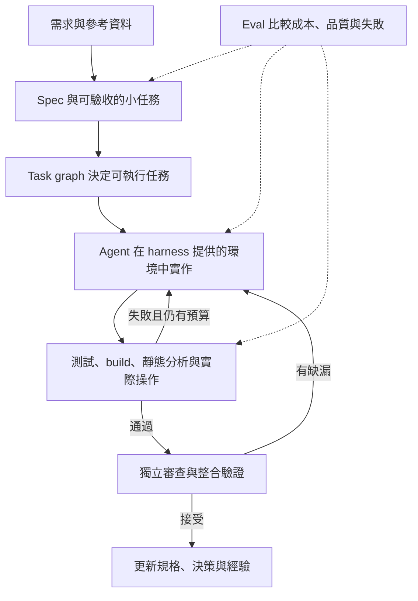

# AI 軟體開發工作流：2026-10-08 最新調研與知識更新指南

> 查核日期：2026-10-08（Asia/Taipei）。範圍：AI 輔助軟體工程，涵蓋個人開發、既有專案、團隊流程與自建 agent 系統。
> 方法：以作者維護的 repository、release notes、官方文件、第一方工程文章與原始調查為依據。搜尋結果與社群討論只用來找線索。
> 「好用」的評估與導入順序是本文建議，未在你的程式專案中實測。動態文件代表查核日看到的內容，不保證每個帳號、版本與平台都有相同功能。

## 1. 先看結論：值得學的是什麼

我的建議是：**先建立可驗證的小任務迴圈，再選一套主要流程，按需要增加規格、隔離與編排。** 不必把 Superpowers、Matt Pocock skills、OpenSpec、BMAD 全部疊起來。

最值得掌握的五件事：

1. **Verification / backpressure**：讓 agent 可以自己跑出有意義的對錯訊號。
2. **Spec 與任務切片**：清楚的行為、邊界、非目標、驗收條件，比一次寫滿整個系統實作細節有用。
3. **Context engineering**：把必要資訊送到正確的任務；不用把所有歷史、規則與 skills 永遠塞進上下文。
4. **Harness engineering**：設計工具、執行環境、權限、持久狀態與回饋機制。
5. **Evals 與流程刪減**：用代表性任務比較流程；模型或工具更新後，重新確認舊規則是否還有價值。

這是跨來源綜合判斷：Anthropic 把可自行驗證列為開發實務首項，HumanLayer 強調 research–plan–implement，OpenAI 的近期指引則要求減少膨脹且衝突的 skills。不是某一家工具專屬的工作法。[Claude Code best practices](https://code.claude.com/docs/en/best-practices)、[HumanLayer ACE](https://www.humanlayer.dev/blog/advanced-context-engineering)、[OpenAI：重新思考 skills](https://developers.openai.com/blog/rethinking-skills-and-prompts-for-gpt-6-astra)

### 「業界常用」的證據界線

Stack Overflow 在 **2026-10-06** 公布的調查指出：66% 受訪者使用 coding assistants／coding agents，26.2% 使用 automated agent workflows。這些是受訪者自陳的工具類別使用率，不是 Superpowers、OpenSpec 或 Ralph 的市佔率，也不是隨機抽樣全體工程師的結果。[原始發布說明](https://stackoverflow.co/company/press/archive/stack-overflow-annual-developer-survey-ai-trust-conditional/)

Cursor 公布 Faire 的採用案例：團隊每週執行超過 2,000 次自動化 agent runs，包含 CI 修復、問題分類與 code review 路由。這是具名的廠商案例，能證明此模式有人實際部署，不能推廣成所有團隊都有相同效益。[Faire 案例](https://cursor.com/blog/faire)

對本文提到的社群流程，**本次未找到足以比較其業界普及率的獨立統計**。因此不提供虛構的「業界前十名」排行榜；GitHub stars、作者名氣與社群轉貼只代表關注程度。

## 2. 先分清概念：這些東西不是同一層

| 概念 | 它回答的問題 | 典型產物 | 常見誤解 |
|---|---|---|---|
| SDD：Spec-driven development | 我們到底要做出什麼，怎樣算完成？ | spec、acceptance criteria、change proposal | spec 越長就越好；有文件就等於有驗證 |
| Harness | 模型能看到、操作與恢復什麼？ | tools、sandbox、hooks、context loading、state | 只是一份 system prompt；或必須自己造框架 |
| Loop | 如何根據失敗訊號重試並停止？ | implement → check → diagnose → repair | 無限重跑就一定收斂 |
| Task graph | 工作之間有哪些依賴，哪些可並行？ | DAG、blocked_by、ready frontier | 一定要導入 LangGraph 才能有 graph |
| Execution graph | 程式如何控制分支、暫停、恢復？ | state machine、nodes／edges、checkpoints | 多 agent 的角色圖就是可靠的執行系統 |
| Knowledge／code graph | 程式符號與領域知識如何關聯？ | symbol／call／dependency graph、architecture map | agent 生成的架構圖就是最新真相 |
| Skill | 如何重用特定任務的知識與步驟？ | SKILL.md 與 scripts／references | Markdown 指令等於不可繞過的限制 |
| MCP | 如何接到外部工具或資料？ | server、tools、resources | MCP 自己就是完整開發方法論 |
| Plugin | 如何包裝與分發能力？ | skills、hooks、agents、MCP、mods 套件 | 安裝越多就越可靠 |
| Claude Code Mod | 如何在 Claude Code 內部改變事件與 UI？ | JS／TS event handlers | mods 只是另一種 skill，或等同 permission modes |
| Eval | 流程／skill 在哪些任務上真的改善？ | 任務集、trace、grader、比較結果 | 測過一次成功就能證明穩定性 |

上述是本文整理的分類，不是統一產業標準。Anthropic 區分固定控制流的 workflows 與由模型決定流程的 agents；LangChain 明確把 Deep Agents 定位為 harness、LangGraph 為 orchestration runtime。[Anthropic 模式定義](https://www.anthropic.com/engineering/building-effective-agents)、[LangGraph 官方定位](https://docs.langchain.com/oss/python/langgraph/overview)



## 3. 工作流選擇表

「適用」與「限制」是根據設計做出的評估；證據欄只表示可查核程度，不表示使用率排名。

| 選項 | 主要價值 | 適合先試的情境 | 主要成本／限制 | 證據與定位 |
|---|---|---|---|---|
| 官方原生 agent + 驗證 | 最少額外設定，探索、計畫、實作、檢查 | 小修正、日常功能、熟悉專案 | 仍需提供可跑的檢查與環境 | 官方實務；可作基準組 |
| Superpowers | 設計、計畫、TDD、委派與審查的流程紀律 | 功能有多步驟、容易提早宣稱完成 | 小任務可能多跑不必要流程 | 作者維護的 skills 套件 |
| Matt Pocock skills | 規格討論、垂直切片、任務圖與 reviewer | 希望保留工程判斷且挑選 skills 使用 | 作者流程會變；需適配工具與 issue 系統 | 作者方法；非產業標準 |
| OpenSpec | 既有專案的 change proposal 與規格變更生命週期 | 多人協作、規格要跟程式一起審查 | 文件漂移；不自動證明程式正確 | 開源 spec 工具 |
| GitHub Spec Kit | 規格到計畫、tasks、implementation 的完整路徑 | 新功能、團隊需共同文件與流程 | 產物較多；小修改可能過重 | GitHub 維護的工具 |
| BMAD | 需求、架構與實作的較完整方法集合 | 尚未釐清產品與多個角色的責任 | 選擇與流程學習成本較高 | 開源方法套件 |
| Every Compound Engineering | 把完成工作的經驗回寫到下一輪 | 長期產品、重複踩相同坑的團隊 | 知識庫要清理；別累積互相衝突的規則 | 作者團隊維護的流程 |
| HumanLayer RPI／ACE | 研究與計畫先於實作，控制上下文 | 大型既有 codebase、跨模組問題 | 人類必須審查研究與計畫的假設 | 第一方方法與案例 |
| Ralph 類迴圈 | 用自動檢查與持久狀態推進多輪工作 | 有明確完成訊號的批次修改與修復 | verifier 缺口、卡住、預算失控 | 作者提出的 loop 模式 |
| Claude subagents／agent teams | 分開 context、平行調查與審查 | 可獨立探索、跨模組但檔案可隔離 | 協作成本；teams 仍標示 experimental | 官方原生能力 |
| Cursor Automations／cloud agents、Copilot GitHub 工作流 | 事件觸發任務並產生可 review 的變更 | CI、issue、PR 周邊重複工作 | 環境、權限、資源與接入成本 | 官方產品＋具名採用案例 |
| LangGraph／Deep Agents | 可編程的持久狀態與 agent runtime | 自建可恢復、多分支的 agent 服務 | 自己維護狀態、故障與執行語義 | 官方 SDK／runtime |
| Tessl | skills、loops 與 agent enablement 的工具方向 | 想探索 skills 評估、團隊導入 | 功能與定位需逐項查核，不沿用早期宣傳 | 商業工具；列為探索項 |
| Claude Code Mods | 深入事件與 UI 客製化 | 上下文儀表板、可互動的工具審查介面 | 高權限；API 與平台相容性需追蹤 | 2026-10 新發布能力 |

表內一手來源：[Superpowers](https://github.com/obra/superpowers)、[Matt Pocock](https://github.com/mattpocock/skills)、[OpenSpec](https://github.com/Fission-AI/OpenSpec)、[Spec Kit](https://github.com/github/spec-kit)、[BMAD](https://github.com/bmad-code-org/BMAD-METHOD)、[Compound Engineering](https://github.com/EveryInc/compound-engineering-plugin)、[HumanLayer](https://www.humanlayer.dev/blog/advanced-context-engineering)、[Ralph](https://ghuntley.com/ralph/)、[Agent teams](https://code.claude.com/docs/en/agent-teams)、[Cursor Automations](https://cursor.com/docs/cloud-agent/automations)、[Copilot on GitHub](https://docs.github.com/en/copilot/concepts/copilot-surfaces/copilot-on-github)、[Deep Agents](https://docs.langchain.com/oss/python/deepagents/overview)、[Tessl](https://tessl.io/)、[Mods](https://code.claude.com/docs/en/plugins/mods/overview)。

## 4. Superpowers、Matt Pocock 與 SDD 應該怎麼理解

### 4.1 版本快照：發布版與 main 要分開

下表日期使用台灣時間；原始 UTC 發布日期一併保留。版本來自本次讀取的 GitHub latest release，不代表你的 marketplace 已安裝相同版本。

| 專案 | 查到的發布版 | 台灣發布日（UTC 原始日） | 重點 |
|---|---|---|---|
| Superpowers | v6.4.2 | 09-26（09-25） | plan 減少預寫 implementation；保留 inline／subagent 執行選擇 |
| Matt Pocock skills | v1.3.1 | 10-04（10-04） | 正式納入 implement-spec、retro 等流程 |
| Spec Kit | v1.1.2 | 10-08（10-07） | 不只早期單一路徑；含 converge 與其他入口 |
| OpenSpec | v1.14.1 | 10-06（10-06） | OPSX artifacts／change lifecycle；Stores beta |
| BMAD | v6.12.1 | 10-05（10-04） | 已發布 v6 與 main 上 v7／Toolsmith Unreleased 要區分 |

可回查的固定 release：[Superpowers v6.4.2](https://github.com/obra/superpowers/releases/tag/v6.4.2)、[Matt v1.3.1](https://github.com/mattpocock/skills/releases/tag/v1.3.1)、[Spec Kit v1.1.2](https://github.com/github/spec-kit/releases/tag/v1.1.2)、[OpenSpec v1.14.1](https://github.com/Fission-AI/OpenSpec/releases/tag/v1.14.1)、[BMAD v6.12.1](https://github.com/bmad-code-org/BMAD-METHOD/releases/tag/v6.12.1)。

### 4.2 Superpowers：想讓 agent 自動遵循工程紀律

Superpowers 是一組完整的 skills 工作法：需求與設計、計畫、隔離工作、實作、TDD、review 與收尾。作者把它定位成 agent 預設會遵循的方法。適合希望減少「直接開寫、漏驗證、提早宣稱完成」的人。[作者 README](https://github.com/obra/superpowers)

v6.4.2 的計畫強調介面 signature、assertions、spec values 與必要的演算法意圖，而不是把完整程式先寫進 plan；先前版本也重新提供 Native inline execution，並非所有任務都必須逐項開 subagent。查核時 README 的部分舊措辭與 release notes 不一致，因此以指定 tag 的 skill 為準。[Release notes](https://github.com/obra/superpowers/blob/main/RELEASE-NOTES.md)、[v6.4.2 planning skill](https://github.com/obra/superpowers/blob/v6.4.2/skills/writing-plans/SKILL.md)

**縮寫提醒：SDD 也可能指 Subagent-driven development。** Superpowers 這個 skill 指每個任務用新的 implementer context、逐任務檢查規格與程式品質，再做整體 review；與 Spec-driven development 是不同概念，可以搭配。本文其他章節單寫 SDD 時指「規格驅動」。[Subagent-driven development](https://github.com/obra/superpowers/blob/v6.4.2/skills/subagent-driven-development/SKILL.md)

我的建議：先看流程負擔是否值得；小修正不需要長篇需求拷問。inline 成本較低，逐任務 subagent 可隔離上下文但增加派工與 review 成本，應依任務比較。

### 4.3 Matt Pocock：規格、垂直切片與 task graph

這不是一個單一 SDD 引擎，而是作者整理的可組合 skills。當前可參考的流程是：

```text
grill-with-docs → to-spec → to-tickets
  → implement（逐票）或 implement-spec（整體協調）
  → code-review → retro
```

`to-tickets` 切的是可以展示的垂直 tracer bullet，而非先完成所有資料層再做畫面；票附 blocking edges 並讓新 context 能理解。小改動可省略票層。[to-tickets](https://github.com/mattpocock/skills/blob/main/docs/engineering/to-tickets.md)

`implement-spec` 以 task graph 讀取相依性，平行執行 blockers 已整合的 ready frontier，implementers 各用 worktree，最後合到 integration branch。它需要能在背景執行 subagents 的 harness 與已設定的 tracker；不強制 GitHub 或一定開 PR。[implement-spec](https://github.com/mattpocock/skills/blob/main/docs/engineering/implement-spec.md)

文件也明列限制：worktrees 延後而不消除共享檔案碰撞；tracker 的 blocked 狀態可能落後實際整合；整體 review／fix 若無停止條件會拖很久。這表示任務圖、整合進度與驗證要一起設計，不能只喊「開多個 agents」。[官方已知問題](https://github.com/mattpocock/skills/blob/main/docs/engineering/implement-spec.md)

`retro` 把回顧重點放在 agent 的環境與 checks；近期也把領域文件命名從 CONTEXT 改成 GLOSSARY，並刪除專用 resolving-merge-conflicts skill。這些都是舊版使用者值得核對的 migration，而不是模型變了就繼續累加規則。[Changelog](https://github.com/mattpocock/skills/blob/main/CHANGELOG.md)

若想要真正 AFK 的 deterministic orchestration，作者另有 TypeScript 的 [Sandcastle](https://github.com/mattpocock/sandcastle)。它與在同一 agent session 中派工的 implement-spec 不同；此處列為延伸探索，不宣稱比原生工具更成熟或更快。

### 4.4 規格工具：依規格生命週期選擇

- **Spec Kit**：當前 README 包含 `specify → plan → tasks → implement → converge`，並有 bug fixing／idea assessment 入口。既有專案指引建議先做 bounded change，不先替全部舊程式補巨型規格。[README](https://github.com/github/spec-kit)、[Brownfield guide](https://github.github.io/spec-kit/guides/existing-projects.html)
- **OpenSpec**：以 `explore → propose → apply → archive` 管理 change 與 artifacts，把完成的規格變更納入主 specs；跨 repository 的 Stores 仍 beta。規格驗證不能代替實際行為驗證。[README](https://github.com/Fission-AI/OpenSpec)、[v1.14.1](https://github.com/Fission-AI/OpenSpec/releases/tag/v1.14.1)
- **BMAD**：涵蓋產品、架構與實作的較完整方法；先確認 stable v6 的流程，不把 main 上的 v7／Toolsmith Unreleased 當成已正式發布。[Releases](https://github.com/bmad-code-org/BMAD-METHOD/releases)、[Unreleased changelog](https://github.com/bmad-code-org/BMAD-METHOD/blob/main/CHANGELOG.md)
- **Tessl**：當前定位包含 skills、loops、factory 與 agent enablement。不能拿 2025 的 Framework closed-beta 狀態概括現在；功能與可用性要逐項查，效益數字也需看方法。[當前首頁](https://tessl.io/)、[2025 歷史公告](https://tessl.io/blog/tessl-launches-spec-driven-framework-and-registry)

**怎麼搭配**：Spec 工具管理「需求與變更的來源」，implementation skills 管理「如何做」，harness 提供「做與驗證的環境」。共同指向同一份 spec 與完成標準，避免多份互相衝突的真相。

我的選擇建議：既有專案常有規格變更可先看 OpenSpec；想要模板與完整路徑可看 Spec Kit；產品需求與架構還未定可探索 BMAD。這是適用判斷，沒有證明某一套在所有情境都更好。


## 5. Harness、loop、graph：怎樣才是工程方法

### 5.1 Harness：工具環境比口頭要求重要

一個實用的 coding harness 需要讓 agent 知道如何啟動專案、執行檢查、讀取失敗、保存進度與恢復。Anthropic 的長任務研究使用 initializer、feature list、progress file 與 git history；這是可參考的實驗設計，不是所有專案都要複製的固定格式。[2025-11-26 長任務研究](https://www.anthropic.com/engineering/effective-harnesses-for-long-running-agents)

**本文建議的最小組合**：精簡專案指引、必要 tools、確定可用的 build／test、範圍可審查的變更、預算與終止條件。只有反覆出現的問題才轉成 skill 或 hook。不要先寫巨大規則集，卻讓 agent 無法啟動測試。

近期重要修正：Anthropic 在 2026-07-24 報告，對新一代模型縮減超過 80% system prompt，未在其 coding evals 上測得下降；OpenAI 2026-09-11 也指出冗長、重複、觸發條件過廣的 skills 會干擾選擇與執行。**這支持定期重測並刪減規則，不能解讀成所有限制都可以刪除。** [Anthropic context 更新](https://claude.dev/blog/the-new-rules-of-context-engineering-for-claude-5-generation-models/)、[OpenAI skills 更新](https://developers.openai.com/blog/rethinking-skills-and-prompts-for-gpt-6-astra)

### 5.2 Loop：驗證器與停止條件決定品質

Ralph 的核心是反覆執行任務，並用 build、tests、typechecker 等 backpressure 拒絕錯誤產物。作者也談到規格錯誤會造成反覆做錯；迴圈無法修正未被識別的錯誤需求。[Ralph 原文](https://ghuntley.com/ralph/)

建議把每輪狀態記成：選定任務、變更摘要、實際檢查結果、剩餘失敗、下一步。增加以下停止條件：驗收通過；超過時間／費用／輪數；連續數輪沒有新進展；需要產品決策或外部資源。這些門檻要由實際任務決定。

對 correctness，優先使用可重現的程式檢查；對設計與可用性，再加入 rubric、畫面操作與 reviewer。Anthropic 2026-03-24 的實驗將生成者與評估者分開，也坦承獨立評估者仍可能過於寬鬆；不能把第二個 LLM 當成絕對真相。[Generator–evaluator harness](https://www.anthropic.com/engineering/harness-design-long-running-apps)

OpenAI 的 repair-loop 範例同樣把產出、驗證、修復分開，適合拿來理解 CI 失敗修復與文件範例維護，而不是無限重試。[Iterative repair loops](https://developers.openai.com/cookbook/examples/codex/build_iterative_repair_loops_with_codex)

### 5.3 Graph：至少要分三種

- **任務相依圖**：例如 API contract 確定後，client 與 server 可並行，最後跑整合測試。用 issue dependencies 或簡單檔案即可，不必先寫 orchestration framework。
- **執行控制圖**：對固定分支、人工批准、故障恢復與跨長時間狀態，才考慮 LangGraph。官方提供 checkpoints 與 stores；前者保存單一 thread 狀態，後者保存跨 thread 的資料。[LangGraph persistence](https://docs.langchain.com/oss/python/langgraph/persistence)
- **知識／程式圖**：用 symbols、呼叫與依賴關係回答改動影響哪些位置。Google Code Wiki 是自動生成文件與架構圖的例子；仍要回到實際 source 確認。[Google Code Wiki](https://developers.googleblog.com/en/introducing-code-wiki-accelerating-your-code-understanding/)

**建議升級順序**：搜尋與 LSP／符號定位 → 小範圍影響分析 → 實際遇到跨模組依賴問題後再加圖。這是成本判斷，不是任何官方強制規則。

### 5.4 自建 agent 系統：Deep Agents 與 LangGraph

LangGraph 是底層 orchestration runtime；Deep Agents 把 filesystem、subagents、context management 等 harness 能力放在其上。它們主要幫你「建造 agent 系統」，與「在編輯器裡選一套開發流程」是不同工作。[官方架構定位](https://docs.langchain.com/oss/python/langgraph/overview)

值得注意的近期改動：Deep Agents **v0.7（官方文章日期 2026-07-29）** 刪除基礎 system prompt、縮短工具描述，將 todo planning 改為 opt-in，報告 base input tokens 下降 65%。這是特定 eval 與預設輸入的比較，不是所有任務總帳單下降 65%；也不是查核日最新版本的宣稱。[v0.7 發布與實驗界線](https://www.langchain.com/blog/deep-agents-v0-7)

## 6. Anthropic Mods：這次最需要補上的新知

### 6.1 已確認是正式的 Mods

官方追蹤 issue 在 2026-09-03 提出 function hooks，9 月 9 日說明對外名稱是 Claude Mods，**10 月 1 日更新宣布上線**；同日官方教程發布。不是把 modes 寫錯，也不是一般的 slash-command 套件。[官方進度](https://github.com/anthropics/claude-code/issues/91870)、[2026-10-01 教程](https://claude.dev/blog/getting-started-with-claude-code-mods/)

Mod 是使用 JS／TS event handlers 的 plugin，可觀察、改寫或接管 Claude Code 事件，並繪製 UI。官方概覽列出的 CLI 門檻是 **v2.1.287+**，Desktop 內含版本為 **v2.1.286+**；這是最低支援版本，不是最新版。[Mods overview](https://code.claude.com/docs/en/plugins/mods/overview)

### 6.2 跟現有客製化方式如何選

| 需求 | 優先考慮 | 理由 |
|---|---|---|
| 重用某種研究、review 或實作方法 | Skill | 儲存模型讀取的任務指引 |
| 執行現有 script、記錄事件或做檢查 | Settings hook | 事件觸發外部處理 |
| 連接 issue tracker、資料庫或外部服務 | MCP／適合的 CLI | 提供 agent 可以呼叫的工具 |
| 統一安裝與分發上述元件 | Plugin | 管理套件與來源 |
| 改寫內部事件、加入互動 pane／band | Mod | 需要 Claude Code 內部事件與介面能力 |
| 決定工具動作是否自動接受 | Permission mode／policy | 管理執行權限；與 mods 是不同軸 |

此表為官方能力分類的精簡轉述。[官方比較](https://code.claude.com/docs/en/plugins/mods/overview#compare-mods-settings-hooks-skills-and-mcp-servers)

官方教程的三個示例值得先讀原始碼：**Token Weather**（context 儀表）、**Blast Radius**（命令影響提示）、**Replay Theater**（回放修改）。它們是教學示例，不是已證明廣泛採用的標準工作流。[官方教程與示例](https://claude.dev/blog/getting-started-with-claude-code-mods/)

### 6.3 技術與導入界線

典型 mod 含 `.claude-plugin/plugin.json`、`hooks/hooks.json` 與 JS／TS hooks module；可用 `--plugin-dir` 在一個 session 載入。官方 create 教程提供建立與 reload／validate 流程。[Create a mod](https://code.claude.com/docs/en/plugins/mods/create)

API 會隨版本變化，載入時生成的 `.claude-plugin/types/` 是該 build 的權威型別；handler 透過 `next` 形成 middleware chain。[官方實作說明](https://claude.dev/blog/getting-started-with-claude-code-mods/)、[Mods reference](https://code.claude.com/docs/en/plugins/mods/reference)

**Mod 是高權限程式碼。** 官方明列它可接觸檔案、程序、網路、環境變數與 session，也可能介入 approval；mod 本身不是 Bash sandbox 內的受限腳本。`claude plugin validate` 可列出 hooks／calls，但不能視為完整安全稽核。這是評估 mod 是否適合安裝的實際條件。[官方信任與權限說明](https://code.claude.com/docs/en/plugins/mods/overview#decide-whether-to-trust-a-mod)

Hooks 與 UI 支援也要分開：CLI／Desktop 可呈現介面；VS Code chat panel、headless 與 SDK 的 UI 能力不同。不要只因某 mod 在 terminal 有截圖就假設各平台等價。[Where mods run](https://code.claude.com/docs/en/plugins/mods/overview#where-mods-run)

**給你的建議**：先用現有 skills、測試與 hooks 解決流程問題；只有缺少可互動的觀測或控制介面時才探索 mods。先從觀察型儀表做實驗，保留版本與來源，等有明確收益再改寫工具動作。

## 7. 最近值得一起追蹤的方向

### 7.1 多 agent：隔離與整合比數量重要

官方 Claude agent teams 在查核日仍標示 **experimental、預設關閉**；teammates 各有 context 並可通訊。官方指出它有顯著 token 與協作成本，適用平行探索與可以獨立負責的部分；同檔案、強依賴或順序工作不一定受益。[Agent teams](https://code.claude.com/docs/en/agent-teams)

本文建議：先用一個 focused subagent 做調查或獨立 review，再擴成多個 implementers。若並行寫程式，明確定義檔案 ownership、shared contract、worktree、ports 與整合檢查。Worktree 只隔離 checkout，不會自動隔離資料庫、模擬器、build cache 或其他共享資源。

### 7.2 Cloud／ambient agents：讓事件啟動可 review 的任務

Cursor Automations 提供 schedule／event triggers；GitHub Copilot 可以從 GitHub 的需求與 repository 流程委派 coding work。適合先試 CI 失敗診斷、問題分類、文件修復與受限的維護任務。[Cursor docs](https://cursor.com/docs/cloud-agent/automations)、[Copilot docs](https://docs.github.com/en/copilot/concepts/copilot-surfaces/copilot-on-github)

**2026-10-06** 的 Claude cloud-session field guide 說明每個 task 有獨立機器、repository 與 branch，讓長任務不依賴本機持續開著。它仍需要正確的 setup 和可執行驗證，不是把需求丟上雲端就能得到可靠 PR。[最新 cloud 實務](https://claude.dev/blog/claude-code-in-the-cloud/)

若你是在「開發自己的 agent 服務」，Claude Managed Agents 是代管 loop、tool execution 與環境的另一選項；不要和 Claude Code cloud sessions 混為一談。[Managed Agents overview](https://platform.claude.com/docs/en/managed-agents/overview)

### 7.3 Compound engineering：把經驗變成下次可讀的資產

Every 的維護中套件把 brainstorm、plan、work、simplify、review、compound 串成核心流程；學習回寫是與一般「完成後結束」流程不同的價值。[Compound Engineering README](https://github.com/EveryInc/compound-engineering-plugin)

值得採用的部分是：把具體問題、原因、修復與驗證方式記下來，下一個相關任務才載入。不要把每個偶發錯誤都變成永久的全域禁令。這是本文建議的知識維護方式。

### 7.4 Evals：現在應該評估 workflow 本身

OpenAI 提供 skill eval 方法：capture trace／artifacts，同時檢查結果、流程與效率。Anthropic 在 **2026-09-28** 提供 `/claude-api build-eval` 與 `/claude-api hillclimb` 的指引，要求代表性任務及 held-out cases，避免只改善看過的例子。指令屬於該 skill，實際可用性需確認你的安裝。[OpenAI skill evals](https://developers.openai.com/blog/eval-skills)、[Anthropic eval 與 hillclimbing](https://claude.dev/blog/automating-eval-design-and-hillclimbing/)

生產力數字也需要小心解讀。METR 的 2026-02-24 更新指出後續研究受參與者選擇與多 agent 的時間衡量影響，無法可靠估計當時效益。不要拿舊「AI 讓工程師變慢」結果或新的自陳倍數當成所有專案的定律。[METR 原始更新](https://metr.org/blog/2026-02-24-uplift-update/)

## 8. 以你目前的知識庫，怎麼導入比較實用

你已經有 2026-08 的 harness／loop／graph 手冊與研究素材。這次新增的是日期快照；沒有把舊內容整批重寫。以下是本文建議，實際是否採用請用你自己的任務驗證。

### 推薦的起始組合

**日常預設：原生 coding agent + 簡短專案指引 + 可執行驗證。**

**主要流程：選 Superpowers 或 Matt Pocock skills 作為一個骨架。** 需要多人共同維護規格時，再把 OpenSpec 或 Spec Kit 用作規格生命週期；不同套件不能同時各自決定需求、任務狀態與完成標準。

**記憶：借用 Compound Engineering 的回寫方式。** 專案規則、決策、解法各自存放，按需要載入並定期清理。

**長任務：加 bounded loop 與 progress artifacts。** 多人並行與自建執行圖等實際需要出現後，再加 task graph／LangGraph。Mods 放在需要深入客製化 Claude Code 時探索。

| 任務 | 建議流程 | 需要看到的證據 |
|---|---|---|
| 小 bug／單點修改 | 重現 → 修改 → 針對性回歸 | 修改前失敗與修改後通過的行為 |
| 中型功能 | 需求釐清 → 薄 spec → 垂直切片 → 實作／驗證 → review | 驗收案例、錯誤路徑與整合結果 |
| 大型既有系統改動 | research → reviewed plan → contract／task graph → 分片實作 | 影響範圍、相依性與跨模組驗證 |
| 批次 migration | 試跑樣本 → 分批 loop → checkpoints → 最終整合 | 批次進度、殘留差異、可恢復點 |
| CI 周邊自動化 | event → 診斷 → 受限修復 → PR → CI／review | 任務來源、可 review 的 diff、未解問題 |
| 自建 agent 產品 | 狀態／恢復需求 → harness／graph → traces → eval | interruption recovery、持久狀態與效益比較 |

對 Android，驗證需依變更選擇 compilation、unit tests、lint、instrumented tests 與裝置操作；不要每個小改都跑最重流程。並行任務也要處理 emulator、Gradle 與 ports 的共享狀態。這些是你的既有 Android 手冊可以繼續深化的部分，本文沒有重新查核 Android 工具版本。

### 建議兩週實驗，不用一次換掉全部流程

- **第一階段**：選 6–10 個真實且可重現的任務，涵蓋 bug、功能、重構與測試缺口；記錄原生 agent 的結果。
- **第二階段**：只增加一套主要流程，以同樣 snapshot 與驗收要求比較；必要時重跑，避免一次運氣好就下結論。
- **第三階段**：只補上持續發生的問題，例如規格不清、context 混亂、未驗證或整合失敗；一次改一個因素。

比較：需求完成度、獨立檢查、回歸缺陷、人工介入次數、review 分鐘、總 elapsed time、token／費用、改動範圍與返工。模型、版本、effort、工具權限與測試環境也要記錄。以「可接受變更的總成本」判斷，不以 agent 產出的行數或角色數判斷。

## 9. 跟既有 2026-08 手冊相比，應重新查核的項目

| 舊認知／資料 | 本次查核帶來的修正 | 建議 |
|---|---|---|
| Claude 客製化主要是 skills／hooks／MCP | 10 月正式加入 Mods 的內部事件與 UI 介面 | 加入概念；實際安裝前查版本與信任範圍 |
| Superpowers 只看 README 的計畫格式 | v6.4.2 的 planning 內容與舊措辭有差異 | 優先看 versioned skill 與 release notes |
| Matt Pocock 只按一串舊 slash commands 執行 | 維護中 skills 已包含 task graph 與整合流程 | 以當前 SKILL.md 為準，不硬抄舊影片 |
| Deep Agents 預設一定有 todo planning | v0.7 開始改成 opt-in | 自建服務升級時查 default behavior |
| 規則越多、步驟越固定越可靠 | 近期官方資料開始強調減少衝突與舊 scaffolding | 用 eval 檢驗哪些規則值得保留 |
| 把知識 graph 與流程 graph 放一起理解 | 任務、執行、程式知識是不同需求 | 分別定義更新責任與驗證方式 |
| 引用 2025 的採用率／效益作現在結論 | 10 月已有 2026 調查；效益研究也有方法變動 | 保留年份、分母與研究限制 |

這是局部更新清單，不表示舊手冊的所有其他說法已重新驗證。特別是固定百分比、套件數量、架構演變與效益數字，都應回到當前原始來源確認。

## 10. 未來怎麼搜尋：可重複的知識更新流程

### 10.1 四步驟：發現 → 查核 → 試用 → 保留／刪除

1. **發現**：官方 changelog、作者 repo releases／commits、工程文章；社群只負責指出新名稱。
2. **查核**：找完整原文，核對日期、版本、功能狀態、平台；對宣傳效益找方法與限制。
3. **試用**：用一個可重現的真實任務，比較原生基準與新流程。避免同時換模型、工具與流程。
4. **記錄決策**：採用、試驗中、追蹤或淘汰。每則記錄附來源、適用條件與下次查核日期。

官方文件也可能沒有更新日期，README 也可能慢於 release notes；查核優先順序建議是：**指定版本的實作／skill → 對應 release notes → 最新官方文件 → 作者文章 → 社群解讀**。不同來源衝突時，保留衝突並在本機確認行為。

### 10.2 搜尋詞：先搜工程問題，再搜熱門名字

下列日期只是以這次調研為例；下次改為你的上次查核日期。搜尋引擎的日期與 `after:` 是篩選線索，仍要打開頁面確認。

```text
# 大方向與實際工程方法
"agentic coding" "workflow" after:2026-09-01
"harness engineering" "evals" after:2026-09-01
"coding agent" "context engineering" "failure"
"spec-driven development" "brownfield" "limitations"
"coding agent" "backpressure" "verification"
"agent workflow" "durable execution" "checkpoint"

# 指定官方／作者來源
site:code.claude.com/docs/en "mods"
site:claude.dev/blog "mods" after:2026-09-01
site:claude.dev/blog "cloud" after:2026-09-01
site:anthropic.com/engineering "harness"
site:developers.openai.com "skills" "evals"
site:developers.openai.com "context" after:2026-09-01
site:cursor.com/changelog "automations"
site:docs.github.com "copilot" "agent"
site:github.com/obra/superpowers "release"
site:github.com/mattpocock/skills "implement-spec"
site:github.com/Fission-AI/OpenSpec "release"
site:github.com/github/spec-kit "release"
site:docs.langchain.com "deepagents" "changelog"

# 找失敗、成本與可重現證據
"<工具名稱>" "breaking changes"
"<工具名稱>" "migration" "limitations"
"<工具名稱>" "benchmark" "methodology"
"<工具名稱>" "context" "token" "cost"
"<工具名稱>" "worktree" "conflict"
"<工具名稱>" "false positive" "review"
```

每個候選工具至少回答：解決什麼痛點？跟原生 agent 的差異？需要什麼環境？失敗如何恢復？效益怎麼量測？移除是否容易？找不到答案先放追蹤，不急著導入。

### 10.3 固定追蹤的少量來源

| 來源 | 追蹤內容 | 建議頻率 |
|---|---|---|
| [Claude Code changelog](https://github.com/anthropics/claude-code/blob/main/CHANGELOG.md)／[文件索引](https://code.claude.com/docs/llms.txt) | 功能、預設行為、版本與平台差異 | 每週 |
| [claude.dev Blog](https://claude.dev/blog/)／[Anthropic Engineering](https://www.anthropic.com/engineering) | 新模式、harness、eval 與限制 | 每週掃描 |
| [OpenAI Developers](https://developers.openai.com/) | Codex／skills／loop／context 的官方更新 | 每週掃描 |
| [Superpowers releases](https://github.com/obra/superpowers/releases) | skill 行為與版本差異 | 每週／升級前 |
| [Matt Pocock skills commits](https://github.com/mattpocock/skills/commits/main/) | 命令、任務圖與作者流程演變 | 每週／升級前 |
| [OpenSpec releases](https://github.com/Fission-AI/OpenSpec/releases)／[Spec Kit releases](https://github.com/github/spec-kit/releases) | spec 生命週期與 migration | 每月／升級前 |
| [Compound Engineering](https://github.com/EveryInc/compound-engineering-plugin)／[HumanLayer Blog](https://www.humanlayer.com/blog) | 經驗回寫、context 與實際工作流 | 每月 |
| [Cursor changelog](https://cursor.com/changelog)／[GitHub changelog](https://github.blog/changelog/) | cloud／PR／event automation | 每週掃描 |
| [LangChain Blog](https://www.langchain.com/blog)／[Deep Agents repo](https://github.com/langchain-ai/deepagents) | 自建 harness／runtime 的預設變化 | 使用時每週；其餘每月 |
| [Stack Overflow survey](https://survey.stackoverflow.co/)／[METR research](https://metr.org/research/) | 採用與生產力的原始證據 | 季度／新報告發布 |

可以用 GitHub Watch 的 custom notifications 只訂閱 releases；有 Atom feed 的 repository 可追蹤 `releases.atom` 或 `commits/main.atom`。沒有穩定 feed 的來源，用固定清單巡查或頁面差異工具。這裡只提供方法，本次沒有建立訂閱或定期自動化。

### 10.4 維持低負擔的節奏

- **每週 20–30 分鐘**：掃 changelog 與作者 repo，挑 3–5 個真正改變能力或預設行為的項目。
- **每月 60–90 分鐘**：選一個痛點試新方法，整理差異；刪掉失效規則與重複 skills。
- **模型／工具大更新後**：先跑小型回歸任務，再決定流程是否要調整。
- **每季**：回看採用調查、研究與具名案例；將沒有使用價值的追蹤來源移出固定清單。

這些時間是建議的預算，不是研究推算的最佳頻率。

### 10.5 知識紀錄模板

```markdown
## <日期>：<工具／方法更新>
- 查核日期與來源：
- 發布日期／版本／commit：
- 狀態：stable / preview / experimental / 未確認
- 類型：spec / harness / loop / task graph / knowledge / eval
- 真正改變了什麼：
- 跟目前工作流的差異：
- 適用情境與不適用情境：
- 採用證據：官方能力 / 作者案例 / 廠商客戶案例 / 獨立研究
- 本地實驗：任務、snapshot、模型、環境與驗收
- 結果：成功率、人工時間、費用、缺陷、限制
- 決策：採用 / 試驗 / 追蹤 / 淘汰
- 下次查核日期：
```

### 10.6 可直接交給 AI 的下次更新提示

```text
請上網更新我對 AI 軟體開發工作流的認識，跟這份 Markdown 比較差異。
查核基準使用今天日期；重點看上次查核日之後的新資料。

先讀我指定的舊報告，然後搜尋官方文件、作者 repo、release notes 和原始研究。
涵蓋 Superpowers、Matt Pocock skills、SDD 工具、Claude Code mods/hooks/skills、
Codex、context engineering、bounded loops、task/execution/knowledge graphs、
cloud/event-driven agents 與 workflow evals。

重要主張必須打開原文查核並附 URL。
每項列出發布日期、版本或 commit、查核日期、功能狀態、適用情境與限制。
把官方可用、作者經驗、廠商案例、獨立採用／效益證據分開。
找不到目前普及率就直接說沒有證據；不要用 stars 推算市佔。
文件與實作衝突時，保留衝突，優先查指定版本的 source/skill/release。

輸出：
1. 與舊報告相比最重要的變化與過時說法；
2. 對我目前流程值得採用、試驗、追蹤、刪除的項目；
3. 一個最小可重現的驗證實驗；
4. 更新後 Markdown 與待查問題。
不要自動安裝工具、改全域設定、建立排程或啟用外部自動化。
```

## 11. 資料限制與延伸閱讀

本次是有範圍的網路研究，沒有逐一安裝框架或測試 mods，也沒有證明任何套件在你的專案一定更快。大部分工作流套件只有作者文件與案例，因此推薦是按用途與維護成本做的判斷。

「最新」是截至 2026-10-08 可讀取的一手來源快照；無法保證搜尋完整收錄所有剛發布的內容。文中日期有區分查核、發布與版本門檻；沒有查到穩定版本的工具，不強填最新版。

- [本次 Superpowers／Matt Pocock／SDD 一手研究筆記](research/2026-10-08-workflow-source-notes.md)
- [既有 Agentic 開發工作流手冊](agentic-workflow-handbook.md)
- [既有調研索引](README.md)

**最有價值的更新方式，是讓知識追蹤與真實任務相連：每次只引入能解決一個已觀察問題的方法，保留能量測的改善。**
