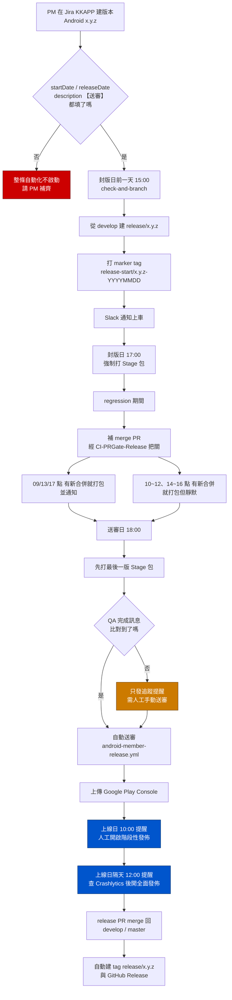
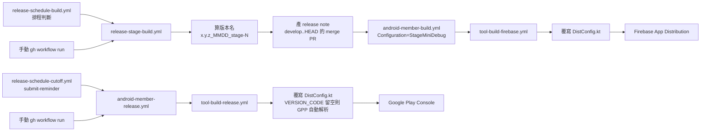
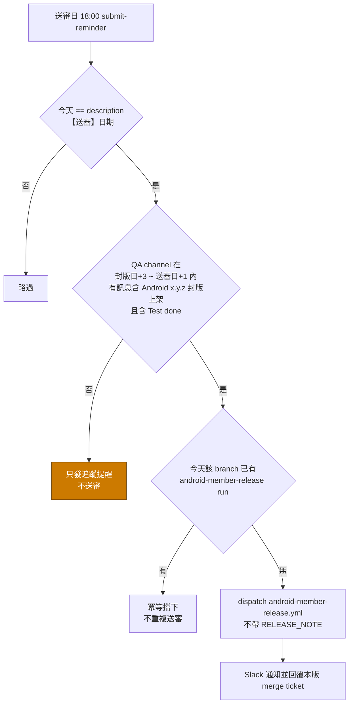

# Android Member 發版流程對照

Repo：`kkday-it/kkday-android-member`
所有時間為 Asia/Taipei（cron 寫的是 UTC）。

---

## 一、流程總覽



藍色為**人工在 Play Console 操作**的節點，CI 只發提醒。

---

## 二、打包鏈路



`DistConfig.kt` 由 CI 於建置時整檔覆寫，**repo 裡的版本號不用改也不該改**。

---

## 三、自動送審判斷



---

## 四、流程 / 腳本 / Skill 對照表

| 發版流程做的內容 | 對應腳本 / GitHub Action 排程檢查 | 對應 skill | 如何呼叫 |
|---|---|---|---|
| PM 在 Jira KKAPP 建版本 `Android x.y.z`，設 `startDate`（封版日）、`releaseDate`（上線日）、description 寫 `【封版】…【送審】YYYY/MM/DD【上線】…` | 無 workflow。**所有排程的唯一資料來源**，格式錯整條自動化不啟動（送審日只能靠 regex 從 description 抓） | `release-create` Step 1 | `/release-create`，或「確認 Jira 發版設定」 |
| 封版日**前一天 15:00** 從 `develop` 建 `release/x.y.z`、打 marker tag、Slack 通知上車 | `release-schedule-cutoff.yml` → `check-and-branch`；cron `0 7 * * 2,3,4`（週二~四）。檢查「明天 == startDate」 | `release-create` | 自動。補跑：`gh workflow run release-schedule-cutoff.yml --field job=check-and-branch` |
| 手動開的 hotfix 分支納入自動化管理 | 排程只認 `release-start/` marker tag，無 tag 的分支全部略過 | `release-create` Step 4 | `gh api …/git/refs -f ref="refs/tags/release-start/x.y.z-YYYYMMDD"` |
| regression 期間補 merge 進 release 的 PR 檢查 | `CI-PRGate-Release.yml`；**非排程**，`pull_request` to `release/**`。判 issue type → 驗 `CI-E2ETesting-Feature.yml` / `CI-UnitTest-Feature.yml` 對 head SHA 的 run 是否 success | `release-changelog` | `gh pr checks <pr-number>` |
| 確認本版含哪些 PR、比對 Jira fixVersion | 無專屬 workflow。CI 內部以 `origin/develop..HEAD --merges` 產 Firebase release note | `release-changelog` | `/release-changelog` |
| **封版日當天 17:00** 強制打一包 | `release-schedule-build.yml`；cron `0 9 * * 1-5`。先判「今天 == startDate」，是則 `reason=cutoff-day` | `release-build` | 自動。立刻打：見第五節 |
| regression 補包（有新合併才打），09/13/17 點發 Slack | 同上；cron `0 1,5 * * 1-4` + `0 9 * * 1-5`。窗口＝封版日+3 ~ 上線日-4，比對 HEAD 與上次成功包的 SHA | `release-build` | 自動 |
| regression 靜默包（打包但不通知 channel） | 同上；cron `0 2,3,4,6,7,8 * * 1-4`（10~12、14~16 點），`NOTIFY=false` | `release-build` | 自動 |
| 實際打 Stage 包（`StageMiniDebug` → Firebase App Distribution），算版本名 `x.y.z_MMDD_stage-N`、產 release note | `release-stage-build.yml` → `android-member-build.yml` → `tool-build-firebase.yml`。序號取「今日成功包數」與「已用最大序號」max+1 | `release-build` | `/release-build`，或見第五節 |
| 送審日 18:00 先留一版最新 Stage 包 | `release-schedule-build.yml`；cron `0 10 * * 1-5`，比對「今天 == 【送審】日期」 | `release-build` | 自動 |
| 送審日 18:00 自動送審（QA Slack 訊息含 `Android x.y.z 封版上架` + `Test done`，且今日尚未送審） | `release-schedule-cutoff.yml` → `submit-reminder`；cron `0 10 * * 1-5`。三條件全過才 dispatch，不帶 `RELEASE_NOTE` | `release-submit` | 自動。補跑：`--field job=submit-reminder` |
| Production build + 上傳 Google Play Console | `android-member-release.yml` → `tool-build-release.yml`。`VERSION_CODE` 留空則 GPP 查 Play Console 最大版號 +1 | `release-submit` | 見第五節 |
| 上線日 10:00 提醒值日生開**階段性發佈** | `release-schedule-cutoff.yml` → `rollout-reminder`；cron `0 2 * * 1-5`，比對「今天 == releaseDate」 | `release-submit` Step 4 | 人工在 Play Console 操作。補提醒：`--field job=rollout-reminder` |
| 上線日**隔天** 12:00 提醒查 Crashlytics 後開**全面發佈** | `release-schedule-cutoff.yml` → `post-rollout-reminder`；cron `0 4 * * 1-5`，比對「今天 == releaseDate+1」 | `release-submit` Step 4 | 人工操作。補提醒：`--field job=post-rollout-reminder` |
| release PR merge 回 `develop`/`master` 後建 tag `release/x.y.z` + GitHub Release | `release-on-merge-automation.yml`；**非排程**，`pull_request: closed`。notes 取上一個 `release/*` tag 至今的 `--no-merges` commit + 固定安全性評估段落 | `release-changelog`（說明用） | 全自動。試跑：`--field version=x.y.z --field dry_run=true` |
| ~~merge 進 release 就自動打包~~ / ~~Google Calendar + Apps Script 觸發~~ | `release-auto-build.yml`、`release-calendar-trigger.yml` —— 兩支 job 都 `if: false` **已停用** | 無 | 不要用 |

---

## 五、常用指令

立刻打一包 stage（`NOTIFY=false` 則不通知 channel）：

```bash
gh workflow run release-stage-build.yml --repo kkday-it/kkday-android-member --ref release/2.123.0 --field NOTIFY=true
```

手動送審（`VERSION_CODE` 留空交給 Gradle Play Publisher 自動解析）：

```bash
gh workflow run android-member-release.yml --repo kkday-it/kkday-android-member --ref release/2.123.0 --field VERSION_NAME=2.123.0
```

看實際打包結果（`release-stage-build.yml` 只負責 dispatch，要看下游）：

```bash
gh run list --repo kkday-it/kkday-android-member --workflow=android-member-build.yml --branch release/2.123.0 --limit 5
```

補跑封版／送審／regression 判斷：

```bash
gh workflow run release-schedule-build.yml --repo kkday-it/kkday-android-member
```

補跑建分支／送審／上線提醒（`job` 務必指定，`all` 會讓其他 job 一起判斷而誤觸發）：

```bash
gh workflow run release-schedule-cutoff.yml --repo kkday-it/kkday-android-member --field job=check-and-branch
```

列出目前 release 分支：

```bash
git ls-remote --heads origin 'refs/heads/release/*' | sed 's#.*refs/heads/release/##' | sort -t. -k1,1n -k2,2n -k3,3n | tail -5
```

查本版含哪些 PR：

```bash
git log origin/develop..origin/release/2.123.0 --merges --oneline
```

查 Jira 版本設定：

```bash
curl -s -u "$JIRA_EMAIL:$JIRA_API_TOKEN" "https://kkday.atlassian.net/rest/api/3/project/KKAPP/versions" | jq -r '.[] | select(.name | startswith("Android")) | {name, startDate, releaseDate, description}'
```

---

## 六、排查：排程 success 不代表有做事

`release-schedule-*.yml` 的 job 幾乎所有分支都是 `should_build=false` + `exit 0`，**conclusion 一律是 success**。判斷有沒有實際動作只能看 log 的 `ℹ️` / `⚠️` 訊息，或看實際產物（分支、tag、下游 run）。

```bash
gh run list --repo kkday-it/kkday-android-member --workflow=release-schedule-build.yml --limit 10
```

| 觀察到 | 判斷 | 處理 |
|---|---|---|
| 該時段完全沒有 run | 排程漏觸發（封版日 17:30 曾完全沒觸發、regression 延遲過 70~95 分鐘） | 補跑，或直接手動打包 |
| 有 run（success）但沒有下游 run | 條件判斷後略過，**不是失敗** | 看 log 確認原因，多數不用處理 |
| 有下游 run 但 failed | 真的建置失敗 | `gh run view <id> --log-failed` |

常見的「success 但沒動作」log：

- `不是封版日，且週五不做 regression 檢查` — 正常
- `不在 regression 補包窗口（封版日+3 ~ 上線日-4）內` — 正常
- `沒有新合併，略過打包` — HEAD 與上次成功包 SHA 相同，正常
- `已送審，不補發靜默包通知` — 正常
- `所有 release 分支都找不到 marker tag` — 分支未納管，需補 tag
- `在 Jira 找不到 startDate / releaseDate` — Jira 設定沒補齊
- `在 Jira description 找不到【送審】日期` — description 格式錯
- `有效時間窗口內未找到 QA regression 完成訊息` — 最常見，QA 已測完就手動送審

把「條件不符略過」誤判成「漏觸發」而去補跑，會多吃一個 stage 序號並多發一輪 Slack。
