# AI SDLC 自動化流程規劃

## 設計原則：Composable Skills

本規劃的所有 skill 遵循以下原則：

### 獨立運作優先

每個 skill 都是一個**可獨立使用的單元**，不預設上下游相依。使用者可以只用 `issue-analyze` 做排查、只用 `pr-create` 發 PR，不需要啟動整條 pipeline。

### 通用 I/O 契約

每個 skill 定義通用的輸入輸出格式：

```
輸入：接受多種來源（Jira ticket、PRD 文件、Figma URL、Markdown 文件、口述文字…）
輸出：產出標準格式的 artifact（Markdown 報告、test skeleton、PR…）
```

Skill 內部負責判斷輸入來源並適配，使用者不需要先把資料轉換成特定格式。

### 整合為可選插件

外部系統整合與 skill 串聯均為**可選 integration**，以 flag 或自動偵測啟用：

| Integration | 啟用條件 | 行為 |
|-------------|---------|------|
| 自動交棒 | 使用者配置了下游 skill，或以 pipeline 模式啟動 | 完成時自動將產出傳入下游 skill |
| Jira | 輸入包含 Jira ticket key（如 `MEMAPP-123`） | 自動抓取 ticket 資訊、回寫 comment |
| Slack | 設定檔中配置了 Slack channel | 發送通知 |
| Confluence | 使用者指定 space/page | 發布報告 |

### 自由組裝

使用者可依需求組合 skill，不需要跑完整 pipeline。

**無依賴限制**：工單流程、發版流程的所有 skill 可任意作為起點，只需提供對應輸入（Jira URL、branch 名稱等）即可獨立執行。

**需求開發流程有階段依賴**：部分 skill 依賴 OpenSpec 前一階段產出的文件。若前置文件缺失，skill 會提示用戶選擇處理方式：

| Skill | 核心依賴 | 無來源時的行為 |
|-------|----------|--------------|
| `sbe-analyze` | 需求來源（Jira / Figma / PRD / 文字） | 在當前對話中詢問用戶提供，等待後繼續；不跳轉其他 skill |
| `sasd-analyze` | 需求來源（Jira / Figma / PRD / 文字） | 在當前對話中詢問用戶提供，等待後繼續；不跳轉其他 skill |
| `task-breakdown` | 需求來源（Jira / Figma / PRD / 文字） | 在當前對話中詢問用戶提供，等待後繼續；不跳轉其他 skill |
| `task-impl` | `tasks.md` | 1. 先執行 `task-breakdown` 建立 tasks.md 再繼續<br>2. 直接根據需求來源進行開發 |
| `spec-change` | `proposal.md` + `spec.md` + `design.md` + `tasks.md` | 1. 先補齊缺失文件再繼續<br>2. 僅對現有文件進行規格變更 |

> **原則**：`sbe-analyze`、`sasd-analyze`、`task-breakdown` 這三個 skill 均採用「需求來源優先」策略。前一階段產出的文件（如 spec.md、design.md）只是補充參考，有的話讀取，沒有也能繼續。核心是確保能讀到 PRD / Figma / Jira 等原始需求資料。

**常見組合範例**：

```
# 工單單點排查（無依賴，隨時可用）
issue-analyze MEMAPP-456

# 工單全流程（無依賴，隨時可用）
issue-analyze → issue-fix → pr-create → code-review → doc-update → issue-retro

# 需求開發從頭跑（有 OpenSpec 全程串接）
feature-analyze → sbe-analyze → sasd-analyze → task-breakdown → task-impl → pr-create

# 需求開發跳過分析，直接從任務開始（需手動提供 tasks.md）
task-impl → pr-create → code-review → doc-update

# 只跑前半段規格，DEV 之後手動接手
feature-analyze → sbe-analyze → sasd-analyze → task-breakdown
```

---

## 架構全景

### 需求開發流程

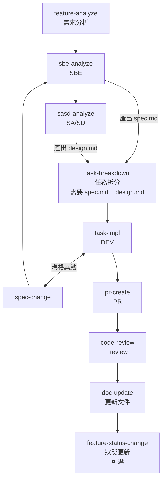

### 工單流程

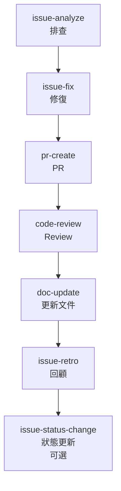

### 發版流程

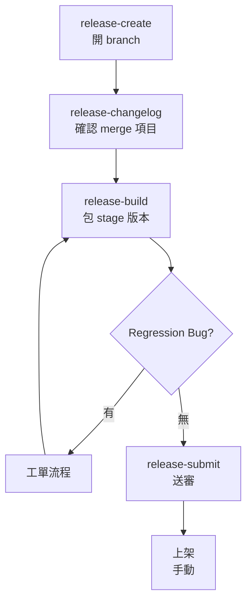

### 懶人包全自動流程（`auto-dev`）

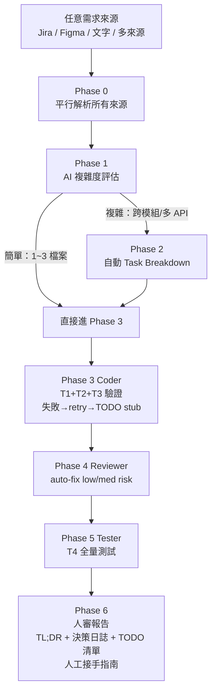

---

## 架構總覽：四大流程與 Skill 對應

### 一、需求開發流程

需求分析 → SBE → SA/SD → 任務拆分 → DEV（↕ 規格異動） → PR → Review → 更新文件

| 階段 | 對應 Skill | 現況 | Skill 簡易說明 | 內部呼叫 |
|------|-----------|:----:|----------------|---------|
| 需求分析 | `feature-analyze` | ✅ | **Input**: PRD / Figma / Jira / 自由文字<br>**Output**: 需求規格 + codebase 分析（對應 `proposal.md`） | `requirement-analyzer` — 掃描 codebase 產出需求規格與 gap analysis<br>`openspec-new-change` — 建立 change 目錄<br>`openspec-propose` — 產出 `proposal.md` 草稿<br>`jira` — 更新 ticket 狀態與留言 |
| SBE | `sbe-analyze` | ✅ | **Input**: 需求規格<br>**Output**: Gherkin 驗收標準，寫入 `spec.md` | `openspec-continue-change` — 將 `spec.md` 寫入 change 目錄<br>`jira` — 留言附上驗收標準供 PO/QA 確認 |
| SA/SD | `sasd-analyze` | ✅ | **Input**: 需求來源（Jira / Figma / PRD / 文字，任一即可）<br>**Output**: `design.md`（Android 技術方案，含架構、DI、State Machine、Data model、Compose 實作指南）+ `sasd.md`（iOS/Android 共用業務邏輯，由 `app-sasd-generator` 產出） | `opsx:continue` — 將 `design.md` 寫入 change 目錄<br>`app-sasd-generator` — 產出 `sasd.md`（平台無關業務邏輯文件）<br>`confluence` — 發布 `sasd.md`（可選） |
| 任務拆分 | `task-breakdown` | ✅ | **Input**: `spec.md` + `design.md`（兩者都需要）<br>**Output**: 任務清單 + E2E/Unit test skeleton（對應 `tasks.md`） | `openspec-continue-change` — 將 `tasks.md` 寫入 change 目錄<br>`jira` — 建立對應 sub-task（可選） |
| DEV | `task-impl` | ✅ | **Input**: `tasks.md`<br>**Output**: 逐步實作程式碼 + 通過的測試 + 編譯驗證 | `openspec-apply-change` — 依 `tasks.md` 驅動 TDD 逐項實作<br>`jira` — 更新 sub-task 完成狀態（可選） |
| 規格異動 | `spec-change` | ✅ | **Input**: 規格變更訊號<br>**Output**: 更新後的 `spec.md` + `design.md` + `tasks.md` | `sbe-analyze` — 更新驗收標準<br>`sasd-analyze` — 更新技術方案<br>`task-breakdown` — 更新任務清單<br>`openspec-sync-specs` — 同步更新 change 目錄內的規格文件 |
| PR | `pr-create` | ✅ | **Input**: git working tree<br>**Output**: GitHub PR | `openspec-verify-change` — 驗證實作與 change artifacts 一致性（可選）<br>`jira` — 提取 ticket key 並回寫 PR 連結<br>`github` — 執行 `gh pr create` |
| Review | `code-review` | ✅ | **Input**: PR<br>**Output**: 修正建議 + 風險評估 + 架構一致性報告 + SBE 驗收結果 | `github` — 讀取 PR diff<br>`jira` — 更新 ticket 狀態 |
| 更新文件 | `doc-update` | ✅ | **Input**: git working tree<br>**Output**: 共用文件庫更新 | `openspec-sync-specs` — 同步 delta specs 到主規格目錄<br>`confluence` — 更新技術文件頁面（可選） |
| 狀態更新 | `feature-status-change` | ✅ | **Input**: PR merge 訊號<br>**Output**: Jira Story 狀態更新為 Done | `openspec-archive-change` — 歸檔完成的 change<br>`jira` — 更新 Story 狀態 |

### 二、工單流程

排查 → 修復 → PR → Review → 更新文件 → 回顧

| 階段 | 對應 Skill | 現況 | Skill 簡易說明 | 內部呼叫 |
|------|-----------|:----:|----------------|---------|
| 排查 | `issue-analyze` | ✅ | **Input**: Jira ticket / 錯誤訊息 / 堆疊追蹤 / 截圖<br>**Output**: 排查報告（根因排名 + 影響範圍 + 程式碼位置 + 修復方向） | `jira` — 抓取 ticket 描述、附件與重現步驟<br>`feature-finder` — 定位問題相關程式碼<br>`feature-data-flow-analyze` — 分析影響範圍（可選） |
| 修復 | `issue-fix` | ✅ | **Input**: 排查報告<br>**Output**: 重現測試（紅燈 → 綠燈）+ 修復程式碼 + 品質驗證 | `jira` — 更新 ticket 狀態為「修復中」 |
| PR | `pr-create` | ✅ | **Input**: git working tree + 排查報告<br>**Output**: GitHub PR（bug fix template） | `jira` — 提取 ticket key 並回寫 PR 連結<br>`github` — 執行 `gh pr create` |
| Review | `code-review` | ✅ | **Input**: PR<br>**Output**: 修正建議 + 風險評估 + 架構一致性報告 | `github` — 讀取 PR diff<br>`jira` — 更新 ticket 狀態 |
| 更新文件 | `doc-update` | ✅ | **Input**: git working tree<br>**Output**: 共用文件庫更新 | `confluence` — 同步更新技術文件頁面（可選） |
| 回顧 | `issue-retro` | ✅ | **Input**: pipeline 全程產出<br>**Output**: 回顧文件（根因 + 修復 + 影響 + 預防）+ 監控總表更新 | `jira` — 關聯回顧文件至 ticket<br>`confluence` — 發布回顧頁面 |
| 狀態更新 | `issue-status-change` | ✅ | **Input**: 修復完成訊號<br>**Output**: Jira 工單狀態更新（In Review / Done） | `jira` — 更新工單狀態 |

### 三、發版流程

開 branch → 確認 merge 項目 → 包版本 → 工單循環 → 送審 → 上架

| 階段 | 對應 Skill | 現況 | Skill 簡易說明 | 內部呼叫 |
|------|-----------|:----:|----------------|---------|
| 開 branch | `release-create` | ✅ | **Input**: 版本號<br>**Output**: `release/x.y.z` branch + 更新 versionName/versionCode | `github` — 建立 branch<br>`jira` — 建立 Release version（可選） |
| 確認 merge 項目 | `release-changelog` | ✅ | **Input**: release branch<br>**Output**: 收項目清單 + release note + changelog | `github` — 掃描 merged PR 與 commit history<br>`jira` — 抓取各 ticket 標題與狀態 |
| 包版本 | `release-build` | ✅ | **Input**: branch + variant（sit/stage/production）<br>**Output**: build artifact 上傳 Firebase | `github` — 觸發 GitHub Actions workflow |
| 工單循環 | 同工單流程 | — | 使用工單 pipeline：`issue-analyze` → ... → `issue-retro` | — |
| 送審 | `release-submit` | ✅ | **Input**: 送審指令<br>**Output**: production build 上傳 Firebase + Google Play | `release-build` — 包 production 版本<br>`github` — 觸發 release workflow<br>`jira` — 更新 Release version 狀態 |
| 上架 | — | — | 目前手動 | — |

### 四、懶人包全自動流程（`auto-dev`）

| 階段 | 對應 Skill | 現況 | Skill 簡易說明 |
|------|-----------|:----:|----------------|
| 全自動開發 | `auto-dev` | ✅ | **Input**: 任意需求來源（Jira / Figma / Confluence / Google Doc / 純文字，可多來源同時輸入）<br>**Output**: 完整實作 + Code Review + 人審報告（含 TL;DR 速覽 + 人工接手指南）；全程無人介入，失敗留 TODO 繼續，做完才停 |

### 如何選擇執行模式

兩條路線**完全獨立**——選擇呼叫哪個 skill 就決定了模式，不需要在 skill 內額外設定。

| 適用情境 | 執行模式 | 入口 Skill |
|---------|---------|----------|
| 有 OpenSpec 任務清單、需求複雜、希望人工把關每個 task | **半自動**（互動式） | `task-impl` |
| 需求明確、想一鍵跑完到人審報告、接受 AI 自行決策 | **全自動**（閉環自癒） | `auto-dev` |
| 修 Bug（已有 issue-analyze 結果） | **半自動**（TDD 紅綠燈） | `issue-fix` |

**半自動**（`task-impl` / `issue-fix` / `code-review`）：保留所有人為確認點，驗證失敗時停下通知用戶，由人類決定如何修復。

**全自動**（`auto-dev`）：全程不等確認，AI 自行分類錯誤、自動修復、重驗，超限留 TODO stub，最後輸出人審報告。是全自動路線的唯一入口。

---

### 入門決策樹

**「我想做 X，應該用哪個 skill？」**

```
我想...
├── 分析一個需求，搞清楚要做什麼
│   └── /feature-analyze（+ Jira/Figma/Confluence URL 或文字描述）
│
├── 把需求轉成 Gherkin 驗收情境（BDD）
│   └── /sbe-analyze（+ 需求來源）
│
├── 設計技術方案（架構、Data Model、State Machine）
│   └── /sasd-analyze（+ 需求來源）
│
├── 把設計拆成可執行的任務清單
│   └── /task-breakdown（+ 需求來源，可搭配 spec.md + design.md）
│
├── 依照任務清單逐步實作（有人工把關）
│   └── /task-impl（+ feature name 或 tasks.md）
│
├── 一鍵全自動從需求到實作（AI 自行決策，最後人審）
│   └── /auto-dev（+ 任意需求來源）
│
├── 修 Bug
│   └── /issue-analyze（先排查）→ /issue-fix（再修）
│
├── 發 PR
│   └── /pr-create
│
├── 做 Code Review
│   └── /code-review（+ PR number 或直接觸發）
│
├── 需求或設計在 DEV 過程中有異動
│   └── /spec-change（告訴 AI 哪裡需要更新）
│
└── 做完想更新 AI 知識庫（feature doc）
    └── /doc-update（更新 docs/ai-guide/features/<slug>.md）
```

**常見組合**：

| 我的情況 | 建議入口 |
|---------|---------|
| 剛拿到 Jira Story，什麼都還沒做 | `/feature-analyze <Jira URL>` |
| 已有 proposal.md，要開始寫驗收情境 | `/sbe-analyze` |
| 已有 spec + design，要開始寫 code | `/task-breakdown` → `/task-impl` |
| 趕時間，想讓 AI 自動做完 | `/auto-dev <需求描述或 URL>` |
| 實作到一半發現規格要改 | `/spec-change 告訴我哪裡要改` |
| 同事問我這個功能怎麼做 | `/feature-analyze` 的「AI Review」模式 |

---

### 共用 Skill

| Skill | 需求開發 | 工單 | 說明 |
|-------|:-------:|:----:|------|
| `pr-create` | ✓ | ✓ | 建立 GitHub PR |
| `code-review` | ✓ | ✓ | 修正建議 + 風險評估 + 架構一致性 + SBE 驗收 |
| `doc-update` | ✓ | ✓ | 共用文件庫更新 |

---

## 閉環校驗修復（Closed-Loop Verification & Self-Healing）

### Harness 工程核心概念

「Test Harness」是包覆在程式碼外圍的驗證基礎設施，確保每次異動都通過同一套標準化閘門。以下為核心概念及對應實作：

| Harness 概念 | 定義 | 本流程的實作 |
|------------|------|-----------|
| **Fail Fast** | 由便宜到昂貴逐層驗證，越早失敗越省成本 | T1→T7 階梯；T1 失敗不跑 T3 |
| **Deterministic Routing** | 錯誤分類優先用確定性規則，不交給 LLM 猜測 | `fix-classifier` 16 條規則 route table，命中即停；未命中才用 LLM 分析 |
| **Bounded Self-Healing** | 自動修復有次數上限，避免無限循環 | T1~T4、T6 各層 retry ≤ 3；超限留 TODO stub 升級人類 |
| **High-Risk Isolation** | 敏感路徑不自動修，強制人工審閱 | 支付 / 登入 / 追蹤路徑直接升級，`auto-dev` 模式亦不例外 |
| **Audit Trail** | 所有驗證結果可追蹤 | 驗證結果寫回 `tasks.md`：`{T1✓ T2✓ T3✓ retry:N}` |
| **Escalation with Context** | 升級時附完整歷程，讓人類接手有 context | 升級報告含前 N 次嘗試摘要 + 當前錯誤 + 建議下一步 |
| **Coverage Gate** | 驗證「測試通過」之外，還驗證「測試存在」 | `auto-dev` Phase 5：git diff 掃新增 class，檢查對應 `*Test.kt` 是否存在 |
| **Structured Context Injection** | 預先整理精煉摘要注入 context，取代全量掃描 | 知識庫（`docs/ai-guide/`）在每個 skill 執行前讀取；`feature-doc-generator` / `doc-update` 維持新鮮度 |

### 快速模式（TDD / Harness 可選）

| 快速模式 | 可跳過 TDD | 可跳過 Harness |
|---------|:---:|:---:|
| `feature-analyze` F mode（一次產出全部文件） | N/A（只產文件） | N/A |
| `task-breakdown` 直接實作（option 2） | ✅ 不產測試任務 | N/A（只產 tasks.md） |
| `task-impl` 直接實作模式（Step A） | ✅ 無 TDD 循環 | ✅ 實作完成後詢問是否跳過 T1+T2 |
| `auto-dev --quick`（快速模式） | ✅ 跳過測試建立 | ✅ 跳過 T1→T4 + Coverage Gate |

兩條路線都依 **Tier 階梯**（T1→T7）驗證，差異在失敗時的行為：

| 路線 | 失敗行為 | 入口 |
|------|---------|------|
| **半自動**（`task-impl` / `issue-fix` / `code-review`） | 停下通知用戶，由人類決定修復方式 | `task-impl` |
| **全自動**（`auto-dev`） | 自動分類 → fix-agent → 重驗，超限留 TODO stub | `auto-dev` |

以下 Tier 架構說明適用於理解兩種路線的驗證層級。**「自動修？」欄僅適用於全自動路線（`auto-dev`）**；半自動路線的同層驗證失敗時一律停下通知用戶。

### Verification Tier 階梯

驗證設計成 7 層階梯，cheapest → most expensive。**每層失敗就地修，修不掉才升級到下一層或人類**。

| Tier | 驗證項 | 指令（Android） | 預期成本 | 修復策略 | 自動修？ |
|------|--------|---------------|---------|---------|--------|
| T1 | Syntax / Compile | `./gradlew :<module>:compileDevelopDebugKotlin` | 秒~10秒 | 自動 patch（import / 簽章 / 型別） | ✅ |
| T2 | Lint / Static | `./gradlew detekt`、`lintDevelopDebug` | 10~30秒 | 自動 patch（規則違反） | ✅ |
| T3 | Unit Test 增量 | `--tests "*ChangedClass*"` | 30秒~2分 | Triage 後 patch（修 spec / 修 impl / 修 test） | ✅ |
| T4 | Unit Test 全量 | `./gradlew testDevelopDebugUnitTest` | 3~10分 | regression triage | ✅ |
| T5 | E2E / SBE | Maestro 跑對應 Gherkin scenarios | 5~30分 | 失敗成本太高 | ❌ 升級人類 |
| T6 | AI Code Review | `code-review` skill | 1~3分 | Must-Fix 自動修 + re-review；Suggestion 入 PR comment | ✅ |
| T7 | Human Review | GitHub PR review | 數小時~天 | 人類主導 | ❌ |

**Retry budget**：T1~T4、T6 各層 **上限 3 次**；T5、T7 是 hard escalation point。

### Self-Healing Loop 標準形態

```
執行 Task / 修復 / Review
  ↓
跑 Tier N 驗證
  ↓
失敗？─ 否 ─→ 進 Tier N+1
  │
  是
  ↓
讀錯誤輸出 → 錯誤分類（route table）
  ├─ syntax/import     → fix-agent (T1)
  ├─ type mismatch     → fix-agent (T1)
  ├─ lint rule         → fix-agent (T2)
  ├─ test assertion    → triage-agent → 判斷修 spec / 修 impl / 修 test
  ├─ flaky             → retry once + 標記
  ├─ infra/env         → 不改程式，回報用戶
  ├─ high-risk path    → 升級人類（不自動修支付/登入/追蹤）
  └─ unknown           → 升級給人類
  ↓
派發 fix-agent / triage-agent 執行修復
  ↓
重跑 Tier N 驗證 ──┐
  ↓                │
成功？             │
  │ 否：retry++    │
  │ retry < 3 ─────┘
  │ retry >= 3 → 升級給人類（附前 3 次嘗試紀錄）
  │
  是 → 進 Tier N+1
```

### 錯誤分類 Route Table

| 錯誤特徵 | 類別 | 修復策略 | Agent |
|---------|------|---------|-------|
| `Unresolved reference:` | missing-import / missing-impl | 讀 design.md / sasd.md 確認應引入哪個 class，補 import 或建 interface | `compile-fix-agent` (sonnet) |
| `Type mismatch: inferred type is X but Y was expected` | type-mismatch | 比對簽章修參數型別或回傳型別 | `compile-fix-agent` (sonnet) |
| `MagicNumber`, `MaxLineLength`, `LongMethod` (detekt) | lint-rule | 抽 const / 換行 / 拆 function | `lint-fix-agent` (sonnet) |
| `AssertionError` / `expected ... but was ...` | test-assertion | 1) 讀 spec.md 對應 Gherkin；2) 比對 impl 行為；3) 判斷修 spec / impl / test 哪邊 | `test-triage-agent` (opus) |
| `Test ignored` / 偶發 timeout | flaky | 重跑 1 次；仍失敗則標記 `@Ignore` 並升級 | — |
| `Could not resolve` / 網路 / SDK 缺失 | infra/env | **不改程式**，回報用戶處理環境 | — |
| 其他 | unknown | 直接升級給人類 | — |

### 完整案例：實作「會員登入加 OTP 驗證」

```
Task 1: 建立 OtpVerifyUseCase（task-impl 派發 api-engineer subagent）
│
├─ T1 Compile（：domain:usecase:compileDevelopDebugKotlin）
│   ├─ FAIL: "Unresolved reference: OtpRepository"
│   ├─ classify → missing-impl
│   ├─ compile-fix-agent: 讀 design.md → 在 :domain:contract 建 OtpRepository interface
│   ├─ retry compile → PASS
│
├─ T2 Lint（detekt）
│   ├─ FAIL: "MagicNumber: 6 should be const"
│   ├─ classify → lint-rule
│   ├─ lint-fix-agent: 抽 const OTP_LENGTH = 6
│   ├─ retry detekt → PASS
│
├─ T3 Unit Test 增量（--tests "*OtpVerify*"）
│   ├─ FAIL: assertion expected SUCCESS but was INVALID_OTP
│   ├─ classify → test-assertion → test-triage-agent (opus) 出馬
│   ├─ triage 步驟：
│   │   1. 讀 spec.md 對應 Gherkin: "WHEN 輸入正確 OTP THEN 進主畫面"
│   │   2. 讀 OtpVerifyUseCase 實作 → 比對 Gherkin
│   │   3. 結論：impl 錯（少了 trim()，user 輸入帶空白）
│   ├─ fix impl → retry test → PASS
│
└─ Mark tasks.md：- [x] [P] Task 1 {T1✓ T2✓ T3✓ retry:0}

… Task 2~N 同上 …

最終批次（所有 task 完成後）：
│
├─ T4 全量 Unit Test（regression check） → PASS
│
├─ T5 E2E / SBE（Maestro 跑 Gherkin scenarios）— 用戶選擇是否執行
│   ├─ FAIL: 等不到 #home_tab
│   ├─ classify → e2e-failure
│   ├─ **不自動修**，產出失敗 trace + screenshot
│   ├─ 升級給人類（附 3 個假設：UI ID 變更 / timing / 預設帳號失效）
│
├─ T6 AI Code Review（code-review skill）
│   ├─ Round 1: FOUND Must-Fix: "OtpVerifyUseCase 沒處理 token expired"
│   ├─ classify → review-must-fix（low-risk，自動修）
│   ├─ code-review-fix-agent: 補 expired 分支 + 加 unit test
│   ├─ 重跑 T1~T3 增量校驗 → PASS
│   ├─ Round 2: re-review → APPROVED
│
└─ 進 pr-create
```

### 各 skill 在閉環中的角色

| Skill | 負責 Tier | 升級條件 |
|-------|---------|---------|
| `task-impl` | T1~T4（每個 task 增量、完成後全量） | retry 上限 / 高風險路徑 / 需修 spec |
| `issue-fix` | TDD 紅燈 → 修 → TDD 綠燈 → T2~T4 regression | 紅燈跑不出來（根因判斷錯）/ 高風險路徑 |
| `code-review` | T6（Mode A 自動修；Mode B 預設只報告） | high-risk Must-Fix / retry 上限 / 需修規格 |
| `openspec-verify-change` | 文件 vs 實作 三維度（Completeness / Correctness / Coherence）+ low-risk 自動修 | high-risk drift（建議走 spec-change） |
| `spec-change` | Drift 偵測（Step 0.5）+ 文件串聯更新 | 高風險路徑偏差 |

### 升級報告統一格式

當任一 skill 達到升級條件，輸出：

```
⚠️ <Skill> 校驗失敗，升級給人類

Tier: T<N>（<驗證項>）
分類: <類別>
重試次數: <K>/3

前 K 次嘗試摘要：
1. [錯誤摘要] → [修復動作] → [仍失敗原因]
2. ...

當前錯誤：
<錯誤輸出最後 30 行>

建議下一步：
- 若是規格問題 → 執行 spec-change
- 若是環境問題 → [具體建議]
- 否則人工接手後輸入 y 繼續
```

### 設計原則

1. **驗證階梯由便宜到昂貴**：早攔截早便宜，T1 失敗不會跑 T3
2. **修復策略優先確定性**：route table 規則匹配優先，匹配不到才用 LLM 推理
3. **Retry 有上限**：典型 3 次，避免無限重試吃 token
4. **高風險路徑（支付/登入/追蹤）不自動修**：直接升級給人類
5. **升級時附完整紀錄**：前 N 次嘗試摘要 + 當前錯誤 + 建議下一步，讓人類接手有 context
6. **驗證紀錄寫回 tasks.md**：`- [x] {T1✓ T2✓ T3✓ retry:N}`，便於後續追蹤與 eval

### Skill 與 Harness 核心概念對照

| Harness 概念 | 對應 Skill / 機制 | 說明 |
|------------|----------------|------|
| Fail Fast（T1） | `task-impl` Step 2.5、`auto-dev` Phase 3 | 每個 task 完成後立即跑 `compileDevelopDebugKotlin` |
| Fail Fast（T2） | `task-impl` Step 2.5、`auto-dev` Phase 3 | 緊接 T1 跑 `detekt` |
| Fail Fast（T3） | `task-impl` Step 2.5（TDD 模式）、`auto-dev` Phase 3 | 增量測試 `--tests "*ChangedClass*"` |
| Fail Fast（T4） | `task-impl` Step 4、`auto-dev` Phase 5 | 全量回歸 `testDevelopDebugUnitTest` |
| Fail Fast（T5） | `task-impl` Step 4（可選）、`code-review` | Maestro 跑 Gherkin scenarios；失敗升級人類 |
| Fail Fast（T6） | `code-review` | AI Code Review；Must-Fix 自動修，Suggestion 入 PR comment |
| Fail Fast（T7） | `pr-create` → GitHub PR review | 人工終審 |
| Deterministic Routing | `fix-classifier` | 16 條規則 route table；路由到 `compile-fix-agent` / `lint-fix-agent` / `test-triage-agent` |
| fix-agent 真實派發 | `fix-classifier` Step 5 | 使用 `Agent` tool 實際派發 subagent（非口頭描述） |
| Bounded Self-Healing | `auto-dev` Phase 3 決策守則 | retry ≤ 3；超限留 `// TODO(auto-dev)` 繼續 |
| High-Risk Isolation | `task-impl` Step 2、`auto-dev` 決策守則 | 支付/登入/追蹤路徑不自動修，強制升級人類 |
| Audit Trail | `task-impl` Step 2.5 | 寫回 `tasks.md`：`{T1✓ T2✓ T3✓ retry:N}` |
| Coverage Gate | `auto-dev` Phase 5 | git diff 掃新增 class，確認 `*Test.kt` 存在；缺測試列入人審 `[覆蓋缺失] G1` |
| Gherkin→Maestro→testTag 契約 | `sbe-analyze`→`task-breakdown`→`task-impl` | Gherkin 定義行為 → Maestro 腳本定義 `id:` testTag → Compose 用相同 testTag 實作 |
| Structured Context Injection | 所有 skill 的「知識庫讀取」步驟 | 讀 `docs/ai-guide/features/<slug>.md` + `01-architecture.md`，取代全量 codebase 掃描 |
| 知識庫更新（Context 保鮮） | `feature-doc-generator`、`doc-update`、`feature-doc-update` | 需求完成後自動更新 feature doc，確保下次 skill 讀到的是最新資訊 |
| UNVERIFIED 警告 | `feature-analyze` Step 2.1、`task-breakdown` Step 2、`task-impl` Step 1 | 讀到 AI 草稿 feature doc 時顯示警告，防止誤把未驗證假設當作事實 |
| 需求完整性檢查 | `sbe-analyze` Step 0.55 | 讀取 Figma 後自動偵測缺少的 Loading/Empty/Error 狀態；多來源時偵測矛盾並要求確認 |
| Maestro E2E 優先級 | `task-breakdown` Step 4 | P0（必有）/ P1（複雜才加）/ P2（跳過），避免每個 Scenario 都產 Maestro 任務導致任務清單過重 |
| TODO Stub 彙整 | `task-impl` Step 4、`auto-dev` Phase 6 | 完成摘要列出所有跳過的任務，方便後續追蹤補完 |
| 人工接手指南 | `auto-dev` Phase 6 | 報告末尾附具體接手步驟（grep TODO / 查 log / 重跑驗證），降低接手成本 |

---

## 一、需求開發流程 — 詳細 Pipeline

### Step 1 — 需求分析 `feature-analyze`

- **Input**: PRD / Figma / Jira ticket / 自由文字（任一或組合）；若無輸入，skill 會主動反問
- **Output（標準模式）**: `proposal.md`
- **Output（快速模式）**: `proposal.md` + `specs/` + `design.md` + `tasks.md`（透過 `opsx:ff`）

自動執行：
1. 偵測是否有輸入來源；若無，反問用戶
2. 讀取所有輸入來源（Jira / Confluence / Figma / Google Docs / 文字）
3. 進入 Plan Mode，詢問快速模式（F）或標準模式（1/2）
4. 讀取知識庫（feature doc + 01-architecture.md）；若 feature doc 含 `UNVERIFIED` 標記或不存在，顯示警告並自動產出草稿
5. **快速模式（F）**：呼叫 `opsx:ff` 一次產出所有文件 → 完成後顯示決策選擇（繼續下一步 → task-impl）
6. **標準模式**：執行分析（標準或深度）→ 呼叫 `opsx:new` 產出 `proposal.md` → 顯示決策選擇（繼續下一步 → sbe-analyze）

可選整合：
- **交棒（標準）** → `sbe-analyze`
- **交棒（快速）** → `task-impl`
- **OpenSpec**：`opsx:new` 或 `opsx:ff` 建立 change 目錄與所有文件
- **Jira**：更新 ticket 狀態、留言附上分析連結

### Step 2 — SBE `sbe-analyze`

- **Input**: 需求來源（Jira / Figma / PRD / 文字，任一即可）；無來源時在當前對話詢問用戶提供
- **Output（有 OpenSpec）**: Gherkin 驗收標準，寫入 `specs/<capability>/spec.md`
- **Output（無 OpenSpec）**: 直接在對話中以 Markdown 輸出 Gherkin

自動執行：
1. 偵測當前對話是否有可用的需求來源；若無，提示用戶提供（不跳轉其他 skill）
2. 讀取所有可用來源，同時讀取 proposal.md（若存在）作為補充參考
3. **完整性檢查**：若有 Figma，確認 Loading / Empty / Error 狀態是否存在；若缺少，詢問是否 AI 推測（標 [AI推測]）；若多來源，偵測矛盾並列出供用戶確認
4. 偵測是否有 OpenSpec change 目錄，決定產出路徑
5. 可選標準分析或深度分析
6. 產出 Gherkin 格式的驗收標準（Given-When-Then），寫入 spec.md 或對話輸出
7. 完成後顯示**決策選擇**，等待用戶確認：
   - **人為修改**：直接提出修改意見，AI 立即更新 specs.md 並再次確認
   - **AI Review 並修改**：AI 自動 Review（從不同角度審核情境覆蓋率、優先級分類、Gherkin 語法）
   - **繼續下一步**：繼續 sasd-analyze

可選整合：
- **交棒** → `sasd-analyze`
- **OpenSpec**：將 `spec.md` 寫入 change 目錄的 `specs/`
- **Jira**：留言附上驗收標準供 PO/QA 確認

### Step 3 — SA/SD `sasd-analyze`

- **Input**: 需求來源（Jira / Figma / PRD / 文字，任一即可）；無來源時在當前對話詢問用戶提供
- **Output（有 OpenSpec）**：
  - `design.md`（Android 技術方案：架構、DI 綁定、UI State Machine sealed class、Data model Kotlin 結構、Compose 畫面組件層次，detail 足以驅動任務拆分）
  - `sasd.md`（iOS/Android 共用業務邏輯，呼叫 `app-sasd-generator` 產出，無平台程式碼）
- **Output（無 OpenSpec）**: 直接在對話中以 Markdown 輸出技術設計

自動執行：
1. 偵測當前對話是否有可用的需求來源；若無，提示用戶提供（不跳轉其他 skill）
2. 讀取所有可用來源，同時讀取 spec.md / proposal.md（若存在）作為補充參考
3. 偵測是否有 OpenSpec change 目錄，決定產出路徑
4. 可選標準分析或深度分析
5. 產出 `design.md`（Android 技術設計），內容包含：
   - **受影響模組清單**：各模組修改類型與說明
   - **Data model**：Kotlin data class 結構（含 JSON key mapping）
   - **API Contract**：所有端點的 Request / Response schema
   - **UI State Machine**：逐畫面的 sealed class 定義 + 狀態轉換表
   - **DI 綁定（Koin）**：新增 / 修改的 module binding
   - **Repository / UseCase 契約**：interface 定義
   - **Compose 畫面結構**：組件層次與狀態提升方式
   - **Breaking Change 風險評估**：風險矩陣（支付/登入/追蹤敏感路徑特別標記）
6. 呼叫 `app-sasd-generator` 產出 `sasd.md`（iOS/Android 共用業務邏輯文件，無平台程式碼），內容包含：
   - **Change Scope 表格**：逐功能點列出現況設計 vs 新設計（含所有分支/空狀態/錯誤狀態）及 B2C API
   - **Sequence Diagram**：核心流程時序圖（App / BFF / 外部服務互動）
   - **B2C API Spec**：所有 API 的 request / response 範例（PRD 未定義時模擬合理 schema 並標注待確認）
   - Compatibility、Time Estimation 留 TODO 供 RD 補填
7. 完成後顯示**決策選擇**，等待用戶確認：
   - **人為修改**：直接提出修改意見，AI 立即更新 design.md/sasd.md 並再次確認
   - **AI Review 並修改**：AI 自動 Review（從不同角度審核 API 一致性、State Machine 覆蓋率、Breaking Change 標記、Data model 與 API Response 一致性）
   - **繼續下一步**：繼續 task-breakdown

可選整合：
- **交棒** → `task-breakdown`
- **OpenSpec**：`opsx:continue` 將 `design.md` 寫入 change 目錄
- **app-sasd-generator**：產出 `sasd.md`（強制呼叫，非可選）
- **Confluence**：發布 `sasd.md`（可選）

### Step 4 — 任務拆分 `task-breakdown`

- **Input**: 需求來源（Jira / Figma / PRD / 文字，任一即可）；無來源時在當前對話詢問用戶提供
- **Output（有 OpenSpec）**: `tasks.md`（任務清單）
- **Output（無 OpenSpec）**: 直接在對話中以 Markdown 輸出任務清單

自動執行：
1. 偵測當前對話是否有可用的需求來源；若無，提示用戶提供（不跳轉其他 skill）
2. 讀取所有可用來源，同時讀取 spec.md / design.md（若存在）作為補充參考
3. 讀取知識庫（naming-conventions / modules / di-koin）；若任一參考文件含 `UNVERIFIED` 標記，顯示警告，提醒以 design.md / spec.md 為主要依據
4. 偵測是否有 OpenSpec change 目錄，決定產出路徑
5. **詢問開發方式**（必選）：
   - **T — TDD**：任務包含 E2E test skeleton（含 testTag 契約定義）、Unit Test 紅燈先行、UseCase、整合串接、DI 綁定
     - Maestro E2E 腳本需定義每個互動/斷言元件的 `id:`（即 Compose testTag，命名 `snake_case`）
     - testTag 名稱為 UI 實作契約，`ui-engineer` 須用相同值設定 `Modifier.testTag(...)`
     - Maestro 任務優先級：P0（Happy Path / 關鍵操作，必有）、P1（重要 Error State，複雜才加）、P2（純 Unit Test 已覆蓋，跳過 Maestro）
   - **D — 直接實作**：僅包含 API 串接、UI 實作、UseCase、整合串接、DI 綁定（不含測試 skeleton）
6. 選擇拆分模式：標準拆分或深度拆分
7. 每個任務標註預期影響的模組和檔案，可並行任務標記 `[P]`
8. 排定建議實作順序（依賴關係優先）
9. 完成後顯示**決策選擇**，等待用戶確認：
   - **人為修改**：直接提出修改意見，AI 立即更新 tasks.md 並再次確認
   - **AI Review 並修改**：AI 自動 Review（從不同角度審核任務遺漏、`[P]` 標記正確性、DoD 覆蓋率）
   - **繼續下一步**：繼續 task-impl

可選整合：
- **交棒** → `task-impl`
- **OpenSpec**：產出 `tasks.md`
- **Jira**：建立對應的 sub-task

### Step 5 — DEV `task-impl`

- **Input（有 tasks.md）**: `tasks.md`（`task-breakdown` 產出）
- **Input（無 tasks.md）**: 需求來源（Jira / Figma / PRD / 文字）；無來源時在當前對話詢問用戶提供
- **Output（OpenSpec 模式）**: 逐步實作程式碼 + TDD 測試通過 + 任務標記完成 + 編譯驗證
- **Output（直接實作模式）**: 單次分析後直接修改程式碼 + 編譯驗證

自動執行（OpenSpec 模式）：
1. 讀取 tasks.md，識別 `[P]` 並行任務；若參考文件含 `UNVERIFIED` 標記，顯示警告
2. `[P]` 任務執行順序（含 E2E 時分兩波）：
   - **第一波並行**：`api-engineer` + `unit-test-engineer` + `e2e-engineer`
   - `e2e-engineer` 需為每個可互動/斷言元件定義 `id:`（testTag），完成後輸出 testTag 清單
   - **第二波**（e2e-engineer 完成後）：`ui-engineer` 讀取 Maestro 腳本取得 testTag 清單，Compose 元件用相同 `Modifier.testTag(...)` 實作
3. TDD 循環：紅燈 → 實作 → 綠燈，每完成一個任務立即標記 `- [x]`
4. 每 task 完成後跑 T1→T2→T3 增量驗證（半自動：失敗通知用戶；全自動：fix-classifier 自動分類修復）
5. 所有任務完成後執行 T4 全量 build + test + lint；T5 前先確認 `maestro --version`
6. 完成摘要包含 **TODO Stub 彙整**（所有 `{T<N>✗ skipped}` 任務清單）

自動執行（直接實作模式，無 tasks.md，小型需求）：
1. 詢問用戶提供需求來源，讀取後進行單次分析
2. 詢問用戶：先執行 task-breakdown（中大型需求），或直接實作（小型需求）
3. 直接實作：單次分析 → 修改對應檔案，不做 TDD、不追蹤任務進度
4. 實作完成後詢問是否執行 T1+T2 驗證（可選；跳過時顯示 ⚠️ 未驗證警告）

可選整合：
- **交棒** → `pr-create`
- **OpenSpec**：與 `/opsx:apply` 整合，依 tasks.md 驅動 TDD 流程
- **Jira**：每完成一個 task 自動更新 sub-task 狀態

### Step 6 — 規格異動 `spec-change`

- **Input**: 規格變更訊號（DEV 階段發現規格需修改）
- **Output**: 重走一次 `sbe-analyze` → `sasd-analyze` → `task-breakdown` 的更新產出

自動執行：
1. 偵測 / 接收規格變更觸發
2. 以新規格重跑 `sbe-analyze`（更新 Gherkin 驗收標準）
3. 重跑 `sasd-analyze`（更新 SA/SD 文件、ADR、design.md）
4. 重跑 `task-breakdown`（更新 tasks.md 與 test skeleton）
5. 完成後回到 DEV 繼續實作

可選整合：
- **OpenSpec**：同步更新 change artifacts
- **Jira**：更新相關 ticket / sub-task

### Step 7 — PR `pr-create`

- **Input**: git working tree（`task-impl` 完成訊號 / 或偵測到未發 PR 的變更）
- **Output**: GitHub PR

自動執行：
1. 跑 `detekt` + `lintDevelopDebug` + `testDevelopDebugUnitTest`
2. 全部通過後，從 git diff + commit history 自動產出 PR description：
   - 修改內容摘要
   - 影響範圍
   - Feature 交付檢查清單自動預填
3. 使用 `gh pr create` 發 PR

可選整合：
- **交棒** → `code-review`
- **Jira**：從 branch name / commit message 提取 ticket key，回寫 PR 連結
- **OpenSpec**：從 change artifacts 提取關聯的 SA/SD/Figma 連結
- **Slack**：通知 channel PR 已建立

### Step 8 — Review `code-review`

- **Input**: PR（`pr-create` 完成訊號 / 或直接指定 PR number）
- **Output**: 修正建議 + 風險評估 + 架構一致性報告 + SBE 驗收結果

自動執行：
1. Claude code review，產出修正建議
2. 與架構設計文件交叉比對，產出架構一致性報告
3. 回歸風險評估：分析受影響的 caller/依賴方，敏感路徑標記 high-risk
4. **SBE 驗收**：自動執行 Gherkin 驗收標準對應的 E2E test
5. 結果回寫 PR comment

可選整合：
- **交棒** → `doc-update`（Review 通過後）
- **OpenSpec**：以 `design.md` 作為架構比對基準
- **Jira**：Review 通過後自動更新 ticket 狀態
- **Slack**：high-risk 通知

### Step 9 — 更新文件 `doc-update`

- **Input**: git working tree（`code-review` 通過訊號 / 或直接指定 branch）
- **Output**: 共用文件庫更新

自動執行：
1. 掃描本次 git diff，識別所有變更的模組、class、public API
2. 比對現有文件，找出需要更新的項目：
   - README / 模組說明文件
   - API 文件（public interface 變更時）
   - OpenSpec artifacts（specs / design 與實作的差異）
   - Changelog 條目
3. 自動產出文件更新的 diff，commit 至同一 branch

可選整合：
- **交棒** → `feature-status-change`（可選）
- **OpenSpec**：同步更新 specs/design artifacts，標註與實作的偏差
- **Confluence**：更新對應的技術文件頁面

---

## 二、工單流程 — 詳細 Pipeline

### Step 1 — 排查 `issue-analyze`

- **Input**: Jira ticket / 錯誤訊息 / 堆疊追蹤 / 截圖 / 自由描述（任一即可）
- **Output**: 排查報告（根因排名 + 影響範圍 + 程式碼位置 + 修復方向）

自動執行：
1. 解析輸入，識別 bug 相關資訊
2. 在 codebase 中定位可能的問題程式碼
3. 分析 git blame 找出最近修改該區域的 commit/PR
4. 搜尋相關的 Crashlytics/Sentry 記錄（如有 MCP 整合）
5. 產出排查報告

可選整合：
- **交棒** → `issue-fix`
- **Jira**：抓取 ticket 資訊 + 回寫 comment
- **Confluence**：發布排查報告

### Step 2 — 修復 `issue-fix`

- **Input**: 排查報告（`issue-analyze` 產出 / 或直接提供根因描述）
- **Output**: 重現測試（紅燈 → 綠燈）+ 修復程式碼 + 品質驗證

自動執行：
1. 根據排查報告，自動產出「重現 bug 的測試案例」（紅燈）
2. 自動實作修復程式碼
3. 確認測試通過（綠燈）
4. 跑 `detekt` + `lintDevelopDebug` + 全量 unit test

可選整合：
- **交棒** → `pr-create`
- **Jira**：更新 ticket 狀態為「修復中」

### Step 3 — PR `pr-create`

- **Input**: git working tree + 排查報告（`issue-fix` 完成訊號 / 或直接從 working tree 發 PR）
- **Output**: GitHub PR（bug fix template）

自動執行：
1. 品質檢查全部通過（上一步已確認）
2. 從 git diff + commit history + 排查報告自動產出 PR description：
   - 問題原因（從排查報告提取）
   - 修改內容摘要
   - 修改前後對照
   - 驗證方式（從測試案例提取）
3. 使用 `gh pr create` 發 PR（套用 bug fix template）

可選整合：
- **交棒** → `code-review`
- **Jira**：回寫 PR 連結
- **Slack**：通知

### Step 4 — Review `code-review`

- **Input**: PR（`pr-create` 建立的 PR / 或直接指定 PR number）
- **Output**: 修正建議 + 風險評估 + 架構一致性報告

自動執行：
1. Claude code review，產出修正建議
2. 與架構設計文件交叉比對，產出架構一致性報告
3. 回歸風險評估：分析受影響的 caller/依賴方，敏感路徑標記 high-risk
4. **SBE 驗收**：自動執行對應的 E2E test
5. 結果回寫 PR comment

可選整合：
- **交棒** → `doc-update`（Review 通過後）
- **Jira**：Review 通過後自動更新 ticket 狀態
- **Slack**：high-risk 通知

### Step 5 — 更新文件 `doc-update`

- **Input**: git working tree（`code-review` 通過訊號 / 或直接指定 branch）
- **Output**: 共用文件庫更新

自動執行：
1. 掃描本次 git diff，識別變更的模組與 public API
2. 比對現有文件，自動更新受影響的文件（README、API 文件、Changelog 等）
3. commit 至同一 branch

可選整合：
- **交棒** → `issue-retro`
- **OpenSpec**：同步更新 specs/design
- **Confluence**：更新技術文件

### Step 6 — 回顧 `issue-retro`

- **Input**: pipeline 全程產出 / Slack 對話
- **Output**: 回顧文件（根因 + 修復 + 影響 + 預防）+ 監控總表更新

自動執行：
1. 彙整整條 pipeline 的產出：排查報告 + 修復 diff + Review 結果
2. 自動產出回顧文件：
   - 問題描述（從 Jira ticket）
   - 根因分析（從 `issue-analyze` 排查報告）
   - 修復方案（從 `issue-fix` diff）
   - 影響範圍（從 `code-review` 風險評估）
   - 預防措施建議
3. 更新監控總表（P0/P1）

可選整合：
- **交棒** → `issue-status-change`（可選）
- **Confluence**：發布回顧頁面
- **Jira**：關聯回顧文件

---

## 三、發版流程 — 詳細 Pipeline

### Step 1 — 開 branch `release-create`

- **Input**: 版本號（如「開版 2.115.0」）
- **Output**: `release/x.y.z` branch + 更新 versionName/versionCode

自動執行：
1. 從 base branch 建立 `release/x.y.z` branch
2. 更新 `DistConfig.kt` 的 versionName 和 versionCode

可選整合：
- **交棒** → `release-changelog`
- **Jira**：建立 Release version
- **Slack**：通知開版

### Step 2 — 確認 merge 項目 `release-changelog`

- **Input**: release branch（`release-create` 完成訊號 / 或直接指定）
- **Output**: 收項目清單 + release note + changelog

自動執行：
1. 掃描自上次 release tag 以來的所有 merged PR
2. 從 commit message 提取 `[type][MEMAPP-xxx]` 資訊
3. 自動產出：
   - **收項目清單**：按 type 分類（feat/fix/refactor）
   - **Release Note**：面向使用者的更新說明
   - **Changelog**：面向開發者的技術變更記錄

可選整合：
- **交棒** → `release-build`
- **Jira**：抓取每張 ticket 的標題和狀態，關聯至 Release version
- **Slack**：發布項目清單
- **Confluence**：發布 release note

### Step 3 — 包版本 `release-build`

- **Input**: branch + variant（sit / stage / production）
- **Output**: build artifact 上傳 Firebase

自動執行：
1. 依指定 variant 觸發對應 workflow：
   - **stage**：`android-member-build.yml`（StageMiniDebug）→ Firebase
   - **production**：`android-member-build.yml`（ProductionRelease）→ Firebase
2. 等待 build 完成，回報結果

可選整合：
- **Slack**：通知 build 結果

### Step 4 — 工單循環

QA 主導 regression 測試，工單使用工單流程處理。

每次工單 PR merge 到 release branch 後，`release-auto-build.yml` 自動觸發，重新包 stage 版本至 Firebase。

### Step 5 — 送審 `release-submit`

- **Input**: 送審指令（regression 完成，準備送審）
- **Output**: production build 上傳 Firebase + Google Play

自動執行：
1. 呼叫 `release-build`（production variant）包 production 版本
2. 觸發 `android-member-release.yml` → `tool-build-release.yml`
3. 上傳 Firebase + Google Play（publishProductionReleaseBundle）

可選整合：
- **Slack**：通知 PM 確認送審
- **Jira**：更新 Release version 狀態

### Step 6 — 上架

目前手動操作。

---

## 四、懶人包全自動流程 — 詳細 Pipeline

### `auto-dev`（懶人包全自動開發）

- **Input**: 任意需求來源（Jira URL / Confluence URL / Figma URL / Google Doc URL / 純文字，可多來源同時輸入）
- **Output**: 完整實作 + Code Review 通過（或 ESCALATE 紀錄）+ 人審報告

全程無人介入：遇到不確定自動決策並記錄假設；失敗超過 retry 上限留 TODO stub 繼續；最後輸出人審報告等待人工確認。

**執行模式**（啟動後第一步確認，全程沿用，中途不再詢問）：

| 模式 | 說明 |
|------|------|
| **階段驗證模式**（預設） | 每 task 跑 T1→T2→T3；完成後跑 T4 + Coverage Gate；自動建立測試 |
| **快速模式**（`auto-dev 2`） | 跳過所有驗證與測試建立，直接輸出人審報告（⚠️ 未驗證） |

| Phase | 說明 | 負責 Agent |
|-------|------|-----------|
| 模式選擇 | 確認階段驗證 / 快速模式，全程沿用 | 主 orchestrator |
| Phase 0 | 平行解析所有輸入來源（Jira / Figma / Confluence / 文字） | 平行 reader agents |
| Phase 1 | AI 評估複雜度：簡單（直接做）或複雜（先拆任務） | 主 orchestrator |
| Phase 2 | Task Breakdown（複雜時才跑），產出 `auto-dev-<slug>-tasks.md` | planner-agent (sonnet) |
| Phase 3 | 實作（Coder）：`[P]` 任務平行；每 task 跑 T1+T2+T3（階段驗證）或跳過（快速）；失敗 retry 3 次，超限留 TODO；同步建立新 class 的最小 Unit Test | coder-agent (sonnet) × N |
| Phase 4 | Code Review（Reviewer）：auto-fix low/med risk；ESCALATE 記錄不修 | reviewer-agent (sonnet) |
| Phase 5 | T4 全量測試（階段驗證）+ Coverage Gate（掃新增 class 確認 `*Test.kt` 存在）；快速模式跳過 | 主 orchestrator |
| Phase 6 | 人審報告：**TL;DR 速覽**（幾個需人審項目 / 最重要一個 / 能否合并）+ 決策日誌 + TODO 清單 + Coverage Gate 缺失 + 高風險項目 + **人工接手指南**（grep TODO / 查日誌 / 重跑驗證 6 步） | 主 orchestrator |

**AUTO-DEV 決策守則**（全程適用）：

| 情境 | 自動決策 | 記錄格式 |
|------|---------|---------|
| 需求模糊 | 最小可行解釋（最常見業務邏輯） | `[假設] A1: <決策>` |
| T1/T2/T3 retry > 3 | 留 `// TODO(auto-dev): <錯誤摘要>` | `[失敗] D1: <task>` |
| 測試失敗 retry > 3 | `@Ignore("auto-dev-TODO")` | `[失敗] D2: <test>` |
| Code Review ESCALATE | 記錄不修，加入人審清單 | `[人審] E1: <原因>` |
| 高風險路徑（支付/登入） | 實作但強制進人審清單 | `[高風險] F1: <路徑>` |

可選整合：
- **Jira**：讀取 ticket 描述、AC、附件
- **Figma**：讀取設計稿概要（呼叫 `figma:figma-use`）
- **Confluence / Google Doc**：讀取 PRD 全文

---

## 五、基礎設施 Skill

各流程節點共用的底層工具型 skill，供上層 skill 或使用者直接呼叫。

### 外部整合

| Skill | 現況 | 職責 |
|-------|:----:|------|
| `jira` | ✅ | Jira 工單讀取 / 更新 / 留言 / 狀態變更 |
| `github` | ✅ | GitHub repo / branch / PR / commit 操作 |
| `confluence` | ✅ | Confluence 頁面建立 / 更新 |
| `google-docs` | ✅ | Google Docs / Sheets 內容讀取 |

### 需求與程式碼分析

| Skill | 現況 | 職責 |
|-------|:----:|------|
| `requirement-analyzer` | ✅ | 讀取 PRD / Figma / Codebase，產出結構化需求規格與 gap analysis |
| `app-sasd-generator` | ✅ | 產出 iOS/Android 雙端共用 SA/SD 業務邏輯文件（`sasd.md`）；聚焦「要改什麼」的大方向說明，不含平台程式碼；由 `sasd-analyze` 內部呼叫，亦可獨立使用 |
| `feature-finder` | ✅ | 找出 Android 專案中特定功能的所有實作檔案 |
| `feature-data-flow-analyze` | ✅ | 追蹤功能完整資料流，從 UI 到後端 API |
| `pr-review` | ✅ | 讀取 GitHub PR URL 並執行 code review |

### 閉環校驗輔助

| Skill | 現況 | 職責 |
|-------|:----:|------|
| `fix-classifier` | ✅ | 錯誤分類器：把 Gradle / Kotlin / JUnit 輸出依 16 條規則分類（missing-reference / type-mismatch / lint-rule / test-assertion…），路由到 compile-fix / lint-fix / test-triage agent；被 `task-impl` / `issue-fix` / `code-review` 內部呼叫，亦可單獨使用 |
| `eval-runner` | ✅ | Skill 回歸測試：對 skill 執行固定 eval case（fingerprint 比對），偵測 skill 改動後是否退化；eval case 存放於 `.claude/skills/<name>/evals/` |
| `prod-feedback-link` | ✅ | 生產環境反饋閉環：Crashlytics / Sentry crash → 連結對應 feature doc / spec → 觸發 `issue-analyze` → 生成 Gherkin spec patch 候選，使 spec 隨 prod 行為演化 |
| `auto-dev` | ✅ | 懶人包全自動開發：接受任意需求來源（多來源可同時輸入），自動完成 planner→coder→reviewer→tester，全程無人介入，輸出人審報告 |

### 知識庫維護

| Skill | 現況 | 職責 |
|-------|:----:|------|
| `feature-doc-generator` | ✅ | 從零掃描 codebase，自動產出 `docs/ai-guide/` 下的功能技術文件 |
| `feature-doc-update` | ✅ | 需求實作完成後，根據 git diff 自動判斷並更新受影響的 feature doc |

### OpenSpec 工作流

| Skill | 現況 | 職責 |
|-------|:----:|------|
| `openspec-new-change` | ✅ | 建立新的 OpenSpec change 目錄結構 |
| `openspec-propose` | ✅ | 產出 proposal.md |
| `openspec-continue-change` | ✅ | 進入 design 階段，產出 SA/SD + ADR + `design.md` |
| `openspec-apply-change` | ✅ | 依 tasks.md 逐項實作（TDD 流程） |
| `openspec-verify-change` | ✅ | 三維度驗證（完整性、正確性、一致性） |
| `openspec-archive-change` | ✅ | 歸檔完成的 OpenSpec 變更 |
| `openspec-bulk-archive-change` | ✅ | 批次歸檔多個 OpenSpec 變更 |
| `openspec-explore` | ✅ | 瀏覽與查詢現有 OpenSpec 變更 |
| `openspec-ff-change` | ✅ | 快速推進所有 OpenSpec 階段 |
| `openspec-sync-specs` | ✅ | 同步 delta specs 到主規格目錄 |
| `openspec-onboard` | ✅ | OpenSpec 新手引導 |

### Claude Code Hooks

PostToolUse / PreToolUse hook 在每次工具呼叫時自動觸發，實現即時驗證與追蹤。設定檔：`.claude/settings.json`。

| Hook 檔案 | 類型 | 觸發條件 | 行為 |
|----------|------|---------|------|
| `post-kt-verify.py` | PostToolUse | Edit / Write 工具修改 `.kt` 檔 | 自動跑 T1 `compileDevelopDebugKotlin` + T2 `detekt`，失敗立即回灌 `systemMessage` 給 Claude；設 `POST_KT_VERIFY_DISABLED=true` 可暫停 |
| `jira-worklog-tracker.py` | PostToolUse | 每次工具呼叫 | 累計 session 活躍時間，對應 Jira ticket |
| `jira-worklog-flush.py` | Stop | session 結束 | Flush 累計工時到 Jira worklog |
| `check-md-placement.sh` | PreToolUse | Edit / Write `.md` 檔 | 檢查 Markdown 文件放在合法的 `docs/` 子目錄 |

---

## 現況盤點

### Claude Skill 清單

> 共用 skill（`pr-create`、`code-review`、`doc-update`）在需求開發與工單流程均會使用，列於兩欄。

| 需求開發 | 工單 | 發版 | 懶人包 | 基礎設施（閉環校驗） | 基礎設施（其他） |
|---------|-----|-----|--------|---------------------|-----------------|
| `feature-analyze` | `issue-analyze` | `release-create` | `auto-dev` | `fix-classifier` | `requirement-analyzer` |
| `sbe-analyze` | `issue-fix` | `release-changelog` |  | `eval-runner` | `app-sasd-generator` |
| `sasd-analyze` | `pr-create` | `release-build` |  | `prod-feedback-link` | `feature-finder` |
| `task-breakdown` | `code-review` | `release-submit` |  |  | `feature-data-flow-analyze` |
| `task-impl` | `doc-update` |  |  |  | `feature-doc-generator` |
| `spec-change` | `issue-retro` |  |  |  | `feature-doc-update` |
| `pr-create` | `issue-status-change` |  |  |  | `pr-review` |
| `code-review` |  |  |  |  | `jira` |
| `doc-update` |  |  |  |  | `github` |
| `feature-status-change` |  |  |  |  | `confluence` |
|  |  |  |  |  | `google-docs` |

**OpenSpec 工作流**（需求開發的規格管理子流程）：

| 主線 | 輔助 |
|-----|-----|
| `openspec-new-change` | `openspec-explore` |
| `openspec-propose` | `openspec-ff-change` |
| `openspec-continue-change` | `openspec-sync-specs` |
| `openspec-apply-change` | `openspec-bulk-archive-change` |
| `openspec-verify-change` | `openspec-onboard` |
| `openspec-archive-change` | |

### CI/CD Pipeline（GitHub Actions）

| 類別 | Workflow | 說明 |
|------|---------|------|
| Build | `android-member-build.yml` | developDebug / stageMiniDebug / productionRelease + Firebase 分發 |
| Release | `android-member-release.yml` | productionRelease 上傳 + 送審 |
| Release Auto | `release-auto-build.yml` | release branch merge 後自動包 stage |
| Release Stage | `release-stage-scheduled-build.yml` | 排程補包 stage |
| Quality | `CI-Detekt.yml` | Kotlin 靜態程式碼分析 |
| Quality | `CI-UnitTest.yml` | 單元測試執行與報告 |
| Quality | `CI-E2ETesting.yml` | Maestro E2E 測試 |
| Distribution | `tool-build-firebase.yml` | Firebase App Distribution |

---

## 六、需求開發各 Skill 詳細流程圖

> **圖例說明**
> - 🟡 橙黃色節點：需人工回答才能繼續（決策點）
> - 🔵 藍色節點：OpenSpec CLI / skill 內部呼叫
> - 🟢 綠色節點：文件產出物
> - 白色節點：自動執行步驟

```
classDef human fill:#FFB347,stroke:#E8820C,color:#000
classDef openspec fill:#5B9BD5,stroke:#2E75B6,color:#fff
classDef output fill:#70AD47,stroke:#375623,color:#fff
```

---

### Skill 1 — `feature-analyze`（需求分析）

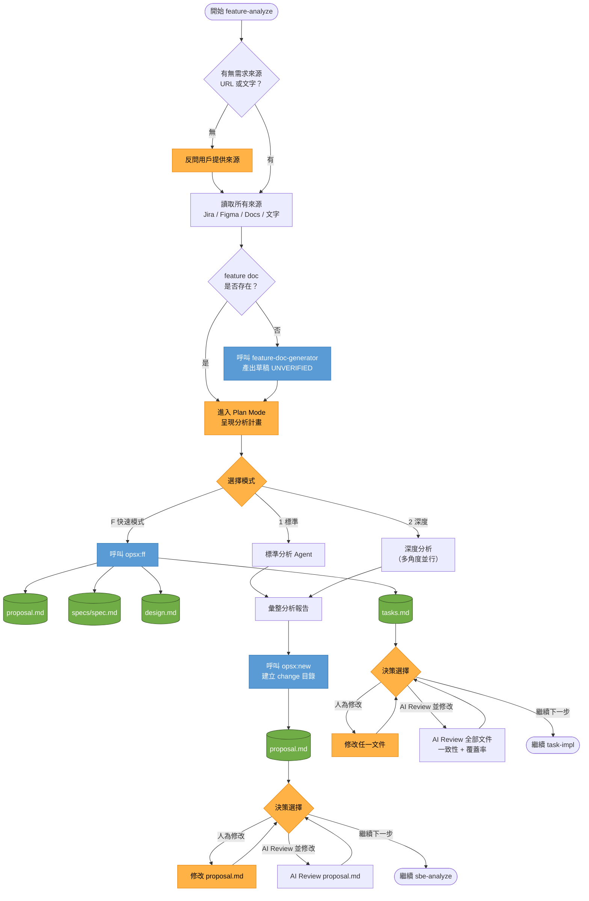

---

### Skill 2 — `sbe-analyze`（SBE 驗收情境分析）

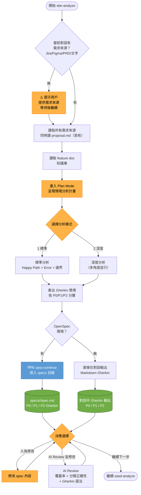

---

### Skill 3 — `sasd-analyze`（SA/SD 系統分析）

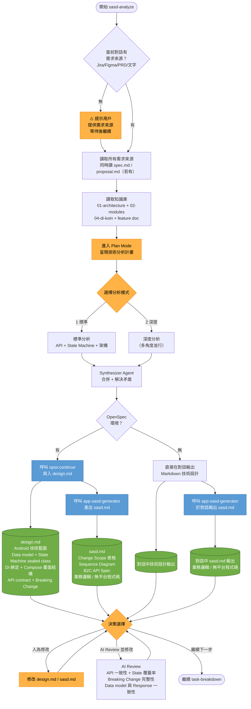

---

### Skill 4 — `task-breakdown`（任務拆分）

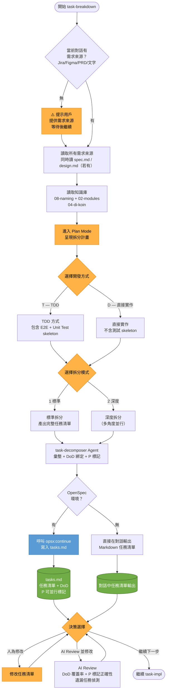

---

### Skill 5 — `task-impl`（DEV 開發實作）

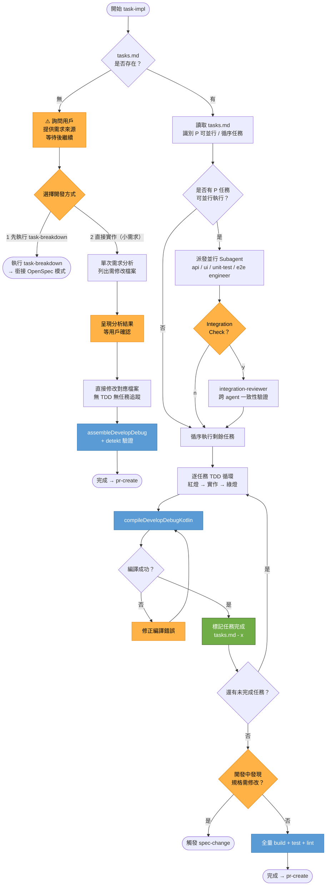

---

### Skill 6 — `spec-change`（規格異動）

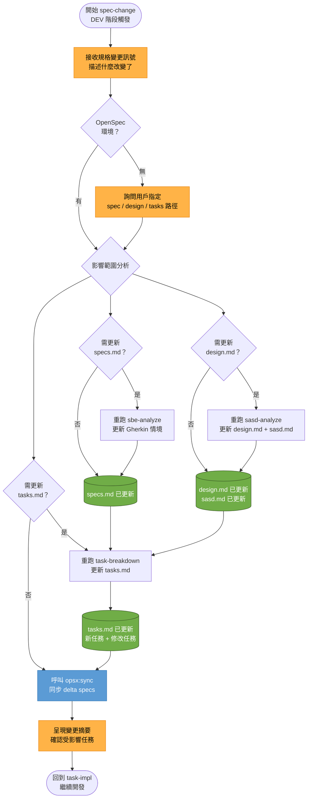

---

### Skill 7 — `auto-dev`（懶人包全自動開發）

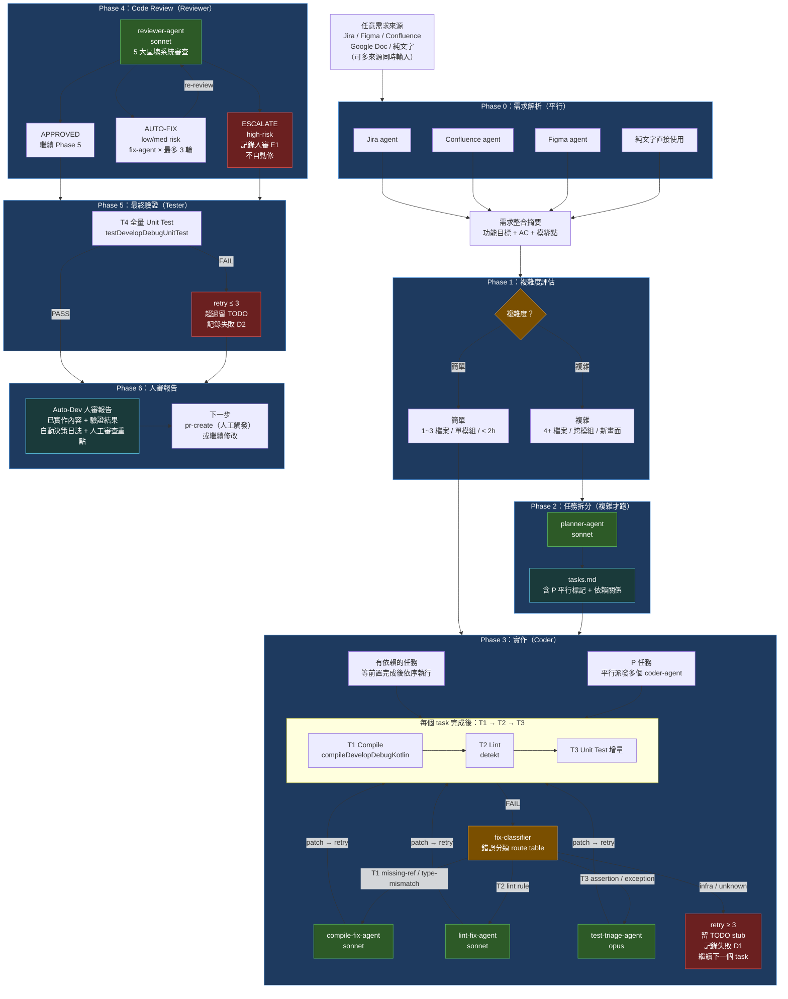

---

### Skill 8 — `issue-fix`（工單修復）

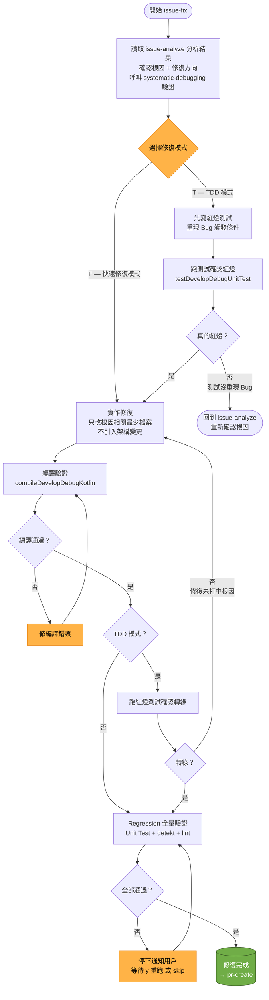
