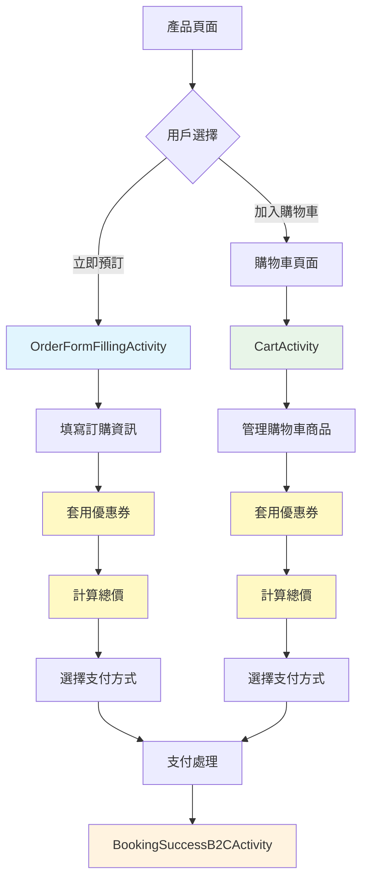
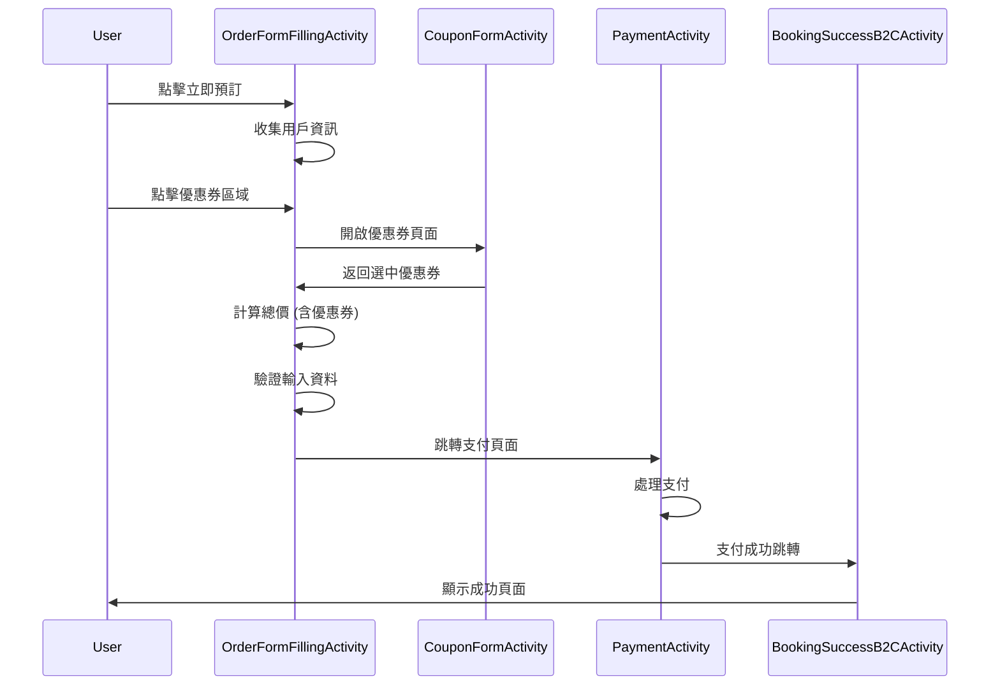
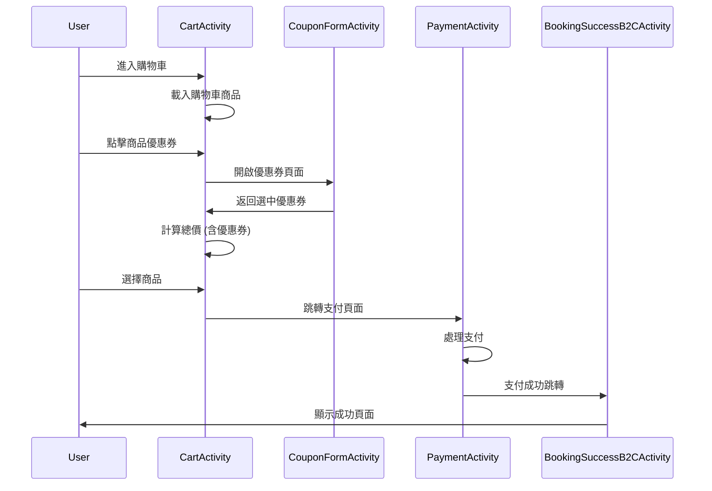
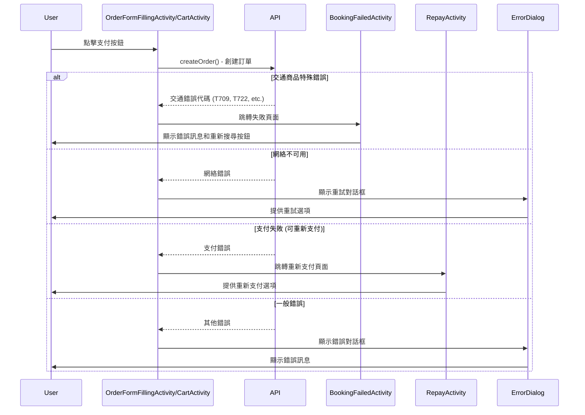
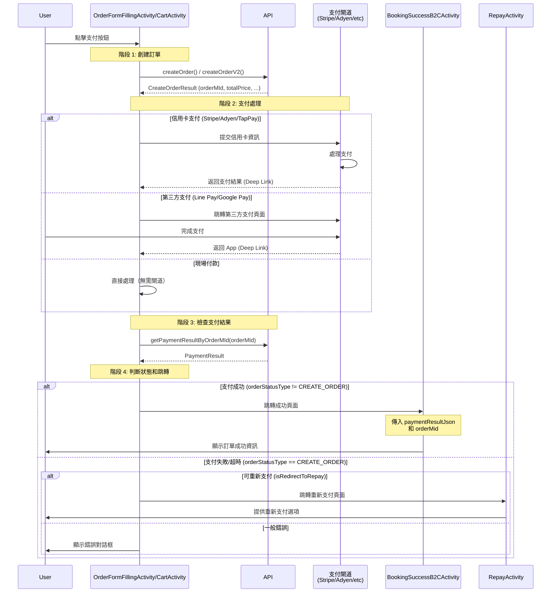
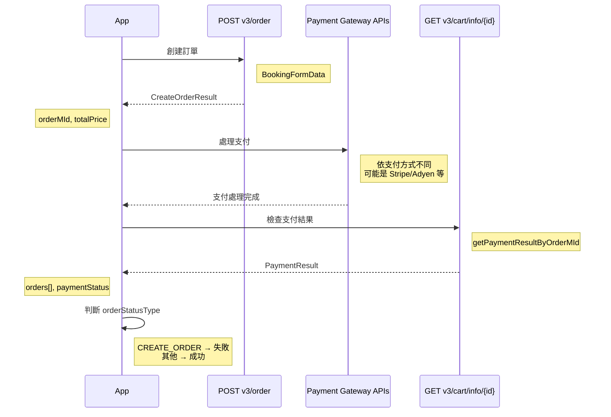
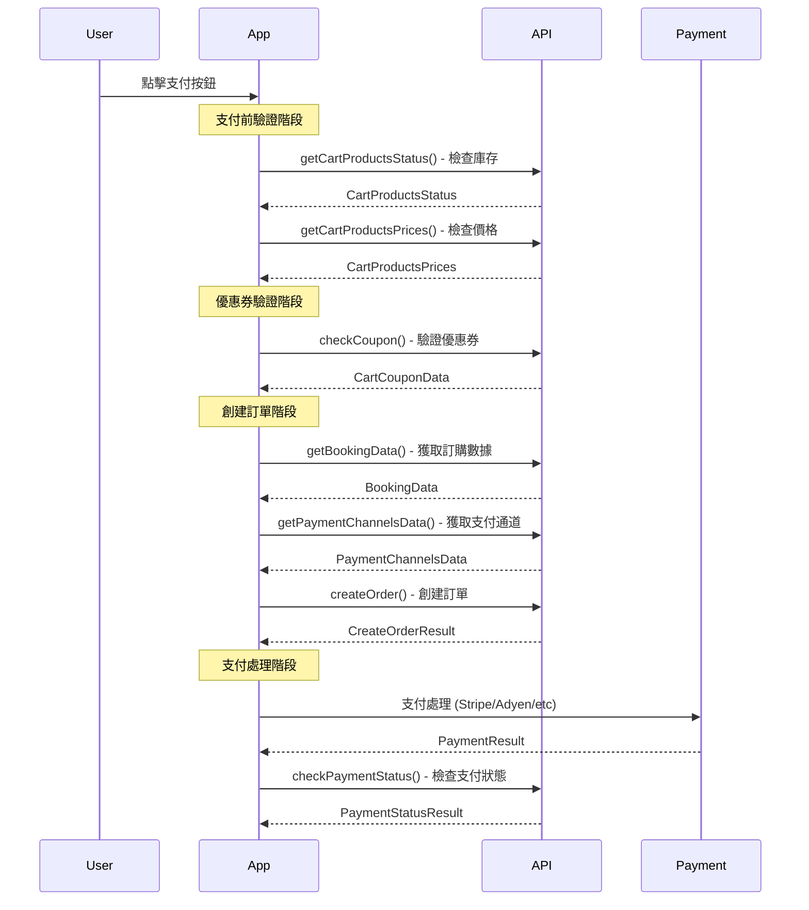
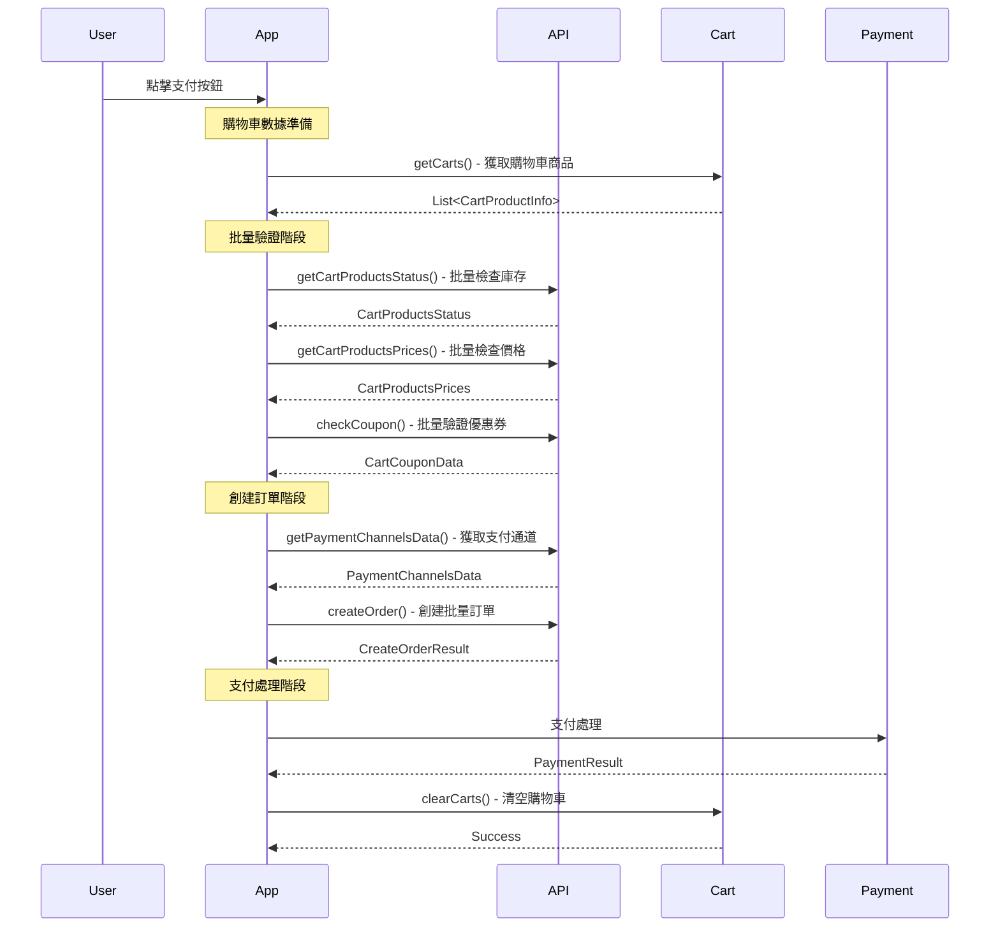
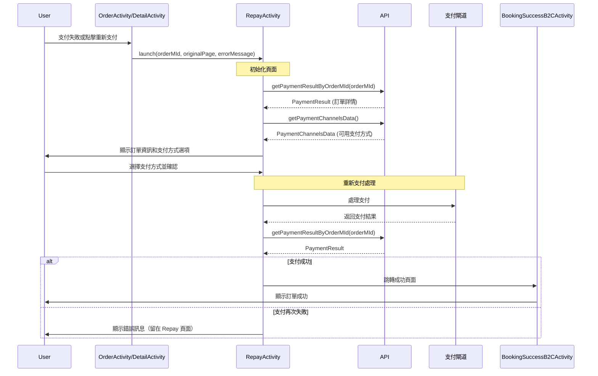

# KKDay Android 訂購流程開發文檔

## 📝 異動記錄

| 日期 | 異動內容 | 編輯者 |
|------|----------|--------|
| 2025/6/6 | 初始文件 | jason |
| 2025/6/6 | 新增 BookingData 介紹、訂購失敗流程 | jason |
| 2025/10/23 | 新增「支付處理到成功頁面的完整流程」章節，詳細說明 getPaymentResultByOrderMId API 使用時機 | AI Agent |
| 2025/10/23 | 新增「RepayActivity 重新支付流程」章節，說明進入 Repay 的各種情境與 API 呼叫 | AI Agent |

## 🎯 文檔目的
本文檔旨在幫助開發者快速理解和進入 KKDay Android 應用的訂購流程開發工作，涵蓋從產品選擇到訂購成功的完整流程。

## 📋 目錄
1. [流程概覽](#流程概覽)
2. [架構設計](#架構設計)
3. [核心組件與關鍵代碼位置](#核心組件與關鍵代碼位置)
4. [詳細流程](#詳細流程)
5. [API 流程和數據模型](#api-流程和數據模型)
6. [TODO](#todo)

## 🔄 流程概覽

### 訂購流程的兩個入口點




## 🏗️ 架構設計

### 狀態管理
- 使用 **Reductor** 進行狀態管理
- **AppState** 作為全局狀態容器
- 購物車數據通過 **CartRepository** 管理

## 🧩 核心組件與關鍵代碼位置

### 1. 立即訂購入口 - OrderFormFillingActivity
**文件位置**: `app/src/main/java/com/kkday/member/view/product/form/OrderFormFillingActivity.kt`

**主要職責**:
- 處理立即預訂流程
- 用戶資訊收集和驗證
- 產品資訊確認
- **優惠券套用和管理**
- **價格計算和顯示**
- 支付流程處理
- 訂單創建和支付

**關鍵方法**:
```kotlin
// 啟動方法
companion object {
    fun launch(
        context: Context,
        productId: String,
        productOid: String,
        packageId: PkgOid,
        itemId: PkgItemOid?,
        startDate: String?,
        isZeroPrice: Boolean = false,
        priorityBookingData: PriorityBookingData? = null,
        allowPayOnSite: Boolean = false,
        isHotel: Boolean = false
    )
}

// 優惠券點擊處理
private fun onCouponClick() {
    bookingAdapter.getBookingUserInfo().let {
        val transBookingData = getOrderSpecificationData()
        val newBookingUserInfo = if (transBookingData == null) {
            it
        } else {
            it.copy(
                _lastName = it.lastName.ifBlank {
                    transBookingData.memberData?.lastName ?: ""
                },
                telInfo = if (it.telInfo?.telCountryCode.isNullOrBlank() || it.telInfo?.number.isNullOrBlank()) {
                    UserTelephoneInfo(
                        telCountryCode = transBookingData.memberData?.telephone?.areaCode,
                        number = transBookingData.memberData?.telephone?.number,
                    )
                } else {
                    it.telInfo
                }
            )
        }
        orderFormFillingPresenter.clickCheckCouponButton(newBookingUserInfo)
        CouponFormActivity.launch(
            this, bookingAdapter.getCouponData().code, launcher = launcher
        )
    }
}

// 初始化操作
private fun initAction() {
    if (getIsHotel()) {
        val orderSpecData = bookingRepository.getOrderSpecificationData()
        viewModel.setOrderSpecData(orderSpecData)
    }
    initDelegate()
    initLauncher()
}

// 獲取支付策略列表
private fun getPaymentStrategyList() {
    val priorityBooking = viewModel.getPriorityBookingOid()?.let {
        PriorityBooking(it, getCurrentProductOid(), getCurrentPackageId())
    }
    viewModel.getPaymentStrategyList(
        activity = this,
        productOids = getCurrentProductOid(),
        scheduleDate = getCurrentStartDate(),
        orderDate = getCurrentOrderDate(),
        transBookingData = viewModel.transBookingData,
        priorityBooking = priorityBooking,
        allowPayOnSite = getAllowPayOnSite(),
        originCartAmount = bookingAdapter.getOrderOriginPrice().toString(),
        cartAmount = bookingAdapter.getOrderPriceWithCouponAndPoints().toString()
    )
}

// 價格計算和更新
private fun updatePaymentSummary() {
    val paymentSummary = bookingAdapter.getPaymentSummary()
    val totalPrice = with(paymentSummary) {
        val rewardPrice = rewardPriceData?.cashReward?.deduct ?: 0.0
        PriceUtils.getDisplayTotalPriceDouble(price, coupon, rewardPrice)
    }
    
    val priceSpanned = currencyDisplayManager.formatPrice(
        totalPrice,
        null,
        false,
        CurrencyUtil.CurrencyType.getCurrency(paymentSummary.price.currency),
        CurrencyDisplayFormat.EXPLICIT,
        CurrencyDisplayStyle.ProdPagePackagePrice18,
        this
    )
    binding.layoutConfirmField.setPriceText(priceSpanned)
}

// 創建訂單數據
private fun getCreateOrderData(): CreateOrderData? {
    val paymentStrategy = bookingAdapter.getPaymentStrategy() ?: return null
    
    val orderData = CreateOrderData(
        bookingAdapter.getBookingUserInfo(),
        invoiceDataList,
        viewModel.isTransNeedSavingUserProfile(bookingAdapter.getIsSavingProfile()),
        paymentStrategy,
        isUsedRewardPoints,
        bookingAdapter.getCreditCard(),
        bookingAdapter.getMemberTermsVerifyData()
    )
    return orderData
}

// 支付按鈕點擊處理
private fun clickPayButton(createOrderData: CreateOrderData) {
    when (val paymentStrategy = createOrderData.paymentStrategy) {
        is StripeCreditCardStrategy -> {
            orderFormFillingPresenter.checkStripeCreditCardBeforePay(
                createOrderData.paymentStrategy as StripeCreditCardStrategy,
                bookingAdapter.getIsUsedRewardPoints(),
                createOrderData
            )
        }
        is GMOStrategy -> {
            orderFormFillingPresenter.checkGMOCreditCardBeforePay(
                createOrderData.paymentStrategy, createOrderData
            )
        }
        is AdyenStrategy -> {
            if (paymentStrategy.adyen.isComponents) {
                showAdyenCreditCardDialog(paymentStrategy, bookingAdapter.getAdyenEnvironment())
            }
        }
        else -> {
            orderFormFillingPresenter.clickPayButton(createOrderData)
        }
    }
}
```

### 2. 購物車入口 - CartActivity
**文件位置**: `app/src/main/java/com/kkday/member/view/cart/CartActivity.kt`

**主要職責**:
- 購物車商品管理
- 批量訂購處理
- **優惠券套用和管理**
- **價格計算和顯示**

**關鍵方法**:
```kotlin
// 支付策略處理 (第 1053 行附近)
when (paymentStrategy) {
    is TappayGooglePayStrategy -> {
        proceedWithTappayGooglePay(createOrderResult, paymentStrategy, couponAllowedCreditCardInfo)
        cartPresenter.startPayment()
    }
    is GooglePayStrategy -> {
        if (paymentStrategy.channelInfo.serviceVersion == ServerPaymentChannelInfo.ServiceVersion.V2) {
            GooglePayLauncherActivity.launch(this, createOrderResult, ...)
        } else {
            proceedWithGooglePay(createOrderResult, paymentStrategy)
        }
        cartPresenter.startPayment()
    }
}

// 購物車商品操作
private fun onClickDeleteCouponButton(cartProductId: String) {
    cartPresenter.clickDeleteCouponButton(cartProductId)
}

private fun onClickCouponButton(couponCode: String, cartProductId: String) {
    CouponFormActivity.launch(this, couponCode, cartProductId, launcher)
}

private fun onClickDeleteProductButton(cartProductId: String) {
    cleanCartDialog.showDialog()
    removeCartProductId = cartProductId
}

// 價格計算
private fun updatePriceView(languageType: LanguageType, cartProducts: List<CartProductInfo>, currency: String) {
    val checkedProducts = cartProducts.filter(CartProductInfo::isChecked)
    val totalPrice = checkedProducts.sumOfDoubleByBigDecimal {
        if (it.orderSpecificationData.bundlePkgOid == null) {
            calculateTotalOrderPrice(it.orderSpecificationData, it.coupon)
        } else {
            calculateTotalOrderPrice(it.totalPrice, it.coupon)
        }
    }
}
```

### 3. 訂購成功頁面 - BookingSuccessB2CActivity
**文件位置**: `libs/feature/order_page/src/main/java/com/kkday/order_page/presentation/view/BookingSuccessB2CActivity.kt`

**主要職責**:
- 展示訂購成功資訊
- 處理支付結果數據
- 提供後續操作選項
- 訂單詳情查看

**繼承關係**: `BookingSuccessB2CActivity extends BaseActivity`

```kotlin
@Router(KRouterConst.PAGE_BOOKING_SUCCESS)
class BookingSuccessB2CActivity: BaseActivity<ActivityBookingSuccessComposeBinding>(
    ActivityBookingSuccessComposeBinding::inflate
) {
    @RouterParam(KRouterConst.KEY_BOOKING_SUCCESS_PAYMENT_RESULT)
    var paymentResultJson: String? = null

    @RouterParam(KRouterConst.KEY_ORDER_MASTER_ID)
    var orderMid: String? = null

    @RouterParam(KRouterConst.KEY_HAS_PRODUCT_BUNDLES_IDS)
    var productBundlesIds: List<String>? = null

    fun getPaymentResult(): PaymentResult = Gson().fromJsonOrElse(
        paymentResultJson ?: "",
        PaymentResult::class.java,
        PaymentResult.defaultInstance
    )
}
```

### 4. 購物車狀態管理 - CartReducer
**文件**: `app/src/main/java/com/kkday/member/reducer/cart/CartReducer.kt`

```kotlin
// 購物車數據管理
@AutoReducer.Action(value = CartActions.CLICK_PAY_BUTTON, from = CartActions::class)
fun clickPayButton(state: AppState, data: CreateOrderData): Pair<AppState, Commands<AppState>> {
    val updatedCartProducts = getCartProducts().map { cartProductInfo ->
        if (cartProductInfo.isAvailableAndChecked) {
            // 更新發票資訊
            cartProductInfo.copy(invoiceInfo = invoiceInfo)
        } else {
            cartProductInfo
        }
    }
    cartRepository.setCartsAsync(updatedCartProducts)
}

// 優惠券處理
@AutoReducer.Action(value = CartActions.CLICK_DELETE_COUPON_BUTTON, from = CartActions::class)
fun clickDeleteCouponButton(state: AppState, cartProductId: String): Pair<AppState, Commands<AppState>> {
    val updatedCartProducts = getCartProducts().getUpdatedCartProducts(state.applicationContext(), res.data, installmentAmount)
    cartRepository.setCartsAsync(updatedCartProducts)
}
```

### 5. 支付輔助類 - PaymentHelper
**文件**: `app/src/main/java/com/kkday/member/view/product/form/helper/PaymentHelper.kt`

```kotlin
// Stripe 支付參數生成
fun generateCardSourceParams(
    card: CardParams,
    createOrderResult: CreateOrderResult,
    paymentStrategy: PaymentStrategy,
    // ... 其他參數
): SourceParams = SourceParams.createCustomParams(CARD).apply {
    amount = getPriceAmountForStripeFormat(createOrderResult.totalPrice, createOrderResult.currency)
    currency = createOrderResult.currency
    token = stripeTokenId
    metadata = generateStripeSourceMetadata(...)
}

// 優惠券數據更新
fun getUpdatedCouponData(
    context: Context,
    coupon: CouponData,
    cartProductInfo: CartProductInfo,
    installmentAmount: Double?
): CouponData
```

### 6. 狀態管理 - Reductor Actions
**文件**: `app/src/main/java/com/kkday/member/reducer/cart/CartActions.kt`

```kotlin
@ActionCreator
interface CartActions {
    // 購物車操作
    fun clickPayButton(data: CreateOrderData): Action
    fun clickDeleteCouponButton(cartProductId: String): Action
    fun calculateTotalPayPrice(data: CreateOrderData): Action
    
    // 支付相關
    fun getPaymentStrategyList(...): Action
    fun createStripeCreditCardSource(...): Action
}
```

### 7. Repository 層數據管理
```kotlin
// CartRepository - 購物車數據獨立管理
cartRepository.getCarts()                    // 獲取購物車商品
cartRepository.setCartsAsync(cartProducts)   // 異步更新購物車
cartRepository.addToCart(product)            // 添加商品到購物車
cartRepository.removeFromCart(productId)     // 從購物車移除商品

// 狀態更新 - 使用 Reductor
store.dispatch(cartActions.clickPayButton(createOrderData))
store.dispatch(cartActions.clickDeleteCouponButton(cartProductId))
```

## 📊 詳細流程

### 階段一：產品選擇與規格確認
1. **產品頁面瀏覽**
   - 用戶在產品頁面查看產品詳情
   - 選擇日期、數量等規格
   - 決定立即預訂或加入購物車

2. **規格驗證**
   - 檢查庫存狀態
   - 驗證選擇的日期和數量
   - 計算初始價格

### 階段二：訂購資訊填寫
1. **用戶資訊收集**
   - 聯絡人資訊（姓名、電話、郵箱）
   - 旅客資訊（根據產品類型）
   - 特殊需求備註

2. **產品確認**
   - 再次確認產品規格
   - 顯示最終價格
   - 檢查可用性

3. **優惠券處理**
   - 點擊優惠券區域開啟 `CouponFormActivity`
   - 顯示可用和不可用優惠券列表
   - 套用選中的優惠券
   - 即時計算折扣金額

4. **價格計算**
   - 原始商品價格計算
   - 套用優惠券折扣
   - 扣除 KK Points（如果使用）
   - 顯示最終應付金額

### 階段三：支付處理
1. **支付方式選擇**
   - 信用卡支付（Stripe、Adyen、TapPay、GMO）
   - 第三方支付（Google Pay、Apple Pay、Line Pay、JKO Pay 等）
   - 現場付款（部分產品）

2. **支付執行**
   - 創建訂單（呼叫 `createOrder` 或 `createOrderV2` API）
   - 根據支付方式處理支付
   - 驗證支付結果

3. **支付狀態檢查**
   - **呼叫 API**: `GET v3/cart/info/{order_master_mid}` (`getPaymentResultByOrderMId`)
   - **檢查時機**: 支付完成後返回 App
   - **檢查內容**: 訂單狀態、支付狀態、訂單詳情
   - **狀態判斷**:
     - `orderStatusType != CREATE_ORDER` → 支付成功，跳轉成功頁面
     - `orderStatusType == CREATE_ORDER` → 支付處理中或失敗，顯示錯誤或跳轉 Repay

### 階段四：訂購完成
1. **成功頁面展示**
   - 接收 `PaymentResult` JSON 和 `orderMasterMid`
   - 顯示訂單資訊和確認狀態
   - 提供訂單管理選項（查看訂單、下載憑證等）
   - 顯示相關推薦商品

### 立即訂購流程


### 購物車訂購流程


### 訂購失敗流程


#### 訂購失敗的主要類型

**1. 網絡連接問題**
   - **錯誤類型**: 網絡不可用、超時
   - **處理方式**: 顯示重試對話框
   - **用戶體驗**: 提供立即重試選項

**2. 支付相關錯誤** / **交通商品特殊錯誤**
   - **錯誤代碼**: `PAYMENT0001-0004`、信用卡驗證失敗、`T709` (庫存不足)、`T722` (價格異常)、`T721` (內部錯誤)
   - **處理方式**: 跳轉到 `RepayActivity`
   - **用戶體驗**: 保留訂單，允許重新支付

**3. 業務邏輯錯誤**
   - **錯誤代碼**: `P001` (產品不存在)、`CN03` (優惠券不可用)、`CR01` (積分無效)
   - **處理方式**: 顯示錯誤對話框
   - **用戶體驗**: 提示用戶修正後重試

#### 錯誤處理的關鍵邏輯
```kotlin
// 在 OrderFormFillingActivity.showPaymentErrorMessage() 中
when {
    !isNetworkAvailable -> {
        // 網絡錯誤 - 顯示重試對話框
        paymentRetryDialog.showDialog()
    }

   message in Response.Metadata.TRANS_ERROR_LIST || isRedirectToRepay && !getIsZeroPrice() -> {
      // 交通商品錯誤, 支付錯誤 - 跳轉重新支付頁面
        RepayActivity.launch(this, createOrderResult.orderMId, PAGE_TYPE_INSTANT, message)
        finish()
    }
    
    else -> {
        // 一般錯誤 - 顯示錯誤對話框
        showPaymentErrorDialog(message, ::onPaymentDialogClickListener)
    }
}
```

## 🌐 API 流程和數據模型

### 1. 核心 API 端點

#### 獲取訂購數據
```kotlin
// API: GET /v2/booking_data
@GET("v2/booking_data")
fun getBookingData(
    @Query("product_mid") productId: String?,
    @Query("product_oid") productOid: String?,
    @Query("pkg_id") packageId: String?,
    @Query("item_id") itemId: String?,
    @Query("go_date") scheduleDate: String?,
    @Query("currency") currency: String?,
    @Query("lang") lang: String?,
    @Query("locale") countryCode: String?
): Observable<Response<BookingData>>
```

#### 優惠券相關 API
```kotlin
// API: GET /v2/member/coupons - 獲取會員優惠券列表
@GET("v2/member/coupons")
suspend fun getMemberCoupons(
    @Query("currency") currency: String?,
    @Query("timezone") timezone: String?
): B2CApiResponse<PersonalCouponListInfo>

// API: POST /v2/check_cart_coupon - 驗證優惠券
@POST("v2/check_cart_coupon")
fun checkCoupon(
    @Body validateCouponInfo: ValidateCouponInfo?
): Observable<Response<CartCouponData>>

// API: POST /v2/coupons/{coupon}/claim - 領取優惠券
@POST("v2/coupons/{coupon}/claim")
suspend fun acquireCoupon(
    @Path("coupon") coupon: String?,
    @Query("contact_email") email: String?,
    @Query("phone_no") phoneNumber: String?,
    @Query("phone_country_code") phoneCountryCode: String?
): B2CApiResponse<Any>
```

#### 價格和庫存檢查 API
```kotlin
// API: POST /v2/cart/products/prices - 獲取購物車商品價格
@POST("v2/cart/products/prices")
fun getCartProductsPrices(
    @Body cartProductsInfo: CartProductsInfo
): Observable<Response<CartProductsPrices>>

// API: POST /v2/cart/products/status - 檢查商品狀態和庫存
@POST("v2/cart/products/status")
fun getCartProductsStatus(
    @Body cartProductsInfo: CartProductsInfo
): Observable<Response<CartProductsStatus>>
```

#### 獲取支付通道
```kotlin
// API: POST /v2.2/payment/booking/channels
@POST("v2.2/payment/booking/channels")
suspend fun getPaymentChannelsData(
    @Body requestPaymentChannelsData: RequestPaymentChannelsData
): B2CApiResponse<PaymentChannelsData>
```

#### 創建訂單
```kotlin
// API: POST /v3/order (一般商品)
@POST("v3/order")
fun createOrder(
    @Body bookingFormInfo: BookingFormData?
): Observable<Response<CreateOrderResultData>>

// API: POST /v2.1/order (交通商品)
@POST("v2.1/order")
fun createOrderV2(
    @Body bookingFormInfo: BookingFormData?
): Observable<Response<CreateOrderResultData>>
```

#### 支付處理相關 API
```kotlin
// Stripe 支付授權
@POST("v2/payment/stripe/auth")
fun createStripeAuth(
    @Body stripePaymentAuth: StripePaymentAuth?
): Observable<Response<PaymentResult>>

// Stripe V2 支付
@POST("v2.1/payment/stripe/payment")
fun createStripeV2Payment(
    @Body stripeV2Data: TransactionData?
): Observable<Response<TransactionResultData>>

// Stripe V2 確認支付
@POST("v2.1/payment/stripe/confirm")
fun confirmStripeV2Payment(
    @Body stripeV2ConfirmData: TransactionConfirmData?
): Observable<Response<PaymentResult>>

// 支付狀態檢查（簡易版，僅返回支付狀態）
@GET("v2/cart/payment/check/{order_master_mid}")
suspend fun checkPaymentStatus(
    @Path("order_master_mid") orderMasterMid: String
): B2CApiResponse<CheckPaymentStatusResult>

// 取得訂單完整支付結果（★ 主要使用的 API）
@GET("v3/cart/info/{order_master_mid}")
suspend fun <T> getPaymentResultByOrderMId(
    @Path("order_master_mid") orderMasterMid: String,
    @Query("locale") locale: String,
    @Query("lang") lang: String
): B2CApiResponse<T>  // 回傳 PaymentResult
```

**API 說明：**
- `checkPaymentStatus`: 輕量級檢查，僅返回支付狀態和期限
- `getPaymentResultByOrderMId`: 完整的支付結果，包含所有訂單詳情、追蹤資訊等，**是支付完成後主要使用的 API**

### 2. 核心數據模型

#### BookingData - 訂購基礎數據
```kotlin
@Parcelize
data class BookingData(
    @SerializedName("member") val userInfo: BookingUserInfo?,           // 會員資訊
    @SerializedName("product") val productInfo: BookingProductInfo?,    // 產品資訊
    @SerializedName("info") val bookingInfo: BookingInfo?,              // 訂購需求資訊
    @SerializedName("general") val generalInfo: GeneralInfo?,           // 一般資訊
    @SerializedName("allow_pay_on_site") val allowPayOnSite: Boolean?   // 是否允許現場付款
): Parcelable, IVerifiable {
    
    override fun isValid(): Boolean = (userInfo != null && bookingInfo != null)
    
    companion object {
        @JvmField
        val defaultInstance = BookingData(null, null, null, null, null)
    }
}
```

**主要用途：**
- **初始化訂購頁面** - 提供產品的訂購需求和預設資訊
- **用戶資訊預填** - 包含會員的基本資料和偏好設定
- **產品規格確認** - 確認產品的訂購規則和限制
- **支付方式限制** - 決定是否支援現場付款等選項

**包含的子結構：**
- `BookingUserInfo` - 會員基本資料（姓名、電話、郵箱等）
- `BookingProductInfo` - 產品相關資訊（日期類型、標題等）
- `BookingInfo` - 詳細的訂購需求（旅客、航班、接送等資訊）
- `GeneralInfo` - 積分說明等一般資訊

#### CreateOrderData - 創建訂單請求數據
```kotlin
data class CreateOrderData(
    val bookingUserInfo: BookingUserInfo,           // 用戶資訊
    val invoiceDataList: List<InvoiceDataViewInfo>, // 發票資訊列表
    val isSavingUserInfo: Boolean,                  // 是否保存用戶資訊
    val paymentStrategy: PaymentStrategy,           // 支付策略
    val isUsedRewardPoints: Boolean,                // 是否使用積分
    val creditCard: CreditCard,                     // 信用卡資訊
    val memberTermsVerifyData: MemberTermsVerifyData // 會員條款驗證
)
```

**主要用途：**
- **訂單創建準備** - 整合所有必要的訂購資訊準備創建訂單
- **支付策略確認** - 包含選定的支付方式和相關參數
- **用戶偏好設定** - 記錄用戶的保存偏好和積分使用選擇
- **合規性驗證** - 確保發票資訊和會員條款的完整性

**包含的子結構：**
- `BookingUserInfo` - 完整的用戶訂購資訊
- `InvoiceDataViewInfo` - 發票開立相關資訊
- `PaymentStrategy` - 具體的支付策略實現
- `CreditCard` - 信用卡資訊（如適用）
- `MemberTermsVerifyData` - 會員條款驗證狀態

#### BookingFormData - 訂購表單數據
```kotlin
data class BookingFormData(
    @SerializedName("lang") val lang: String,                           // 語言
    @SerializedName("locale") val locale: String?,                      // 地區
    @SerializedName("contact_firstname") val firstName: String,         // 聯絡人姓名
    @SerializedName("contact_lastname") val lastName: String,           // 聯絡人姓氏
    @SerializedName("contact_email") val email: String,                 // 聯絡人信箱
    @SerializedName("contact_country_cd") val countryCode: String,      // 國家代碼
    @SerializedName("contact_tel") val telNumber: String,               // 電話號碼
    @SerializedName("tel_country_cd") val telCountryCode: String,       // 電話國家代碼
    @SerializedName("pmch_oid") val pmchId: String,                     // 支付通道 ID
    @SerializedName("pmch_code") val pmchCode: String,                  // 支付通道代碼
    @SerializedName("pay_method") val payMethod: String,                // 支付方式
    @SerializedName("currency") val currency: String,                   // 幣別
    @SerializedName("pay_currency") val payCurrency: String,            // 支付幣別
    @SerializedName("card_no") val cardNumber: String?,                 // 信用卡號
    @SerializedName("products") val products: List<ProductBookingFormData>, // 商品列表
    @SerializedName("cart_price_total") val priceTotal: Double,         // 總價
    @SerializedName("payment_rule") val paymentRule: PaymentRule,       // 支付規則
    @SerializedName("allow_repay") val allowRepay: Boolean?             // 是否允許重新支付
)
```

**主要用途：**
- **API 請求格式化** - 將前端收集的資料轉換為後端 API 所需格式
- **訂單提交** - 作為 createOrder API 的請求 body
- **支付資訊整合** - 包含完整的支付通道和方式資訊
- **多語言支援** - 處理不同地區和語言的訂購需求

**包含的子結構：**
- `ProductBookingFormData` - 商品詳細訂購資訊列表
- `PaymentRule` - 支付規則和限制
- 聯絡人資訊欄位 - 姓名、電話、郵箱等
- 支付相關欄位 - 通道、方式、幣別等

#### CreateOrderResult - 創建訂單回應
```kotlin
data class CreateOrderResult(
    @SerializedName("order_master_mid") val orderMId: String,           // 訂單主 ID
    @SerializedName("currency") val currency: String,                   // 幣別
    @SerializedName("pay_deadline") val payDeadline: String,            // 支付期限
    @SerializedName("price_total") val totalPrice: Double,              // 總價
    @SerializedName("cart_info") val cartOrders: List<CartOrderInfo>?,  // 購物車訂單資訊
    @SerializedName("overwrite_affiliate_cid") val overwriteCid: String? // 覆寫聯盟 CID
)
```

**主要用途：**
- **訂單確認** - 提供創建成功的訂單基本資訊
- **支付流程啟動** - 包含支付所需的訂單 ID 和金額
- **時效性管理** - 提供支付期限確保及時完成交易
- **追蹤和分析** - 支援聯盟行銷和數據分析需求

**包含的子結構：**
- `CartOrderInfo` - 購物車模式下的訂單詳細資訊
- 基本訂單資訊 - ID、幣別、總價、期限
- 追蹤相關欄位 - 聯盟 CID 等

#### TransactionData - 交易數據
```kotlin
data class TransactionData(
    @SerializedName("pmch_oid") val pmchOid: String,                    // 支付通道 ID
    @SerializedName("order_master_mid") val orderMId: String,           // 訂單主 ID
    @SerializedName("product_mids") val productIds: List<String>,       // 商品 ID 列表
    @SerializedName("product_oids") val productOIds: List<String>,      // 商品 OID 列表
    @SerializedName("go_dates") val scheduleDates: List<String>?,       // 出發日期列表
    @SerializedName("currency") val currency: String,                   // 幣別
    @SerializedName("pay_currency") val payCurrency: String,            // 支付幣別
    @SerializedName("amount") val amount: Double,                       // 金額
    @SerializedName("booking_type") val bookingType: String,            // 訂購類型 (INSTANT/CART/REPAY)
    @SerializedName("locale") val locale: String,                       // 地區
    @SerializedName("lang") val lang: String,                           // 語言
    @SerializedName("is_hrp") val isHighRiskProduct: String,            // 是否高風險商品 (Y/N)
    @SerializedName("payment_group_id") val paymentGroupId: Int?,       // 支付群組 ID
    @SerializedName("priority_booking") val priorityBooking: PriorityBooking?, // 優先訂購
    @SerializedName("group_data") val groupDataList: List<PaymentGroupData?>?, // 群組數據列表
    @SerializedName("credit_card_info") val creditCardInfo: CreditCardInfo? // 信用卡資訊
)
```

**主要用途：**
- **支付處理** - 提供支付服務商所需的完整交易資訊
- **風險控制** - 包含高風險商品標識和相關控制參數
- **多幣別支援** - 處理不同幣別間的匯率和支付
- **群組訂單管理** - 支援組合商品和批量訂購的特殊需求

**包含的子結構：**
- `PriorityBooking` - 優先訂購相關資訊
- `PaymentGroupData` - 群組支付數據列表
- `CreditCardInfo` - 信用卡詳細資訊
- 商品識別欄位 - ID、OID、日期等
- 支付控制欄位 - 通道、金額、風險等級等

#### PaymentResult - 支付結果
```kotlin
data class PaymentResult(
    @SerializedName("points_reward_qty_total") val point: Int,          // KK Points 獎勵總數
    @SerializedName("orders") val orders: List<SummaryData>,            // 訂單結果列表
    @SerializedName("error") val error: PaymentError?,                  // 支付錯誤資訊
    @SerializedName("is_online_payment") val isOnlinePayment: Boolean   // 是否為線上支付
): Parcelable {
    companion object {
        val defaultInstance = PaymentResult(0, listOf(), null, true)
    }
}
```

**主要用途：**
- **支付狀態確認** - 提供最終的支付處理結果
- **訂單詳情列表** - 包含所有相關訂單的完整資訊（透過 `SummaryData`）
- **頁面跳轉控制** - 決定成功或失敗後的頁面導向
- **錯誤處理** - 提供具體的錯誤資訊供用戶介面顯示

**包含的子結構：**
- `SummaryData` - 個別訂單的詳細資訊（訂單狀態、商品資訊、價格、行程日期等）
- `PaymentError` - 支付錯誤詳細資訊
- 輔助方法：
  - `hasTransportationProducts()` - 檢查是否包含交通類商品
  - `isZeroPricePayment()` - 檢查是否為零元訂單

## 🔄 支付處理到成功頁面的完整流程

### 流程總覽
從支付處理到 `BookingSuccessB2CActivity` 的完整流程包含以下階段：
1. **創建訂單** (`createOrder` API)
2. **支付處理** (依支付方式而異)
3. **返回 App** (透過 Deep Link 或直接返回)
4. **檢查支付結果** (`getPaymentResultByOrderMId` API)
5. **跳轉成功頁面** (`BookingSuccessB2CActivity`)

### 詳細流程圖

#### 1. 完整支付流程（含所有支付方式）


#### 2. 關鍵 API 呼叫順序


### 各支付方式的返回處理流程

> 💡 **API 詳細規格請參考**：[payment_api_spec.md](./payment_api_spec.md)

所有支付方式的共同流程：
1. 創建訂單後，處理支付
2. 如需驗證（3D Secure），跳轉到支付閘道驗證頁面
3. 驗證完成後，透過 **Deep Link** 返回 App
4. App 接收 Deep Link 並呼叫 `getPaymentResultByOrderMId` 檢查最終狀態

#### Deep Link 返回處理實作

```kotlin
// 在 OrderFormFillingActivity / CartActivity / RepayActivity 中
override fun handleReturnFromPayment() {
    when (intent.data?.host) {
        // 信用卡支付
        STRIPE_RETURN_HOST -> returnFromStripe()
        ADYEN_RETURN_HOST -> returnFromAdyenThreeDSecureWebView()
        TAPPAY_RETURN_HOST -> returnFromTappayThreeDSecureWebView()
        GMO_RETURN_HOST -> returnFromGMO()
        
        // 第三方支付
        LINE_PAY_RETURN_HOST -> returnFromThirdPartyPayment(intent.data?.host!!)
        JKO_PAY_RETURN_HOST -> returnFromThirdPartyPayment(intent.data?.host!!)
        PAY_PAY_RETURN_HOST -> returnFromThirdPartyPayment(intent.data?.host!!)
        
        // 其他支付方式
        ONEPAY_RETURN_HOST -> returnFromOnePay()
        PAY_DOLLAR_RETURN_HOST -> returnFromPayDollar()
        TOSS_PAY_RETURN_HOST -> returnFromTossPay()
        ATOME_PAY_RETURN_HOST -> returnFromAtomePay()
        PAY_ME_RETURN_HOST -> returnFromPayMe()
        KCP_RETURN_HOST -> returnFromKCP()
        TWOCTWOP_RETURN_HOST -> returnFrom2C2P()
        
        // Payment V3 通用
        PAYMENT_V3_RETURN_HOST -> returnFromPaymentV3(true)
    }
}

// 所有 return 方法最終都會呼叫
private fun checkPaymentResult(orderMasterMid: String) {
    // 呼叫 getPaymentResultByOrderMId API 檢查支付結果
    presenter.getPaymentResultByOrderMId(orderMasterMid)
}
```

#### Deep Link Scheme 說明

| 支付方式 | Deep Link Host | 備註 |
|---------|---------------|------|
| **Stripe** | `stripe_return` | 立即訂購<br/>`cart/stripe_return` 購物車<br/>`repay/stripe_return` 重新支付 |
| **Adyen** | `adyen_return` | 同上，區分三種來源 |
| **TapPay** | `tappay_return` | 同上，區分三種來源 |
| **Line Pay** | `linepay_return` | 同上 |
| **Google Pay** | 透過 Activity Result | 不使用 Deep Link |
| **Payment V3** | `payment_v3_return` | 通用支付流程 V3 |

**Deep Link 格式範例**：
- 立即訂購：`kkday://instant/stripe_return`
- 購物車：`kkday://cart/stripe_return`
- 重新支付：`kkday://repay/stripe_return`

### 跳轉到 BookingSuccessB2CActivity 的邏輯

#### 在 OrderFormFillingActivity 中
```kotlin
override fun updatePaymentResult(
    paymentResult: PaymentResult,
    createOrderResult: CreateOrderResult,
) {
    // 檢查訂單狀態
    val isCreateOrderStatus =
        paymentResult.orders.firstOrNull()?.orderStatusType == ORDER_STATUS_TYPE_CREATE_ORDER

    // 只有非 CREATE_ORDER 狀態才跳轉成功頁面
    if (paymentResult.orders.isNotEmpty() && !isCreateOrderStatus) {
        val paymentResultJson = Gson().toJson(paymentResult)
        goToBookingSuccessPage(
            paymentResultJson,
            createOrderResult.orderMId,
            isOldBookingPage = paymentResult.orders.firstOrNull()?.isAirport ?: false
        )
        orderFormFillingPresenter.bookingSuccessViewReady()
        if (!paymentResult.hasTransportationProducts()) {
            orderFormFillingPresenter.clearBookingState()
        }
    }
}

protected fun goToBookingSuccessPage(
    paymentResultJson: String,
    orderMId: String,
    isOldBookingPage: Boolean = false,
    hasProductBundlesId: List<String>? = null
) {
    if (isOldBookingPage) {
        // 舊版成功頁面（機場接送等）
        OldBookingSuccessActivity.launch(this, transportationType, airportViewInfo)
    } else {
        // 新版成功頁面
        RouterHelper.dispatch(KRouterConst.PAGE_BOOKING_SUCCESS)
            .withParam(KRouterConst.KEY_BOOKING_SUCCESS_PAYMENT_RESULT, paymentResultJson)
            .withParam(KRouterConst.KEY_ORDER_MASTER_ID, orderMId)
            .withParamIf(
                key = KRouterConst.KEY_HAS_PRODUCT_BUNDLES_IDS,
                value = hasProductBundlesId,
                needAdd = hasProductBundlesId != null
            )
            .navigator(this)
    }
    finish()
}
```

#### 在 CartActivity 中
```kotlin
override fun updatePaymentResult(
    paymentResult: PaymentResult,
    createOrderResult: CreateOrderResult
) {
    val isCreateOrderStatus =
        paymentResult.orders.firstOrNull()?.orderStatusType == ORDER_STATUS_TYPE_CREATE_ORDER

    if (paymentResult.orders.isNotEmpty() && !isCreateOrderStatus) {
        val paymentResultJson = Gson().toJson(paymentResult)
        goToBookingSuccessPage(
            paymentResultJson,
            createOrderResult.orderMId,
            hasProductBundlesId = viewModel.storeIsProductBundle()
        )
        cartPresenter.bookingSuccessViewReady(PAGE_TYPE_CART)
        if (!paymentResult.hasTransportationProducts()) {
            cartPresenter.clearBookingState()
        }
        cartPresenter.updateCartProducts()  // 清空已訂購的商品
    }
}
```

### PaymentResult 數據結構

#### 成功的 PaymentResult 範例
```kotlin
PaymentResult(
    point = 100,  // 獲得 100 KK Points
    orders = listOf(
        SummaryData(
            orderId = "ORD123456",
            orderMasterMId = "MASTER123",
            orderStatusType = 1,  // 1 (GO) 表示訂單確認，非 0 (CREATE_ORDER) 表示成功
            productId = "12345",
            productName = "台北 101 觀景台門票",
            orderTotalPrice = "$100.00",
            paidCurrencyPrice = "$95.00",  // 實付金額（扣除優惠券後）
            couponPrice = "$5.00",
            processStatus = "CONFIRMED",
            hasVoucher = true,
            // ... 其他欄位
        )
    ),
    error = null,
    isOnlinePayment = true
)
```

#### 失敗/處理中的 PaymentResult 範例
```kotlin
PaymentResult(
    point = 0,
    orders = listOf(
        SummaryData(
            orderId = "ORD123456",
            orderMasterMId = "MASTER123",
            orderStatusType = 0,  // 0 (CREATE_ORDER) 表示訂單剛創建，支付未完成
            processStatus = "PENDING",
            // ... 其他欄位
        )
    ),
    error = PaymentError(
        code = "TIMEOUT",
        message = "Payment timeout"
    ),
    isOnlinePayment = true
)
```

**重要欄位說明：**
- `orderStatusType`: 
  - `0` = `CREATE_ORDER` - 訂單已創建但支付未完成
  - `1` = `GO` - 訂單已確認
  - `2` = `BACK` - 訂單已完成
  - `3` = `CX` - 訂單已取消
- `processStatus`: 訂單處理狀態（如 "CONFIRMED", "PENDING", "CANCELLED"）
- `hasVoucher`: 是否有電子憑證可下載

### 3. clickPayButton 到 createOrder 的重要流程

從用戶點擊支付按鈕到實際創建訂單之間，系統會執行以下重要檢查和處理：

#### 1. 支付前驗證檢查
```kotlin
// 在 OrderFormFillingViewModel.confirmClick() 中
if (orderSpecificationData != null && needCheck && lastOriginPrice != null && lastOriginPrice!! > 0) {
    // 二次價格校驗，確認是否已經全部售罄
    val isSoldOut = checkProductSoldOutOrNot(orderSpecificationData!!)
    if (isSoldOut) {
        _commonProductSharedFlow.emit(CommonProductUiState.CommonProductUiSoldOut)
        return@launch
    }
    // 二次價格校驗，確認價格是否變動
    checkCommonProductPrice(orderSpecificationData!!, createOrderData)
}
```

**檢查項目：**
- **庫存檢查** - 確認商品是否售罄 (`checkProductSoldOutOrNot`)
- **價格變動檢查** - 比對當前價格與之前價格是否一致 (`checkCommonProductPrice`)
- **產品可用性檢查** - 驗證產品狀態和規格

#### 2. 優惠券最終驗證
```kotlin
// 在 CartReducer.clickPayButton() 中
val cartProductsWithCoupon = checkedProducts.filter { it.coupon.isValid() }
if (cartProductsWithCoupon.isNotEmpty()) {
    NetworkApi.sharedInstance()
        .checkCoupon(state.createValidateCouponInfo(cartProductsWithCoupon))
        .map(cartActions::getCouponStatusResult)
}
```

**驗證內容：**
- **優惠券有效性** - 確認優惠券是否仍然有效
- **適用條件** - 檢查優惠券是否適用於當前商品和支付方式
- **折扣金額** - 重新計算優惠券折扣金額

#### 3. 最終價格計算和確認
```kotlin
// 計算總支付金額
val totalPrice = checkedProducts.sumOfDoubleByBigDecimal {
    calculateTotalOrderPrice(it.orderSpecificationData, it.coupon, it.deductInfo, isUsedRewardPoints)
}
```

**計算項目：**
- **商品原價** - 基礎商品價格
- **優惠券折扣** - 套用優惠券後的折扣金額
- **KK Points 扣除** - 如果使用積分的扣除金額
- **最終應付金額** - 計算最終需要支付的金額

#### 4. 支付策略驗證
```kotlin
// 根據不同支付方式進行特殊處理
when (val paymentStrategy = createOrderData.paymentStrategy) {
    is StripeCreditCardStrategy -> {
        // Stripe 信用卡需要先驗證卡片
        orderFormFillingPresenter.checkStripeCreditCardBeforePay(...)
    }
    is AdyenStrategy -> {
        // Adyen 支付需要特殊處理
        if (paymentStrategy.adyen.isComponents) {
            showAdyenCreditCardDialog(...)
        }
    }
    else -> {
        // 其他支付方式直接處理
        orderFormFillingPresenter.clickPayButton(createOrderData)
    }
}
```

### 4. API 流程圖

#### 立即訂購完整流程


#### 購物車訂購完整流程


## 🔄 RepayActivity 重新支付流程

### 什麼情境會進入 Repay 流程？

#### 進入 Repay 的條件
```kotlin
// 在 OrderFormFillingActivity / CartActivity 中
override fun showPaymentErrorDialogOrLaunchRepay(
    isNetworkAvailable: Boolean,
    message: String,
    isRedirectToRepay: Boolean,
    createOrderResult: CreateOrderResult,
) {
    when {
        !isNetworkAvailable -> {
            // 網絡錯誤 - 顯示重試對話框
            paymentRetryDialog.showDialog()
        }

        isRedirectToRepay && !getIsZeroPrice() -> {
            // 支付錯誤且允許重新支付 - 跳轉 RepayActivity
            RepayActivity.launch(
                this, 
                createOrderResult.orderMId, 
                PAGE_TYPE_INSTANT,  // 或 PAGE_TYPE_CART
                message
            )
            finish()
        }

        else -> {
            // 一般錯誤 - 顯示錯誤對話框
            showPaymentErrorDialog(message, ::onPaymentDialogClickListener)
        }
    }
}
```

#### 觸發 Repay 的具體場景

**1. 支付逾時或狀態不明**
   - **情境**: 從 `getPaymentResultByOrderMId` API 返回的 `orderStatusType == CREATE_ORDER`
   - **原因**: 訂單已創建但支付未完成或處理中
   - **處理**: 自動導向 RepayActivity，讓用戶重新選擇支付方式

**2. 支付處理失敗（可重試）**
   - **情境**: 支付閘道返回錯誤但允許重試
   - **錯誤代碼範例**: 
     - `PAYMENT0001` - 支付處理失敗
     - `PAYMENT0002` - 信用卡驗證失敗
     - `PAYMENT0003` - 3D Secure 驗證失敗
     - `PAYMENT0004` - 支付金額異常
   - **處理**: 跳轉 RepayActivity 保留訂單

**3. 交通商品特殊錯誤**
   - **情境**: 交通類商品訂單創建後發生錯誤
   - **錯誤代碼範例**:
     - `T709` - 庫存不足
     - `T722` - 價格異常
     - `T721` - 內部錯誤
   - **處理**: 
     - 交通商品：直接顯示錯誤頁面（`BookingFailedActivity`）
     - 一般商品：跳轉 RepayActivity

**4. 從訂單詳情頁重新支付**
   - **情境**: 用戶在訂單列表或訂單詳情頁點擊「重新支付」按鈕
   - **處理**: 直接啟動 RepayActivity 並傳入 `orderMasterMid`

### RepayActivity 流程圖



### RepayActivity 的關鍵實作

#### 1. 啟動 Repay
```kotlin
companion object {
    fun launch(
        context: Context,
        orderMasterMid: String,
        originalPage: String,  // PAGE_TYPE_INSTANT, PAGE_TYPE_CART, PAGE_TYPE_ORDER_DETAIL
        errorMessage: String = ""
    ) {
        RouterHelper.dispatch(KRouterConst.PAGE_REPAY)
            .withParam(KRouterConst.KEY_ORDER_ID, orderMasterMid)
            .withParam(KRouterConst.KEY_ORIGINAL_PAGE, originalPage)
            .withParam(KRouterConst.KEY_ERROR_MESSAGE, errorMessage)
            .navigator(context)
    }
}
```

#### 2. 初始化並獲取訂單資訊
```kotlin
override fun onResume() {
    super.onResume()
    if (appSharedData.hasAlreadyLoggedIn()) {
        initAction()
    }
}

private fun initAction() {
    // 1. 獲取訂單的支付結果和詳細資訊
    viewModel.getRepayPageInfo(this, getOrderMasterMid())
    viewModel.saveOrderMid(getOrderMasterMid())
    appSharedData.isLaunchRepayPageBefore = true
}

// 在 RepayViewModel 中
fun getRepayPageInfo(context: Context, orderMasterMid: String) {
    viewModelScope.launch {
        // 呼叫 getPaymentResultByOrderMId 取得訂單資訊
        getPaymentResultUseCase(orderMasterMid).onEach {
            if (it is ApiResult.Success) {
                it.data?.let { result ->
                    // 處理訂單資訊
                    _repayPaymentSummary.value = result
                }
            }
        }.launchIn(viewModelScope)
    }
}
```

#### 3. Repay 頁面呼叫的關鍵 API

**A. 獲取訂單資訊**
```kotlin
// API: GET v3/cart/info/{order_master_mid}
// UseCase: GetPaymentResultUseCase
suspend fun invoke(orderMasterMid: String): Flow<ApiResult<PaymentResult>> {
    return repository.getPaymentResultByOrderMId(
        orderMasterMid,
        persistentManager.getCountryCode(),
        persistentManager.getLanguage()
    )
}

// 回傳資訊包含：
// - 訂單詳情 (orders[])
// - 總價 (totalPrice)
// - 幣別 (currency)
// - 支付期限 (payDeadline)
// - 商品資訊 (productInfo)
```

**B. 獲取可用支付方式**
```kotlin
// API: POST v2.2/payment/booking/channels
// 根據訂單內容返回可用的支付通道
// 與初次訂購時相同的 API
```

**C. 處理支付（與初次訂購流程相同）**
```kotlin
// 根據選擇的支付方式，呼叫對應的支付 API
// - Stripe: POST v2/payment/stripe/auth
// - Adyen: POST v2/payment/adyen/payment
// - TapPay: POST v2/payment/tappay/payment
// 等等...
```

**D. 檢查支付結果**
```kotlin
// 支付完成後，再次呼叫 getPaymentResultByOrderMId
// 檢查 orderStatusType 判斷是否成功
```

#### 4. 支付成功後跳轉
```kotlin
override fun updatePaymentResult(
    paymentResult: PaymentResult,
    createOrderResult: CreateOrderResult
) {
    val isCreateOrderStatus =
        paymentResult.orders.firstOrNull()?.orderStatusType == ORDER_STATUS_TYPE_CREATE_ORDER

    if (paymentResult.orders.isNotEmpty() && !isCreateOrderStatus) {
        // 支付成功，跳轉成功頁面
        val paymentResultJson = Gson().toJson(paymentResult)
        repayPresenter.bookingSuccessViewReady(getOriginalPage())
        goToBookingSuccessPage(
            paymentResultJson,
            createOrderResult.orderMId,
            isOldBookingPage = paymentResult.orders.firstOrNull()?.isAirport ?: false
        )
        if (!paymentResult.hasTransportationProducts()) {
            repayPresenter.clearBookingState()
        }
    }
}
```

### Repay 與初次訂購的差異

| 項目 | 初次訂購 | Repay 重新支付 |
|------|---------|--------------|
| **訂單創建** | ✅ 需要呼叫 `createOrder` | ❌ 訂單已存在，不需創建 |
| **訂單資訊來源** | `BookingData` API | `getPaymentResultByOrderMId` API |
| **用戶資訊** | 需要填寫/驗證 | 已存在於訂單中 |
| **優惠券** | 可以選擇和套用 | ❌ 已鎖定，無法更改 |
| **商品規格** | 可以修改 | ❌ 已鎖定，無法更改 |
| **支付方式** | 可以選擇 | ✅ 可以重新選擇 |
| **支付通道** | 根據商品和地區 | 與訂單創建時相同 |
| **追蹤事件** | 完整的訂購追蹤 | 重新支付追蹤 |

### 常見的 Repay 情境範例

**範例 1: 支付超時**
```
1. 用戶在訂購頁面提交訂單
2. 跳轉到 Stripe 3D Secure 驗證頁面
3. 用戶驗證時間過長，超過後端設定的 timeout
4. getPaymentResultByOrderMId 返回 orderStatusType = "CREATE_ORDER"
5. → 自動導向 RepayActivity
```

**範例 2: 信用卡驗證失敗**
```
1. 用戶輸入信用卡資訊並提交
2. 支付閘道驗證信用卡失敗（餘額不足、卡片過期等）
3. 返回錯誤訊息且 isRedirectToRepay = true
4. → 跳轉到 RepayActivity，顯示錯誤訊息
5. 用戶可以更換信用卡或支付方式重試
```

**範例 3: 從訂單列表重新支付**
```
1. 用戶查看訂單列表
2. 看到狀態為「待支付」的訂單
3. 點擊「重新支付」按鈕
4. → 直接啟動 RepayActivity 並傳入 orderMasterMid
5. 用戶選擇支付方式完成支付
```

## 📝 TODO

- [ ] 訂購成功頁流程
- [ ] 從商品頁 Coupon 帶入訂購
- [ ] 填旅規資料相關的邏輯
- [ ] Coupon 邏輯


