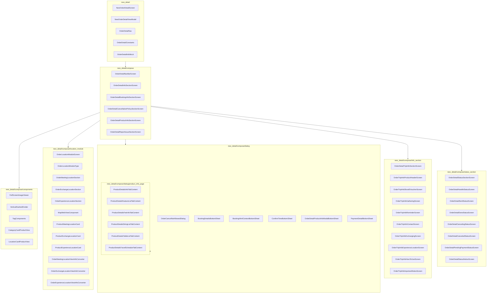
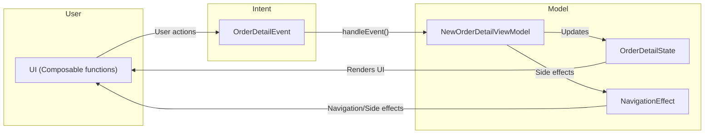

# KKDay Order Detail Page Structure

This document outlines the structure and relationships of the new order detail page implementation in the KKDay Android app.

## Navigation Flow

The navigation flow from `OrderComposeFragment` to `NewOrderDetailScreen` is handled through Jetpack Navigation Compose.

```mermaid
flowchart TB
    OrderComposeFragment --> NavHost
    NavHost -- "orderDetailRoute/{orderId}/{orderMasterMid}" --> NewOrderDetailScreen
    NewOrderDetailScreen --> NewOrderDetailViewModel
    
    %% Content Sections
    NewOrderDetailScreen --> OrderDetailNavBarScreen
    NewOrderDetailScreen --> OrderDetailStatusSectionScreen
    NewOrderDetailScreen --> OrderDetailCancellationPolicySectionScreen
    NewOrderDetailScreen --> OrderDetailTripInfoSectionScreen
    NewOrderDetailScreen --> OrderDetailProductInfoSectionScreen
    NewOrderDetailScreen --> OrderDetailBookingInfoSectionScreen
    NewOrderDetailScreen --> OrderDetailInfoSectionScreen
    NewOrderDetailScreen --> OrderDetailReportIssueSectionScreen
    
    %% Bottom sheets and dialogs
    NewOrderDetailScreen -.-> BookingDetailsBottomSheet
    NewOrderDetailScreen -.-> OrderDetailProductInfoModalBottomSheet
    NewOrderDetailScreen -.-> ConfirmTimeBottomSheet
    NewOrderDetailScreen -.-> RefundPolicyBottomSheetDialog
    NewOrderDetailScreen -.-> PaymentDetailBottomSheet
    NewOrderDetailScreen -.-> BookingHtmlContextBottomSheet
    NewOrderDetailScreen -.-> OrderCancelNotAllowedDialog
    NewOrderDetailScreen -.-> OrderLocationModuleScreen
```

## Package Structure

The `com.kkday.order_page.new_detail` package and its subpackages are organized as follows:

## Component Architecture

### MVI Architecture Pattern

The new order detail page follows the MVI (Model-View-Intent) architecture pattern:

## Main Components

### 1. OrderComposeFragment

The entry point for the order detail flow. This fragment sets up the navigation graph and handles navigation to the `NewOrderDetailScreen`.

### 2. NewOrderDetailScreen

The main composable function that renders the order detail UI. It's composed of multiple sections:

- `OrderDetailNavBarScreen`: Top navigation bar
- `OrderDetailStatusSectionScreen`: Shows order status information
- `OrderDetailCancellationPolicySectionScreen`: Displays cancellation policy
- `OrderDetailTripInfoSectionScreen`: Shows trip information
- `OrderDetailProductInfoSectionScreen`: Displays product details
- `OrderDetailBookingInfoSectionScreen`: Shows booking information
- `OrderDetailInfoSectionScreen`: Displays order summary information
- `OrderDetailReportIssueSectionScreen`: Section for reporting issues with the order

### 3. NewOrderDetailViewModel

Manages the state and business logic for the order detail screen. It handles:

- Loading order details
- Processing user actions
- Navigating to different screens
- Handling side effects

### 4. OrderDetailTripInfoSectionScreen

A key section that displays trip-related information including:

- Product header with product name, package name, and trip date
- E-voucher information (if available)
- Pre-trip information
- Contact information
- Gathering point information
- Exchanging point information
- Experience location information
- How to use information
- Important notes

### 5. Bottom Sheets and Dialogs

Various bottom sheets and dialogs are used to display detailed information:

- `BookingDetailsBottomSheet`: Shows booking details
- `OrderDetailProductInfoModalBottomSheet`: Shows product information
- `ConfirmTimeBottomSheet`: Shows confirmation time information
- `RefundPolicyBottomSheetDialog`: Shows refund policy
- `PaymentDetailBottomSheet`: Shows payment details
- `BookingHtmlContextBottomSheet`: Shows HTML content
- `OrderCancelNotAllowedDialog`: Shows dialog when cancellation is not allowed
- `OrderLocationModuleScreen`: Shows location information

## Navigation Events

Navigation is handled through a sealed class `NavigationEffect` that represents different navigation events:

- `NavigateToReceipt`: Navigate to receipt page
- `NavigateToProductPage`: Navigate to product page
- `NavigateToComment`: Navigate to comment page
- `NavigateToVoucher`: Navigate to voucher page
- `NavigateToCancelOrder`: Navigate to cancel order page
- `NavigateToGatheringPoint`: Show gathering point information
- `NavigateToExchangingPoint`: Show exchanging point information
- `NavigateToExperienceLocation`: Show experience location information
- `NavigateToContactDriver`: Navigate to contact driver page
- `CancelPaySuccess`: Handle cancel pay success
- `ShowModifyDialog`: Show modify dialog
- `ViewAllOrders`: View all orders
- `NavigateToReportIssue`: Navigate to report issue page
- `ShareVoucher`: Share voucher
- `NavigateToRepay`: Navigate to repay page
