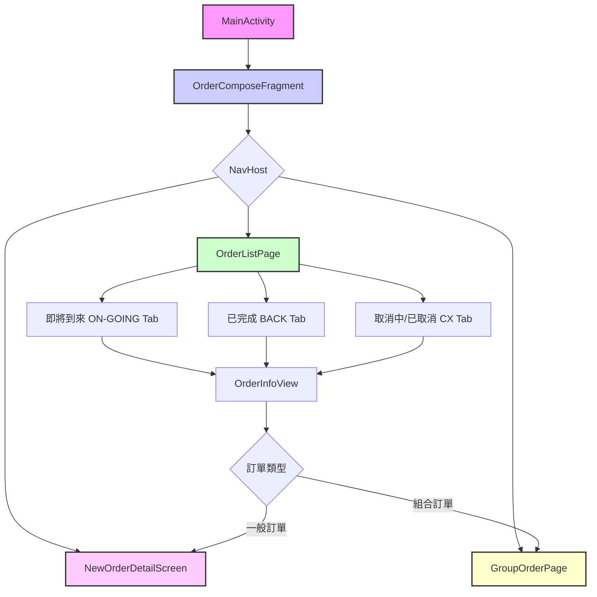
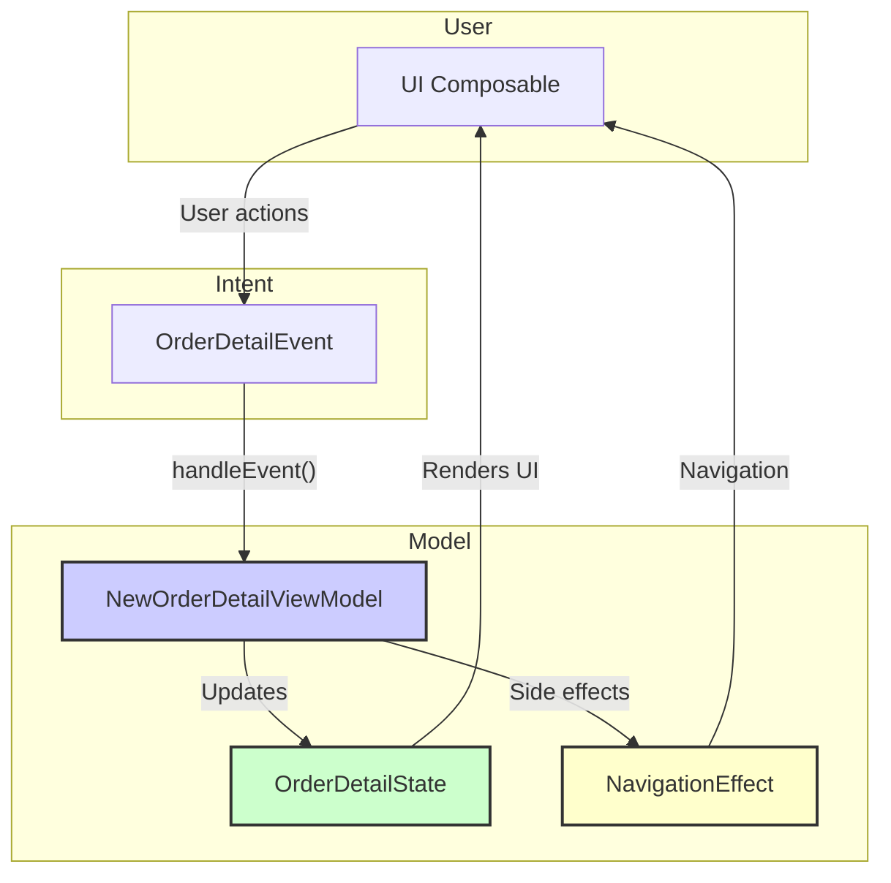

# 訂單列表與明細完整說明

## 概述

本文件詳細說明 KKday Android App 的訂單列表（Order List）與訂單明細（Order Detail）的完整架構、頁面流程、資料結構、以及各種訂單類型的顯示邏輯。

---

## 目錄

1. [訂單列表 (Order List)](#訂單列表-order-list)
2. [訂單明細 (Order Detail)](#訂單明細-order-detail)
3. [訂單資料結構](#訂單資料結構)
4. [訂單卡片類型](#訂單卡片類型)
5. [按鈕與操作](#按鈕與操作)
6. [追蹤埋點](#追蹤埋點)

---

## 訂單列表 (Order List)

### 架構概述

訂單列表採用 **Jetpack Compose + NavHost** 架構，提供流暢的使用者體驗。



### 主要元件

#### 1. OrderComposeFragment
**路徑**: `libs/feature/order_page/src/main/java/com/kkday/order_page/presentation/OrderComposeFragment.kt`

**職責**:
- 應用程式訂單功能的入口
- 內含 `NavHost`，管理頁面導航
- 處理 DeepLink 參數
- 管理 ViewModel 與觀察狀態
- 處理登入驗證回調

**導航路由**:
- `orderListRoute` - 訂單列表頁
- `groupOrderRoute/{bundleOrderId}` - 組合訂單頁
- `orderDetailRoute/{orderId}/{orderMasterMid}` - 訂單明細頁

**DeepLink 處理**:
```kotlin
// DeepLink 格式: app://orders?tab=ON-GOING&from=FAQ
arguments?.getString(KEY_DEEP_LINK_ORDER_LIST_CATEGORY)?.let { category ->
    viewModel.currentPageCategory = OrderListCategory.valueOf(category)
}
```

#### 2. OrderListPage
**路徑**: `libs/feature/order_page/src/main/java/com/kkday/order_page/presentation/compose/OrderListPage.kt`

**職責**:
- 顯示訂單列表
- 提供三個 Tab 切換
- 分頁載入訂單（Paging3）
- 處理下拉刷新
- 顯示推薦商品（未登入用戶）

**Tab 結構**:

| Tab 名稱 | OrderListCategory | 訂單狀態 | API 參數 | 說明 |
|---------|------------------|---------|---------|------|
| 即將到來 | `ON-GOING` | NEW, UPCOMING | `category=ON-GOING` | 待出發的訂單 + 新訂單 |
| 已完成 | `BACK` | DEPARTED | `category=BACK` | 已完成行程的訂單 |
| 取消中/已取消 | `CX` | CANCELLED, APPLYING_CANCEL | `category=CX` | 取消中或已取消的訂單 |

**分頁載入**:
```kotlin
val orderPagingItems = viewModel.getNewOrderListFlow(category, false)
    .collectAsLazyPagingItems()
```

**Tab 切換邏輯**:
```kotlin
LaunchedEffect(category) {
    val page = when (category) {
        OrderListCategory.`ON-GOING` -> 0
        OrderListCategory.BACK -> 1
        OrderListCategory.CX -> 2
    }
    pagerState.scrollToPage(page)
}
```

#### 3. NewOrderListSource
**路徑**: `libs/feature/order_page/src/main/java/com/kkday/order_page/presentation/viewModel/NewOrderListSource.kt`

**職責**:
- 實作 `PagingSource<Int, OrderInfo>`
- 從 API 載入訂單資料
- 處理分頁邏輯
- 整合 Marketplace 對話資訊
- 處理推薦商品資料

**分頁參數**:
- `PER_LIMIT = 5` - 每頁載入 5 筆訂單
- `NEW_ORDER_STARTING_KEY = 1` - 起始頁碼

**API 呼叫**:
```kotlin
suspend fun getOrderList(nextPage: Int): List<OrderInfo> {
    val apiResult = orderRepository.getNewOrderList(
        category = category,
        needOverDateOrder = needOverDateOrder,
        currentPage = nextPage,
        pageSize = PER_LIMIT
    )
    // ... 處理結果
}
```

### API 規格

#### 取得訂單列表
**Endpoint**: `/api/v2.2/orders`

**請求參數**:
```json
{
  "category": "ON-GOING|BACK|CX",
  "need_over_date_order": false,
  "current_page": 1,
  "page_size": 5,
  "currency": "TWD",
  "language": "zh-tw"
}
```

**回應範例**:
```json
{
  "metadata": {
    "status": "0000",
    "desc": "Success",
    "pagination": {
      "current_page": 1,
      "total_pages": 3,
      "total_count": 15
    }
  },
  "data": {
    "orders": [
      {
        "id": "ORD123456",
        "currency": "TWD",
        "order_date": 1699000000,
        "lst_dt_go": 1700000000,
        "product_mid": "PROD001",
        "prod_name": "東京迪士尼樂園門票",
        "package_name": "一日券",
        "status": "UPCOMING",
        "price_total": 2500.0,
        "unread_msg": 0,
        "has_voucher": true
      }
    ],
    "exists_over_date_order": true
  }
}
```

### 訂單列表功能

#### 1. 過期訂單顯示
當 `exists_over_date_order = true` 時，顯示「查看過期訂單」按鈕：

```kotlin
if (viewModel.existsOverDateOrder && !isShowOverDateOrder) {
    item {
        OverDateOrderItem(
            onClick = { viewModel.onClickOverDateOrderItem() }
        )
    }
}
```

點擊後載入過期訂單：
```kotlin
val overDateOrderPagingItems = viewModel.getNewOrderListFlow(
    category,
    needOverDateOrder = true
).collectAsLazyPagingItems()
```

#### 2. 未讀訊息標記
訂單卡片右上角顯示紅點：
```kotlin
if (orderInfo.unreadMsgCount > 0) {
    Badge(
        backgroundColor = kkColorErrorMedium,
        modifier = Modifier.size(8.dp)
    )
}
```

#### 3. 推薦商品（未登入用戶）
當用戶未登入時，顯示推薦商品卡片：
```kotlin
if (viewModel.mNoLoginOrderRecommendList.isNotEmpty()) {
    item {
        MixRecommendOrderCardExpView(
            recommendList = viewModel.mNoLoginOrderRecommendList,
            onCardClick = { card -> 
                // 導航到商品頁
            }
        )
    }
}
```

#### 4. 組合訂單處理
組合訂單（Bundle Orders）顯示為群組：
```kotlin
if (orderInfo.groupOrders.isNotEmpty()) {
    // 顯示組合訂單標記
    GroupOrderBadge()
    // 點擊導航到 GroupOrderPage
    onGroupBundleOrderClickListener(orderInfo)
}
```

#### 5. 即時倒數計時
顯示付款或確認時限倒數：
```kotlin
val countdownState = rememberCountdownTimerState(
    timeLeft = orderInfo.payDeadlineTimeLeft ?: 0
)

CountdownTimer(
    state = countdownState,
    onFinished = { /* 逾時處理 */ }
)
```

### ViewModel 狀態管理

**OrderViewModel** 負責管理訂單列表狀態：

**主要狀態**:
```kotlin
// 當前分類
var currentPageCategory: OrderListCategory = OrderListCategory.`ON-GOING`

// 訂單列表
private val _orderListFlow = MutableStateFlow<List<OrderInfo>>(emptyList())
val orderListFlow: StateFlow<List<OrderInfo>> = _orderListFlow

// 訂單狀態統計
var orderStatusCountList: List<OrderStatusCountInfo> = emptyList()

// 是否顯示過期訂單
var showOverDateOrder: Boolean = false

// Marketplace 對話資訊
var mkpConversationInfoList: List<MarketplaceConversationInfo> = emptyList()
```

**主要操作**:
```kotlin
// Tab 切換
fun onClickTab(page: Int)

// 刷新訂單
fun refreshOrder(orderPagingItems: LazyPagingItems<OrderInfo>? = null)

// 點擊過期訂單
fun onClickOverDateOrderItem()

// 更新訂單評論
fun updateOrderComment(newComment: OrderCommentInfo)
```

---

## 訂單明細 (Order Detail)

### 架構概述

訂單明細採用 **MVI (Model-View-Intent)** 架構模式，提供清晰的狀態管理。



### 主要元件

#### 1. NewOrderDetailScreen
**路徑**: `libs/feature/order_page/src/main/java/com/kkday/order_page/new_detail/NewOrderDetailScreen.kt`

**職責**:
- 訂單明細的主畫面
- 整合多個 Section 元件
- 處理使用者互動事件
- 管理 Bottom Sheet 與 Dialog

**頁面結構**:
```kotlin
@Composable
fun NewOrderDetailScreen(
    navController: NavController,
    orderId: String,
    orderMasterMid: String
) {
    val viewModel: NewOrderDetailViewModel = getViewModel()
    val state by viewModel.state.collectAsState()
    
    Scaffold {
        LazyColumn {
            // 導航列
            item { OrderDetailNavBarScreen() }
            
            // 訂單狀態區塊
            item { OrderDetailStatusSectionScreen() }
            
            // 取消政策
            item { OrderDetailCancellationPolicySectionScreen() }
            
            // 行程資訊
            item { OrderDetailTripInfoSectionScreen() }
            
            // 商品資訊
            item { OrderDetailProductInfoSectionScreen() }
            
            // 訂購資訊
            item { OrderDetailBookingInfoSectionScreen() }
            
            // 訂單資訊
            item { OrderDetailInfoSectionScreen() }
            
            // 問題回報
            item { OrderDetailReportIssueSectionScreen() }
        }
    }
}
```

#### 2. NewOrderDetailViewModel
**路徑**: `libs/feature/order_page/src/main/java/com/kkday/order_page/new_detail/NewOrderDetailViewModel.kt`

**State**:
```kotlin
data class OrderDetailState(
    val isLoading: Boolean = false,
    val error: String? = null,
    val orderDetailInfo: OrderDetailInfo? = null,
    val showBookingDetails: Boolean = false,
    val showProductInfo: Boolean = false,
    val showConfirmTime: Boolean = false,
    val showRefundPolicy: Boolean = false,
    val showPaymentDetail: Boolean = false
)
```

**Event**:
```kotlin
sealed class OrderDetailEvent {
    data class LoadOrderDetail(val orderId: String): OrderDetailEvent()
    data class ViewReceipt(val context: Context): OrderDetailEvent()
    data class BookAgain(val context: Context, val productId: String): OrderDetailEvent()
    data class LeaveComment(val context: Context, val orderId: String): OrderDetailEvent()
    data class NavigateToVoucher(val orderId: String, val placement: String): OrderDetailEvent()
    data class CancelOrder(val context: Context, val orderId: String): OrderDetailEvent()
    data class ShowBookingDetails(val dateItem: OrderDetailDateItem?): OrderDetailEvent()
    data class ShowProductInfo(val productId: String): OrderDetailEvent()
    data class ShowPaymentDetail(val orderId: String): OrderDetailEvent()
    data class ContactDriver(val context: Context): OrderDetailEvent()
    data class ShareVoucher(val context: Context, val orderId: String): OrderDetailEvent()
    data class RepayOrder(val context: Context, val orderMasterMid: String): OrderDetailEvent()
    data class DeepLink(val url: String): OrderDetailEvent()
}
```

**NavigationEffect**:
```kotlin
sealed class NavigationEffect {
    data class NavigateToReceipt(val url: String): NavigationEffect()
    data class NavigateToProductPage(val productId: String): NavigationEffect()
    data class NavigateToComment(val orderId: String): NavigationEffect()
    data class NavigateToVoucher(val orderId: String, val placement: String): NavigationEffect()
    data class NavigateToCancelOrder(val orderId: String): NavigationEffect()
    data class NavigateToGatheringPoint(val orderDetailInfo: OrderDetailInfo): NavigationEffect()
    data class NavigateToExchangingPoint(val orderDetailInfo: OrderDetailInfo): NavigationEffect()
    data class NavigateToExperienceLocation(val orderDetailInfo: OrderDetailInfo): NavigationEffect()
    data class NavigateToContactDriver(val driverInfo: GuideData): NavigationEffect()
    object CancelPaySuccess: NavigationEffect()
    data class ShowModifyDialog(val orderId: String): NavigationEffect()
    object ViewAllOrders: NavigationEffect()
    data class NavigateToReportIssue(val orderId: String): NavigationEffect()
    data class ShareVoucher(val voucherUrl: String): NavigationEffect()
    data class NavigateToRepay(val orderMasterMid: String): NavigationEffect()
}
```

### 訂單明細 Section 說明

#### 1. OrderDetailStatusSectionScreen
顯示訂單狀態資訊，根據不同狀態顯示不同內容：

**訂單狀態類型**:
- `OrderDetailHandleStatusScreen` - 處理中（待確認）
- `OrderDetailSentStatusScreen` - 已發送憑證
- `OrderDetailDoneStatusScreen` - 已完成
- `OrderDetailCancelingStatusScreen` - 取消中
- `OrderDetailCanceledStatusScreen` - 已取消
- `OrderDetailPendingPaymentStatusScreen` - 待付款
- `OrderDetailStatusNoticeScreen` - 狀態通知

**顯示邏輯**:
```kotlin
when (orderDetailInfo.orderStatusDisplay) {
    OrderStatusDisplay.HANDLE -> OrderDetailHandleStatusScreen()
    OrderStatusDisplay.SENT -> OrderDetailSentStatusScreen()
    OrderStatusDisplay.DONE -> OrderDetailDoneStatusScreen()
    OrderStatusDisplay.CANCELING -> OrderDetailCancelingStatusScreen()
    OrderStatusDisplay.CANCELED_USER,
    OrderStatusDisplay.CANCELED_SUPPLY -> OrderDetailCanceledStatusScreen()
    OrderStatusDisplay.PENDING_PAYMENT -> OrderDetailPendingPaymentStatusScreen()
}
```

#### 2. OrderDetailTripInfoSectionScreen
顯示行程相關資訊：

**子元件**:
- `OrderTripInfoProductHeaderScreen` - 商品標題與套餐名稱
- `OrderTripInfoShowEVoucherScreen` - 電子憑證顯示
- `OrderTripInfoGatheringScreen` - 集合地點資訊
- `OrderTripInfoReminderScreen` - 行前提醒
- `OrderTripInfoContactScreen` - 聯絡資訊
- `OrderTripInfoExchangingScreen` - 兌換地點資訊
- `OrderTripInfoExperienceLocationScreen` - 體驗地點資訊
- `OrderTripInfoHowToUseScreen` - 使用說明
- `OrderTripInfoImportantNotesScreen` - 重要須知

**憑證顯示**:
```kotlin
if (orderDetailInfo.hasVoucher) {
    OrderTripInfoShowEVoucherScreen(
        onViewVoucherClick = {
            viewModel.handleEvent(
                OrderDetailEvent.NavigateToVoucher(orderId, "order_detail")
            )
        },
        onShareVoucherClick = {
            viewModel.handleEvent(
                OrderDetailEvent.ShareVoucher(context, orderId)
            )
        }
    )
}
```

#### 3. OrderDetailBookingInfoSectionScreen
顯示訂購資訊：

**顯示內容**:
- 行程日期與時間
- 旅客人數與資訊
- 特殊需求
- 加購項目
- 保險資訊

**日期顯示**:
```kotlin
OrderDetailDateItem(
    dateTitle = "出發日期",
    dateValue = formatDate(orderDetailInfo.goDate),
    timeValue = formatTime(orderDetailInfo.goDate),
    onClick = {
        viewModel.handleEvent(
            OrderDetailEvent.ShowBookingDetails(dateItem)
        )
    }
)
```

#### 4. OrderDetailProductInfoSectionScreen
顯示商品詳細資訊：

**顯示內容**:
- 商品說明
- 方案特色
- 費用說明
- 行程表
- 注意事項

**Modal Bottom Sheet**:
```kotlin
OrderDetailProductInfoModalBottomSheet(
    productId = orderDetailInfo.productId,
    tabs = listOf("商品詳情", "方案特色", "費用說明"),
    onDismiss = {
        viewModel.handleEvent(OrderDetailEvent.HideProductInfo)
    }
)
```

#### 5. OrderDetailInfoSectionScreen
顯示訂單摘要資訊：

**顯示內容**:
- 訂單編號
- 訂單日期
- 訂購人資訊
- 價格明細
- 付款方式
- 取消政策

**價格明細**:
```kotlin
Column {
    PriceRow("商品金額", orderDetailInfo.price)
    PriceRow("優惠券折扣", "-${orderDetailInfo.priceCoupon}")
    PriceRow("點數折抵", "-${orderDetailInfo.memberPointDeduct}")
    Divider()
    PriceRow(
        "總金額",
        orderDetailInfo.displayTotalPrice,
        fontWeight = FontWeight.Bold
    )
}
```

#### 6. OrderDetailCancellationPolicySectionScreen
顯示取消政策：

**政策類型**:
- 免費取消
- 有條件取消
- 不可取消

**顯示邏輯**:
```kotlin
when (orderDetailInfo.cancelPolicy.type) {
    "FREE_CANCEL" -> FreeCancelPolicy(
        deadline = orderDetailInfo.cancelPolicy.deadline
    )
    "CONDITIONAL" -> ConditionalCancelPolicy(
        conditions = orderDetailInfo.cancelPolicy.conditions
    )
    "NON_REFUNDABLE" -> NonRefundablePolicy()
}
```

#### 7. OrderDetailReportIssueSectionScreen
問題回報區塊：

**功能**:
- 報告訂單問題
- 查看常見問題
- 聯絡客服

```kotlin
ReportIssueButton(
    onClick = {
        viewModel.handleEvent(
            OrderDetailEvent.NavigateToReportIssue(orderId)
        )
    }
)
```

### Location Module（地點模組）

#### OrderLocationModuleScreen
**路徑**: `libs/feature/order_page/src/main/java/com/kkday/order_page/new_detail/compose/location_module/`

**地點類型**:
```kotlin
enum class OrderLocationModuleType {
    MEETING_POINT,      // 集合地點
    EXCHANGE_POINT,     // 兌換地點
    EXPERIENCE_LOCATION // 體驗地點
}
```

**元件**:
- `OrderMeetingLocationSection` - 集合地點區塊
- `OrderExchangeLocationSection` - 兌換地點區塊
- `OrderExperienceLocationSection` - 體驗地點區塊
- `MapWebViewComponent` - 地圖 WebView
- `ProductMeetingLocationCard` - 集合地點卡片
- `ProductExchangeLocationCard` - 兌換地點卡片
- `ProductExperienceLocationCard` - 體驗地點卡片

**地圖整合**:
```kotlin
MapWebViewComponent(
    latitude = location.latitude,
    longitude = location.longitude,
    locationName = location.name,
    onMapClick = {
        // 開啟外部地圖 App
        MapChooser.openMap(context, location)
    }
)
```

### Bottom Sheets 與 Dialogs

#### 1. BookingDetailsBottomSheet
顯示訂購詳情：
- 旅客資訊
- 特殊需求
- 加購項目

#### 2. OrderDetailProductInfoModalBottomSheet
顯示商品資訊，支援多個 Tab：
- `ProductDetailsInfoTabContent` - 商品詳情
- `ProductDetailsFeatureListTabContent` - 方案特色
- `ProductDetailsFeeInfoTabContent` - 費用說明
- `ProductDetailsStringListTabContent` - 文字列表
- `ProductDetailsTableListTabContent` - 表格列表
- `ProductDetailsTravelScheduleTabContent` - 行程表

#### 3. ConfirmTimeBottomSheet
顯示確認時限資訊：
- 倒數計時器
- 確認時限說明
- 逾時後果

#### 4. RefundPolicyBottomSheetDialog
顯示退款政策詳情：
- 退款條件
- 退款金額計算
- 退款流程

#### 5. PaymentDetailBottomSheet
顯示付款詳情：
- 付款方式
- 付款狀態
- 交易明細

#### 6. BookingHtmlContextBottomSheet
顯示 HTML 內容：
- 使用 WebView 顯示
- 支援富文本格式

#### 7. OrderCancelNotAllowedDialog
顯示無法取消訂單的原因：
- 取消條件不符
- 聯絡客服選項

---

## 訂單資料結構

### OrderInfo
**路徑**: `libs/model/src/main/java/com/kkday/library/networking/resource/order/Order.kt`

**核心欄位**:
```kotlin
@Parcelize
data class OrderInfo(
    val id: String,                          // 訂單編號
    val currency: String,                    // 幣別
    val orderDate: Long,                     // 訂單日期
    val goDate: Long?,                       // 出發日期
    val backDate: Long?,                     // 回程日期
    val productId: String,                   // 商品 ID
    val packageId: PkgOid,                   // 套餐 ID
    val productName: String,                 // 商品名稱
    val packageName: String,                 // 套餐名稱
    val orderStatus: String,                 // 訂單狀態
    val orderStatusDisplay: OrderStatusDisplay?, // 顯示狀態
    val totalPrice: Double,                  // 總金額
    val displayTotalPrice: String,           // 顯示總金額
    val unreadMsgCount: Int,                 // 未讀訊息數
    val hasVoucher: Boolean,                 // 是否有憑證
    val isInstantBooking: Boolean,           // 是否即時確認
    val isApplyingCancel: Boolean,           // 是否取消中
    val comment: CommentInfo?,               // 評論資訊
    val destination: Destination,            // 目的地
    val productCategory: ProductCategory,    // 商品分類
    val groupOrders: List<OrderInfo>,        // 組合訂單列表
    val transportationType: TransportationType, // 交通類型（交通訂單）
    val extensionInfo: ExtensionOrderInfo,   // 擴展資訊
    val recommend: OrderConfirmRecommendCardView?, // 推薦資訊
    val isOverDateOrder: Boolean = false     // 是否過期訂單
)
```

**訂單狀態**:
```kotlin
companion object {
    const val ORDER_STATUS_NEW = "NEW"                              // 新訂單
    const val ORDER_STATUS_UPCOMING = "UPCOMING"                    // 即將到來
    const val ORDER_STATUS_DEPARTED = "DEPARTED"                    // 已出發
    const val ORDER_STATUS_CANCELLED_OR_APPLYING_CANCELLED = "CANCELLED_OR_APPLYING_CANCELLED" // 取消中或已取消
    const val ORDER_STATUS_PENDING_PAY = "PENDING_PAY"              // 待付款
}
```

**顯示狀態**:
```kotlin
enum class OrderStatusDisplay {
    HANDLE,          // 處理中
    SENT,            // 已發送
    DONE,            // 已完成
    CANCELING,       // 取消中
    CANCELED_USER,   // 使用者取消
    CANCELED_SUPPLY, // 供應商取消
    PENDING_PAYMENT  // 待付款
}
```

**輔助屬性**:
```kotlin
val isUpcoming: Boolean
    get() = orderStatus == ORDER_STATUS_UPCOMING

val isDeparted: Boolean
    get() = orderStatus == ORDER_STATUS_DEPARTED

val isPendingPay: Boolean
    get() = orderStatus == ORDER_STATUS_PENDING_PAY

val isCancelledOrApplyingCancelled: Boolean
    get() = orderStatus == ORDER_STATUS_CANCELLED_OR_APPLYING_CANCELLED

val isNewProductOrder: Boolean // 是否為新版商品訂單

val isSupplierProduct: Boolean // 是否為供應商商品

val isBundleGroupOrders: Boolean // 是否為組合訂單

val isHotelDynamic: Boolean // 是否為飯店動態訂單

val isTransportationOrder: Boolean // 是否為交通訂單
```

### OrderDetailInfo
**路徑**: `libs/base/src/main/java/com/kkday/library/common/model/OrderDetail.kt`

訂單明細的詳細資料結構，包含：
- 完整的訂購人資訊
- 旅客詳細資料
- 商品完整資訊
- 憑證資料
- 取消政策詳情
- 付款詳情
- 退款資訊

### TransportationBookingInfo
**路徑**: `libs/model/src/main/java/com/kkday/library/networking/resource/order/trans/TransportationBookingInfo.kt`

交通訂單專用的訂購資訊：
- 路線資訊 (`RouteTitleInfo`)
- 座位資訊
- 乘客資訊
- 特殊需求
- 交通類型專屬資料

---

## 訂單卡片類型

### 主站訂單卡片

#### OrderCardItem
**路徑**: `libs/feature/order_page/src/main/java/com/kkday/order_page/presentation/compose/OrderCardItem.kt`

**顯示內容**:
- 商品圖片
- 商品名稱與套餐名稱
- 目的地
- 出發日期
- 價格
- 訂單狀態標籤
- 未讀訊息標記

```kotlin
@Composable
fun OrderCardItem(
    orderInfo: OrderInfo,
    currencyDisplayManager: CurrencyDisplayManager,
    onClick: () -> Unit,
    onContactClick: () -> Unit,
    onVoucherClick: () -> Unit
) {
    Card(
        modifier = Modifier
            .fillMaxWidth()
            .clickable { onClick() }
    ) {
        Column {
            // 商品圖片
            AsyncImage(
                model = orderInfo.imgUrl,
                contentDescription = null,
                modifier = Modifier
                    .fillMaxWidth()
                    .height(160.dp)
            )
            
            // 商品資訊
            Column(modifier = Modifier.padding(16.dp)) {
                // 目的地標籤
                DestinationChip(orderInfo.destination)
                
                // 商品名稱
                Text(
                    text = orderInfo.productName,
                    style = fontH6,
                    maxLines = 2
                )
                
                // 套餐名稱
                Text(
                    text = orderInfo.packageName,
                    style = fontBodyMd,
                    color = kkColorTextMedium
                )
                
                // 出發日期
                Row {
                    Icon(Icons.Default.DateRange)
                    Text(formatDate(orderInfo.goDate))
                }
                
                // 價格
                Text(
                    text = orderInfo.displayTotalPrice,
                    style = fontH5,
                    color = kkColorTextPrimaryMedium
                )
            }
        }
    }
}
```

### 交通訂單卡片

交通訂單根據不同的 `TransportationType` 顯示不同的卡片樣式。

#### TransOrderItem（基礎交通卡片）
**路徑**: `libs/feature/order_page/src/main/java/com/kkday/order_page/presentation/compose/transportation/TransOrderItem.kt`

適用於一般交通訂單，顯示：
- 路線資訊（起點 → 終點）
- 出發日期與時間
- 價格
- 訂單狀態

```kotlin
@Composable
fun TransOrderItem(
    orderInfo: OrderInfo,
    onClick: () -> Unit
) {
    val routeTitleInfo = orderInfo.routeTitleInfo
    
    Card(modifier = Modifier.clickable { onClick() }) {
        Column(modifier = Modifier.padding(16.dp)) {
            // 交通類型圖示
            TransportationTypeIcon(orderInfo.transportationType)
            
            // 路線資訊
            Row(verticalAlignment = Alignment.CenterVertically) {
                Text(
                    text = routeTitleInfo.dep,
                    style = fontBodyLg
                )
                Icon(Icons.Default.ArrowForward)
                Text(
                    text = routeTitleInfo.arr,
                    style = fontBodyLg
                )
            }
            
            // 日期時間
            Text(
                text = "${formatDate(orderInfo.goDate)} ${routeTitleInfo.depTime}",
                style = fontBodyMd
            )
            
            // 價格
            Text(
                text = orderInfo.displayTotalPrice,
                style = fontH6
            )
        }
    }
}
```

#### TransportationThsrtwOrderCardItem（高鐵訂單）
**適用**: `TransportationType.THSRTW` - 台灣高鐵

**特殊顯示**:
- 車次資訊
- 座位等級（標準車廂/商務車廂）
- 高鐵站名稱

#### TransportationJrRailOrderCardItem（日本鐵路訂單）
**適用**: `TransportationType.JREAST`, `TransportationType.JRWEST`, `TransportationType.JRCENTRAL`, `TransportationType.JR_RAIL`

**特殊顯示**:
- JR 線路名稱
- 列車類型（新幹線/特急等）
- 座位類型（指定席/自由席）

#### TransRailEuropeOrderItem（歐洲鐵路訂單）
**適用**: `TransportationType.RAIL_EUROPE`

**特殊顯示**:
- 歐洲鐵路通行證類型
- 使用天數
- 適用國家

#### TransportationCnhkbusOrderInfoItem（中港巴士訂單）
**適用**: `TransportationType.CNHKBUS`

**特殊顯示**:
- 巴士路線號碼
- 上車地點
- 下車地點

#### TransportationFlightOrderCardInfoItem（機票訂單）
**適用**: `TransportationType.ZZIMAIR`

**特殊顯示**:
- 航班號
- 起飛/抵達時間
- 艙等資訊
- 航空公司

#### TransportationCarRentalOrderItem（租車訂單）
**適用**: `TransportationType.ZZIMCAR`, `TransportationType.GATHER_CAR`, `TransportationType.RENTAL_CARS`, `TransportationType.ONLINE_TRAVEL_CAR`, `TransportationType.GO_GO_OUT`

**特殊顯示**:
- 車型名稱與圖片
- 取車地點
- 還車地點
- 租車天數

#### TransportationAirportOrderItem（機場接送訂單）
**適用**: `TransportationType.PICK_UP`, `TransportationType.DROP_OFF`

**特殊顯示**:
- 服務類型（接機/送機）
- 機場名稱
- 上車/下車地點
- 航班資訊
- 車型名稱

```kotlin
@Composable
fun TransportationAirportOrderItem(
    orderInfo: OrderInfo,
    airportTransfer: AirportTransfer,
    onClick: () -> Unit
) {
    Card(modifier = Modifier.clickable { onClick() }) {
        Column(modifier = Modifier.padding(16.dp)) {
            // 服務類型標籤
            ServiceTypeBadge(
                type = if (airportTransfer.serviceType == "PICK_UP")
                    "接機" else "送機"
            )
            
            // 機場資訊
            Row {
                Icon(Icons.Default.Flight)
                Text("${airportTransfer.airportCode} ${airportTransfer.airportName}")
            }
            
            // 航班號（接機）
            if (airportTransfer.serviceType == "PICK_UP" && airportTransfer.flightNo != null) {
                Text("航班: ${airportTransfer.flightNo}")
            }
            
            // 地點資訊
            Row {
                Icon(Icons.Default.LocationOn)
                Text(airportTransfer.locationName ?: "")
            }
            
            // 日期時間
            Text(formatDateTime(airportTransfer.goDatetime))
            
            // 車型
            Text("車型: ${airportTransfer.carModelName}")
        }
    }
}
```

#### TransportationCruisesOrderCardInfoItem（郵輪訂單）
**適用**: `TransportationType.CRUISES`, `TransportationType.ROYAL_CRUISES`, `TransportationType.CRUQO_CRUISES`

**特殊顯示**:
- 郵輪名稱
- 航線資訊
- 出發港口
- 停靠港口
- 船艙等級

### 卡片顯示邏輯

```kotlin
@Composable
fun OrderInfoView(
    orderInfo: OrderInfo,
    onClick: () -> Unit
) {
    // 判斷是否為交通訂單
    val isTransportation = orderInfo.transportationType != TransportationType.COMMON
    
    if (isTransportation) {
        // 根據交通類型顯示對應卡片
        when (orderInfo.transportationType) {
            TransportationType.THSRTW -> 
                TransportationThsrtwOrderCardItem(orderInfo, onClick)
            
            TransportationType.JREAST,
            TransportationType.JRWEST,
            TransportationType.JRCENTRAL,
            TransportationType.JR_RAIL -> 
                TransportationJrRailOrderCardItem(orderInfo, onClick)
            
            TransportationType.RAIL_EUROPE -> 
                TransRailEuropeOrderItem(orderInfo, onClick)
            
            TransportationType.CNHKBUS -> 
                TransportationCnhkbusOrderInfoItem(orderInfo, onClick)
            
            TransportationType.ZZIMAIR -> 
                TransportationFlightOrderCardInfoItem(orderInfo, onClick)
            
            TransportationType.ZZIMCAR,
            TransportationType.GATHER_CAR,
            TransportationType.RENTAL_CARS,
            TransportationType.ONLINE_TRAVEL_CAR,
            TransportationType.GO_GO_OUT -> 
                TransportationCarRentalOrderItem(orderInfo, onClick)
            
            TransportationType.PICK_UP,
            TransportationType.DROP_OFF -> 
                TransportationAirportOrderItem(orderInfo, onClick)
            
            TransportationType.CRUISES,
            TransportationType.ROYAL_CRUISES,
            TransportationType.CRUQO_CRUISES -> 
                TransportationCruisesOrderCardInfoItem(orderInfo, onClick)
            
            else -> TransOrderItem(orderInfo, onClick)
        }
    } else {
        // 顯示一般訂單卡片
        OrderCardItem(orderInfo, onClick)
    }
}
```

### 推薦卡片

#### MixRecommendOrderCardExpView
**顯示條件**: 訂單有推薦商品資料

```kotlin
if (orderInfo.recommend != null && orderInfo.recommend.showMixRecommend) {
    MixRecommendOrderCardExpView(
        recommendCardView = orderInfo.recommend,
        onLocationClick = { /* 導航到地點 */ },
        onCardClick = { card -> /* 導航到商品 */ }
    )
}
```

---

## 按鈕與操作

### ComponentOrderButtons
**路徑**: `libs/feature/order_page/src/main/java/com/kkday/order_page/presentation/compose/ComponentOrderButtons.kt`

訂單卡片下方的操作按鈕區塊。

**顯示控制**:
```kotlin
OrderCardExpView(
    isShowOrderButton = true,
    content = { OrderCardItem(orderInfo) }
)
```

### 按鈕類型與顯示邏輯

#### 1. 相關訂單
**顯示條件**:
```kotlin
if (orderInfo.groupOrders.isNotEmpty()) {
    GroupOrderButton(
        text = "相關訂單 (${orderInfo.groupOrders.size})",
        onClick = { onGroupOrderClick(orderInfo) }
    )
}
```

**功能**: 導航到組合訂單頁面，顯示所有相關訂單。

#### 2. 聯絡方式
**顯示條件**:
```kotlin
if (!isOnlyShowGroupOrderButton) {
    ContactButton(
        onClick = { onContactClick(orderInfo) }
    )
}
```

**功能**:
- 聯絡客服
- 聯絡供應商
- 聯絡司機（交通訂單）

#### 3. 查看憑證
**顯示條件**:
```kotlin
if (orderInfo.orderStatus != ORDER_STATUS_CANCELLED_OR_APPLYING_CANCELLED &&
    orderInfo.hasVoucher) {
    ViewVoucherButton(
        onClick = { onVoucherClick(orderInfo) }
    )
}
```

**功能**: 導航到憑證頁面，顯示電子憑證。

#### 4. 評論
**顯示條件**:
```kotlin
if (orderInfo.orderStatusDisplay == OrderStatusDisplay.DONE &&
    !orderInfo.isBundleGroupOrders()) {
    CommentButton(
        isCommented = orderInfo.comment != null,
        onClick = { onCommentClick(orderInfo) }
    )
}
```

**功能**:
- 未評論: 導航到評論頁面
- 已評論: 顯示已評論狀態

#### 5. 再次預定
**顯示條件**:
```kotlin
val isShowReTry = remember {
    val isNewProductOrder = orderInfo.isNewProductOrder
    val shouldShowReBooking = enableOrderReBooking
    val shouldShowRetryOption = when (orderInfo.orderStatusDisplay) {
        OrderStatusDisplay.DONE,
        OrderStatusDisplay.CANCELED_USER,
        OrderStatusDisplay.CANCELED_SUPPLY -> true
        else -> false
    }
    val isGroupMainOrder = orderInfo.id == orderInfo.groupOrders.firstOrNull()?.id
    val isTraditionalOrder = orderInfo.groupOrders.isEmpty()
    
    isNewProductOrder &&
    shouldShowReBooking &&
    shouldShowRetryOption &&
    (isGroupMainOrder || isTraditionalOrder)
}

if (isShowReTry) {
    BookAgainButton(
        onClick = { onBookAgainClick(orderInfo) }
    )
}
```

**功能**: 導航到商品頁面，預填相同的訂購資訊。

#### 6. 取消訂單
**顯示條件**:
```kotlin
if (orderInfo.canCancel) {
    CancelOrderButton(
        onClick = { onCancelClick(orderInfo) }
    )
}
```

**功能**: 
- 檢查取消條件
- 顯示取消政策
- 進入取消流程

#### 7. 修改訂單
**顯示條件**:
```kotlin
if (orderInfo.canModify) {
    ModifyOrderButton(
        onClick = { onModifyClick(orderInfo) }
    )
}
```

**功能**: 修改訂單資訊（特定商品支援）。

#### 8. 繼續付款
**顯示條件**:
```kotlin
if (orderInfo.isPendingPay) {
    ContinuePaymentButton(
        timeLeft = orderInfo.payDeadlineTimeLeft,
        onClick = { onRepayClick(orderInfo) }
    )
}
```

**功能**: 導航到付款頁面繼續未完成的付款。

### 按鈕狀態管理

**ButtonUiState**:
```kotlin
data class ButtonUiState(
    val showContact: Boolean = true,
    val showVoucher: Boolean = false,
    val showComment: Boolean = false,
    val showBookAgain: Boolean = false,
    val showCancel: Boolean = false,
    val showModify: Boolean = false,
    val showRepay: Boolean = false,
    val isCommented: Boolean = false,
    val timeLeft: Int? = null
)
```

---

## 追蹤埋點

### 訂單列表埋點

**KTM 事件定義**:
```kotlin
object EventPage {
    const val ORDER_LIST_PG = "OrderListPg"
}

object EventComponent {
    const val TAB_STATUS = "TabStatus"
    const val OVER_DATE_ORDER = "OverDateOrder"
    const val ORDER_CARD = "OrderCard"
    const val ORDER_BUTTON = "OrderButton"
}
```

**頁面瀏覽**:
```kotlin
fun trackViewOrderListPg(category: OrderListCategory) {
    KKTrackTool
        .shared()
        .eventBuilder()
        .setName(
            EventType.VIEW,
            EventPage.ORDER_LIST_PG,
            EventComponent.EMPTY,
            "View_OrderListPg"
        )
        .addProperty(EventProperty.TAB_STATUS, category.name)
        .trackEvent()
}
```

**Tab 切換**:
```kotlin
fun trackClickOrderListPgTabStatus(category: OrderListCategory) {
    KKTrackTool
        .shared()
        .eventBuilder()
        .setName(
            EventType.CLICK,
            EventPage.ORDER_LIST_PG,
            EventComponent.TAB_STATUS,
            "Click_OrderListPg_TabStatus"
        )
        .addProperty(EventProperty.TAB_STATUS, category.name)
        .trackEvent()
}
```

**訂單卡片點擊**:
```kotlin
fun trackClickOrderCard(orderInfo: OrderInfo, position: Int) {
    KKTrackTool
        .shared()
        .eventBuilder()
        .setName(
            EventType.CLICK,
            EventPage.ORDER_LIST_PG,
            EventComponent.ORDER_CARD,
            "Click_OrderListPg_OrderCard"
        )
        .addProperty(EventProperty.ORDER_ID, orderInfo.id)
        .addProperty(EventProperty.PRODUCT_ID, orderInfo.productId)
        .addProperty(EventProperty.POSITION, position.toString())
        .addProperty(EventProperty.ORDER_STATUS, orderInfo.orderStatus)
        .trackEvent()
}
```

**過期訂單點擊**:
```kotlin
fun trackClickOverDateOrder() {
    KKTrackTool
        .shared()
        .eventBuilder()
        .setName(
            EventType.CLICK,
            EventPage.ORDER_LIST_PG,
            EventComponent.OVER_DATE_ORDER,
            "Click_OrderListPg_OverDateOrder"
        )
        .addProperty(EventProperty.TAB_STATUS, currentPageCategory.name)
        .trackEvent()
}
```

### 訂單明細埋點

**頁面瀏覽**:
```kotlin
fun trackViewOrderDetailPg(orderId: String) {
    KKTrackTool
        .shared()
        .eventBuilder()
        .setName(
            EventType.VIEW,
            EventPage.ORDER_DETAIL_PG,
            EventComponent.EMPTY,
            "View_OrderDetailPg"
        )
        .addProperty(EventProperty.ORDER_ID, orderId)
        .trackEvent()
}
```

**按鈕點擊**:
```kotlin
fun trackClickOrderDetailButton(
    orderId: String,
    buttonType: String
) {
    KKTrackTool
        .shared()
        .eventBuilder()
        .setName(
            EventType.CLICK,
            EventPage.ORDER_DETAIL_PG,
            EventComponent.ORDER_BUTTON,
            "Click_OrderDetailPg_${buttonType}Button"
        )
        .addProperty(EventProperty.ORDER_ID, orderId)
        .addProperty(EventProperty.BUTTON_TYPE, buttonType)
        .trackEvent()
}
```

**憑證查看**:
```kotlin
fun trackClickViewVoucher(
    orderId: String,
    placement: String
) {
    KKTrackTool
        .shared()
        .eventBuilder()
        .setName(
            EventType.CLICK,
            EventPage.ORDER_DETAIL_PG,
            EventComponent.VOUCHER,
            "Click_OrderDetailPg_ViewVoucher"
        )
        .addProperty(EventProperty.ORDER_ID, orderId)
        .addProperty(EventProperty.PLACEMENT, placement)
        .trackEvent()
}
```

---

## 錯誤處理

### API 錯誤

**常見錯誤碼**:
- `0000` - 成功
- `1001` - 訂單不存在
- `1002` - 訂單已取消
- `1003` - 無權限查看
- `1004` - 訂單資料異常
- `5000` - 伺服器錯誤

**錯誤處理**:
```kotlin
when (apiResult) {
    is ApiResult.Error -> {
        when (apiResult.metadata?.status) {
            "1001" -> showError("訂單不存在")
            "1003" -> showError("無權限查看此訂單")
            else -> showError(apiResult.metadata?.desc ?: "系統錯誤")
        }
    }
    is ApiResult.Success -> {
        // 處理成功情況
    }
}
```

### UI 錯誤狀態

**空狀態**:
```kotlin
if (orderList.isEmpty() && !isLoading) {
    EmptyOrderView(
        message = when (category) {
            OrderListCategory.`ON-GOING` -> "目前沒有即將到來的訂單"
            OrderListCategory.BACK -> "目前沒有已完成的訂單"
            OrderListCategory.CX -> "目前沒有取消的訂單"
        }
    )
}
```

**載入失敗**:
```kotlin
if (loadState.refresh is LoadState.Error) {
    ErrorView(
        message = "載入訂單失敗",
        onRetry = { orderPagingItems.retry() }
    )
}
```

---

## 效能優化

### 1. 分頁載入
使用 Paging3 實現分頁載入，避免一次載入過多資料：
- 每頁載入 5 筆訂單
- 支援上拉載入更多
- 自動管理載入狀態

### 2. 圖片載入
使用 Coil 進行圖片載入與快取：
```kotlin
AsyncImage(
    model = ImageRequest.Builder(LocalContext.current)
        .data(orderInfo.imgUrl)
        .crossfade(true)
        .build(),
    contentDescription = null,
    contentScale = ContentScale.Crop
)
```

### 3. 狀態管理
使用 StateFlow 與 remember 優化重組：
```kotlin
val orderListState by viewModel.orderListFlow.collectAsState()
val derivedState = remember(orderListState) {
    // 計算衍生狀態
}
```

### 4. LazyColumn 優化
使用 key 參數避免不必要的重組：
```kotlin
LazyColumn {
    items(
        items = orderList,
        key = { it.id }
    ) { orderInfo ->
        OrderInfoView(orderInfo)
    }
}
```

---

## 測試建議

### 單元測試
- ViewModel 邏輯測試
- Repository API 呼叫測試
- 資料轉換測試
- 狀態管理測試

### UI 測試
- 頁面導航測試
- 按鈕點擊測試
- 狀態顯示測試
- 錯誤處理測試

### 整合測試
- 訂單列表載入流程
- 訂單明細顯示流程
- 支付流程測試
- 取消訂單流程測試

---

## 相關文件

- [新交通專案架構](../trans/TransportationArchitecture.md) - 交通訂單詳細說明
- [TransWeb 架構指南](../trans/TransWebActivityGuidelines.md) - 交通訂單支付流程
- [訂單列表基礎文件](./list/README.md) - 訂單列表簡介
- [訂單明細基礎文件](./detail/NewOrderDetailPageGuidelines.md) - 訂單明細架構
- [訂單追蹤流程](../booking/booking_tracking_flow.md) - 訂單埋點規範
