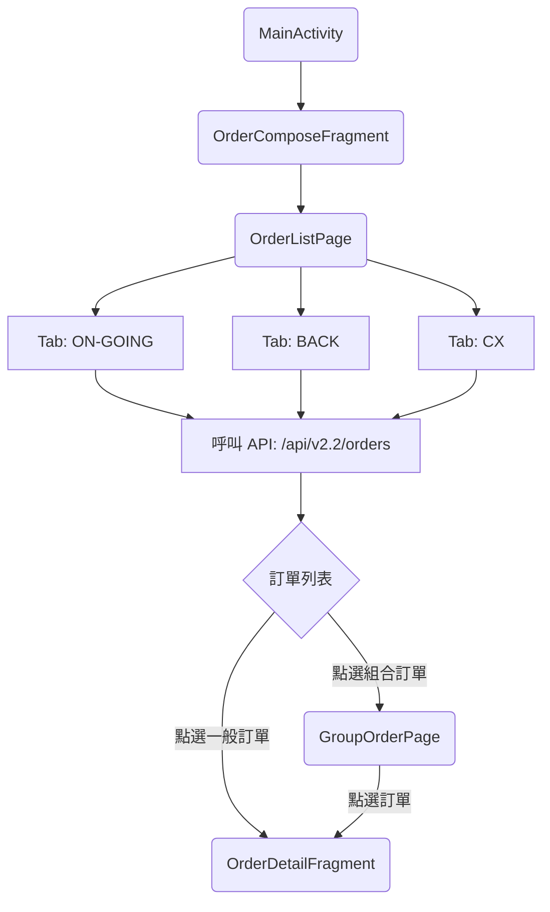

# 訂單列表專案導覽文件

本文檔說明程式碼專案中訂單列表的導覽結構與實作細節。主要使用 `NavHost` 在 **OrderComposeFragment**
中根據使用者操作，呈現不同的訂單頁面與功能，並在 **OrderListPage** 中根據訂單屬性及選擇的 Tab 自動切換頁面。

---

## 架構概述

- **MainActivity**  
  應用程式的入口，負責初始化並啟動主要流程。

- **OrderComposeFragment**  
  從 **MainActivity** 進入，內含 `NavHost`，根據導覽邏輯切換以下頁面：
    - **OrderListPage**：顯示訂單列表，並依訂單是否為組合訂單及使用者選擇的 Tab 決定後續跳轉。
    - **GroupOrderPage**：顯示團體訂單相關操作與內容。

- **OrderListPage**
    - 包含三個不同的 Tab：
        - **即將到來（ON-GOING）**
        - **已完成（BACK）**
        - **取消中/已取消（CX）**
    - 點選任一 Tab 時，會觸發 `/api/v2.2/orders` API 呼叫，依據傳入的參數過濾並取得對應資料。
    - 當使用者點選某筆訂單時，系統會根據該訂單是否為組合訂單自動判斷跳轉：
        - **一般訂單**：進入 **OrderDetailFragment** 顯示訂單詳情。
        - **組合訂單**：直接跳轉至 **GroupOrderPage** 處理團體訂單操作。

- **OrderDetailFragment**  
  顯示選取訂單的詳細資料，提供返回與後續操作功能。

- **GroupOrderPage**  
  針對團體訂單提供專用的功能與操作介面。

---

## 導覽流程

1. **MainActivity** 啟動後導航至 **OrderComposeFragment**。
2. **OrderComposeFragment** 內部利用 `NavHost`，根據操作展示 **OrderListPage** 或
   **GroupOrderPage**。
3. 在 **OrderListPage** 中：
    - 使用者可透過三個 Tab（即將到來 ON-GOING、已完成 BACK、取消中/已取消 CX）切換訂單列表，並觸發
      `/api/v2.2/orders` API 呼叫以更新畫面資料。
    - 點選某筆訂單後，依據訂單屬性自動判斷：
        - **一般訂單**：跳轉至 **OrderDetailFragment** 查看詳情。
        - **組合訂單**：直接跳轉至 **GroupOrderPage** 執行團體訂單相關操作。

---

## 導覽結構圖



---

## 訂單卡片

訂單卡片主要由 `OrderCardExpView` 組件負責，並根據不同情境傳入對應的卡片樣式。該組件透過參數
`content: @Composable () -> Unit` 接收傳入的樣式，從而實現彈性化呈現。

### 顯示邏輯

- **主站訂單且需要推薦**
    - 採用 `MixRecommendOrderCardExpView` 呈現訂單資訊並展示推薦內容。

- **其他情境**
    - 僅顯示基本的訂單卡片內容。

### 卡片樣式分類

根據訂單類型，目前主要區分為以下兩類卡片樣式：

- **主站訂單**
    - 使用樣式：`OrderCardItem`

- **點對點訂單**
    - 使用樣式：`TransOrderItem`
    - 還有其他特定情境下的樣式，例如：
        - `TransportationFlightOrderCardInfoItem`
        - `TransportationCarRentalOrderItem`
        - .....

---

## 訂單卡片下的按鈕區塊 ComponentOrderButtons

此區塊的顯示與否是根據 `OrderCardExpView` 中的參數 `isShowOrderButton` 來決定的。按鈕的呈現邏輯與顯示條件整理如下：

### 按鈕顯示邏輯

- **相關訂單**  
  顯示條件：當 `orderInfo.groupOrders.isNotEmpty()` 為 true 時顯示。

- **聯絡方式**  
  顯示條件：當 `isOnlyShowGroupOrderButton` 為 false 時顯示。

- **查看憑證**  
  顯示條件：當 `orderInfo.orderStatus != OrderInfo.ORDER_STATUS_CANCELLED_OR_APPLYING_CANCELLED` 且
  `orderInfo.hasVoucher` 為 true 時顯示。

- **評論**  
  顯示條件：當 `orderInfo.orderStatusDisplay == DONE` 且 `orderInfo.isBundleGroupOrders()` 為 false
  時顯示。

- **再次預定**  
  顯示條件根據 `isShowReTry` 的判斷，具體邏輯如下：

  ```kotlin
  val isShowReTry = remember {
      val isNewProductOrder = orderInfo.isNewProductOrder

      val shouldShowReBooking = enableOrderReBooking

      val shouldShowRetryOption = when (orderInfo.orderStatusDisplay) {
          DONE,
          CANCELED_USER,
          CANCELED_SUPPLY -> true
          else -> false
      }

      val isGroupMainOrder = orderInfo.id == orderInfo.groupOrders.firstOrNull()?.id
      val isTraditionalOrder = orderInfo.groupOrders.isEmpty()

      isNewProductOrder &&
      shouldShowReBooking &&
      shouldShowRetryOption &&
      (isGroupMainOrder || isTraditionalOrder)
  }
    ```
  