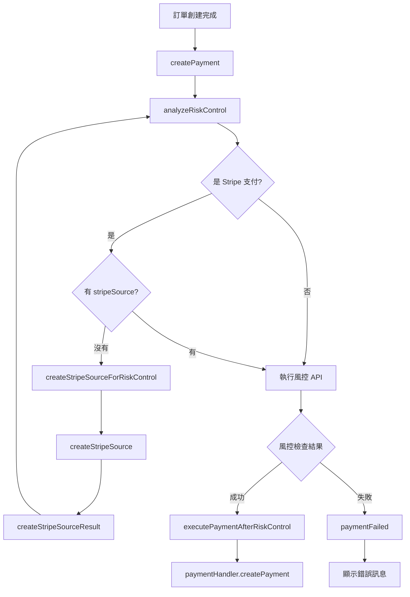
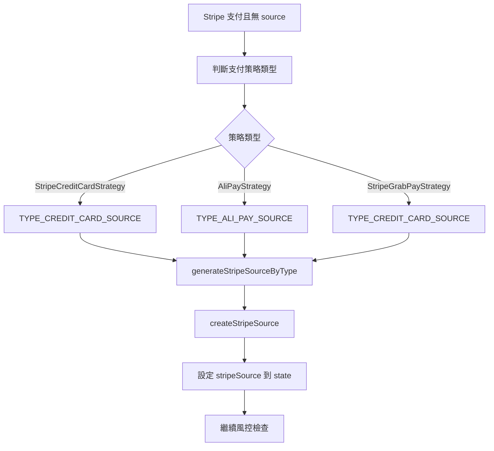
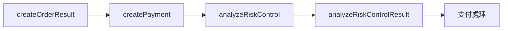
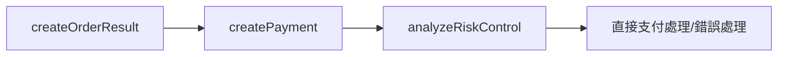
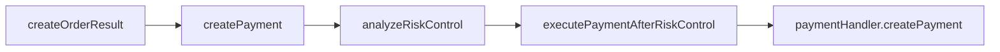

# 風控 API 整合說明

## 概述
本次修改整合了新的風控 API (`api/v3/pre/order/analyze`) 到現有的支付流程中，**所有訂單**（包括零價格訂單）在支付 API 呼叫前都會執行風控檢查。同時針對 Stripe 支付方式進行了特別優化，確保在執行風控檢查前必須先取得 Stripe source 資料。

## 修改內容

### 1. API 介面與資料模型
- **IRiskControlApiService.kt**: 風控 API service 介面
- **RiskControlAnalyzeRequest.kt**: 風控分析請求資料模型

### 2. Repository 層
- **RiskControlRepository.kt**: 風控資料存取層
  - 使用 `@Factory` annotation 進行依賴注入
  - 透過 Retrofit 直接建立 API service 實例
  - 使用 `safeApiCall` 處理 API 請求

### 3. 支付流程修改
- **PaymentActions.kt**: 風控相關 actions
  - `ANALYZE_RISK_CONTROL`: 開始風控分析
  - `EXECUTE_PAYMENT_AFTER_RISK_CONTROL`: 風控檢查成功後執行支付

- **PaymentReducer.kt**: 修改支付流程邏輯
  - **所有訂單**（包括零價格訂單）都會先執行風控檢查
  - `analyzeRiskControl` 函數：
    - **Stripe 支付方式**: 使用類型檢查 (`paymentStrategy is StripeStrategy || paymentStrategy is StripeGrabPayStrategy`) 判斷是否為 Stripe 相關支付
    - **Stripe source 檢查**: 如果是 Stripe 支付但沒有 stripeSource，會先建立 source 再執行風控
    - **成功時**: 觸發 `executePaymentAfterRiskControl` action
    - **失敗時**: 直接呼叫 `paymentActions.paymentFailed()` 顯示錯誤
  - `executePaymentAfterRiskControl` 函數：專門處理風控檢查成功後的支付邏輯
  - **架構改善**: 將風控檢查和支付執行分離，提高可維護性和可測試性

### 4. 資料來源
- **訂單編號**: 從 `state.createOrderResult().orderMId` 取得
- **支付方式**: 從 `state.paymentStrategy().channelInfo.paymentMethod` 取得
- **信用卡國家**: 
  - **Stripe 支付方式**: 從 `state.stripeSource()?.source?.sourceTypeData?.get("country")` 取得
  - **非 Stripe 支付方式**: 設為 `null`
  - **Repay 流程支援**: 如果是 Stripe 支付但沒有 stripeSource，會自動建立後再取得國家代碼

### 5. 錯誤處理
- 風控 API 失敗時使用 `R.string.order_confirm_snackbar_try_again_later` 顯示錯誤訊息
- 使用 `kotlinx.coroutines.rx2.asObservable` 將 Flow 轉換為 Observable

## 流程圖

### 整體流程


### Stripe Source 建立流程


## 架構演進

### 最初版本


### 簡化版本


### 最終版本 (當前)


## 測試要點
1. **所有訂單成功流程**: 確認風控 API 被呼叫且支付正常進行
2. **所有訂單失敗流程**: 模擬風控失敗，確認顯示錯誤訊息且支付中止  
3. **零價格訂單流程**: 確認零價格訂單也會執行風控檢查
4. **Stripe 支付流程**: 
   - 確認 Stripe 支付方式的類型檢查正確 (`StripeStrategy` 和 `StripeGrabPayStrategy`)
   - 測試有 stripeSource 的情況下直接執行風控
   - 測試沒有 stripeSource 的情況下先建立 source 再執行風控
5. **Repay 流程**: 測試從非 Stripe 支付方式切換到 Stripe 支付方式的情況
6. **API 參數驗證**: 確認 order_master_mid、payment_method、card_country 正確傳遞
7. **Action 分離**: 確認 `executePaymentAfterRiskControl` action 被正確觸發

## API 規格
- **Endpoint**: `api/v3/pre/order/analyze`
- **Method**: POST
- **Request Body**:
  ```json
  {
    "order_master_mid": "25MM214111711",
    "payment_method": "CREDIT_CARD",
    "card_country": "JP"
  }
  ```
- **Success Response**: status = "0000"
- **Error Response**: status = "A0001"

## 主要變更摘要
1. **統一風控檢查**: 所有訂單（包括零價格）都會執行風控檢查
2. **Stripe 支付優化**: 
   - 使用類型安全的支付策略檢查 (`paymentStrategy is StripeStrategy`)
   - 確保 Stripe 支付方式在風控檢查前必須有 stripeSource 資料
   - 支援 Repay 流程中的 Stripe 支付方式切換
3. **架構改善**: 
   - 新增 `executePaymentAfterRiskControl` action 和 reducer
   - 將風控檢查和支付執行分離，符合單一職責原則
   - 提高程式碼的可測試性和可維護性
4. **類型安全**: 使用 Kotlin 類型檢查取代字串比對，提高程式碼安全性
