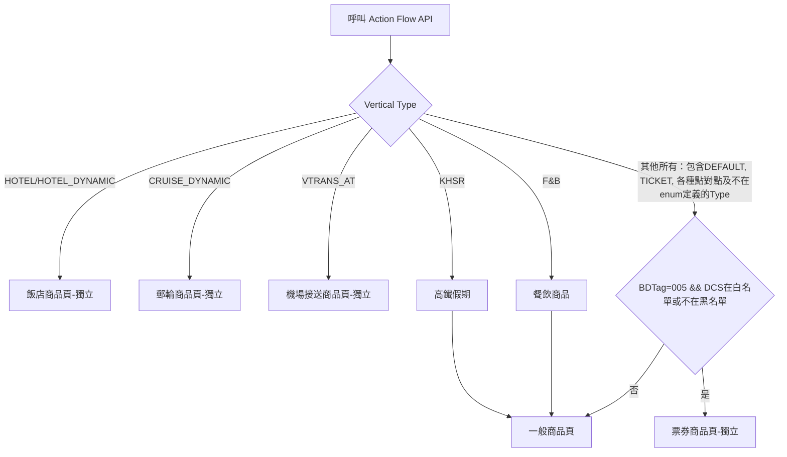

# KKDay Android 訂購流程開發文檔

## 📝 異動記錄

| 日期      | 異動內容                   | 編輯者 |
|----------|---------------------------|-------|
| 2025/8/1 | 初始文件                   | Allen |
| 2025/6/6 | 新增商品頁分流ActionFlow流程 | Allen |

## 🎯 文檔目的
介紹商品頁分流機制



## 🧩 核心組件與關鍵代碼位置

### 商品頁入口 - ProductHostActivity

**主要職責**:
- 商品頁主容器，從點擊商品卡或Deeplink進入
- 處理API分流、不同Vertical UI邏輯或獨立頁面分流

**判斷流程**:

- ProductHostActivity 實作 QueueItActivityDelegate 目的是當流量過大時，幫用戶做排隊進入頁面的功能

- override fun onQueuePassed() // 通過排隊檢查後的初始入口點
```kotlin
lifecycleScope.launch {
    val vertical = getProductVertical() // Call Action Flow API取得Product Vertical
    getProductDetail(vertical) // 請求ProductInfo API取得商品資料，然後如流程圖運作
}
```
- 先判斷幾種有特殊Vertical對應獨立商品頁的類型：如飯店、郵輪、機接

- 飯店商品頁容器 HotelProductDetailFragment，有繼承 SharedProductDetailFragment取用共用功能
    - Hotel 2.0可以直接請求專屬的Hotel ProductInfo API，就不請求ProductInfo API
    - 無論是Hotel 2.0還是3.0(Hotel Dynamic)，都需要進入飯店商品頁，裡面會再分機制處理2.0, 3.0流程
    - 要注意的是Hotel 2.0可以全部都拿Hotel ProductInfo API資料，Hotel 3.0要用ProductInfo API部分資料

- 郵輪獨立頁 TransProductDetailFragment

- 機接獨立頁，待開發

- 票券獨立頁 MultipleProductDetailFragment，有繼承SharedProductDetailFragment取用共用功能
    - 判斷方式是用BDTag=005 && DCS在白名單或不在黑名單，要注意不是用Vertical = TICKET來判斷

- 一般商品頁 CommonProductDetailFragment，幾乎等同於 SharedProductDetailFragment，有繼承
    - F&B目前共用一般商品頁，但是到規格選擇頁時會有不同頁面
    - KHSR目前共用一般商品頁，但是到方案選擇時會用Webview流程

- 使用nav_grapth.xml裡面定義Framgent的首頁與跳轉次級頁面

```kotlin
private fun observeData() {
    viewModel.productDetailState.launchAndCollectIn(this, isDistinct = true) { state ->
        showLoadingProgress(state.isLoading)
        when {
            // Hotel 3.0 -> 獨立飯店商品頁
            state.getVertical() == ProductSettingInfo.Vertical.HOTEL_DYNAMIC -> {
                hotelProductPage(ProductSettingInfo.Vertical.HOTEL_DYNAMIC)
            }

            // 郵輪 -> 獨立郵輪商品頁
            state.getVertical() == ProductSettingInfo.Vertical.CRUISE_DYNAMIC -> {
                transProductPage()
            }

            // 機場接送 TODO 尚未開發完成，暫時開出類別
            state.getVertical() == ProductSettingInfo.Vertical.VTRANS_AT -> {
                commonProductPage()
            }

            // BDTag=005 && DCS在白名單或不在黑名單 -> 獨立票券商品頁 (vertical = TICKET或其他符合條件商品)
            state.productDetailData?.getBD005ProductEarliestSaleTime(
                viewModel.productSpecialFlowQuickSkuEntry.value,
                viewModel.abTestTicketSku
            ) != null -> {
                vmProductPage()
            }

            // 商品詳情不為空且沒有錯誤 -> 一般商品頁 (含未分類、高鐵假期KHSR、餐品商品F&B)
            state.productDetailData != null || state.error.isNotEmpty() -> {
                commonProductPage()
            }
        }
        window.statusBarColor = ContextCompat.getColor(this, android.R.color.transparent)
    }
}
```

## 簡易Vertical開發Guideline
- 準備新增的資料存取，在data層model, networking, repository所屬的資料夾創建相關檔案

- 在feature:{vertical}:{domain}模組底下開發UI與業務邏輯操作

- 新增檔案繼承復用feature:shared:{domain}底下的Fragment, Controller, ViewModel, Interface, EpoxyModel, Compose view等，可以開擴充interface，可以新增變數與fun，不改動到shared模組內檔案為原則，可以在Vertical團隊內可以互相PR review

- 需要改動到shared基本功能或者在主站模組或資料夾的檔案上做變更，需要發PR請主站同仁Review，如有問題，可以先slack詢問rd_app_allen.li

- 全站可共用的UI，可以放在kkcomponent模組底下

- 大型需求前可以有一個技術實作sync會議，討論有無既有功能復用、架構如何設計、技術困難點等問題

## 模組分層架構
- Global層：最頂層app模組，可以使用全部模組的功能，用來打包以及放置既有的程式碼，較無分類，需要從view資料夾查看各個業務的頁面入口點，含有mvp及redux舊架構。還有版本及gradle設定的模組。

- Feature層：以業務或使用者頁面入口做為分類，且因應2025的Vertical商品拆分，會以開發團隊為區分

    - Common(主站)：

    - Multiple：目前先以商品和SKU為主，後續視需求新增

    - Hotel：目前先以商品和搜尋頁為主，後續視需求新增

    - Transportation：本身為一個獨立模組，需要把先前寫在app module的部分搬移過來

    - 原先在使用的功能需要按照業務區分，往下抽成Shared(共用)模組，業務模組維護自己的特化檔案，可以繼承復用、覆寫、新增變數與方法來搭建自己的UI，如同堆積木的方式

    - 畫面呈現容器Fragment

    - Interface定義需要實作的方法

        - 決定UI Section是否出現的Epoxy Controller、可以取用、繼承、複寫共用模組的功能

    - Compose View或Epoxy Model製作客製化的UI

- Domain層：主要放置usecase，按照業務已資料夾方式區分檔案，其中Vertical團隊會有專屬的資料夾

- Shared層：

    - base模組為早期共用模組，未來需要逐漸淘汰，sharedPrefernce需外移

    - payment為全站共用

    - routing模組：內部按資料夾區分，其中Vertical團隊會有專屬的資料夾

- Data層：按照依賴關係從上到下的模組又區分為repository、networking、roomDb、model，內部都是按資料夾區分

    - repository：資料存取的工具類，可以開發抓取網路或本地快取、本地持久性資料，其中Vertical團隊會有專屬的資料夾
    - networking：定義api的request, response路徑與格式，其中Vertical團隊會有專屬的資料夾

    - roomDb：存取room的工具

    - model：定義資料格式與local資料的，內部還有dataStore工具，其中Vertical團隊會有專屬的資料夾
