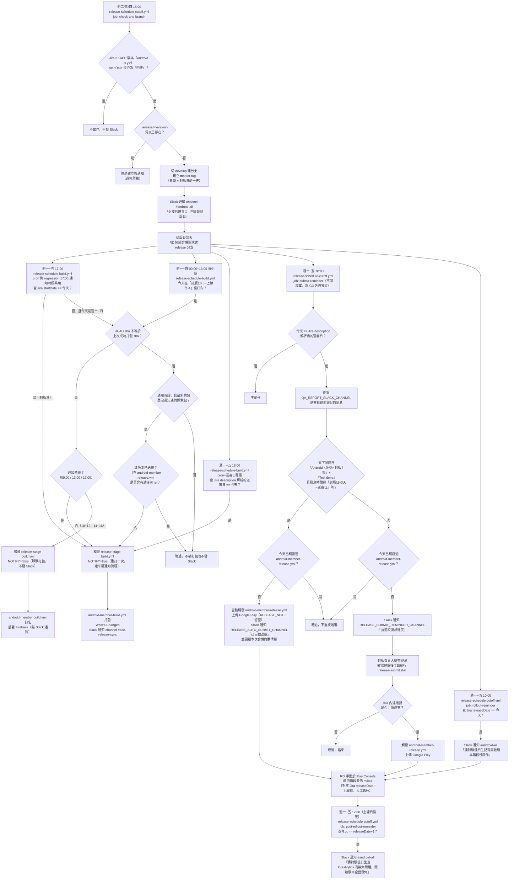

# 封版排程自動化（Release Schedule Automation）

## 總覽

取代原本依賴 **Google Calendar + Apps Script** 觸發、且需要手動改 GitHub Repo Variable 才能開關 Slack 通知的封版排程機制。改用 **GitHub Actions 原生 `schedule` cron**，直接查詢 Jira KKAPP Release 頁面每個版本的 `startDate`（封版日）與 description 文字裡的送審日（Jira 沒有結構化的送審日欄位），走「封版日前一天建分支 → 封版當日打包 → regression 期間驗證 → 送審日提醒/自動送審」的循環，全程無需人工進 Calendar 或 GitHub 設定頁操作，也不假設封版日固定是星期幾。

送審這一步已改為**條件式自動化**：QA regression 完成訊息比對成功時，直接觸發 Google Play 送審，不再等待人工執行 `release-submit` skill；只有比對失敗（找不到完成訊息）時才會通知封版負責人介入排查，此時才需要人工手動送審。

相關程式碼：
- [.github/workflows/release-schedule-cutoff.yml](../../../.github/workflows/release-schedule-cutoff.yml)：週二/三/四查 Jira `startDate`、提前一天開分支；週一~五查 Jira description 解析的送審日，符合就提醒/自動送審（含 QA 訊息偵測）；週一~五查 Jira `releaseDate`，上線日提醒開啟階段性發佈、上線日隔天提醒查 Crashlytics 後開啟全面發佈
- [.github/workflows/release-schedule-build.yml](../../../.github/workflows/release-schedule-build.yml)：查 Jira `startDate`/送審日，封版當日與 regression 期間的排程打包（regression 期間每小時檢查、分通知/靜默時段、通知時段偵測到未通知過的靜默包且尚未送審時直接重打並通知）
- [.github/workflows/release-stage-build.yml](../../../.github/workflows/release-stage-build.yml)：實際打包邏輯（`NOTIFY` 參數控制是否通知；stage 版本序號合併手動+自動打包紀錄取 max+1）
- `.claude/skills/release-create`、`release-build`、`release-submit`：人工手動路徑仍保留，供例外情況使用

### 舊機制已停用

[release-auto-build.yml](../../../.github/workflows/release-auto-build.yml)（「merge 進 release 分支就自動打包」）已完全停用。原因：分支改成封版日前一天建立後，marker tag 日期跟著提前一天，這支 workflow 判斷「今天是否剛建分支」的邏輯因此誤判，導致封版當日的每筆 merge 都被當成 regression 補 merge，跟 `release-schedule-build.yml` 的排程打包重複觸發。

停用方式：Job 層級直接把原本三段條件（`RELEASE_AUTO_BUILD_ENABLED != 'false'` && `merged == true` && `startsWith(base.ref, 'release/')`）整段換成 `if: false`。Repo variable `RELEASE_AUTO_BUILD_ENABLED` 目前設為 `false`，但因為程式碼裡已經沒有任何地方讀取它，**不是真的雙重保險**，只是殘留設定。

若之後要復原：不能只刪除 `if: false`，必須把上面三段條件整段還原,否則 job 會對任何 closed 的 `release/**` PR（包含沒 merge 就直接關閉的）都觸發。復原前建議先確認 `release-schedule-build.yml` 的 regression 補包窗口（見下方「封版日、送審日與排程動作對照」）已能涵蓋需求，避免兩套機制重新打架。

---

## 名詞定義

| 名詞 | 說明 |
|---|---|
| 封版日 | Jira KKAPP 版本的 `startDate` 欄位；由 `check-and-branch` job 每天動態查詢，不假設固定星期幾 |
| 送審日 | Jira **沒有結構化的送審日欄位**，只存在 `description` 文字裡（格式：`【封版】...【送審】...【上線】...【Owner】...`），程式用正規表達式 `【送審】(\d{4}/\d{2}/\d{2})` 解析取得 |
| 上線日 | Jira 版本的 `releaseDate` 欄位，代表 RD 手動開 Google Play 階段發布的日子；`release-schedule-build.yml` 的 regression 補包窗口結束邊界、`release-schedule-cutoff.yml` 的 `rollout-reminder`／`post-rollout-reminder` 兩個提醒 job 都會用到這個欄位 |
| 版本名稱格式 | Jira KKAPP 專案版本名稱固定為 `Android <x.y.z>`（同專案還混著 iOS / api-b2c 版本），程式用 `test("^Android [0-9]+\\.[0-9]+\\.[0-9]+$")` 篩選，再用 `sub("^Android "; "")` 取出純版號給 branch/tag 命名用 |
| 建分支日 | 封版日的前一天，`check-and-branch` job 實際建立 `release/<version>` 分支與 marker tag 的日子 |
| marker tag | `release-start/<version>-<YYYYMMDD>`，建分支日當下建立的 git tag；**只用來判斷「哪個 release 分支是自動化在管的」**（濾掉無 marker tag 的手動 hotfix 分支），不再用它的日期做任何計算——所有日期判斷都直接重新查 Jira |
| 通知時段 / 靜默時段 | regression 補包每小時（09:00~17:00）都檢查，但只有 **09:00、13:00、17:00** 三個「通知時段」打包會通知 channel（`NOTIFY=true`）；其餘整點（10~12、14~16）為「靜默時段」，有新合併照打包但不通知（`NOTIFY=false`），確保 channel 一天最多三次打包通知 |
| 靜默包 | 打包當下 `NOTIFY=false` 的 Stage 包（來自靜默時段排程或手動打包沒開通知）；通知時段偵測到最新的包是靜默包、且該版本尚未送審時，會直接重打一次並帶 `NOTIFY=true`，讓 channel 補上跟平常打包一樣的通知，不是發一則額外的摘要文字 |
| regression 補包窗口 | `release-schedule-build.yml` 判斷「封版日之後、上線日之前」要不要因為新合併而補打包的區間，範圍是 `封版日+3` ~ `上線日-4`（結束邊界改用上線日而非送審日，避免窗口過短、漏掉送審後到上線前這段時間；用 -4 而非 -3 是為了讓上線日是週一時，窗口結束日落在週四而不是週五——regression 檢查只排週一~四，落在週五就不會有排程自動檢查），刻意排除封版日前後的週末 |
| 封版負責人 | 負責追蹤該次封版 regression 進度、執行送審的人（依 Jira 頁面上的 assignee 輪值） |

---

## 整體流程圖

各時間點各自獨立觸發；唯一例外是 17:00——封版當日強制打包與 regression 通知時段共用同一條 cron（同一時刻掛兩條 cron 會放大 GitHub Actions 密集排程漏觸發的風險），job 內先判封版日、非封版日才走 regression 檢查：

---

## Skill 作法（人工手動路徑如何被排程重用）

排程 workflow **不重寫**任何打包/送審邏輯，只是在對的時間點呼叫既有 skill 背後的 workflow：

| Skill（人工可單獨使用） | 排程如何重用 | 差異 |
|---|---|---|
| `release-create`（開分支） | `release-schedule-cutoff.yml` 用相同的版本排序/建分支邏輯，但改由 Jira 資料驅動、走 `gh api` 直接建 ref，不需要人工確認版號 | skill 版會用 `AskUserQuestion` 讓人確認版號；排程版直接信任 Jira 版本名稱 |
| `release-build`（打包） | `release-schedule-build.yml` 觸發 `release-stage-build.yml`，`NOTIFY` 依時段動態帶入（通知時段/封版日/送審日 `true`、靜默時段 `false`） | 人工用 skill 或手動 dispatch 時 `NOTIFY` 預設 `false`（靜默）；靜默的手動包會在下個通知時段被排程偵測到，若該版本尚未送審會直接重打一次補上通知，不會漏 |
| `release-submit`（送審） | QA 關鍵字比對成功時，`release-schedule-cutoff.yml` 直接 `gh workflow run android-member-release.yml --field VERSION_NAME=<version>` | 略過 skill Step 1 的送審前置確認清單、Step 2 的版本說明（What's New）撰寫，`RELEASE_NOTE` 留空不帶；只有比對失敗時才會請封版負責人走完整 skill 流程（含確認清單與版本說明） |

---

## 運作邏輯詳解

### 1. 為什麼還需要 marker tag（日期判斷都直接查 Jira 了）

`release-schedule-cutoff.yml` 開分支的同時會建立 `release-start/<version>-<YYYYMMDD>` tag，但這個 tag **只用來回答一個問題**：「目前版號最大的 `release/*` 分支，是不是自動化真的建立的？」本 repo hotfix 分支很常見（`release/2.105.1` 這種），版號可能比正在跑 regression 的主版本還大，但不是排程建的、Jira 上也沒有對應的封版流程可查。`release-schedule-build.yml` 和 `submit-reminder` job 都會由低到高版本掃描所有 `release/*` 分支，挑出「有 marker tag」的最高版本，藉此濾掉這種 hotfix 分支，確定要追蹤的是哪一版。

找到版本後，**所有日期判斷都重新查一次 Jira**（`startDate` 當封版日、`description` 解析送審日），不使用 marker tag 上的日期反推——即使分支不是精準在「封版日前一天」建立的（例如人工用 `workflow_dispatch` 補建），日期判斷依然正確。

### 2. 封版日、送審日與排程動作對照

不再用固定天數位移，全部直接比對 Jira 查到的日期。各時間點各自綁專屬 cron，同一個 job 用 `github.event.schedule` 分流，確保每次執行只檢查對應的那一種情境（用 cron 字串而非執行當下的時鐘判斷時段，GitHub 排程延遲跨小時也不會誤判）。唯一共用時段的是 17:00——封版強制打包與 regression 通知時段合併在同一條 cron，job 內先判封版日：

| 排程檢查點 | 專屬 cron | 判斷條件 | 動作 |
|---|---|---|---|
| 建分支（`release-schedule-cutoff.yml` check-and-branch） | 週二/三/四 15:00 | Jira `startDate - 今天 == 1` | 建立分支＋marker tag |
| regression 補包・通知時段（`release-schedule-build.yml`） | 週一~四 09:00、13:00（17:00 見下條） | 今天介於 `封版日+3` ~ `上線日-4` 之間，且 HEAD sha 有變化 | 有新合併就打包＋通知（`NOTIFY=true`）；沒有新合併但最新的包是「沒通知過的靜默包」且該版本尚未送審時，直接重打一次並帶 `NOTIFY=true`（跟平常合併觸發同一條路徑，不發摘要文字）；已送審則略過 |
| regression 補包・靜默時段（`release-schedule-build.yml`） | 週一~四 10:00~12:00、14:00~16:00（每小時） | 同上 | 有新合併就打包但**不通知**（`NOTIFY=false`），沒有則略過 |
| 封版當日強制打包＋regression 17:00 通知時段（`release-schedule-build.yml`） | 週一~五 17:00（共用一條 cron） | 先判 Jira `startDate == 今天`（封版日只會落在週三~五）；非封版日且今天是週一~四，改走 regression 通知時段檢查 | 封版日：強制打包一次（無論有無合併）；否則同「通知時段」的行為 |
| 送審當日強制打包（`release-schedule-build.yml`） | 週一~五 18:00 | Jira description 解析出的送審日 == 今天 | 強制打包一次，留一版最新的 Stage 包供送審前確認 |
| 送審提醒/自動送審（`release-schedule-cutoff.yml` submit-reminder） | 週一~五 18:00 | Jira description 解析出的送審日 == 今天 | 查 QA 訊息，決定要不要自動送審 |
| 階段性發佈提醒（`release-schedule-cutoff.yml` rollout-reminder） | 週一~五 10:00 | Jira `releaseDate == 今天` | Slack 通知 `#android-all`「請封版值日生記得開啟版本階段性發佈」 |
| 全面發佈提醒（`release-schedule-cutoff.yml` post-rollout-reminder） | 週一~五 12:00 | Jira `releaseDate + 1 == 今天` | Slack 通知 `#android-all`「請封版值日生查 Crashlytics 有無大問題，開啟版本全面發佈」 |

「送審當日強制打包」跟「送審提醒/自動送審」剛好都排在 18:00，但分別在 `release-schedule-build.yml`／`release-schedule-cutoff.yml` 兩個獨立檔案裡執行，彼此沒有共用 job、沒有互相依賴，也不會互相阻塞——前者是打 Firebase Stage 包，後者是查 QA 訊息決定要不要送 Google Play，兩條路徑本來就互不影響。

**密集 cron 的已知風險與因應**：GitHub Actions 對同一個 workflow 檔案裡排太密集的多個 cron 有偶發性延遲或漏觸發的問題（實際發生過：封版日 17:30 的強制打包完全沒有觸發紀錄、同檔案裡的 regression 檢查則延遲 70~95 分鐘才觸發）。regression 改成每小時檢查後無法再靠拉開間距迴避，改用兩個手段降低風險：(1) 17:00 不另掛第二條 cron，封版強制打包與 regression 通知時段**合併成一條**、job 內分流；(2) 通知/靜默時段用 `github.event.schedule` 的 cron 字串判斷而非執行當下的時鐘，排程延遲跨小時也不會誤判時段。延遲或漏觸發仍可能發生，所以下方決策點與已知限制仍保留 idempotency 檢查、`workflow_dispatch` 手動補救等安全網。順帶一提，建分支（`release-schedule-cutoff.yml` check-and-branch）排在 15:00，跟 `release-schedule-build.yml` 的時段群錯開，減少跨檔案同時觸發造成 self-hosted runner 排隊的機率。

**為什麼 regression 窗口是「封版日+3 ~ 上線日-4」，不是送審日-3**：regression 應該持續到接近上線前，不是送審當下就停止——送審後到 Google Play 審核通過、實際上線前，這段時間如果又合併了修正，仍然需要補包驗證。用送審日當結束邊界會讓窗口過短、漏掉這段時間；改用上線日（Jira `releaseDate` 結構化欄位）當結束邊界才涵蓋完整的驗證期。`-4`（而非 `-3`）是因為 regression 檢查只排週一~四：上線日常見落在週一，`上線日-3` 會落在週五（沒有排程檢查、白算），改成 `上線日-4` 則落在週四（有排程檢查）。`+3` 是刻意排除封版日前後週末的緩衝天數。這個調整只解決「上線日是週一」這個最常見的情況，如果上線日剛好是別的星期幾，窗口邊界還是有機率落在週五或週末，詳見下方已知限制。

**舉例**：假設封版日是**週五**、送審日是**下週四**、上線日是**下下週一**（用實際日期舉例：封版日 2026-07-17、送審日 2026-07-23、上線日 2026-07-27），各排程動作分別落在星期幾：

| 排程動作 | 日期 | 星期 |
|---|---|---|
| 建分支（check-and-branch，封版日前一天 15:00） | 2026-07-16 | **週四** |
| 封版當日強制打包（17:00） | 2026-07-17 | **週五**（＝封版日） |
| regression 補包窗口開始（`封版日+3`） | 2026-07-20 | **週一** |
| regression 補包實際檢查（09:00~17:00 每小時，僅週一~四，有新合併才打包；僅 09:00/13:00/17:00 通知） | 2026-07-20 ~ 07-23 | 週一 ~ 週四 |
| 送審當日強制打包（18:00）＋送審提醒/自動送審（18:00）＋regression 補包窗口結束（`上線日-4`） | 2026-07-23 | **週四**（送審日跟窗口結束日剛好同一天，三個獨立檔案/邏輯各自觸發，互不影響） |
| 上線（RD 手動於 Play Console 開啟階段發佈） | 2026-07-27 | **週一**（＝上線日，非自動化） |

這個例子裡窗口是週一到週四整整四天，全部落在有排程檢查的範圍內，不會踩到「窗口落在週五/週末」的已知限制。

### 3. 「有新合併才打包」怎麼判斷，以及通知/靜默時段與補發摘要

比對 `release/<version>` 目前 HEAD 的 commit sha，與 **`android-member-build.yml` 上一次成功的 StageMiniDebug 打包**的 `head_sha`。查的是真正執行打包的 `android-member-build.yml` 而不是 `release-stage-build.yml`——後者只負責 dispatch，本身「成功」不代表下游真的打包成功；而且查 `android-member-build.yml` 也涵蓋**手動直接 dispatch 的包**，避免手動包沒被算到。

兩者不同（有新合併）時觸發打包，`NOTIFY` 依時段決定：**通知時段**（09:00/13:00/17:00）帶 `NOTIFY=true`，channel 收到打包開始 / What's Changed / 完成三則訊息；**靜默時段**（10~12、14~16 點）帶 `NOTIFY=false`，照打包但不發任何 Slack 訊息。

兩者相同（沒有新合併）時，通知時段會多做一層檢查：如果最新的成功包是「靜默包」（打包當下 `NOTIFY=false`——可能來自靜默時段排程，也可能是有人手動打包沒開通知；判斷方式是查該 run 的 `start-message-stage-release` job 是否執行過），且該版本**尚未送審**（查 `android-member-release.yml` 對這個 release 分支是否曾有過任何 run，不限成功/失敗），就直接重打一次（`should_build=true`，重用「有新合併」同一條觸發路徑，`NOTIFY=true`），讓 channel 收到跟平常打包完全一樣的「打包開始 / What's Changed / 打包完成」三則訊息——不發任何摘要文字。這確保「有出包當天必有通知、channel 一天最多三次通知」，不會再發生包出了但沒人知道的情況（2.122.0 週實際發生過：手動包沒開通知＋排程看到 sha 已打包就略過，channel 整週靜默）。若該版本已送審，則視為 regression 補包通知已無意義，直接跳過，不補打包也不發任何訊息。

### 4. 版本序號（stage-N）怎麼計算

Stage 包版本名格式是 `<version>_<MMDD>_stage-<N>`，`N` 由 `release-stage-build.yml` 計算：查**當天**該 branch 的 `android-member-build.yml` StageMiniDebug 成功 run（手動+自動都涵蓋），取「成功 run 數」與「從 run 標題解析出的已用最大序號」兩者較大值再 +1。`android-member-build.yml` 的 run-name 帶 `VERSION_NAME`，序號才解析得到；解析不到（舊格式標題）就退回用 run 數。

過去只數 `release-stage-build.yml` 自己的執行次數，手動直接 dispatch `android-member-build.yml` 的包不會被算到，發生過撞名（`2.122.0_0729_stage-1` 手動包已用掉 -1/-2，流程包又算出 -1，Firebase 上出現兩個同名但內容不同的包）。取 max 再 +1 也涵蓋「手動的人填了更大序號」的情況。

### 5. QA 完成訊息怎麼判斷

分兩層：

1. **有效訊息時間窗口**：只有 `ts`（訊息實際發送時間）落在「Jira `startDate`（封版日）+3 天」到「Jira 送審日當天（含）」這個區間內的訊息，才會拿去做文字比對；區間外的即使文字對得上也不算數。窗口上限用**送審日**而不是上線日——這個 job 只在送審日當天執行一次，執行當下不可能有「未來」的訊息，用上線日當上限沒有實質效果，還可能誤導閱讀者以為窗口真的延伸到上線日。超過送審日還等不到符合的訊息，本來就該走人工介入（見下方決策點 #8），不是自動化要去處理的情境。
2. **Slack API 查詢邊界**：呼叫 `conversations.history` 查詢 `QA_REPORT_SLACK_CHANNEL`，`oldest` 取「送審日往前推 2 天」與「窗口起點（封版日+3天）」兩者較早的一個。取較早值是為了避免查詢邊界比窗口起點還晚，導致窗口起點附近的訊息還沒進到窗口過濾就先被 Slack API 擋在外面（漏抓）。

文字比對本身是**關鍵字模糊比對**：對窗口內的每則訊息 `text` 檢查是否同時包含：

- `Android <版號> 封版上架`（例如 `Android 2.122.0 封版上架`，`<版號>` 直接帶入當次判斷的 release 版本號）
- `Test done`

這是 Jira 自動化幫每個版本建立的「封版上架」ticket 狀態轉為 Test done 時發的通知（固定格式：`<連結|Android <版號> 封版上架> - Test done`），不是 QA_Automation_Bot 的彙整報告。兩者都命中才算「找到」，只要有一則訊息符合即可（不要求最新一則）。**這個比對天生就含版號**，不會像舊版比對邏輯一樣誤判成別的版本測試完成（舊版風險已解除，詳見下方已知限制 #2 的更新說明）。

2026-07-30 起改用這個比對方式，原因是 2.122.0 這次 QA_Automation_Bot 彙整報告的文字是 `QA regression testing report`（沒有 `(APP)` 後綴），跟原本寫死的關鍵字對不上，導致自動比對完全找不到，18:00 誤發了「請封版負責人排查」的追蹤提醒——即使 QA 其實已經測完。彙整報告的文字格式本來就不受這個流程控制（QA 團隊自己維護），且原本比對邏輯也沒有版號、有多版本並行風險；改用版號固定的 Jira 狀態通知後兩個問題一起解決。

---

## 人工與自動的決策點

| # | 決策點 | 判斷依據 | 自動 / 人工 | 說明 |
|---|---|---|---|---|
| 1 | 明天要不要封版（建分支） | Jira `startDate` 是否等於明天 | **自動** | 完全取代原本人工看 Calendar，改成封版日前一天預先建分支 |
| 2 | 要不要建立分支 | `release/<version>` 是否已存在 | **自動** | 防止重複建立與重複通知 |
| 3 | 封版當日要不要打包 | Jira `startDate == 今天` | **自動（強制）** | 不論有無合併都打包一次，作為封版基準版本；直接查 Jira，不經過 marker tag 日期反推 |
| 4 | regression 期間要不要打包 | 今天在「封版日+3 ~ 上線日-4」窗口內，且 commit sha 有變化（09:00~17:00 每小時檢查） | **自動** | 沒有新合併就不浪費打包資源；窗口用 Jira 實際日期計算，不假設封版日星期幾。打包是否通知依時段：09:00/13:00/17:00 通知、其餘靜默；通知時段若沒新合併，但最新的包是沒通知過的靜默包且尚未送審，會直接重打一次並通知（見運作邏輯詳解 #3）；已送審則不再補打包 |
| 5 | 送審當日要不要強制打包 | Jira description 解析出的送審日 == 今天 | **自動（強制）** | 送審前留一版反映最新合併內容的 Stage 包；跟第 6 點同樣是 18:00，但在不同檔案（`release-schedule-build.yml`）獨立執行，不影響送審判斷 |
| 6 | 送審日要不要發提醒 | 今天是否等於 Jira description 解析出的送審日 | **自動** | 送審日沒有結構化欄位，用正規表達式從 description 解析；不假設固定星期幾 |
| 7 | 判斷 QA 是否測完，並決定要不要送審到 Google Play | 關鍵字模糊比對 Slack 訊息（含版號，比對 `Android <版號> 封版上架` + `Test done`），且訊息時間需落在「封版日+3天 ~ 送審日」窗口內，且今天尚未觸發過 `android-member-release.yml` | **自動（含動作）** | 兩個文字條件＋時間窗口都命中，直接觸發 `android-member-release.yml` 送審，不等待人工確認；`RELEASE_NOTE` 留空不帶版本說明文字；送審通知下方會回覆本次合併的 PR/票清單 |
| 8 | 比對失敗時要不要人工介入送審 | 今天是送審日、時間窗口內找不到符合訊息，且今天尚未觸發過 `android-member-release.yml` | **人工** | 只有這個例外分支才需要封版負責人手動執行 `release-submit` skill（含完整前置確認清單與版本說明），確保比對失效時仍有人工把關；若今天已經觸發過送審（例如封版負責人已手動處理），則不再發這則提醒 |
| 9 | 要不要對外開放階段發佈（rollout） | RD 在 Google Play Console 觀察指標後決定，對應 Jira `releaseDate`（上線日） | **人工** | 完全不在自動化範圍內，本來就是最後一道人工關卡；`rollout-reminder` job 只負責提醒，不會代為執行 |
| 10 | 上線日要不要發階段性發佈提醒 | Jira `releaseDate == 今天` | **自動** | 提醒封版值日生記得手動開啟階段性發佈，純通知不含動作 |
| 11 | 上線日隔天要不要發全面發佈提醒 | Jira `releaseDate + 1 == 今天` | **自動** | 提醒封版值日生查 Crashlytics 後決定要不要開啟全面發佈，純通知不含動作、不判斷 Crashlytics 實際狀況 |

**設計原則**：凡是「打包、開分支、發通知」這類可重複、可回溯、影響範圍在內部（Slack/GitHub）的動作，都盡量自動化。送審原本因為是「對外不可逆」動作而保留人工確認，現已改為**條件式自動化**：只信任兩段文字關鍵字比對結果，比對成功才自動送審；比對失敗（含 Slack API 失敗、變數未設定等視為未找到的情況）一律退回人工路徑，不會用自動化去猜測或補救不確定的狀態。階段發佈仍是唯一完全排除在自動化外的關卡。

---

## 通知偵測資料與觸發條件總表

| 來源 | 偵測內容 | 觸發條件 | 通知 channel | 訊息重點 |
|---|---|---|---|---|
| Jira REST API `/rest/api/3/project/KKAPP/versions` | 未發布版本的 `startDate` | `startDate - 今天 == 1`（明天），且版本名稱符合 `Android x.y.z` | `#android-all` | 「release/&lt;version&gt; 分支已建立🚀，明天是封版日」 |
| Git ref：`release/<version>` 是否存在 | 分支存在性 | 已存在 | 無 | 略過，僅記錄 log |
| Jira `startDate`（重新查詢） | 封版日 | `startDate == 今天` | `#b2c-release-sync`（經 `android-member-build.yml` 既有 job） | 打包開始 / What's Changed / 打包完成 |
| Jira `releaseDate` ＋ GitHub Actions run 記錄的 `head_sha` | regression 窗口內是否有新 commit（09:00~17:00 每小時） | 今天在「封版日+3 ~ 上線日-4」內，且 sha 不同 | 通知時段（09:00/13:00/17:00）：`#b2c-release-sync`；靜默時段（10~12、14~16 點）：無通知 | 同上（版本號含 `_stage-N` 遞增，序號合併手動+自動打包紀錄取 max+1） |
| GitHub Actions runs ＋ jobs API（最新成功 StageMiniDebug run 的通知 job 是否執行過）＋ `android-member-release.yml` 對該分支是否曾有過任何 run | 通知時段沒有新合併時，最新的包是否為「沒通知過的靜默包」，且該版本是否已送審 | 今天在 regression 窗口內的通知時段，無新合併，最新成功包未發過通知，且尚未送審 | `#b2c-release-sync`（經 `android-member-build.yml` 既有 job，重打一次觸發） | 打包開始 / What's Changed / 打包完成（跟平常合併觸發完全相同，不發摘要文字）；若已送審則整個跳過 |
| Slack `conversations.history`（`QA_REPORT_SLACK_CHANNEL`，查詢邊界取「送審日前 2 天」與「封版日+3天」較早者） | 訊息文字是否同時含 `Android <版號> 封版上架`／`Test done`（含版號，2026-07-30 起改用此比對），且訊息時間落在「封版日+3天 ~ 送審日」窗口內 | 今天為 Jira 送審日，找到符合訊息，且今天尚未觸發過 `android-member-release.yml` | `RELEASE_AUTO_SUBMIT_CHANNEL` | 觸發 `android-member-release.yml` 自動送審後，通知「QA regression 已確認測試完畢 ✅，已自動觸發送審」，並在同一則訊息下方回覆本次合併進這個版本的 PR/票清單 |
| 同上，但時間窗口內查無符合訊息 | 同上 | 今天為 Jira 送審日，沒找到符合訊息，且今天尚未觸發過 `android-member-release.yml` | `RELEASE_SUBMIT_REMINDER_CHANNEL` | 「今天是送審日，尚未偵測到 QA 完成訊息，請排查測試進度，確認完畢後手動執行 release-submit skill」；若今天已經觸發過 `android-member-release.yml`（例如封版負責人已手動送審），則整個跳過不發 |
| Jira `releaseDate`（重新查詢） | 上線日 | `releaseDate == 今天` | `#android-all` | 「今天是上線日 🚀，請封版值日生記得開啟版本階段性發佈」 |
| Jira `releaseDate`（重新查詢） | 上線日隔天 | `releaseDate + 1 == 今天` | `#android-all` | 「上線後第一天，請封版值日生到 Crashlytics 查看有無大問題，開啟版本全面發佈」 |

---

## 通知 Channel 總覽

以「頻道」為單位，列出這個自動化流程會用到的所有 channel、各自收到什麼通知、用途是什麼。

| Channel | 類型 | 用途 | 收到的通知內容 | 觸發時機 |
|---|---|---|---|---|
| `#android-all`（硬編碼固定頻道） | 通知目的地 | 封版分支建立公告；上線日階段性發佈提醒；上線日隔天全面發佈提醒 | 「release/&lt;version&gt; 分支已建立🚀，明天是封版日，請夥伴們陸續上車」／「請封版值日生記得開啟版本階段性發佈」／「請封版值日生查 Crashlytics 有無大問題，開啟版本全面發佈」 | 週二/三/四判定明天需封版且分支尚未存在；週一~五 10:00 判定今天是上線日；週一~五 12:00 判定今天是上線日隔天 |
| `#b2c-release-sync`（硬編碼固定頻道，打包通知由 `android-member-build.yml` 既有 job 發送，`release-schedule-build.yml` 只負責觸發打包、不直接發訊息） | 通知目的地 | Stage 打包狀態通知 | 打包開始 / What's Changed（合併內容清單）/ 打包成功或失敗 | 封版當日 17:00 強制打包一次；regression 補包窗口內（週一~四 09:00~17:00 每小時檢查）有新合併時觸發打包，僅 09:00/13:00/17:00 通知時段發訊息，一天最多三次；通知時段若無新合併但最新的包是尚未送審的靜默包，直接重打一次帶上通知；送審當日 18:00 強制打包一次 |
| `vars.RELEASE_AUTO_SUBMIT_CHANNEL`（Repo Variable，需自行設定 channel ID） | 通知目的地 | 送審結果通知 | 「QA regression 已確認測試完畢 ✅，已自動觸發送審（未帶版本說明文字）」，同一則訊息下方會回覆一則「本次送審合併的票」（比對 `develop...release/<version>` 的 PR 清單） | 今天為 Jira 送審日，且時間窗口（封版日+3天 ~ 送審日）內的 Slack 訊息比對到兩段關鍵字文字，且今天尚未觸發過 `android-member-release.yml`，自動送審成功後發送 |
| `vars.RELEASE_SUBMIT_REMINDER_CHANNEL`（Repo Variable，需自行設定 channel ID） | 通知目的地 | 例外情況追蹤提醒 | 「今天是 Jira 標記的送審日，尚未偵測到 QA regression 完成訊息，請排查現況並於確認後手動執行 release-submit skill」 | 今天為 Jira 送審日，時間窗口內找不到符合關鍵字的訊息（含比對失敗、API 呼叫失敗、變數未設定等情況），且今天尚未觸發過 `android-member-release.yml`；若已經觸發過（例如封版負責人已手動送審），則不再發這則提醒 |
| `vars.QA_REPORT_SLACK_CHANNEL`（Repo Variable，需自行設定 channel ID） | **讀取來源，非通知目的地** | QA regression 回報頻道，自動化讀取「送審日前 2 天／封版日+3天」較早者起的訊息，再篩出時間落在「封版日+3天 ~ 送審日」窗口內的做關鍵字比對，不會主動發訊息到這裡 | 無（被動讀取） | 每次 `submit-reminder` job 執行且今天為 Jira 送審日時查詢一次 |

### Channel 名稱與實際 ID 對照

文件內以頻道名稱（`#android-all`、`#b2c-release-sync`）取代原本的 Slack channel ID，方便閱讀；程式碼中仍是用 Slack API 要求的 channel ID 字串做比對，兩者對照如下：

| 文件中顯示名稱 | 程式碼內實際比對值（Channel ID） |
|---|---|
| `#android-all` | `C708A9EJH` |
| `#b2c-release-sync` | `C02HT55FS3H` |

`vars.RELEASE_AUTO_SUBMIT_CHANNEL`、`vars.RELEASE_SUBMIT_REMINDER_CHANNEL`、`vars.QA_REPORT_SLACK_CHANNEL` 是 Repo Variable，實際 ID 存在 GitHub Repo Settings → Actions → Variables，不寫死在程式碼裡，異動時不需要改檔案，直接改 Variable 值即可。

### 以後要改 Channel ID，該改哪些檔案

`C708A9EJH`（`#android-all`）與 `C02HT55FS3H`（`#b2c-release-sync`）是硬編碼字串，散落在多個 workflow 檔案，不是只存在於這個排程自動化流程裡。異動前建議整份 repo 搜尋 `grep -rn "C708A9EJH\|C02HT55FS3H" .github/workflows/` 一次改齊，避免漏改。

**本流程實際用到的檔案：**

| Channel ID | 檔案 | 用途 |
|---|---|---|
| `C708A9EJH`（`#android-all`） | [.github/workflows/release-schedule-cutoff.yml](../../../.github/workflows/release-schedule-cutoff.yml) | 封版分支建立通知；`rollout-reminder`（上線日階段性發佈提醒）；`post-rollout-reminder`（上線日隔天全面發佈提醒） |
| `C02HT55FS3H`（`#b2c-release-sync`） | [.github/workflows/android-member-build.yml](../../../.github/workflows/android-member-build.yml) | Stage 打包狀態通知（打包開始 / What's Changed / 完成或失敗，共 3 處） |
| `C02HT55FS3H`（`#b2c-release-sync`） | [.github/workflows/release-schedule-build.yml](../../../.github/workflows/release-schedule-build.yml) | 不直接發訊息；通知時段偵測到最新包未通知過且尚未送審時，觸發 `release-stage-build.yml` 重打一次，實際訊息仍由 `android-member-build.yml` 發送 |

**其他也硬編碼同一組 ID、但不屬於這個排程自動化流程的檔案（異動 ID 前建議一併確認是否還在使用）：**

| Channel ID | 檔案 | 備註 |
|---|---|---|
| `C708A9EJH` | [.github/workflows/release-branch-created.yml](../../../.github/workflows/release-branch-created.yml) | 已停用（`on:` 觸發已被註解掉，說明已整合進 `release-calendar-trigger.yml`） |
| `C708A9EJH` | [.github/workflows/release-calendar-trigger.yml](../../../.github/workflows/release-calendar-trigger.yml) | 舊版「Google Calendar + Apps Script」觸發流程，已用 `if: false` 停用（截止確認 Apps Script 是否已停止送 `repository_dispatch` 前的保險做法），檔案本身尚未移除 |
| `C708A9EJH` | [.github/workflows/release-on-merge-automation.yml](../../../.github/workflows/release-on-merge-automation.yml) | PR merge 後的另一條自動化（`After Release Automation`），與封版排程無直接關聯，但共用同一通知頻道 |
| `C02HT55FS3H` | [.github/workflows/tool-build-release.yml](../../../.github/workflows/tool-build-release.yml) | 可重用 workflow（`workflow_call`），「已送審」通知訊息 |

---

## Repo 設定需求（Secrets / Variables）

| 類型 | 名稱 | 用途 |
|---|---|---|
| Secret | `JIRA_EMAIL` / `JIRA_API_TOKEN` | 呼叫 Jira REST API 查 KKAPP 版本資訊 |
| Secret | `SLACK_BOT_TOKEN`（既有） | 需確認具備 `channels:history` / `groups:history` 權限，且已加入 `QA_REPORT_SLACK_CHANNEL` |
| Variable | `RELEASE_SUBMIT_REMINDER_CHANNEL` | 未偵測到 QA 完成訊息時的「追蹤進度」提醒頻道 |
| Variable | `QA_REPORT_SLACK_CHANNEL` | 要監測的 QA regression 回報頻道 |
| Variable | `RELEASE_AUTO_SUBMIT_CHANNEL` | 偵測到 QA 完成訊息時的「送審就緒」通知頻道 |
| Variable | `RELEASE_AUTO_BUILD_ENABLED` | 舊機制（[release-auto-build.yml](../../../.github/workflows/release-auto-build.yml)）的啟用開關，目前設為 `false`；即使之後被改回 `true`，該 workflow job 內寫死的 `if: false` 仍會讓它保持停用 |

---

## 已知限制與風險

1. **Jira 版本命名假設**：假設版本名稱一律是 `Android x.y.z` 格式（同專案還混著 iOS / api-b2c 版本），若 PM 誤填其他格式或漏掉 `Android ` 前綴，`check-and-branch` 會直接跳過並印 log，不會建出錯誤分支，但也不會自動補救，需要人工介入。
2. **（2026-07-30 已解除）關鍵字比對曾經不含版號、且格式綁定 QA_Automation_Bot 彙整報告的措辭**：原本比對 `QA regression testing report(APP)` + `本次迭代功能皆測試完畢`，這兩個問題都在 2026-07-30 改用 `Android <版號> 封版上架` + `Test done`（Jira 狀態通知，格式固定、天生含版號）後解除——不再有多版本並行誤判成別版測完的風險，措辭也不再依賴 QA 團隊自己維護的彙整報告文字（2.122.0 這次就是彙整報告少了 `(APP)` 後綴，導致原本的比對完全找不到，才觸發了這次修改）。仍要注意：這個 Jira 狀態通知一樣可能被無關訊息誤觸發（例如轉貼舊訊息），且比對成功會直接送審、沒有人工二次確認，緩解方式同前——階段發佈（rollout）仍為人工關卡，可在發現誤送審後於 Play Console 暫停發布止血。
3. **Slack 訊息查詢無分頁**：`conversations.history` 一次最多抓 200 則，若 QA 頻道在查詢窗口內訊息量超過此數，可能漏抓最舊的訊息。目前假設該頻道是 QA 專用、訊息量不大，之後有需要可再加分頁邏輯。
4. **例外情況仍走人工 skill**：若某週不照排程節奏走（例如提早封版、臨時 hotfix），可直接用 `release-create` / `release-build` / `release-submit` skill 手動處理，不受排程邏輯影響（排程只是「多一層自動化」，不是唯一入口）。關鍵字比對失敗時的送審，也是走這條人工 skill 路徑。
5. **自動送審不含版本說明文字**：`RELEASE_NOTE` 固定留空，Google Play 該版本的「What's New」需要 RD 事後於 Play Console 補填，或後續視需求改為自動帶入 What's Changed 內容。
6. **送審日完全依賴 PM 手動填寫的 description 格式**：Jira Version 沒有結構化的送審日欄位，程式靠正規表達式 `【送審】(\d{4}/\d{2}/\d{2})` 從 `description` 解析。格式錯誤、漏填、或用不同分隔符（例如 `2026.07.16` 而非 `2026/07/16`）都會讓解析失敗，此時排程只會印警告 log 並略過，不會自動補救，需要人工修正 description 或用 `workflow_dispatch` 手動觸發。
7. **`startDate`/`releaseDate` 語意是團隊慣例，不是 Jira 強制規範**：目前假設 `startDate` = 封版日、`releaseDate` = 上線日（人工階段發布），這是跟團隊確認過的填寫慣例，但 Jira 本身不會強制驗證這個語意。若 PM 填寫習慣改變，排程會照錯誤語意執行且不會有任何警告，建議定期抽查幾筆 Jira 版本資料跟排程實際行為是否一致。
8. **regression 補包窗口仍可能落在週五或週末**：窗口是「封版日+3 ~ 上線日-4」，`-4`（而非 `-3`）是刻意針對「上線日是週一」這個最常見的情況調整——這種情況下 `上線日-4` 會落在週四（regression 排程有排週四），如果用 `-3` 則會落在週五（沒有排程）。但這只解決上線日是週一的情況：如果上線日是週二，`上線日-4` 會落在週五；如果上線日是週三或週四，`上線日-4` 會落在週末。`+3` 也只是刻意排除封版日前後緊鄰的週末，不是假設固定間隔天數。regression 排程 cron 目前只排**週一~四**（不含週五），所以只要窗口邊界算出來剛好是週五或週六日，那一天就不會有排程自動檢查，只能等下一次排程（通常是下週一）或用 `workflow_dispatch` 手動觸發補檢查，沒有額外保護或警告。
9. **封版日提前到週一或更早不在檢查範圍內**：`check-and-branch` 只在週二、三、四 15:00 檢查「明天是否封版」，對應封版日只涵蓋週三、四、五。若封版日臨時提前到週一（前一天週日）或週二（前一天週一），排程不會自動建分支，需要人工用 `workflow_dispatch` 手動觸發補建。
10. **`VERSION_CODE` 自動決定機制**：以前有一套用 GitHub Gist 存版號、每次 +1 寫回去的機制，2025/10 因為裡面寫死一組個人 PAT 被以資安理由整個移除，之後自動送審路徑其實完全沒有補上 `VERSION_CODE`（`android-member-release.yml` 的 `VERSION_CODE` input 是 `required: false`，留空會讓產生出來的 `DistConfig.kt` 變成 `const val buildVersionCode = `，編譯直接失敗）。現已改用 Gradle Play Publisher 外掛內建的 `resolutionStrategy.AUTO`：`VERSION_CODE` 留空時，`tool-build-release.yml` 帶 `-PautoVersionCode=true`，`app/build.gradle.kts` 讓 `versionCode` 保持 `null`，交由外掛在打包當下查詢 Play Console 所有 track 目前最大版號並自動 +1。**實際上線後發現一個真的踩過的坑**：`play {}` 這個設定原本是套用到全部 build variant（包含只送 Firebase、不上架 Play Store 的 StageMiniDebug/DevelopDebug），導致 `resolutionStrategy.AUTO` 要求的服務帳號憑證檔（`google-play-store-production.json`，只有正式上架流程才會解密）在 Stage 打包時也被要求存在，讓封版日/regression 期間的強制打包直接失敗。已修正為只在 `productionRelease` 這個 variant 啟用（`enabled.set(false)` + `playConfigs { register("productionRelease") { enabled.set(true) } }`），Stage 打包已驗證能正常跑完；但 `productionRelease` 走 `resolutionStrategy.AUTO` 真正送 Google Play 這條路徑，**仍然只讀過官方文件、還沒有實際跑過一次正式打包驗證**，建議正式讓 `submit-reminder` 自動送審之前，先手動跑一次 `release-submit` skill（`VERSION_CODE` 留空）驗證整個流程真的能正確打包上傳。
11. **靜默包補通知與版本序號解析依賴命名格式**：判斷「最新的包有沒有通知過」靠的是查 run 底下名為 `start-message-stage-release` 的 job；stage 序號解析靠 `android-member-build.yml` run-name 裡的 `VERSION_NAME`（格式 `_<MMDD>_stage-<N>`）與 run 標題含 `StageMiniDebug` 字樣。改 job 名稱、run-name 格式或版本名格式時，要同步檢查 `release-schedule-build.yml` 與 `release-stage-build.yml` 裡對應的字串比對，否則會靜默退化（靜默包不再補打包通知、序號退回只數 run 數）。
12. **靜默包補打包會消耗一次額外的 CI 打包資源**：偵測到未通知的靜默包時，是直接重打一次（`NOTIFY=true`）而非只發文字通知，即使該 commit 內容跟上次成功包完全相同，也會產生一支新的 `_stage-N` 包並重新部署到 Firebase。這是刻意的取捨——換取跟平常打包完全一致的 Slack 通知格式（三則訊息），但每次補發都多耗一次打包時間與 Firebase 配額。已送審的版本會直接跳過不再補打包，稍微限縮了影響範圍。
13. **`rollout-reminder`／`post-rollout-reminder` 沒有 idempotency 檢查**：不像 `submit-reminder` 有「今天是否已觸發過 `android-member-release.yml`」的防重複送審檢查，這兩個提醒 job 純粹是 Slack 通知、沒有實際上傳/送審動作，所以沒有加對應的防重複邏輯——如果 workflow 因故重跑（例如手動用 `workflow_dispatch` 補測），同一天可能收到重複提醒，屬於可接受的小瑕疵，不影響實際發版流程。
