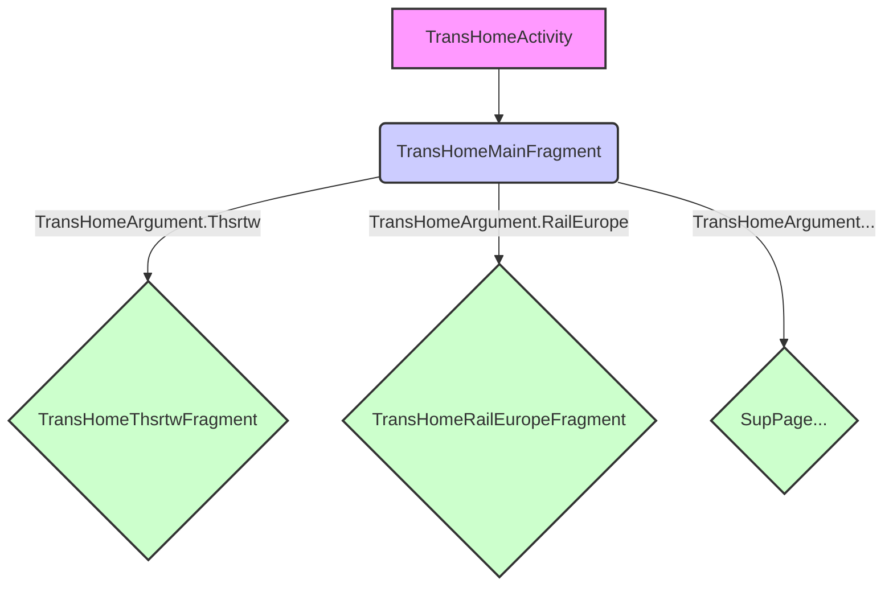

# 新交通首頁 (New Transportation Homepage)

## 簡介 (Introduction)

負責實現 KKday App 中全新的交通首頁功能。它提供了一個統一的入口，讓使用者可以輕鬆地瀏覽和搜尋各種交通服務，例如高鐵、巴士、租車、機票等。

## 功能 (Features)

*  **統一入口 (Unified Entry Point)**：提供一個單一的頁面，整合所有交通服務。
*  **多樣化交通服務 (Diverse Transportation Services)**：支援高鐵、巴士、租車、機票等多種交通服務的搜尋和預訂。
*  **流暢的使用者體驗 (Smooth User Experience)**：提供直觀且易於使用的介面。
*  **可擴展性 (Scalability)**：易於新增新的交通服務類型。
*  **QueueIt**：使用QueueIt排隊機制。

## 專案結構 (Project Structure)

這個模組主要包含以下幾個部分：

*  **`TransHomeActivity`**: 作為整個交通首頁的入口 Activity，負責處理頁面跳轉和資料傳遞。
*  **`TransHomeMainFragment`**: 交通首頁的主要內容 Fragment，負責顯示各種交通服務的入口和相關資訊。
*  **`SupPage`**: 代表在 `TransHomeMainFragment` 中顯示的子頁面，例如高鐵、巴士等各個交通服務的獨立頁面。
*  **ViewModel**: 每個頁面都有對應的ViewModel，負責處理資料邏輯。
*  **QueueIt**: 使用QueueIt排隊機制，在人流過大時，會進入排隊頁面。

## 流程圖 (Flowchart)

以下是 `TransHomeActivity` -> `TransHomeMainFragment` -> `SupPage`

**說明:**

1.  **`TransHomeActivity`**: 作為整個交通首頁的入口，它會載入 `TransHomeMainFragment`。
2.  **`TransHomeMainFragment`**: 顯示交通首頁的主要內容，包含各種交通服務的入口。
3.  **`SupPage`**: 在 `TransHomeMainFragment` 中，使用者可以選擇不同的交通服務，例如高鐵、巴士、租車、機票等，點擊後會進入對應的子頁面。
4.  **子頁面**: 每個子頁面都負責顯示該交通服務的相關資訊和搜尋功能。

| 標題 (Title) | TransHomeArgument | TransportationType | config (ProductID) |
|---|---|---|---|
| 台灣高鐵 (Taiwan High Speed Rail) | `TransHomeArgument.Thsrtw` | `TransportationType.THSRTW` | `thrstwProductID` |
| 歐洲鐵路 (Europe Rail) | `TransHomeArgument.RailEurope` | `TransportationType.RAIL_EUROPE` | `europeProductID` |
| 高速巴士 (Highway Bus) | `TransHomeArgument.KosokuBu` | `TransportationType.KOSOKUBUS` | `busListProductID` |
| 中港巴士 (China-Hong Kong Bus) | `TransHomeArgument.CnhkBus` | `TransportationType.CNHKBUS` | `cnhkBusProductID` |
| 越南巴士 (Vexere Bus) | `TransHomeArgument.VexereBus` | `TransportationType.VEXERE` | `vexereBusProductID` |
| 租車 | `TransHomeArgument.GatherCar` | `TransportationType.GATHER_CAR`, `TransportationType.RENTAL_CARS`, `TransportationType.ONLINE_TRAVEL_CAR`, `TransportationType.GO_GO_OUT` | `gathercarProductID` |
| 韓國租車 | `TransHomeArgument.ZzimCar` | `TransportationType.ZZIMCAR` | `zzimCarProductID` |
| 立榮假期 | `TransHomeArgument.UniairHolidays` | `TransportationType.UNIAIRHOLIDAYS` | `uniairholidaysProductID` |
| 韓國機票 | `TransHomeArgument.ZzimAir` | `TransportationType.ZZIMAIR` | `zzimAirProductID` |
| 日本鐵路 | `TransHomeArgument.JrRail` | `TransportationType.JREAST`, `TransportationType.JR_RAIL`, `TransportationType.JRWEST`, `TransportationType.JRCENTRAL` | `jrRailProductID` |
| 郵輪 | `TransHomeArgument.Cruises` | `TransportationType.CRUISES`, `TransportationType.ROYAL_CRUISES`, `TransportationType.CRUQO_CRUISES` | `productId 是有多個，由後端控` |
| 機場接機 (Airport Pickup) | `TransHomeArgument.PickUp` | `TransportationType.PICK_UP` | - |
| 機場送機 (Airport Drop-off) | `TransHomeArgument.DropOff` | `TransportationType.DROP_OFF` | - |

## 延伸閱讀

詳細的架構說明、所有 `TransportationType` 完整介紹、DeepLink 處理、以及機場接送（點對點）功能說明，請參考：

- **[TransportationArchitecture.md](./TransportationArchitecture.md)** - 新交通專案完整架構與流程說明
  - 20 種 TransportationType 詳細說明
  - 架構層級與頁面流程
  - URL DeepLink 處理規範
  - 機場接送完整功能介紹
  - 登入驗證與支付流程
  - 資料層架構與錯誤處理

- **[TransWebActivityGuidelines.md](./TransWebActivityGuidelines.md)** - TransWeb 架構指南
  - MVVM 架構詳解
  - WebView 與支付流程
  - JavaScript 接口整合