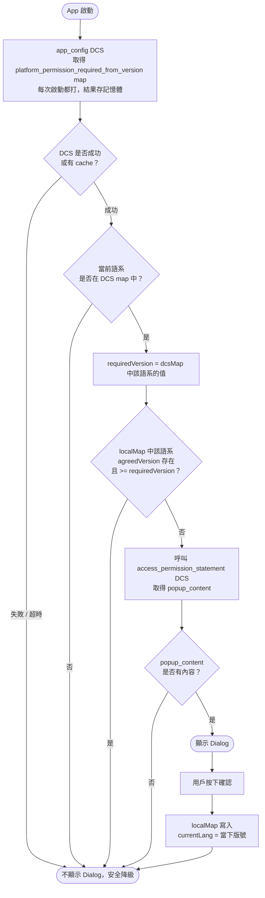

# Access Permission Statement — 跨平台規格

> 適用平台：Android / iOS  
> 最後更新：2026-04-10

---

## 背景

App 啟動時需在特定條件下向用戶顯示「存取權限聲明」Dialog。  
原本只記錄「該語言是否已看過」，無法在新版本發布後強制所有用戶重新同意。  
本次改動讓後端可隨時透過 DCS 控制「哪些語系、哪個版本以下的用戶需要重新同意」，不需要發版。

---

## 一、DCS 改動

### 現有 key：`access_permission_statement`

維持不變，用於取得 Dialog 的 HTML 顯示內容（`popup_content`）。  
**只在確定需要顯示 Dialog 時才呼叫**，不需每次啟動都打。

### 現有 key：`app_config`（每次啟動都打）

新增兩個平台專屬欄位，值為**語系 → 最低版號**的 map：

```json
{
  "android_permission_required_from_version": {
    "zh-tw": 300,
    "en": 200,
    "ja": 0
  },
  "ios_permission_required_from_version": {
    "zh-tw": 5010,
    "en": 4020
  }
}
```

| 欄位 | 平台 | value 型別 | 說明 |
|---|---|---|---|
| `android_permission_required_from_version` | Android | `Map<String, Int>` | key = 語系代碼，value = 最低 versionCode |
| `ios_permission_required_from_version` | iOS | `Map<String, Int>` | key = 語系代碼，value = 最低 build number |

**語系判斷規則：**
- 當前語系**存在於 map** → 進行版號比對
- 當前語系**不存在於 map** → 不顯示 Dialog（後端未對此語系設定要求）
- 無 `default` fallback，未列出的語系一律不顯示
- 各平台只讀取自己的欄位，兩者數值體系不同，互不影響

**後端操作說明：**
- 需要特定語系的用戶重新同意：在 map 中加入或更新該語系的版號
- 需要全部已列出語系的用戶重新同意：將 map 中所有語系的版號改為最新版
- 某語系不需要強制重同意：從 map 中移除該語系的 key
- 兩個平台可獨立控制，互不影響

---

## 二、本地端儲存改動

### 舊欄位（廢棄）

```
KEY_ACCESS_PERMISSION_STATEMENT  →  List<String>   // 不再使用
```

### 新欄位

```
KEY_PERMISSION_AGREED_MAP  →  Map<String, Int>
```

key = 語系代碼，value = 用戶同意時的 App 版號。

| 狀態 | 說明 |
|---|---|
| key 不存在 | 該語系從未同意過（含升版後的舊用戶）|
| key 存在，value = N | 該語系在版本 N 時同意過 |

- Android 同意時寫入 `BuildConfig.VERSION_CODE`
- iOS 同意時寫入 `CFBundleVersion`（build number）

**舊用戶升版後的行為：**  
舊欄位不做 migration，`KEY_PERMISSION_AGREED_MAP` 為空，所有語系視為未同意，若該語系在 DCS map 中即強制顯示 Dialog。

---

## 三、判斷邏輯

### 流程圖



### 判斷條件（文字說明）

```
requiredVersion = dcsMap[currentLang]
若 requiredVersion 不存在 → 不顯示，結束

agreedVersion = localMap[currentLang]
若 agreedVersion 存在 AND agreedVersion >= requiredVersion → 不顯示，結束

→ 呼叫 access_permission_statement DCS 取內容 → 顯示
```

### 用戶確認後

```
localMap[currentLang] = 當下 App 版號
```

---

## 四、情境分析

> DCS 設定：`{"zh-tw": 300, "en": 200, "ja": 0}`  
> 版本號：v1=100、v2=200、v3=300（Android versionCode 為例）

### Case 1：v2 上版，條款未更新，DCS map 不變

| 語系 | 用戶狀況 | localAgreed | required | 結果 |
|---|---|---|---|---|
| zh-tw | v1 同意過升 v2 | 100 | 300 | 100 < 300 → 強制顯示 |
| zh-tw | v2 全新安裝 | null | 300 | null → 顯示 |
| en | v1 同意過升 v2 | 100 | 200 | 100 < 200 → 強制顯示 |
| en | v2 同意後繼續用 | 200 | 200 | 200 >= 200 → 不顯示 |
| ko | 任何用戶 | 任意 | 不在 map | → 不顯示 |

### Case 2：v3 上版，後端將 zh-tw required 改為 300

| 語系 | 用戶狀況 | localAgreed | required | 結果 |
|---|---|---|---|---|
| zh-tw | v2 時已同意 | 200 | 300 | 200 < 300 → 強制顯示 |
| zh-tw | v3 同意後 | 300 | 300 | 300 >= 300 → 不顯示 |
| en | v2 時已同意 | 200 | 200 | 200 >= 200 → 不顯示 |

### Case 3：舊版 App 用戶升版（無 migration）

| 語系 | 狀況 | localAgreed | required | 結果 |
|---|---|---|---|---|
| zh-tw | 舊版曾同意，升版後 localMap 為空 | null | 300 | null → 強制顯示 ✅ |
| ko | 舊版曾同意，but ko 不在 DCS map | null | 不在 map | → 不顯示 ✅ |

---

## 五、降級處理

若 `app_config` DCS 呼叫失敗或超時：
- `platform_permission_required_from_version` 視為空 map
- 所有語系都不在 map → 全部不顯示 Dialog
- **不影響用戶正常使用，安全降級**

---

## 六、注意事項

- `localMap` 以語系為 key，各語系獨立記錄同意版號，互不影響
- 語系不在 DCS map → 不顯示（無 default fallback）
- 舊用戶升版後 localMap 為空，DCS map 中有列出的語系都會強制重新同意
- Android `versionCode` 與 iOS `build number` 是各自獨立的整數體系，後端透過不同欄位分開管理
