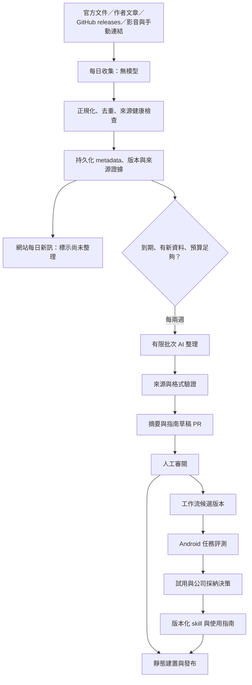

# Android AI 開發工作流與持續更新知識網站：設計提案

日期：2026-10-08（Asia/Taipei）  
狀態：可供討論的架構提案；尚未建站、部署或開通付費服務。  
公開範圍假設：業界知識與經過整理的通用模板可公開，公司規範、業務案例、原始文件與執行紀錄保留私有。此假設不代表發布授權。

## 1. 建議從什麼方向著手

你已有相當完整的 Android SDLC 文件，下一步應把重心轉向「採用現成工作流、維護公司差異、用實測決定更新」。不必再為每個角色重新發明一套 orchestration。

建立兩個相連、但有不同更新節奏的系統：

1. **知識雷達**：每日收集公開來源，不呼叫付費模型；每兩週整理值得讀的變更、方法和案例。
2. **工作流產品**：固定版本的上游工作流，加上 Android／公司 profile、驗證工具與評測任務。新資訊只能提出候選變更，不能自動覆寫公司規範。

公司要的「效率、品質、準確度、長時間平行處理」應用四組數據回答：完成任務的總時間與人工時間、驗收成功率與回歸、每個成功任務的成本、平行後的衝突與整合等待。文章數、agent 數、產出行數都不是主要成效指標。

**推薦第一版：GitHub Actions + Astro/Starlight 靜態網站 + Git 儲存整理後資料。先不需要 DB，也不需要 GCP。** 網站瀏覽不呼叫模型。先選一個主工作流作為基底，例如已使用的 Superpowers；Matt Pocock 的方法作為需求澄清、任務切分和設計的選配，不把多套完整指揮流程疊在一起。

相關調研：[最新工作流調研](../agentic-workflow-research/workflow-landscape-2026-10-08.md)、[原始來源筆記](../agentic-workflow-research/research/2026-10-08-workflow-source-notes.md)。這份提案依據 docs 的目錄盤點與核心流程文件精讀；不是對全部文件逐條稽核。

## 2. 目前文件對設計的影響

| 現有資產 | 可沿用的價值 | 需要調整的地方 |
|---|---|---|
| `android-dev-guide` | Android 技術基準、rules、checklist、漸進讀取 | 通用基準不能直接取代公司專案選型 |
| `dev-guide` | 公司規範、決策、遷移策略 | 公司採 Koin annotations；通用範例的 Hilt 不應蓋過此決策 |
| `ai-guide/workflow/ai-sdlc.md` | Feature／Bug／Release 的完整生命週期與分級驗證 | 收斂重複的角色指揮邏輯；明確區分完成實作、待驗證、驗收通過 |
| `agents/task-decomposer.md` | Gherkin 與任務 DoD 的映射 | 加入依賴、寫入檔案範圍、共享資源；減少只按 API／UI 層切分 |
| `agents/feature-engineer.md` | 重試限制與執行紀錄 | 各任務用獨立 worktree；避免在共享工作目錄用 stash 影響其他任務 |
| `agents/integration-reviewer.md` | 整合前檢查 | 檔案存在、checkbox 勾選不能代表需求通過；改用固定 base/head 與執行證據 |
| `testing` | Maestro E2E、JaCoCo 與品質觀測構想 | 測試檔存在不代表測試有執行；需記錄 executed／failed／skipped |
| `feature-impl/release-automation` | 發布條件與跨系統協作 | 在實際 Android repo 驗證腳本與權限；此知識網站不承接簽章與商店發布密鑰 |

目前 repo 以文件為主，部分文件宣稱完成的技能、腳本或 workflow 尚未出現在此 repo。應建立「文件描述／找到實作／執行驗證」三種證據狀態，避免把設計當成已經可運作的系統。

需優先修正的流程語意：

- `auto-dev --quick` 等跳過編譯與測試的模式可做探索，但產物不能因此取得公司正式驗收資格。
- 任務失敗後留下 TODO stub，應標記 blocked／failed；依賴它的任務不能被當成已解鎖。
- coverage 不應只看是否新增 `*Test.kt`；至少確認相關測試實際執行、非全部跳過，並覆蓋指定行為。
- 自動 review 與 integration review 要使用明確的 base SHA、head SHA、spec 版本，避免模糊的 diff 範圍。

## 3. 架構選項與取捨

| 方案 | 組成 | 適合情況 | 成本與負擔 | 建議 |
|---|---|---|---|---|
| A：靜態優先 | Actions、RSS/API collectors、Git、Astro/Starlight | 個人維護、小團隊、每日批次、讀多寫少 | 元件少；費用受 GitHub 方案、執行時間和模型用量影響 | 第一版採用 |
| B：批次雲端 | Actions 觸發 Cloud Run Job、Firestore、GCS；仍輸出靜態網站 | 多人編輯、資料量增加、私有權限、任務超出 Actions 適用範圍 | 雲端帳務、IAM、備份與操作成本增加 | 遇到實際限制再遷移 |
| C：即時服務 | 常駐後端、即時搜尋、向量庫、每次閱讀 AI | 已證明需要個人化互動或即時分析 | 高維護量與難預測用量 | 目前不採用 |

Astro/Starlight 適合 Markdown 文件、導覽、全文搜尋與靜態發布；知識雷達首頁、篩選卡片及比較頁另做小型自訂頁面。全文搜尋搜尋已發布內容，與外部網路搜尋是兩回事。[Starlight 專案結構](https://starlight.astro.build/guides/project-structure/)



## 4. 公開與私有的界線

此 repo 有訂單、支付、會員等業務文件。第一版應保留原始 repo 私有，另用只含核准內容的 public export repo 發布網站；或先全部採私有網站並加真正的登入授權。

**網站建置沒有顯示某個檔案，不等於 Git repo 的檔案或歷史不公開。** 不能直接把整個 `docs/` 複製到網站或公開 repo。

採明確 export allowlist：只有 `visibility: public` 且已核准的內容與套件可匯出。新資料預設 private／draft。公司的案例要另寫可公開版本，移除客戶、流程細節、內部 API、金額與敏感紀錄。

GitHub Pages 的方案限制與網站存取權須分別確認；私有來源 repo 不會自動讓 Pages 網站私有。若公司需要身分登入，可採支援公司 SSO 的 hosting，或另設 Cloud Run＋IAP 並驗證實際組織設定。[Pages 限制](https://docs.github.com/en/pages/getting-started-with-github-pages/github-pages-limits)、[建立 Pages 網站](https://docs.github.com/en/enterprise-cloud%40latest/pages/getting-started-with-github-pages/creating-a-github-pages-site)

## 5. 來源策略：先可維護，再擴大

初期維護約 20–30 個明確來源，優先順序如下。這是初始容量建議，不是業界普及率統計。

| 層級 | 來源 | 蒐集方式 | 用途 |
|---|---|---|---|
| A | 官方產品文件、changelog、官方工程文章 | RSS/Atom；無 feed 時定點頁面內容差異 | 能力、限制、價格與產品更新 |
| A | 原作者 GitHub releases／文件 | GitHub API、release Atom | 固定版本與相容性變更 |
| B | 原作者技術文章、方法示範 | feed、手動加入原文 | 方法與使用情境 |
| B/C | YouTube 原作者頻道 | uploads playlist/API 或已驗證的 feed | 發現示範、保留原始影片連結 |
| C | Threads 等社群、社群轉述 | 手動連結收件匣；官方 API 可用時加 adapter | 趨勢線索，不能直接當驗證證據 |

初始主題包含：Superpowers、Matt Pocock skills、Spec Kit/OpenSpec、Anthropic Claude Code/Mods/Skills、agent harness、bounded loop、task graph、評測與 Android 驗證。沿用調研報告的官方及作者來源清單。

RSS 訂閱是收集文章；AI 整理是第二階段。API、RSS、排程執行都有配額或資源成本，應表述為「每日不花模型 token」，而非保證全系統永遠免費。

### YouTube 與 Threads 的務實邊界

- YouTube 先收標題、發布時間、描述與影片連結。不因沒有字幕阻擋更新。
- 官方字幕下載需要授權與相應影片權限，不能保證下載所有公開影片的字幕；沒有可合法取得的逐字稿時，只能摘要描述，並標示「未檢視影片全文」。配額以當時官方規則與專案控制台為準，不硬編碼舊的 search.list 配額假設。[YouTube 入門](https://developers.google.com/youtube/v3/getting-started)、[字幕下載](https://developers.google.com/youtube/v3/docs/captions/download)
- Threads 官方 keyword-search 文件在本次查核未能可靠讀取，因此不在第一版承諾特定權限、配額或搜尋能力。先用手動連結表單；之後確認官方 API、帳號資格與 token 週期，再加 adapter。避免依賴未授權爬取或登入 cookie。
- 廣泛網路搜尋每兩週作為補充，可先由你在聊天工具手動搜尋，將來源貼入收件匣。若未來接搜尋 API，另列費用與查詢預算，不假設 DeepSeek completion 本身就會上網。

### 成功案例怎麼寫

每則案例分開標示：作者自述、廠商案例、可重現示範、團隊內部實測。記錄任務範圍、模型／harness／版本、人工介入、驗收條件、成本及失敗情況。缺少這些資訊的內容列為「案例分享」，不能標成已證實提升效率。

## 6. 去重與資料模型

去重順序：

1. 用來源穩定 ID 去掉重複抓取，例如 repo＋release ID、video ID、feed GUID。
2. 正規化 URL，移除已知 tracking parameters；保留辨識文章或影片所需的 query，不任意刪除全部 query。
3. 計算清理後內容 hash，同一 URL 更新時新增 revision，不覆蓋原始發布時間。
4. 用事件 key 合併同一 repo/version/capability 的多來源報導，保留所有引用與來源角色。
5. 標題相似只標為疑似重複；每兩週用規則、人工或有限模型協助分組，不憑相似標題永久合併。

不同版本與不同能力是不同事件。「同一篇文章更新」和「同一產品的新 release」也要分開處理。

| 實體 | 必要欄位 |
|---|---|
| Source | id、type、URL、trust tier、topic、fetch policy、enabled、last_attempt、last_success |
| ItemRevision | source_id、external_id、canonical_url、published_at、updated_at、fetched_at、content_hash、excerpt、access_scope |
| Event | event_id、entity、version/capability、item_revision_ids、dedup_reason、status |
| Enrichment | event_id、source_ids、claim_evidence、model、prompt_version、input_hash、usage、review_state |
| WorkflowRelease | id、version、upstream_ref、license、bundle_hash、supported_harnesses、profile、evaluation_ids、adoption_state |
| EvaluationRun | task_id、base/head SHA、spec_hash、model/harness、results、executed/skipped、cost、human_minutes |
| ChangeProposal | motivation、evidence、expected_gain、affected_profiles、trial_plan、rollback、owner |

每日使用 ETag／Last-Modified 等條件抓取；來源失敗時保留舊資料、記錄失敗，不把整個來源清空。網站顯示最後成功更新及來源延遲，不能只顯示最近一次 workflow 執行時間。

小型 metadata 與已核准內容可存在專用 data branch；可重抓的快取與大型資料另有留存政策。Actions cache、artifact 不能當唯一持久化資料庫。只存合理摘要、允許的片段與來源連結，不大量轉存文章或影片全文。

## 7. 更新排程與 AI 費用

### 每日收集

建議每天台北 09:17 對應 UTC `17 1 * * *`，避免整點尖峰。支援手動補跑、按 last_success 補抓，以及同時執行保護。GitHub schedule 可能延遲；公開 repo 長期沒有活動也有停用規則，不可作精確 SLA。[GitHub schedule](https://docs.github.com/en/actions/reference/workflows-and-actions/events-that-trigger-workflows#schedule)

每日流程：fetch → normalize → exact dedup → validate → 寫入 durable state → 建置每日新訊。只發布合法 metadata／短摘錄；機器蒐集的新訊明確標為未經深入整理，不生成假的使用教學。

### 每兩週付費整理

不要用 `*/14` 表示真正每 14 天；日曆月份會重置。每日 job 檢查持久化的 `next_ai_due_at`，只有 enabled、有新資料、沒有未處理的同批結果且預算足夠時才執行。第一版 `AI_ENABLED=false`，人工確認設定後才啟用。

每批處理約 20–30 個高優先事件；未選事件保留收件匣。對輸入片段長度、總 token、輸出 token、呼叫次數與 retry 均設定上限。來源缺失先跳過，不讓模型自造證據。

執行台帳在呼叫前保留批次與預算；完成後記錄供應商 usage 與結果 hash。快取 key 包含內容 hash、prompt 版本、model 與輸出 schema。PR 未審核不重做同批摘要。模糊 timeout 可能已計费，標記待確認，不盲目付費重試。

模型只接收公開來源與選定片段，不接收公司業務 docs。回傳結構化結果與 `source_ids`／`claim_evidence`；程式檢查來源 ID、引用片段及欄位。此檢查只能確認可追溯性，不能保證推論完全正確，正式教學仍須審閱。

DeepSeek API 可作 provider；目前官方 pricing 頁列出 `deepseek-flash` 與 `deepseek-v4-pro`，模型與價格都會變動，因此用設定檔指定並記錄查核日期。[DeepSeek 官方價格](https://api-docs.deepseek.com/quick_start/pricing/)

### 預算示例與限制

以下僅是 2026-10-08 官方價目與假設 token 用量的試算，不是每月帳單保證：以 Flash 的 peak、cache miss 價格，輸入每百萬 token US$0.30、輸出 US$1.20；每批 100,000 input＋15,000 output 約 **US$0.048**。一個月兩至三批，純模型約 US$0.096–0.144；不含額外推理用量、重試、查詢服務或其他執行成本。以實際 usage 計算，切勿拿估計字數當準確 token 數。

可先設每批 US$0.50、每月 US$2 的應用層上限；這是建議預算，你可調整。呼叫前用保守價格與最大輸出估算並預留費用；價目過期／模型不存在就停止付費步驟。達上限只繼續免費收集，網站顯示整理延期。

模型預算保護是本系統的拒絕呼叫機制，不是供應商帳戶硬上限；其他服務仍需各自控制。GCP 的 alerts-only budget 不會自動停止支出，官方另有支援範圍受限的 spend cap budgets，須逐服務查核。[GCP 預算](https://docs.cloud.google.com/billing/docs/how-to/budgets)

## 8. 公司工作流：上游核心＋Android profile＋證據


規範優先順序：專案明確決策與例外 → 公司 profile → 通用 Android 基準 → 外部工作流預設。Koin／Hilt、module 架構、測試工具、release 條件都放在 profile，不改寫整套上游技能。

| 階段 | 最小交付物 | 可自動驗證的部分 | 人類重點 |
|---|---|---|---|
| 需求／分析 | 目標、範圍、SBE/acceptance、風險 | 欄位完整性、需求映射 | 業務正確性與取捨 |
| 設計 | 介面、狀態、失敗路徑、ADR | 規範衝突、依賴 | 架構與高風險決策 |
| 任務規劃 | DAG、write_paths、驗收與資源 | 依賴循環、衝突 | 切分能否獨立驗收 |
| 實作 | patch、測試、執行證據 | compile、lint、相關測試 | 行為與維護成本 |
| 整合 | 固定 head 的完整驗證 | integration/E2E、契約 | 未覆蓋風險 |
| 發布 | artifact、版本、回滾方案 | 可配置的 release checks | 支付、登入、商店等正式發布 |
| 維運 | 回歸、事故、指標、改善提案 | 記錄與趨勢 | 是否改流程、是否回滾 |

外部工作流更新流程：discovered → candidate → evaluated → trial → approved → deprecated。內容「很熱門」只影響閱讀排序；進入公司流程需通過代表性任務與負責人採納。

### 長任務與平行處理

先把任務切成可驗收的垂直行為，再建立依賴圖；對共用型別、API 契約、navigation、DI、Gradle 設定先固定介面或安排單一 owner。可平行的條件是依賴已滿足、寫入範圍不衝突且共享資源可用，不是不同角色名字。

每個任務契約至少記錄：task_id、spec_hash、base_sha、depends_on、read/write_paths、acceptance、validation commands、resource_locks、max_attempts、time/token_budget、checkpoint、handoff_summary。

狀態：pending → ready → running → ready_for_review → accepted；另有 blocked、failed。下游解鎖必須依據已接受且已提供於指定整合基線的產物；不能只看 branch 上檔案存在。

每個任務用獨立 worktree／branch。worktree 不會自動隔離所有 Gradle cache、emulator、連接埠或測試帳號；另外設定資源鎖與必要的 Gradle user home。先限制兩個實作者平行，觀察吞吐與衝突再增加。

長任務將狀態寫到持久化紀錄；中斷後由 checkpoint 恢復，不依赖完整對話歷史。有限重試後轉 blocked，人類处理根因；獨立任務仍可繼續。先用簡單 DAG 與執行台帳，只有確實需要多分支恢復與跨系統狀態時才引入 LangGraph 等引擎。

### 最小 Android 評測集

先挑 8–12 個代表任務：Compose 狀態／旋轉、ViewModel 邏輯、網路失敗與重試、資料同步、Koin 注入、跨 module 介面、小型既有 bug、Maestro 關鍵路徑。支付／登入可用脫敏 fixture 與 sandbox，不把真實憑證放入評測。

固定同一需求、起始 commit、acceptance 和環境，比較目前流程、上游基底、加公司 profile 三種設定。模型改版也算變因；一次盡量只改一項。保留一部分不提供解法的驗收案例，避免只優化已知題目。

記錄首次成功、重試後成功、人工分鐘、模型成本、總時間、測試 executed/failed/skipped、回歸與整合衝突。無測試執行或全部 skipped 是不完整證據。把編譯／測試與 AI reviewer 的結論分開列出。

先建立自己的基線，再設定採納門檻，例如驗收不下降、關鍵回歸為零、人工時間或成本改善。這些是團隊決策門檻，不能先宣稱某工作流一定改善百分之多少。

## 9. 網站資訊與下載內容

網站入口：

- 今日新訊：來源、時間、事件／版本、是否整理、去重後的其他來源。
- 雙週精選：本期改變、適用情境、限制、可行動項目。
- 工作流目錄：解決的問題、適用 SDLC 階段、harness、版本、實測狀態。
- Android 使用指南：依任務選 workflow/profile、輸入輸出、流程圖、驗收證據範例。
- 案例：成功與失敗都保留，清楚標示證據等級。
- 下載：通用 skill bundle、Markdown 指南、profile 範例、release notes。
- 更新紀錄與來源健康：最後收集／最後 AI 整理／最後人類驗證分開顯示。

工作流下載需包含完整 skill 目錄與必要 references/scripts、manifest、上游版本、授權、來源、SHA256、相容性、安裝與移除方式。只提供 `SKILL.md` 可能缺少依賴。對第三方採連結或授權允許的再散布；自行 overlay 清楚標示。公司私有 profile 不放公開下載。

可下載狀態至少分 experimental、tested、company-approved；公開頁面的 company-approved 僅在可公開且有證據時使用，不洩漏內部測試內容。

## 10. 建議 repo 結構與執行契約

以下是未來結構，不代表檔案已建立：

```text
site/                      # Astro/Starlight；只讀核准內容
content/public/            # 公開可發布 Markdown
content/private/           # 內部資料，不進公開匯出
registry/workflows/        # manifest、版本、upstream ref
profiles/android/          # 通用 Android 規則
profiles/company/          # 私有公司差異
config/sources.yaml        # 來源 allowlist 與 fetch policy
config/pipeline.yaml       # interval、模型、預算、留存
schemas/                   # 資料、manifest、AI 結果契約
scripts/collect/           # RSS/GitHub/YouTube adapters
scripts/enrich/            # due gate、budget、provider、validation
scripts/export/            # public allowlist 與套件
scripts/setup/             # 經架構確認後實作 wizard
.github/workflows/         # collect、enrich、preview、publish
```

執行介面要先約定 collect、enrich dry-run、enrich paid、validate、export、build。不同入口使用同一套資料 schema，避免手動與排程產生不同流程。

權限最小化：抓公開來源只讀；寫入 data branch 的 job 才可寫內容；草稿 job 才可開 PR；deploy job 才有 deploy 權限。第三方 Actions 固定可審查版本，外部文章當資料，不讓文章指示改動設定或執行指令。

`GITHUB_TOKEN` 產生的 push 通常不再觸發另一個 push workflow；應在同一 workflow 明確串接 build/deploy，或用明確 dispatch/reusable workflow，不依賴隱含連鎖觸發。[GitHub 觸發規則](https://docs.github.com/en/actions/how-tos/write-workflows/choose-when-workflows-run/trigger-a-workflow)

## 11. Wizard 設計

Wizard 只引導你必須親自完成的帳號登入、權限與憑證設定；可由程式處理的設定與測試由程式完成。第一版尚未選定實際部署 repo 與 workflows，因此本次交付步驟與值映射；可執行腳本在實作時對應實際存在的入口，不先做指向不存在流程的假 wizard。

| 階段 | 人類操作 | 程式可做的部分 | 值／目的地 | 完成條件 |
|---|---|---|---|---|
| 1 範圍 | 選公開通用內容或內部站 | 顯示 export 預覽與敏感路徑清單 | visibility、export repo → 設定檔 | 不公開整個 docs |
| 2 GitHub | 登入、選 repo／方案 | 檢查 repo、default branch、權限與必要檔案 | source/export repo → 設定檔 | 已有初始 commit 與 workflows |
| 3 網站發布 | 必要的 Pages／hosting 啟用 | 檢查建置與發布設定 | site URL、deployment target | 預覽可讀、存取權正確 |
| 4 來源 | 選頻道與來源 | 驗證 feeds、測一次 API | sources.yaml、channel IDs | 至少一個來源成功，錯誤可呈現 |
| 5 AI 預算 | 選模型、14 天週期、金額；是否啟用 | dry-run 批次與費用估算 | AI_ENABLED、interval、budgets、model | 預設不付費；顯示預算設定 |
| 6 DeepSeek | 在官方帳戶取得 token | 隱藏輸入、直接寫入 GitHub Secret | DEEPSEEK_API_KEY → Secret | 不回顯、不寫 repo、不放命令參數 |
| 7 YouTube 選配 | 建專案、啟用 API、設定 API key 限制 | 驗證 metadata adapter | YOUTUBE_API_KEY → Secret | 不承諾下載任意字幕 |
| 8 驗收 | 檢視公開預覽；首次 paid run 明確選擇 | collect、validate、budget dry-run、部署測試 | run IDs、測試結果 | 可重跑且不重複付費 |

Secrets 用隱藏輸入與標準輸入傳遞，避免 shell tracing、history 或 log 暴露；不將 token 寫入明文 resume state。wizard 可重跑／跳過選配，只保存非敏感的完成狀態。完成後檢查腳本語法、錯誤處理及 secret redaction。

### GCP 選配 wizard（方案 B 才啟用）

人類選 project、billing、region 並確認 IAM；程式提供可審查設定，建立 job identity、WIF 與儲存。GitHub Actions 透過 OIDC/WIF 取得短期權限，限制到指定 repo/branch；不要求下載長期 service-account JSON key。[WIF 部署管線](https://docs.cloud.google.com/iam/docs/workload-identity-federation-with-deployment-pipelines)

Cloud Run Job 做批次收集／整理，Firestore 存 metadata/state，GCS 存允許保存的資產／export；GitHub Actions 或獨立雲端排程只選一個主觸發者。用同一 schema，網站仍可讀靜態輸出。

Firestore Standard 有免費配額，但不是所有功能都免費；Cloud Run、儲存、流量與 logs 也各有計費條件。新增雲端不代表成本一定比 Actions 更低。[Firestore 價格](https://firebase.google.com/docs/firestore/pricing)、[Cloud Run 價格](https://cloud.google.com/run/pricing)

## 12. 分階段實作與驗收

| 階段 | 交付 | 完成標準 |
|---|---|---|
| 0 整理基準 | docs 分類、公开 allowlist、profile 與證據表 | 私有業務文件不進 export；列出哪些流程未實作 |
| 1 無 AI MVP | 靜態站、10 個可靠來源、daily collector、精確去重、手動入口 | 重跑不增重複；單來源故障保留舊資料；網站無 secret、無即時模型 |
| 2 雙週整理 | provider、台帳、預算、來源驗證、草稿 PR | 未到期／無新資料／超預算不付費；同批可恢復；人工核准後發布指南 |
| 3 工作流下載 | 一個主基底、Android/company profile、完整 bundle | 授權與版本可追溯；示範任務可安裝、驗證、移除 |
| 4 團隊評測 | 8–12 任務、基線與 trial、採納／回滾 | 有實際執行證據；可說明效率與品質變化 |
| 5 規模化 | 有需要才加 GCP、DB、登入、多角色 | 有量測證明目前瓶頸；遷移不破壞既有 schema |

MVP 刻意不包含任意影片逐字稿、Threads 全網搜尋、每日模型摘要、向量 DB 或自動修改公司規範。先證明你每兩週能從網站找到值得採用的方法，再加蒐集廣度。

## 13. 你未來如何保持更新

每日由系統收集；每兩週由你花約一次固定 review 時段閱讀精選；每月檢視公司流程指標；每季重跑主要評測或在模型／harness 有重大變更時提前重跑。

搜尋用「問題＋證據」而不是只追新名詞，例如：

- `agent harness long-running tasks checkpoint evaluation`：是否有中斷恢復、成本、失敗紀錄？
- `parallel coding agents worktree integration benchmark`：是否量測整合等待與共享資源？
- `Android coding agent Compose regression tests`：是否真的執行 Android 測試？
- `spec driven development existing codebase migration`：是否適用既有專案而非僅從零展示？
- `Superpowers release breaking changes`、`Matt Pocock skills releases`：追原作者版本差異。
- 官方產品名稱加 `changelog`、`skills`、`mods`、`hooks`、`limitations`：優先確認產品原語再看教學。

每兩週摘要固定回答：什麼真的變了？對 Android 哪種任務有用？有哪些限制？目前證據等級？需要更改哪個 profile？是否值得跑小實驗？

最有價值的產出不是每天更多文章，而是可以追溯的「採納／不採納」決策，以及團隊可以重現的工作流版本。

## 14. 接下來的具體選擇

建議採方案 A，先保留來源 repo 私有、將核准內容匯出到公開網站。先做無模型 MVP 和一套 Android 工作流基線，再加雙週 DeepSeek 整理。GCP／DB／Threads adapters 都延後至需求成立。

實作前需要確定：網站公開範圍、source/export repo 分工、部署方案，以及 AI 每批／每月預算。未確定的部分已用上述保守假設完成設計，不會在未確認時發布公司資料或開通付費呼叫。
