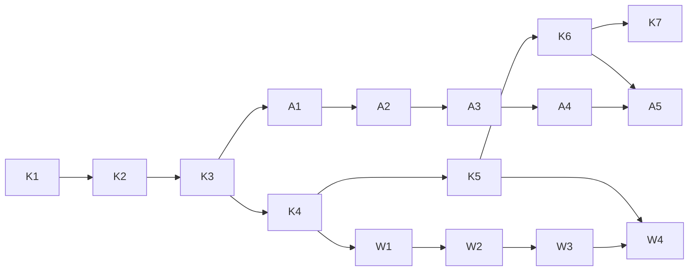

# AI 工作流平台：執行入口與任務順序

狀態：K1–K7已本機完成並合併main；A1–A5本機完成，等待分支整合；W1–W4未開始。日期：2026-10-08。

設計依據：[已確認的架構提案](../../platform-design/2026-10-08-android-ai-workflow-platform-design.md)。以下三份計劃分別有可驗收的交付物；不用一次完成所有系統。

| 順序 | 計劃 | 任務 | 完成後能做什麼 |
|---|---|---|---|
| 1 | [無模型知識網站 MVP](2026-10-08-knowledge-radar-mvp.md) | K1–K7 | 本機瀏覽、每日收集、去重、來源健康、核准內容匯出；發布需完成帳號設定 |
| 2 | [双週 AI 整理](2026-10-08-fortnightly-enrichment.md) | A1–A5 | 預算內整理新資訊，生成可審閱草稿；預設無付費呼叫 |
| 3 | [Android 工作流與評測](2026-10-08-android-workflow-registry.md) | W1–W4 | 完整技能包、profile、評測與採納紀錄；實際 Android 驗證需測試 repo |

## 分工與上下文

目前依使用者選擇，以 Sol 原生依序執行，每次只做一個任務。每次讀架構提案、所屬計劃、當前任務的依賴與執行紀錄；遇到介面或架構變更先記錄原因，不自行更換方案。Sol 6.1 審查 K1/K4 的公開隔離、K6/K7 的發布權限、A1/A3 的付費與恢復，以及 W2/W3 的公司規範與驗收。

執行方式可選：同一對話原生逐項執行，或每任務獨立實作者／審查者。建議原生執行並在上述關鍵點切回 Sol 審查，減少重複傳遞上下文。尚未授權建立 subagents，不會自動派遣。

## 依賴圖

此順序是安全的預設串行路徑。K5（網站 UI）與 A1（到期／預算）在 K4 完成後可分開 worktree 執行，但只有共用資料契約已凍結、寫入範圍不重疊、且明確安排整合者時才平行。W3 的實際評測不能以 mock 結果冒充。

## 執行紀錄

實作時建立 `docs/platform-design/execution-log.md`，每次追加 task_id、狀態、base/head SHA、修改檔案、驗收命令及結果、未解決問題、下一任務；付費批次紀錄存在 pipeline state，不寫 token 或私有原文。

任務狀態：pending → running → ready_for_review → accepted，或 blocked/failed。需要審查的任務通過審查後才 accepted。不能只憑檔案存在或測試檔新增解鎖下游。

## 目前仍需帳號／外部資源的項目

- 原始 repo 的實際 visibility、匯出 repo 名称、Pages／hosting 存取範圍：不影響本機實作；阻擋公開發布。
- DeepSeek token 與啟用付費：不影響 mock provider 與 dry-run；阻擋真實模型呼叫。
- Android 測試 repo、起始 SHA 與可用環境：不影響 registry／契約；阻擋實際評測結論。
- GCP／Firestore／Threads 自動搜尋：延期範圍，不列入本輪實作。

repo 已有 main 基線與 K 階段實作；其他原有公司 docs 仍未追蹤。實作時先確認分支基線；不得用 `git add .` 或 `git add docs` 一次提交全部公司文件。只提交當前任務明確檔案；建立／公開遠端 repo、push 和首次發布在具體預覽後處理。

## 範圍覆蓋

| 設計提案內容 | 計劃落點 |
|---|---|
| 公私隔離、資料契約、來源、去重、每日更新、靜態網站 | K1–K6 |
| GitHub／Pages wizard | K7 |
| 雙週整理、費用、模型與引用證據 | A1–A5 |
| skill 下載、Android/company profile、案例、任務契約、評測 | W1–W4 |
| YouTube metadata | K2（有 key 才啟用；否則手動連結） |
| Threads | K2 手動入口；自動 API adapter 延期 |
| GCP／免費 DB | 保留設計方案 B；不實作沒有需求的雲端元件 |
| 自動 Android 發布與跨系統整合 | 公司測試 repo 後續專案；本輪只交付契約與指南 |
